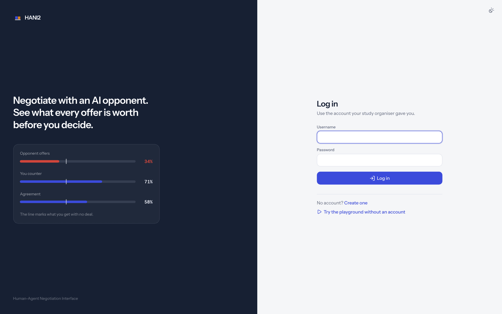
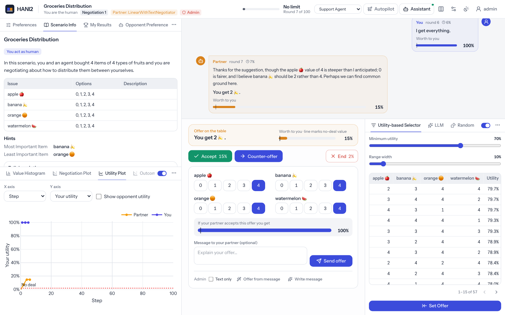
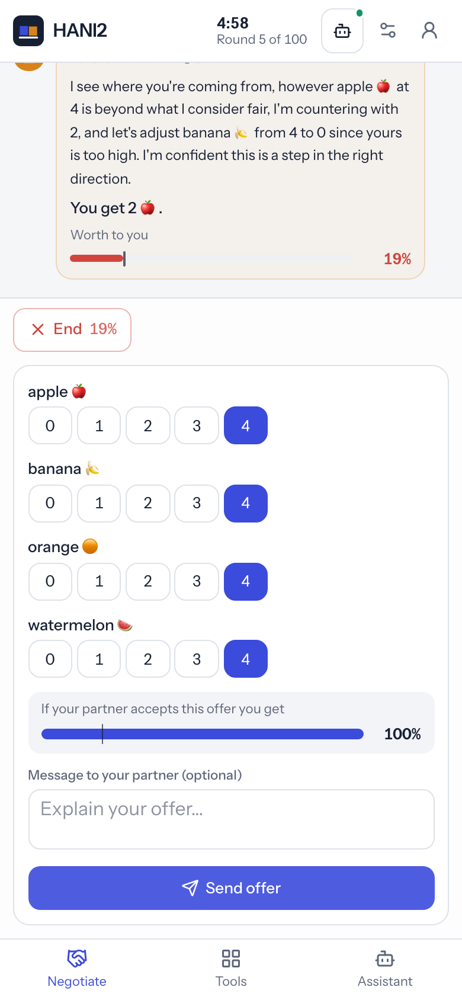

# Quick start

This page takes you from a fresh install to a finished negotiation. It assumes you have installed HANI2 (see [Installation](installation.md)).

## Start the server

```bash
hani2 setup   # once: creates the settings folder, default users and sample scenarios
hani2         # starts the server and opens the app in your browser
```

`hani2` prints the addresses it serves and the settings folder it uses:

```text
  HANI2 0.1.0
  App         http://localhost:5006/app
  Playground  http://localhost:5006/play
  Admin       http://localhost:5006/admin
  Settings    /home/you/negmas/hani2/settings
```

If you skip `hani2 setup`, the first `hani2` run does it for you quietly. Use `--no-browser` to keep the browser closed, `--page play` or `--page admin` to open a different page, and `--port` to use another port. The [command line](cli.md) page lists every option.

## Log in

Opening `/app` without being logged in sends you to the login page.



`hani2 setup` creates two accounts:

| Username | Password | Role |
| --- | --- | --- |
| `admin` | `adminpass` | Administrator: sees the admin console, the per-session admin settings and the opponent's type |
| `user` | `userpass` | Ordinary participant |

Change the admin password before you run a study, either with `hani2 setup --admin-password ...` or with `hani2 users passwd admin`. A server started with `--host 0.0.0.0` (reachable from other machines) refuses the admin login with `adminpass` until you do (see [Default accounts](../guide/authentication.md#default-accounts)). The login page also links to registration (when `auth.allow_registration` is on) and to the playground (when `playground.enabled` is on). See [Authentication](../guide/authentication.md) for the other sign-in modes.

If you only want to try the interface, open `http://localhost:5006/play` instead. The playground needs no account.

## The negotiation page



On a desktop browser the page has four parts:

- **The header**: the title, the scenario name, your role ("You are the Seller"), the round label ("Negotiation 1"), the countdown, and buttons for the assistant, the layout, settings, the colour theme and your account.
- **The tool panes** on the left (upper and lower) and on the right (side). Each pane holds tabs such as your preferences, the scenario information and offer helpers.
- **The history thread** in the middle: every offer and message you and your opponent exchange.
- **The action dock** under the thread: the buttons you use to negotiate.

The [interface](../guide/interface.md) page describes each part in detail.

## Walk through a negotiation

### 1. Load and start

When the page opens, a scenario is already loaded. The action dock shows the round label, the scenario title and your role, and asks you to check your preferences before you start. On the first round it also shows the welcome text from `announcements.md`.

Read the **Preferences** and **Scenario Info** tabs in the tool panes. They tell you what each possible deal is worth to you and what you get if there is no deal.

Press **Start negotiation**. Press **Different scenario** first if you want another one. The thread shows "Setting up the negotiation…" and then "Your opponent is thinking…" while the AI opponent makes its move.

### 2. The offer on the table

When your opponent makes an offer, it appears in the **Offer on the table** box at the top of the action dock and as a bubble in the history thread. If you move first, the box reads "No offer on the table yet. Make the first offer."

Next to the offer is a **utility gauge**: a bar that shows how much the offer is worth to you, from 0% to 100%. A thin vertical tick on the bar marks your value on disagreement (the no-deal value): what you get if the negotiation ends without agreement. When an offer is worth less to you than no deal, the bar and the percentage turn red.

### 3. Decide: accept, counter-offer or end

Three buttons sit under the offer. They are active only on your turn.

- **Accept** shows the offer's value to you. Pressing it opens a confirmation dialog with the offer, its gauge, and a warning if it is worth less than ending the negotiation. Press **Accept offer** to agree.
- **Counter-offer** opens the counter-offer editor (see below).
- **End** shows your no-deal value. Pressing it opens a confirmation dialog that tells you what you will receive. Press **End negotiation** to leave without agreement.

Nothing is final until you confirm in the dialog. Press **Cancel** to go back.

### 4. The counter-offer editor

The editor has one field per issue. Issues with up to six values show as buttons; longer lists show as a drop-down; numeric ranges show as a number box with the allowed range above it. A description of the issue, if the scenario has one, appears under the field.

When it is your first move, the editor starts from your best outcome; after that it starts from your last offer. Under the fields a gauge shows "If your opponent accepts this offer you get", and it updates as you change values.

If messages are allowed, write an optional message to your opponent in the text box. Press **Send offer** (or Ctrl+Enter / Cmd+Enter in the message box) to send the offer and the message together.

### 5. Follow the history

Each offer appears in the thread as a bubble: yours on the right, your opponent's on the left. A bubble shows who made it, the round, how much of the time had passed, the message, the offer, and a small gauge of its worth to you. When the negotiation ends, a line in the thread states the outcome.

### 6. The result

When the negotiation ends, the action dock shows "Agreement reached" with the agreed deal, or "No agreement" with the reason (time ran out, you ended it, or your opponent ended it), and a gauge of your final utility. Press **Next negotiation** to load the next scenario.

If a per-negotiation questionnaire is configured, it appears before the next negotiation (see [Studies and results](../guide/studies.md)).

## Tools

The tool panes hold the built-in tools. Click a tab to switch tools. Some tools start switched off; use the switch next to the tabs, or the **Turn on** button in the tool, to enable them. The **⋯** menu next to the tabs moves a tool to another pane or hides it; the **+** button brings hidden tools back. See [Tools](../guide/tools.md) for what each tool shows.

## Layouts

The layout button in the header switches between three views:

| View | What you see |
| --- | --- |
| Full | Upper and lower tool panes on the left; on the right the thread on top, with the action dock and the offer generators side by side below it |
| Simple | The thread and action dock, with one tools area on the right that holds every tool |
| Focus | The thread and action dock only |

You can also open the page in a given view with `?view=simple` (or `full`, `focus`) in the URL.

## Settings

The gear button opens the settings drawer. Every participant can change how the page looks:

- show the whole history, or only your opponent's latest offer;
- show or hide your own offers in the history;
- put the newest offer on top;
- keep the offer editor open all the time;
- show offers as sentences or as issue chips;
- change the text size.

Administrators see more sections in the same drawer: timing, negotiation rules, scenarios and opponents, and tools. These apply to the current session only. See [Admin console](../guide/admin.md).

The theme button next to it cycles between system, light and dark.

## The assistant

If the Assistant is enabled for you, the header shows an **Assistant** button with a coloured dot: green when it is on and ready, amber while it is working, grey when it is switched off. The button opens the assistant dock, where you can chat with it, switch it on or off, and choose how much it may do. See [Assistant](../guide/assistant.md).

If autopilot is allowed, an **Autopilot** button also appears in the header. See [Autopilot](../guide/autopilot.md).

## On a phone



On screens narrower than 1024 pixels the page switches to a mobile layout. A bar at the bottom has **Negotiate**, **Tools** and (when the Assistant is on) **Assistant** tabs. Negotiate shows the thread and the action dock; Tools shows every tool in one tabbed area; Assistant shows the chat.

## Next steps

- [The interface](../guide/interface.md) in detail
- [Configuration reference](../guide/configuration.md)
- [Studies and results](../guide/studies.md) and [Prolific](../guide/prolific.md) to run a study
- [Build an Assistant](../tutorials/assistant.md)
