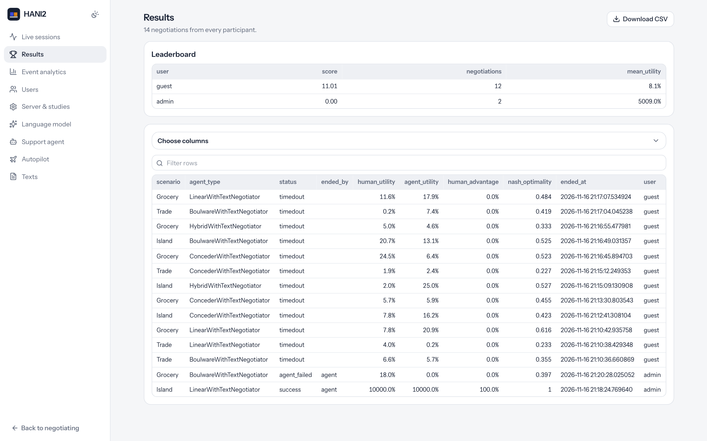

# Admin console

The admin console at `/admin` is laid out like a system settings window: a sidebar on the left with a search field and the pages in groups, and the chosen page on the right. Every page is a list of rounded groups; each row has a label and a short hint on the left and its control (a switch, a pop-up menu, a number with − / + buttons, a text field) on the right. Rows with a `›` open a sub-page, with a back button and a path ("Projects & Studies › HI2027 › hi-2027-01") in the title bar. Administrators also get extra controls on the negotiation page itself, described at the end of this page.

## Access

Open `http://localhost:5006/admin`, or choose **Administration** in the account menu of the negotiation page. If you are not logged in, the console sends you to the login page and back. A logged-in user who is not an administrator sees "This page is for administrators."

A user is an administrator when any of these is true:

- the username is `admin`;
- the account has the role `admin` (`hani2 users add --admin`, the **Administrator** switch when adding a user, or **Make admin** on the Users page);
- the account's email is listed in `admin.emails` in `env.json` (useful for OAuth sign-in).

See [Authentication](authentication.md). The `?admin=1` query parameter on the negotiation page does not open the console; see [the interface](interface.md).

## Pages

| Group | Page | What it holds |
|---|---|---|
| Activity | Live sessions | The sessions on this server, refreshed every five seconds. |
| | Results | Every negotiation, the leaderboard and the results CSV. |
| | Event analytics | Charts and a filterable event log, recorded sessions, the events CSV. |
| | Replay | Opens [Replay](recordings.md). |
| Studies | Projects & Studies | Projects, their studies, `project.yaml` and `study.yaml`, the links to give participants, results counts and the Assistant balance. |
| | Texts | The welcome text, the consent form, the scenario sets and the custom order, per layer, with a live preview. |
| Library | Scenarios | Every scenario type, its details, new ones by upload or link, and the scenario sets. |
| | Opponents | Opponent groups and their members, your own opponent classes, and the pool participants face. |
| | Assistants | Assistant groups, your own Assistant classes, the pool participants get, and the balance per study. |
| | Tools | Tool groups, the tools sessions are offered, where each tool goes in each view, and your own tools. |
| Server | General | Title, public address, sign-in and OAuth (`env.json`). |
| | Negotiation | Negotiation defaults (`env.json` → `negotiation`). |
| | Tool settings | Which tools exist and to whom they go (`env.json` → `tools`). |
| | Language model | `llm_settings.json`. |
| | Assistant settings | `assistant_settings.json`. |
| | Autopilot | `autopilot_settings.json`. |
| Language models | Connections | Sign-ins to model providers (API keys, subscriptions, local servers): status, test, sign in, remove; the providers and their sign-in methods. Settings folder only. |
| | Models | The model chains per purpose, per layer: reorder, duplicate, parameters, test an entry, test the chains. |
| Accounts | Users | Add users, make admins, set passwords, delete. |

The sidebar ends with **Replay recordings** and **Back to negotiating**. The page is kept in the URL fragment, so `/admin#results` opens the results directly; a fragment may also name a row (`/admin#opponents/opponent-pool`). The fragments of earlier versions still work (`#server` opens General, `#agent` Assistant settings, `#tools` Tool settings).

On a narrow screen (a phone) the sidebar is a page of its own: pick a page to open it, and the back button at the top left returns to the list.

### Search

Type in the search field at the top of the sidebar (or press ⌘F / Ctrl+F). The sidebar then lists every setting whose label, hint or file key contains all the words you typed, across all pages, with the page each one is on: "temperature" finds the temperature of the language model and of the Assistant, "consent" the consent switch and the consent form. Press Enter for the first result, or the arrow keys to move through them. Choosing a result opens its page, scrolls to the row, highlights it briefly and puts the keyboard focus on its control. The search also covers the tools and the Assistant's abilities, which come from the server.

The whole console works with the keyboard: Tab moves between controls, the arrow keys move through the sidebar, Space toggles a switch, and Escape clears the search.

## Layers: where a setting is saved

A setting can live in three places, called layers:

- **All projects (settings folder)**: `$HANI2_HOME/settings` (default `~/negmas/hani2/settings`), shared by every project and study;
- **a project**: `projects/<project>/`, for every study of that project;
- **a study**: the study's folder, for that study only.

A session reads each file from its study first, then its project, then the settings folder, then the bundled defaults (see [Configuration reference](configuration.md)).

Pages whose settings can live in a layer start with an **Edit and save in** bar. Pick the layer there; it stays chosen while you move between pages. The page then shows the values in effect *at that layer*, and **Save** writes only the values you changed, and only into that layer's own file. A row whose value is set in the chosen project or study layer is marked **set here**; its ↺ button removes it from that layer, so the inherited value applies again. The bar at the bottom always says where the next save goes.

When the console is opened inside a study (`/s/<project>/<study>/admin`), it starts with that study's layer chosen, and the bar names the study. It never saves to another layer behind your back: every read and write names its layer explicitly. (The API refuses a settings write that names no layer from inside a study; see the [admin API](projects.md#admin-api).)

General is the exception: sign-in and identity apply to the whole server and are always saved in the settings folder.

Saved settings apply to sessions created after saving. Sessions already open keep their settings.

## Live sessions

Four figures (open sessions, sessions negotiating now, sessions recorded in the event log, logged events) and a searchable table of every session the server holds in memory:

| Column | Meaning |
| --- | --- |
| `user` | The user name (`guest_<id>` for playground visitors, `prolific_<PID>` for Prolific participants) |
| `mode` | `main` (`/app`) or `guest` (`/play`) |
| `phase` | `idle`, `ready`, `starting`, `running`, `ended`, `questionnaire` or `finished` |
| `round` | Negotiations started in this session |
| `scenario` | The loaded scenario |
| `opponent` | The opponent type of the latest negotiation |
| `support_agent` | The Assistant of the session |
| `connections` | Open browser tabs |
| `idle` | Seconds since the last message from the browser |

The server removes sessions that have no open tab, are not negotiating, and have been idle for more than six hours (it checks every ten minutes).

## Results

**Download CSV** (`/api/admin/results.csv`, saved as `hani2_results.csv`), the **Leaderboard** (`user`, `score`, `negotiations`, `mean_utility`) when there is anything to rank, and a searchable table of every negotiation, newest first. **Choose columns** picks the columns to show; it starts with the default columns plus `user`. Utilities and the human advantage are shown as percentages. The console shows the results of the server's default study; open it at `/s/<project>/<study>/admin` (or use **Open in this study** on a study's page) for another study. [Studies and results](studies.md) describes the files and their columns.

## Event analytics

- **Events by type** and **Activity over time (per hour)** charts.
- **Filter events**: user, event type, from date, until date, and **Apply**.
- A searchable event table (up to 2000 rows) with `timestamp`, `user`, `event_type`, `component`, `action`, `value`, `scenario_id` and `utility_value`.
- **Recorded sessions**: start and end time, user, mode, project, study and browser of the latest 200 sessions.
- **Export CSV** downloads every event (`/api/admin/events.csv`, saved as `hani2_events.csv`).

## Projects & Studies

The list shows every project with its full name, kind, year and number of studies, and **New project** creates one. Open a project to edit `project.yaml`:

- **Project**: full name, short description, link, year, kind (research, opponents evaluated, Assistants evaluated), organizer and contact. The hint of each row names the [text variable](projects.md#texts-with-variables) it fills.
- **Defaults for its studies**: scenario set, counted negotiations (`n_required`), practice round, practice and counted time limits, time limit, rounds, expected minutes, the participant's role rule and preferred roles. An empty field keeps the default.
- **Scheduling**: how opponents, Assistants and scenarios are assigned to each human (`scheduling` in the file), from the server's [scheduling methods](scheduling.md). Each row shows the method in use and a one-line summary; a method chosen here is marked *set here*, and the first entry of the menu inherits it again. **About these methods** opens a page that explains every method with its formulas, examples, advantages and disadvantages.
- **Custom variables**: any other key of the file, used in texts as `{{project_<key>}}`. Add and remove them here; saving keeps every key, including those the console has no field for.
- **Studies**, with **New study** (a name and a type).

Open a study to see and edit:

- **Participant links** with copy buttons: the Prolific study URL (with Prolific's `{}` placeholders), the participant link of an online study, the session link of a lab study, and the play and app links. The address comes from **Public address** on the General page (or `HANI2_PUBLIC_URL`).
- **Results**: the number of participants and of recorded negotiations, and **Open in this study**.
- **Assistant balance**: how many counted humans each Assistant of the pool has, and every assignment.
- **Study**: type, title, link, year, start and end dates, organizer, contact; **Completion**: Prolific study id, completion code, completion URL and the end text.
- **Overrides of the project's defaults**, **Scheduling** (each dimension shows the method the study uses; empty: the project's choice, else the server default) and **Custom variables** (`{{study_<key>}}`). Problems in `study.yaml` (an unknown scheduling method, a setting given twice) are shown at the top of the page.

**Save** writes `project.yaml` or `study.yaml`. See [Projects and studies](projects.md).

## Texts

Pick the layer and one of **Welcome text** (`announcements.md`), **Consent form** (`consent.md`), **Scenario sets** (`scenario_sets.yaml`) and **Custom order** (`scenario_order.txt`, one scenario type per line: the `Custom` set).

- **Source** says which layer the text in effect comes from and whether the chosen layer has its own file. Without one, the editor starts with the inherited text, and **Save** creates the layer's own copy; **Use the inherited text** deletes the layer's copy again.
- **Preview** (welcome text and consent form) renders the text as Markdown with the [text variables](projects.md#texts-with-variables) filled in, as a participant of the chosen study would see it; at the settings or project layer, pick the study to preview with. Unknown `{{variables}}` are listed above the preview and left as written.
- **Available variables** lists every variable with its value for the preview, with a copy button.
- **In effect for a study** shows, for any study, which layer each of the four texts comes from.

Consent is recorded per study (see [Consent per study](projects.md#consent-per-study)).

## The library pages: Scenarios, Opponents, Assistants and Tools

The four library pages share one explorer and the [library](library.md) behind it (the admin API
under `/api/admin/library`, see the [Library API](../reference/library-api.md)). Each page has,
for the layer picked at the top:

- **Groups** (scenario sets on the Scenarios page): your groups first, then those inherited from a
  less specific layer, then the built-in ones, each with what it is, where it is defined and how
  many items it holds after composition. Open a group to edit it: add an item or another group
  (`@name`, which includes everything in it, in place; `:name` still works), remove entries, and
  (scenario sets) move them up or down. **Members after composition** lists what the group
  expands to, with duplicates dropped and cycles broken. **Save** writes the group at the chosen
  layer only; a group of the same name at a less specific layer is shadowed, not changed. A group
  of another layer is read-only here, and **Copy into** saves it at the chosen layer, where it
  then replaces the other one. Built-in groups cannot be changed. When a saved group names an
  unknown group or item, a class that does not load, or forms a cycle, it is saved anyway and the
  console lists the warnings. **New group** creates one. Click an entry (or its arrow) to go
  forward: an item opens the same details page as in the item list, a group lists its members.
  **Back** returns to the group with any unsaved changes intact.
- The page's own sections: the default scenario set, the pools, the tools offered and their
  placement (below).
- **Add**: upload a file or link a path, at the chosen layer.
    - **Upload** a `.zip` (scenarios: one scenario folder, `<Type>.yml` plus one file per role, or a
      category of them) or a `.py` file (opponents, Assistants, tools). HANI2 checks it before it
      keeps anything: only plain files with safe relative paths (no `..`, absolute paths or
      symbolic links), at most 5000 entries and 200 MB unpacked, at most 100 MB uploaded; every scenario must pass `hani2 scenario check`, and every class must load
      the way HANI2 will load it. A scenario type's name must not equal or start like a registered
      type, because a scenario finds its display by that name.
    - **Link** an absolute path on the server (a scenario folder or category; a `.py` file or a
      package folder) or a class spec (`pkg.module:Class`), read in place. **Import path** adds
      folders to Python's import path for a class spec.
    - **Name** names the new item (scenarios: the type), **Classes** takes only some classes of a
      file, **Also add to group** adds what was added to a group (created when missing; a group of
      a less specific layer is copied into the chosen one), and **Replace** replaces an item of the
      same name added at this layer.
    - The answer lists what was added and the warnings (for example a scenario without
      `_info.yaml`).
- **Items**: every item with its source (built in, registered, uploaded, linked) and groups,
  searchable. Open one for its details, to add it to a group, or (when it was uploaded or linked at
  the chosen layer) to **Remove** it: an upload's files are moved to the layer's `.trash` folder
  (`scenarios/.trash/`, `library/<kind>/.trash/`), a link is removed and what it points to is left
  alone. Groups that list the item are not changed.

Uploads go to the layer's `scenarios/<name>/` (scenarios) or `library/<kind>/<name>/` folder and
are listed in its `library.yaml`; scenario links are kept in its `scenario_links.yaml`. The same
files are written by `hani2 library` on the command line.

!!! warning "Uploaded code runs on the server"
    Opponents, Assistants and tools are Python code, and a scenario may bring a `display.py`. They
    run inside the HANI2 server, with its permissions, when they are checked and whenever they are
    used. The console asks you to confirm that you trust the code (scenarios: to allow Python
    files) before uploading or linking.

### Scenarios

Items are the scenario types: registered generators and category folders, uploaded or linked.
Open one for its title and descriptions, its roles (with the participant's role and the no-deal
values), its issues and options and a table of sample utilities (the best outcome for each role
and a few others); pick a saved scenario of its pool, or **Generate** a fresh example from a
generator. Scenarios with a `display.py` are marked.

**Outcome space** plots every outcome in utility space (negmas's 2D utility plot): the
participant's role on the x axis against another role on the y axis, with the Pareto frontier, the
Nash, Kalai, Kalai–Smorodinsky and maximum-welfare points, and shading where an outcome is worse
than a role's no-deal value. With more than two roles, **Roles** picks the pair (the participant's
role against each other role). Outcome spaces of more than 5000 outcomes, and continuous ones, are
plotted from a random sample of 5000, and the frontier and solutions are those of the sample. The
plot loads after the rest of the page.

**Scenario set in use** is the default set of the chosen layer (`default` in its
`scenario_sets.yaml`; **Inherit** removes it). `Custom` is the custom order, edited under Texts.
See [Scenarios](scenarios.md) and [Scenario sets](scenario-sets.md).

### Opponents

Groups are the built-in groups (`@llm`, `@template`, `@notext`, `@negmas`, `@classic`, `@genius`,
`@pan`, `@custom`) and the group files (`groups/<key>.json` of the settings folder, a project or a
study, and those an outside system put in a study's `results/`). Open a group to see every member
with a one-line description, searchable (useful for `@genius` with its 196 agents); members whose
class does not load are marked.

**Opponents participants face** is the pool of the chosen layer, as a list of groups and single
classes to tick. It is stored in `env.json` (`opponents`) for the settings layer, in
`project.yaml` (`defaults.opponents`) for a project and in `study.yaml` (`overrides.opponents`)
for a study. A URL's `?opponents=` or `?group=`, `HANI2_OPPONENTS` and an outside system's
schedule still win. See [Opponents](opponents.md#group-files).

### Assistants

The same for Assistants: the built-in groups `@default` and `@tutorial` and the
`assistant_groups/` files; **Assistants participants get** (the pool: `assistants` in
`project.yaml` / `study.yaml`; at the settings layer it is the Assistant class of Assistant
settings); and the **Assistant balance** of a study (how many humans each Assistant has).
Assistant classes are written `module:Class`. See [Assistant](assistant.md).

### Tools

Items are the tools (built in, from `env.json`, or added here), each with its default pane, when
it appears, who gets it and its built-in groups (`information`, `visualization`,
`recommendation`, `admin`, `assistant`, `all`). Tool groups are the built-in ones and those of
`tools.yaml`. See [Tool groups](library.md#tool-groups).

- **Tools offered to sessions**: **Inherit**, or **Choose here** the tools and tool groups sessions
  of the chosen layer get (`tools.yaml` → `offer`). **Offered now** lists the tools that gives;
  choosing nothing offers no tool. Tool settings (`env.json`) can still switch a tool off.
- **Placement in each view**: a table of every tool with its pane and order, or *hidden*, in the
  full, simple and focus views. Tools placed at the chosen layer are in bold. Open a tool (or
  **Change the placement** on its page) for the **placement editor**: for each view, **Shown**,
  **Pane** (upper, lower, side) and **Order** (smaller first). Values set at the chosen layer are
  marked *set here*, with a button to inherit that value again; **Save** writes the tool's entry
  in the layer's `tools.yaml` → `placement`, and **Inherit** removes it. Sessions move the tools
  when the view changes, and a participant's own arrangement is kept per view. See
  [Where tools go in each view](library.md#where-tools-go-in-each-view).

## General

Edits `env.json` in the settings folder.

| Field | Key |
| --- | --- |
| Title, Subtitle | `title`, `subtitle` |
| Public address (used in participant links) | `public_url` |
| Sign-in: username and password, OAuth only, password and OAuth, or no sign-in | `auth.mode` (`password`, `oauth`, `dual`, `none`) |
| People can create accounts | `auth.allow_registration` |
| Require consent | `auth.enforce_consent` |
| Playground | `playground.enabled` |
| Admin emails | `admin.emails` |
| OAuth redirect base | `oauth.redirect_uri` |
| GitHub and Google client id and secret | `oauth.providers.github.key` / `.secret`, `oauth.providers.google.key` / `.secret` |

A provider is used when it has both a key and a secret and is not explicitly disabled.

## Negotiation

`env.json` → `negotiation`, per layer: rounds (`n_steps`), time limit in seconds (`time_limit`, empty for none), the participant's role rule (`role_rule`), **Show the opponent's type** (`show_opponent_type`) and **Participants may choose the scenario** (`allow_scenario_selection`). The opponent pool and the scenario set have their own pages (links at the bottom).

## Tool settings

`env.json` → `tools`, per layer. **Enlarged tools open as** a large window, the full screen, or not at all (`tools.maximize`: `window`, `fullscreen`, `off`; see [The interface](interface.md#enlarge-and-put-back)). **Participants see opponent utilities** (`tools.show_opponent_utility`). **Extra tools** (`tools.extra`, class paths such as `my_pkg.tools:MyTool`). Then one row per registered tool with its description, pane and timing, and two switches: **Offered** (off adds it to `tools.disabled`) and **Admins only** (`tools.overrides.<name>.admin_only`). See [Tools](tools.md).

## Language model

`llm_settings.json`, used by the LLM offer tool, tools built on `LLMTool`, message writing, offer extraction and LLM opponents. Its provider and model are the old single-model settings, used only when no model chain is set (see [Models](#models)); its prompts always apply. A banner shows whether the model is configured ("Ready: provider / model") or which API key variable is missing. Fields: provider (`ollama`, `openai`, `anthropic`, `gemini`, `azure`, `groq`, `mistral`, `openrouter`), model, Ollama address (`ollama_base_url`), API key variable (`api_key_env`), temperature, max tokens, and the extraction, generation and instruction prompts. See [Language models](llms.md).

## Connections

The connections model chains use, kept in the settings folder for every project and study. Each
row shows a status dot, the provider, the sign-in method, the masked key or the environment
variable, and the address. **Test** checks the connection and lists the provider's models when it
can. **Sign in** starts a device-code sign-in for a subscription connection: the page shows the
code and the address where you enter it, and waits until you confirm. **Show implicit** lists the
connections that exist without being added. **Add a connection** offers only the sign-in methods
the chosen provider supports, and says why when a provider has no subscription sign-in. See
[Models and connections](models.md#connections).

## Models

The model chains of the chosen layer, one group per purpose (`default`, the Assistant, LLM
opponents, tools, offer extraction and message writing, the judge). A purpose without a chain
in the layer shows the chain in effect and where it comes from; **Set a chain here** gives the layer
its own chain. Each entry has a connection (or "the provider's first connection"), a model,
parameters (`temperature=0.2, max_tokens=800`) and a label. You can test, move, duplicate and remove
an entry. **Test chains** shows which entry each purpose resolves to now, and why each earlier entry
was skipped; with unsaved changes it tests those. See [Models and connections](models.md#model-chains).

## Assistant settings

`assistant_settings.json`.

| Field | Key |
| --- | --- |
| Who gets the Assistant: everyone, admins only, nobody | `mode` (`on`, `auto`, `off`) |
| Assistant class (`module:Class`, empty for the built-in one) | `agent_class` |
| Highest autonomy: Suggest, Semi, Full | `autonomy` |
| Abilities granted (one switch each) | `capabilities.<name>` |
| Provider, model, API base, API key variable | `provider`, `model`, `api_base`, `api_key_env` |
| Temperature, max tokens, tool steps per turn | `temperature`, `max_tokens`, `max_tool_iterations` |
| Speaks up unprompted when a negotiation starts, it is the participant's turn, a negotiation ends | `proactive.on_negotiation_started`, `proactive.on_action_requested`, `proactive.on_negotiation_ended` |
| System prompt | `system_prompt` |

Participants can narrow these permissions in their Assistant settings but never widen them. See [Assistant](assistant.md).

## Autopilot

`autopilot_settings.json`.

| Field | Key |
| --- | --- |
| Autopilot allowed | `allowed` |
| Default driver | `driver` |
| Participants choose the driver: playground only, yes, no | `user_can_choose` (`null`, `true`, `false`) |
| Pause between steps (s) | `step_delay` |
| Drivers offered (none ticked offers all) | `allowed_drivers` |

## Users

- **Add a user**: username, password, optional email, and an **Administrator** switch. Users created here count as having consented.
- **Accounts**, with a filter: for every account the name, an `admin` badge, the full name, email, OAuth provider and consent status, and **Make admin** / **Remove admin**, **Set password**, and delete. Deleting asks for confirmation and keeps the user's results.

The `admin` account cannot be demoted or deleted, and you cannot delete your own account. The same operations are available on the command line with `hani2 users` (see [Command line](../getting-started/cli.md)).

## Admin controls on the negotiation page

An administrator negotiating on `/app` (or on `/play` while logged in) gets more than a participant:

- The **Admin** badge and the opponent's name in the header, and no time limit by default (`time_limit` starts as none for admins).
- The **Scenario** picker before each negotiation: a scenario type and a scenario name, then **Load**.
- The **Opponent for the next negotiation** picker, with suggestions from every opponent group. Leave it empty for a random opponent from the pool.
- In the counter-offer editor: **Text only**, **Offer from message** and **Write message**.
- Admin-only tools in the tool panes.
- Extra sections in the settings drawer.

The opponent picker and the opponent's name are also available in admin mode (`?admin=1`) without an admin account. The other controls are not.

### The admin settings drawer

The gear button opens the settings drawer. Below the display settings, administrators see four more sections. They change the current session only; most take effect at the next negotiation. "Server-wide defaults are in Administration."

| Section | Setting | Key | Default |
| --- | --- | --- | --- |
| Timing | Rounds | `n_steps` | 100 |
| | Time limit (s) | `time_limit` | 300 (none for admins) |
| | Time per step (s) | `step_time_limit` | none |
| | Negotiator time (s) | `negotiator_time_limit` | none |
| | End probability per step | `pend` | 0 |
| | End probability per second | `pend_per_second` | 0 |
| Negotiation rules | An empty offer ends the negotiation | `end_on_no_response` | off |
| | Allow messages without an offer | `allow_text_only_offers` | on |
| | Show messages from the opponent | `allow_text_agent` | on |
| | Let the participant write messages | `allow_text_human` | on |
| | Text-only mode | `text_only_mode` | off |
| | Write a message when none is given (uses the LLM) | `auto_generate` | off |
| | Start the editor from my last offer | `init_with_last` | on |
| | Otherwise start from my best outcome | `init_with_best` | on |
| Scenarios and opponents | Use saved scenario pools (off: generate a fresh scenario each time) | `load_existing` | on (off in the playground) |
| | Follow the scenario order | `predefined_order` | on (off in the playground) |
| | Participants may choose the scenario | `allow_scenario_selection` | off |
| | Show the opponent agent's type | `show_opponent_type` | off (on for admins) |
| | Opponent agents (comma separated) | `opponent_types` | empty |
| Tools | Tools can be switched on and off | `allow_tool_switch` | on |
| | Tools can be moved between panes | `allow_moving_tools` | on |

Three further per-session keys exist but have no control in the drawer: `human_index` (which negotiator seat the participant takes, default 1), `auto_extract` (fill the offer from the message with the LLM before sending, default off) and `generate_on_failure` (generate a scenario when loading one fails, default on).

Every key in this table can also be given a server-wide default under `"negotiation"` in `env.json`. The bundled `env.json` sets `n_steps` to 100 and `time_limit` to 300. See [Configuration reference](configuration.md).
