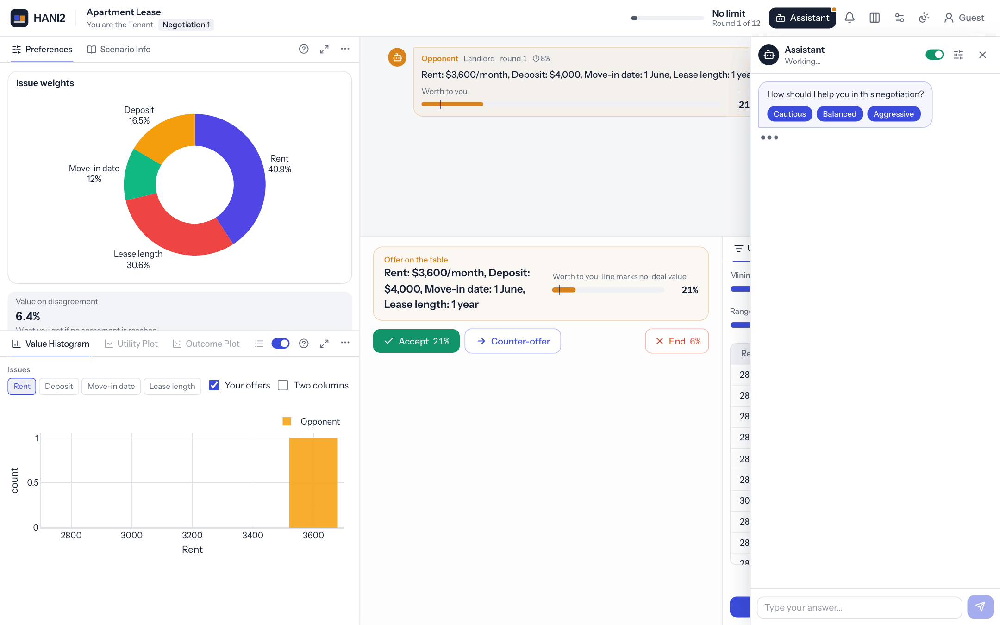

# Assistant

The Assistant is the AI helper that sits next to the participant while they negotiate. It lives in the **Assistant** dock on the right of the negotiation desk, and it can also reach the participant outside the dock: through notifications, the status board under the action panel, highlights and notes on the interface, layout changes and small panels it builds itself.

Every session gets its own agent. The default agent is driven by a language model that calls functions (send a toast, fill the offer, highlight a button, and so on). You can replace it with your own Python class, with or without a language model. The [Assistant tutorial](../tutorials/assistant.md) builds nine such agents step by step.



## What the agent can do

Depending on the capabilities you grant and the autonomy level, the agent can:

- chat with the participant and ask them questions with answer buttons;
- pop up notifications (toasts), which the participant can read again in the notification list, and write a persistent recommendation on the status board;
- pin short messages at the top or bottom of the screen, which makes room for them (see [Pinned messages](#pinned-messages));
- show, hide, enable, focus, reorder and move the analysis tools between panes;
- fill the counter-offer fields and write the message to the opponent;
- send a counter-offer, accept the opponent's offer or end the negotiation, either directly or through the participant's confirmation dialog;
- spotlight parts of the interface (buttons, issues, tool tabs, panes) with a short callout;
- attach notes to issues and other elements;
- switch the layout between the full, simple, focus and bare (no tools) views, collapse regions and resize the panes;
- change how offers read (the offer sentence, number formats, value names, the control of each issue) over the scenario's defaults;
- change the participant's display settings and restyle the page with a small style sheet;
- show interactive panels built from the same components as tools, and react when the participant clicks their buttons.
- find the participant's tools, read what they show and operate their inputs and buttons;
- add tools to the participant's screen while they negotiate: its own tools or registered ones (see [Tools the agent can find, use and add](#tools-the-agent-can-find-use-and-add)).

It also has a built-in safety net: when the participant edits a draft offer worth less than their reserved value, the agent warns them (see [Built-in reserved-value warning](#built-in-reserved-value-warning)).

## Turning the agent on

Who gets an agent is decided when a session is created. The first setting found wins:

1. The `HANI2_ASSISTANT` environment variable. `hani2 --assistant on|off|auto` and `hani2 --no-assistant` set it for you.
2. The `mode` key in `assistant_settings.json`.

| Value | Who gets the agent |
|-------|--------------------|
| `on` | Everyone (the default). |
| `off` | Nobody. The Assistant button is not shown. |
| `auto` | Admins only. |

The environment variable also accepts `1`, `true`, `yes` and `enabled` for `on`; `0`, `false`, `no` and `disabled` for `off`; and `admin` or `admins` for `auto`.

```bash
hani2 --assistant auto       # only admins see the assistant
HANI2_ASSISTANT=off hani2    # the same switch as an environment variable
```

### With or without an Assistant (competitions)

The same installation runs both competition formats; you choose at start-up:

| Competition | Participants get | Start with |
| --- | --- | --- |
| Human-Agent Negotiation (HAN) | no assistant: they negotiate on their own | `hani2 --no-assistant` |
| Hybrid Intelligence (HI) | the built-in assistant | `hani2 --assistant on` |
| Hybrid Intelligence (HI) | a submitted assistant | `hani2 --assistant team_a.agent:TeamAgent` or `hani2 --assistant path/to/team_a.py:TeamAgent` |

A value that is not `on`, `off` or `auto` is read as a Assistant class: `package.module:Class`,
`package.module.Class`, or a Python file and a class name separated by a colon. The class must
subclass `Assistant`; `hani2` checks this before the server starts and stops with an error if the
class cannot be loaded. Passing a class means `on`: every participant gets that agent. The class goes
into the `HANI2_ASSISTANT_CLASS` environment variable, which overrides `agent_class` in
`assistant_settings.json`.

To keep a competition's choice with its data, make it part of an experiment:

Combine it with `--opponents` to choose the opponent agents the participants face (see
[Opponents](opponents.md)), for example `hani2 --no-assistant --opponents :template`.

```bash
hani2 experiment create han-2027 --no-assistant --no-webmcp --opponents :template
hani2 experiment create hi-2027 --assistant submissions/team_a.py:TeamAgent --opponents BoulwareTBNegotiator
hani2 --experiment han-2027     # or: hani2 --experiment hi-2027
```

`experiment create --assistant` accepts the same values as the server option and writes them to
the experiment's `assistant_settings.json` (`mode`, and `agent_class` as an absolute path for a
file). A command-line `--assistant` given when starting the server still wins over the
experiment's setting.

### Running without an Assistant

For studies or competitions where participants must negotiate on their own (for example the
Human-Agent Negotiation competition), switch the agent off for everyone. Any of these works:

- start the server with `hani2 --no-assistant` (the same as `--assistant off` or `HANI2_ASSISTANT=off`);
- set **Who gets the Assistant** to *Nobody* under *Assistant settings* in the admin console (`"mode": "off"`);
- create a dedicated experiment with `hani2 experiment create han --no-assistant`, which
  writes `{"mode": "off"}` to the experiment's `assistant_settings.json` and turns the
  autopilot off, then run it with `hani2 --experiment han`.

With the agent off there is no Assistant button, status board, reserved-value warning from the
agent, or Assistant autopilot driver, and the WebMCP `hani2_ask_assistant` tool reports that
the session has no assistant. Add `--no-webmcp` to the experiment command to also keep browser AI
agents out (see [WebMCP](webmcp.md)).

The participant can switch their agent off and on with the switch in the dock header. A switched-off agent does not answer chat messages, does not speak up on its own and does not react to events. Prolific participants start with the agent switched off; they can still turn it on.

!!! note
    The agent is created once per session. A changed setting or a new `agent_class` applies to sessions created afterwards. Restart `hani2` (sessions live in memory) to pick up changes during development.

## Assistant pools and assignment

A study can compare several Assistants: give it a *pool* and HANI2 assigns one Assistant to each
human. The pool of a session comes from the first of these that names one:

1. **The page URL** (admins only): `?assistant=<spec>` or `?assistants=<specs>`. Else the
   `assistant` key of the [opponent group file](opponents.md#group-files) the participant arrived
   with (`?group=<key>`; the old key `support_agent` is read too).
2. **`schedule.json`** in the participant's results folder: the `assistant` of the current slot,
   else the top-level `assistant` (see [Prolific](prolific.md#schedules)).
3. **`hani2 --assistants`** (the `HANI2_ASSISTANTS` environment variable), else `hani2 --assistant <class>`
   (`HANI2_ASSISTANT_CLASS`).
4. **`assistants`** in the study's `study.yaml`, else in the project's `project.yaml`.
5. **`agent_class`** in `assistant_settings.json`: the single configured class, as before.

Give either one class or a pool, not both: `hani2 --assistant <class>` together with
`--assistants` (or `HANI2_ASSISTANT_CLASS` together with `HANI2_ASSISTANTS`) is refused at
startup with a message saying which to use. A pool may hold a single class
(`--assistants pkg.mod:Class`), and `--assistant on|off|auto` may be combined with `--assistants`
(except `off`, which contradicts a pool). See [Confusing combinations](configuration.md#confusing-combinations).

Each of these is a comma-separated text or a list of Assistant classes (`package.module:Class`,
`package.module.Class` or `path/to/file.py:Class`) and Assistant group tokens:

```yaml
# projects/HI2027/studies/hi-2027-01/study.yaml
type: prolific
assistants: [":finalists", "team_x.agent:TeamX"]
```

```bash
hani2 --assistants ":tutorial"                          # every tutorial Assistant
hani2 --assistants "team_a.agent:A,team_b.agent:B"      # two submitted Assistants
```

Who gets the Assistant at all is still decided by `--assistant on|off|auto` and `mode` (see
[Turning the agent on](#turning-the-agent-on)); with the Assistant off no one is assigned.

The pool member **`none`** means *no Assistant*: a human assigned to it negotiates without one (no
Assistant panel, no Assistant questions, no Assistant-driven autopilot), and their results say
`assistant = none`. It is assigned and balanced like any other member, so

```yaml
assistants: ["team_x.agent:TeamX", "none"]
```

splits a study into an Assistant group and a no-Assistant control group on the same scenarios and
opponents: the baseline of the [added-value score](ablations.md).

### Assistant groups

An Assistant group is a JSON file `assistant_groups/<key>.json` with the same shape as an
opponent group file; the members go under `assistants` (`agents` is accepted too):

```json
{
  "description": "The 2027 finalists",
  "syspath": ["/srv/hi2027/unpacked"],
  "assistants": ["a12.coach.Coach", "a31.helper.Helper"]
}
```

A plain list of specs works too. Every `syspath` folder is added to Python's path, so unpacked
packages import; a relative folder is relative to the group file. `:key` names the group, and so
does a bare `key` (no dot or colon) when such a file exists. HANI2 looks for the file in the
study's results folder (`<results>/assistant_groups/`), the study folder, the project folder
(`projects/<project>/assistant_groups/`; for the `default` project the settings folder) and
the settings folder, in that order; the first file found wins. Two groups are built in:

| Token | Members |
|---|---|
| `:default` | The configured Assistant: `agent_class` in `assistant_settings.json`, else the built-in Assistant (`hani2.assistant:Assistant`). |
| `:tutorial` | The ten Assistants of the [tutorial](../tutorials/assistant.md) (`level1_hello:HelloAgent`, …), when the `examples/support_agent_tutorial` folder is present (a source checkout); empty otherwise. |

Assistant groups may list other groups (`@key` or `:key`, or a bare `key` that names a group
file), expanded in place without duplicates; see
[Groups and composition](library.md#groups-and-composition). Upload or link Assistants with
`hani2 library add assistants coach.zip --group finalists --layer project:HI2027` (see
[Library and groups](library.md)).

`hani2 groups list --kind assistant` shows every group with its members and the file it comes from.

### The group file's `assistant` key

An opponent group file may name the Assistant for the participants who arrive with it:

```json
{
  "syspath": ["/srv/agents/unpacked"],
  "agents": ["a123.module.FinalistA", "a456.module.FinalistB"],
  "assistant": "a789.module.MyAgent"
}
```

A participant opening `/play?group=<key>` then negotiates against the group's opponents with
`a789.module.MyAgent` as their Assistant, switched on from the start (also in a Prolific session).
The value may be one spec, a list, or an Assistant group token. The old key name `support_agent`
works the same way. This is how an outside system (for example a competition website) lets a
team try its own Assistant: it unpacks the package, writes the group file into the results folder
and sends the team to the link.

When the group file names exactly one Assistant (a spec, or `none` for no Assistant), that is the
Assistant of every negotiation the participant plays with the link, logged in or as a
[guest](authentication.md#guests). Nothing replaces it: not the study's Assistant pool, its
scheduling or balance, the participant's own choice ([What participants may
choose](configuration.md#what-participants-may-choose) offers no Assistant then), nor
`assistant_settings.json` → `mode: off`. Only an admin's `?assistants=` wins over it.

### Fixed per human, balanced

Which pool member a human gets is the study's `assistants` [scheduling method](scheduling.md#assistants)
(`scheduling: {assistants: ...}` in study.yaml or project.yaml). The default, `balanced`, is
described here; the others are `random_fixed` (kept per human, drawn at random),
`round_robin` (kept per human, member `index mod size`), `random_each` (a new draw every
negotiation), `latin_square` and `cyclic` (every human works with every Assistant, one per counted
negotiation, in a counterbalanced order: a balanced Latin square or a cyclic rotation) and `external` (only `schedule.json` names the Assistant; without one the session
fails loudly). The method used is recorded in the `assistant_scheduling` column.

With a pool of more than one Assistant and the default method:

- **Each human keeps one Assistant** for every negotiation of the study, across sessions and visits.
- **A new human gets the Assistant with the fewest humans** assigned so far in that study. Ties go to
  the Assistant listed first in the pool, so the order is deterministic: with three Assistants the
  humans get A, B, C, A, B, C, …
- **Who counts.** Participants (Prolific `prolific_*`, online and lab `participant_*`) and logged-in
  users count. Admins and playground guests (`guest_*`) get an Assistant the same way (the one the
  next participant would get) but are not recorded and do not move the balance.
- **Drop-outs count.** A human counts from the moment they are assigned, even if they leave before
  finishing, so the balance reflects the people who actually saw each Assistant.
- **A changed pool.** A human whose Assistant is no longer in the pool is assigned again (the old one
  is kept under `previous_assistants`); the others keep theirs.
- An admin's `?assistant=`, a `schedule.json` entry and a group file naming a single Assistant (a
  test link) are used as given (their first member) and are not recorded.

The assignments are stored in the study's results folder, `assignments.json`, one entry per human
with their participant index (0, 1, … in order of arrival, also used for the
[opponent order](opponents.md#latin-squares)), the Assistant, its group and when it was assigned:

```json
{"version": 1, "next_index": 2, "humans": {
  "prolific_5f2a": {"index": 0, "assistant": "a12.coach.Coach", "assistant_group": "finalists", "assigned_at": "..."},
  "prolific_77c1": {"index": 1, "assistant": "a31.helper.Helper", "assistant_group": "finalists", "assigned_at": "..."}}}
```

The file is read and written under a lock (a thread lock and a file lock) and replaced atomically,
so humans arriving at the same moment never get the same slot twice. Admins can read it at
`GET /api/admin/projects/{project}/studies/{study}/assignments`, and see the balance (how many humans each
Assistant has) on the study's page and on the *Assistants* page of the [admin console](admin.md#assistants), where
they can also manage Assistant groups, upload or link Assistant classes and choose the pool.

### When an Assistant does not load

An Assistant that cannot be imported or created **fails loudly**, wherever it comes from: the
URL, a group file, `schedule.json`, `--assistants`, `study.yaml` / `project.yaml`, and also the
configured `agent_class` of `assistant_settings.json` (which `hani2 experiment create --assistant
<class>` writes). The session runs without an Assistant, the participant sees a red banner above
the negotiation saying so (it stays until the problem is fixed), a toast appears, an `error` event
with action `assistant_failed` is logged, the server log has the reason (and where the class came
from), the admin sessions list (`GET /api/admin/sessions`) shows it, and the results rows carry it
in `assistant_error`. HANI2 never silently swaps in the default Assistant. `hani2 --assistant
<class>`, `hani2 --assistants` and `hani2 experiment create --assistant <class>` check every class
before anything starts. A group file whose `assistant` and old `support_agent` keys name different
Assistants fails the same way (keep only `assistant`).

### Changing Assistant between negotiations

HANI2 re-checks the Assistant before every negotiation: a `schedule.json` slot with another
`assistant`, or a participant coming back with another `?group=`, gets the new Assistant for the
next negotiation (never during one). The practice round uses the top-level `assistant` of the
schedule, else the pool.

## Settings

The agent reads `assistant_settings.json` from the settings folder (`~/negmas/hani2/settings` by default, or the active experiment folder). Your file is merged over the bundled defaults, so it only needs the keys you change. You can also edit these settings in the admin console under **Assistant settings**, for the settings folder, a project or a study. See the [configuration reference](configuration.md) for how settings files are found.

| Key | Default | Meaning |
|-----|---------|---------|
| `mode` | `"on"` | Who gets the agent: `on`, `off` or `auto` (admins only). |
| `agent_class` | `null` | Your agent class as `"module:Class"` or `"module.Class"`. `null` uses the built-in LLM agent. |
| `provider` | `"ollama"` | The litellm provider of the agent's language model (`openai`, `anthropic`, `ollama`, ...). |
| `model` | `"qwen3:4b-instruct"` | The model name for that provider. |
| `api_key_env` | `"OPENAI_API_KEY"` | Name of the environment variable that holds the API key. The key is passed only when the variable is set. |
| `api_base` | `null` | Optional base URL of the model endpoint. |
| `temperature` | `0.3` | Sampling temperature. |
| `max_tokens` | `2000` | Maximum tokens per completion. |
| `max_tool_iterations` | `10` | Maximum model calls per turn. Each call may run several functions. |
| `autonomy` | `"full"` | The admin's autonomy ceiling: `suggest`, `semi` or `full`. |
| `capabilities` | all `true` | The admin grant: one boolean per capability (see below). Missing keys default to `true`. |
| `proactive` | all `false` | `on_negotiation_started`, `on_action_requested`, `on_negotiation_ended`: whether the agent speaks up unprompted on each event. |
| `system_prompt` | built in | The default agent's instructions. An empty value restores the built-in prompt. |

The [language models](llms.md) page explains providers, API keys and local models with Ollama.

## Capabilities

A capability is one thing the agent may do. Each capability that is not effective is removed from the list of functions offered to the language model, and calling it anyway returns an error.

| Key | Label in the UI | What it allows | Functions it unlocks |
|-----|-----------------|----------------|----------------------|
| `chat` | Chat | Talk in the assistant dock and ask questions | `message_user`, `ask_user` |
| `toast` | Notifications | Pop up short notifications (kept in the notification list) | `send_toast` |
| `pin` | Pinned messages | Pin messages above or below the negotiation; the screen makes room for them | `pin_message`, `unpin_message` |
| `tool_enable` | Enable tools | Switch analysis tools on or off | `set_tool_enabled` |
| `tool_visibility` | Show / hide tools | Show, hide and focus tool tabs | `set_tool_visible`, `focus_tool` |
| `tool_order` | Rearrange tools | Reorder tools and move them between panes | `move_tool` |
| `fill_offer` | Fill the offer | Put values in the counter-offer fields | `set_offer` |
| `fill_text` | Write the message | Write the message to the opponent | `set_message_text` |
| `submit_counter` | Send counter-offers | Send a counter-offer | `submit_counter_offer` |
| `accept` | Accept | Accept the opponent's offer | `accept_offer` |
| `end` | End | End the negotiation | `end_negotiation` |
| `highlight` | Highlight | Spotlight parts of the interface with a short note | `highlight`, `clear_highlights` |
| `annotate` | Annotate | Attach notes to issues, offers and other elements | `annotate` |
| `layout` | Change the layout | Switch between the full, simple, focus and bare (no tools) views, and resize or collapse regions | `set_layout` |
| `offer_display` | Change how offers read | Rewrite how offers are shown: the offer sentence, number formats, value names and the control of each issue | `set_offer_display` |
| `interface` | Adjust the interface | Change the participant's display settings (text size, history, offer order) and restyle the page | `set_interface` |
| `presentation` | Choose how it appears | Appear as a panel, a character or both, open beside the page or over the tool area, and decide whether the participant can hide the character | `set_presentation` |
| `panels` | Custom panels | Show interactive panels (cards, tables, buttons) | `show_panel`, `close_panel` |
| `tool_add` | Add tools | Add new tools to the participant's screen during the session, and remove the ones it added | `add_tool`, `remove_tool` |
| `tool_use` | Use tools | Read the participant's tools and use their inputs and buttons | `read_tool`, `use_tool` |
| `private_info` | Its own information | Use what only it knows in this negotiation (past negotiations, market research, part of the participant's preferences); offered only when the human and the Assistant know different things (see [Who knows what](information.md)) | `get_private_information`, `show_past_negotiation` |
| `opponent_model` | Estimate the opponent | Share its estimate of what the opponent wants; the participant's Negotiation Plot and Utility-based Selector then show it, marked as an estimate (see [Estimating the opponent](#estimating-the-opponent)) | `set_opponent_estimate` |
| `opponent_utility` | Know the opponent's preferences (oracle) | See the opponent's utility function and the opponent's utility of every offer (off by default; admin-only) | `get_opponent_utility` |

`opponent_utility` is an [ablation](ablations.md): it gives the Assistant the information a real
Assistant never has, to measure what that information is worth. It is the only *admin-only*
capability: the participant neither sees it in their settings nor can switch it, so the condition is
neither self-selected nor revealed. With it, the state the Assistant receives has an `opponent` entry
(the opponent's issue weights and option values, or its best outcomes, its reserved value and its
utility of the offer on the table, the draft and the recent history), and the system prompt tells it
not to let the opponent know.

The agent always has `get_negotiation_state` and `show_on_board`. It has `list_tools` whenever at least one of `tool_enable`, `tool_visibility`, `tool_order`, `tool_add` or `tool_use` is effective.

Capabilities gate the functions offered to the model, `ToolDispatcher.execute`, and the helper methods on `Assistant`: `highlight()` needs `highlight`, `annotate()` needs `annotate`, `set_layout()` needs `layout`, `set_offer_display()` needs `offer_display`, `set_interface()` needs `interface`, `set_presentation()` and the `presentation` class attribute need `presentation`, `show_panel()` needs `panels`, `focus_tool()` needs `tool_visibility`, `pin_message()` and `unpin_message()` need `pin`, and `toast()` needs `toast` (otherwise the text goes to the chat). A gated helper does nothing and returns `{"ok": False, "error": ...}`, so a participant's switches always win, even over custom Python agents.

## Autonomy

Autonomy decides how far the agent may go on the three negotiation decisions.

| Level | Send a counter-offer | Accept or end |
|-------|----------------------|---------------|
| `suggest` | Fills the offer and message, then highlights the Send button. The participant sends. | Highlights the button. The participant decides. |
| `semi` | Sends it. | Opens the accept or end confirmation dialog. The participant approves or cancels. |
| `full` | Sends it. | Executes immediately. |

The function descriptions given to the model change with the level, so the model knows whether a call will execute, ask for confirmation, or only highlight. Under every level, these functions return an error when it is not the participant's turn.

The participant sees the same three levels in the assistant settings (the sliders icon in the dock header) as **Suggest**, **Semi** and **Full**.

## Admin grant and participant choices

Two layers decide what the agent may do:

- The **admin grant** is the ceiling: the `capabilities` and `autonomy` settings.
- The **participant's choices** live in the assistant settings dialog (the sliders icon in the dock header). Under **Abilities** the participant can switch any granted capability off; under **How much may the assistant do?** they can pick a lower autonomy level.

The administrator also decides, per project or study, which of these controls the participant gets at all (`env.json → interface.participant_settings`: `assistant_switch`, `assistant_autonomy`, `assistant_abilities`, `assistant_delivery`; see [`interface`](configuration.md#interface)). A hidden control keeps the admin grant, and the server refuses the change.

The effective capability set is the intersection: a capability is effective only if the admin granted it and the participant has not switched it off. Capabilities the admin did not grant are not listed, and autonomy levels above the admin's are disabled. The effective autonomy is the lower of the two levels. Both start equal to the admin grant. The same dialog has **Clear the conversation**, which empties the chat and resets the model conversation.

In code, `self.capabilities` is a `CapabilityState`:

```python
from hani2.assistant import Autonomy, Capability, CapabilityState

c = CapabilityState({"chat": True, "accept": True, "end": False}, "semi")
c.has(Capability.CHAT)                 # True
c.set_user_capability("end", True)
c.has("end")                           # False: users cannot widen the grant
c.set_user_autonomy("full")
c.autonomy                             # Autonomy.SEMI: the lower level wins
c.autonomy_allows_execute(Capability.ACCEPT)   # False (needs full)
c.autonomy_allows_confirm(Capability.ACCEPT)   # True (semi or higher)
```

## Pinned messages

A pinned message stays on screen until it is removed, unlike a toast. `pin_message` puts it at the top (under the header) or the bottom (above the status board) of the page. It is part of the page layout, so the panes get shorter to make room and nothing is covered. Use it for what the participant must keep in view: a deadline, a warning, the one piece of advice that matters now.

```python
class DeadlineCoach(Assistant):
    def on_event(self, event_name, nmi=None):
        if event_name == "negotiation_started":
            self.pin_message("**Your walk-away point** is below every offer under 40%.", "top", "warning", pin_id="walkaway")
        elif event_name == "negotiation_ended":
            self.unpin_message("walkaway")
```

Pins have an `id` (yours, or a generated one that the function returns); pinning with an existing `id` replaces that pin. At most eight are kept. The participant can close a pin with ×, unless it was pinned with `dismissible=False`. Loading a new scenario removes every pin. The snapshot the page receives lists them under `pins`.

Every notification (`toast`, `send_toast`, and the server's own) is also kept for the participant's notification list, with `source` `assistant` or `system`.

## How the Assistant appears

`presentation.style` in `assistant_settings.json` (per layer) shows the Assistant as a panel opened from the header (`panel`), as a movable character in a corner of the screen that its notifications come out of (`persona`), as both, or lets the participant choose (`choice`). The participant can hide the character; the header's **Assistant** button then shows instead. See [The Assistant as a character](interface.md#the-assistant-as-a-character). `presentation.place` decides where the open conversation goes: `beside` the page (the default) or `tools`, in the tool area in the open tool's place, so that closing it brings the tool back (see [The Assistant in the tool area](interface.md#the-assistant-in-the-tool-area)).

With the `presentation` capability the agent decides for itself. It can do this from the start with a class attribute, applied when the agent is created and so before the page first shows it:

```python
from hani2.assistant import Assistant


class Mascot(Assistant):
    # only the character, and the participant cannot hide it
    presentation = {"style": "persona", "may_hide": False}


class Helper(Assistant):
    # the panel, opened in the tool area in place of the open tool
    presentation = {"place": "tools"}
```

It can also change it at any time with `set_presentation`, or the model with the function of the same name:

```python
self.set_presentation("both")                  # the character and the header button
self.set_presentation("panel")                 # only the header button
self.set_presentation(may_hide=False)          # the character cannot be hidden (a hidden one comes back)
self.set_presentation(may_show=False)          # once hidden, it cannot be brought back
self.set_presentation(place="tools")           # open over the tool area, in the open tool's place
self.set_presentation(place="beside")          # open beside the page
self.set_presentation(clear=True)              # back to the admin's settings and the participant's choice
```

| Key | Meaning |
| --- | --- |
| `style` | `panel`, `persona` or `both`. Overrides `presentation.style` and the participant's choice, which is no longer offered. Choosing `persona` or `both` shows a hidden character again. |
| `may_hide` | Whether the participant may hide the character (default `true`). `false` also brings a hidden character back. |
| `may_show` | Whether the participant may bring a hidden character back (default `true`). |
| `place` | `beside` or `tools`: where the open conversation goes. Overrides `presentation.place` for this session. With `tools` it opens in a tool popup's window when one is open, else in the tool area where one is on screen (simple and full views, tablets), and beside the page otherwise. |

The locks also apply to the participant's style choice: when hiding is locked, they cannot pick **Panel**, and when showing is locked, they cannot pick **Character** or **Both** for a hidden character. A new Assistant (for example, the next round's Assistant in a counterbalanced study) starts from the admin's settings again. The snapshot's `interface.assistant` holds the result: `style` (what the page shows; `panel` while the character is hidden), `chosen` (the style before hiding), `choice`, `movable`, `persona_hidden`, `may_hide`, `may_show` and `place`.

## Estimating the opponent

The Assistant never sees the opponent's preferences (unless an admin grants the
`opponent_utility` oracle), but it can estimate them, for example from the opponent's offers, and
share the estimate with the participant. With `opponent_model` it calls `set_opponent_estimate`.
The estimate becomes the human negotiator's `opponent_ufun` (negmas keeps it in the negotiator's
`private_info["opponent_ufun"]`), and the participant's tools show it, always marked as an estimate:
the Negotiation Plot appears for a participant who does not have it, and the Utility-based Selector
can show the opponent's estimated utility and choose deals by it. See
[An estimate of the opponent's preferences](tools.md#an-estimate-of-the-opponents-preferences).

From Python, pass a negmas utility function over the scenario's outcome space, or plain data:

```python
self.set_opponent_estimate({
    "weights": {"Price": 3, "Delivery": 1},          # any positive numbers; equal when left out
    "values": {
        "Price": "increasing",                      # numeric issues: increasing or decreasing
        "Delivery": {"1 week": 1.0, "2 weeks": 0.6, "1 month": 0.0},
    },
    "reserved_value": 0.3,
})
self.set_opponent_estimate(None)                    # remove it
```

Options not listed are worth 0; an unknown issue or option is an error (`{"ok": False, "error":
...}`), and so is a value table for a continuous issue. The language model has the same function,
with the same arguments and `clear: true` to remove the estimate. Call it again whenever the
estimate improves: the tools redraw. An estimate is for one scenario and is dropped when the next
one loads.

## Proactive messages

The agent can speak without being asked when one of three events happens:

| Event | When |
|-------|------|
| `negotiation_started` | The participant pressed Start and the negotiation is running. |
| `action_requested` | It is the participant's turn. |
| `negotiation_ended` | The negotiation finished (agreement, timeout or someone ended it). |

Turn each one on in `proactive` (for example `{"proactive": {"on_action_requested": true}}`). On an enabled event, the default agent asks `proactive_note(event)` for a short instruction, adds the current negotiation state, and runs one model turn. If the agent is already busy with another turn, the event is skipped.

The participant chooses where the agent's unprompted replies appear, under **Unprompted messages appear as** in the assistant settings: **Notifications** (the default), **Status board** or **Chat**. Replies to the participant's own chat messages always go to the chat.

## Built-in reserved-value warning

When the participant edits the counter-offer on their turn and the draft is worth less than their reserved value, the agent:

- shows a warning toast with a **Discuss with the assistant** button;
- adds a warning note to the offer editor (if `annotate` is effective);
- writes a recommendation on the status board.

It warns once until the draft is fixed, and again on the next turn. This happens in `on_draft_changed`; override that method to change or remove it.

## Attribution and logging

Every function the agent runs through its dispatcher is logged to the event log as a `support_agent` event with `{"actor": "agent", ...}` and the function name as the action (for example `set_offer`, `accept_executed`, `accept_confirm_requested` or `recommend_accept`). Chat messages the participant sends to the agent are logged as `support_agent` events with `actor` `human` and action `user_message`.

The first logged agent action marks the session, and every negotiation result saved afterwards has `support_agent` set to true in `results.csv`. Every row also says which Assistant took part: `assistant` (the assigned spec), `assistant_group` (the group it came from, if any), `assistant_class` (the class that ran) and `assistant_error` (why it did not start, if it failed); the opponent's group is in `opponent_group`. The same fields are in the `scenario_started` event and in the recordings (the `start` record's `assignment`, and the recording index). A negotiation where autopilot was used has `autopilot` set to true. See [Studies and results](studies.md) for the full results format.

Helper calls made directly on `Assistant` (such as `self.highlight(...)` or `self.post(...)`) are not logged this way. Call `self.dispatcher.execute(name, args)` when you want the action attributed.

## Writing your own agent

Subclass `Assistant`, put the module on Python's path, and point `agent_class` at it:

```python
# my_agent.py
from hani2.assistant import Assistant


class MyAgent(Assistant):
    name = "Coach"

    def handle_user_message(self, text: str) -> None:
        ctx = self.context()
        self.post(f"The opponent's offer is worth {ctx['partner_offer_utility']:.0%} to you.")
```

```json
{"agent_class": "my_agent:MyAgent"}
```

```bash
PYTHONPATH=$PWD hani2 --page play
```

`agent_class` accepts `module:Class` or a dotted `package.module.Class`. The class must subclass `Assistant`. If it cannot be imported, is not a subclass, or its constructor raises, the session runs **without an Assistant** and shows the error (see [When an Assistant does not load](#when-an-assistant-does-not-load)); the server log says:

```text
[hani2] ERROR: cannot import the Assistant 'my_agent:MyAgent': ModuleNotFoundError: No module named 'my_agent' (from agent_class in assistant_settings.json)
```

Earlier versions fell back to the built-in Assistant here; leave `agent_class` empty (`null`) to use it on purpose.

A ready-to-copy starting point lives in `examples/agent_template` in the source repository (`my_agent.py`, `settings.example.json` and an offline test).

### Threading

Agent code runs in worker threads, never on the server's event loop. It may block on a language model or on `ask_user()` without freezing the interface. Use `run_on_doc(fn)` to read or change session state atomically; it runs `fn` under the session lock and returns its result. Hold it briefly.

### Methods to override

| Method | Called when | Default |
|--------|-------------|---------|
| `build_system_prompt() -> str` | At construction | Returns `settings["system_prompt"]`. |
| `make_dispatcher() -> ToolDispatcher` | At construction | Builds `dispatcher_class(self)`. |
| `handle_user_message(text)` | The participant sends a chat message | Answers a pending question, otherwise runs a model turn with the current state attached. |
| `on_event(event_name, nmi=None)` | `negotiation_started`, `action_requested`, `negotiation_ended` | Runs autopilot turns, then proactive turns if enabled. Call `super().on_event(...)` if you still want those. |
| `proactive_note(event_name) -> str \| None` | Before a proactive turn | A short instruction per event. Return `None` to stay silent. |
| `on_draft_changed(draft)` | The participant edits the counter-offer | The reserved-value warning. |
| `on_panel_action(panel_id, action, payload)` | A button in one of the agent's panels is clicked | Sends `(panel <id>) clicked <action>` to the model. |
| `suggest_offer(instruction, mode="both") -> dict \| None` | The participant presses **Generate** in the [LLM offer tool](offer-generators.md#llm) (`mode`: `both`, `outcome_only`, `text_only`; an empty instruction arrives as "Recommend an offer, ...") | One `_complete` call with functions switched off, on the agent's system prompt and conversation plus the current state, asking for JSON; returns `{"outcome": {issue: value} or None, "text": ..., "error": ...}` and adds a plain-language note of the request and the suggestion to the conversation. Returns `None` (the tool uses its own prompt) when the agent is switched off, lacks `fill_offer` / `fill_text` for the mode, or its model is a harness. |
| `_complete(tools, force_action=False, no_tools=False) -> dict` | Each model call | One `litellm.completion` (`no_tools=True`: the last call after the tool rounds run out, with functions switched off). Replace it to use another backend; return `{"role": "assistant", "content": ..., "tool_calls": [...]}`. |
| `_context_snapshot() -> str \| None` | Before a chat, proactive, panel or autopilot turn | `context()` as indented JSON under `[Current negotiation state]`, put before the turn's message; `None` when `context()` fails. |
| `_run_turn(user_text=None, system_note=None, context_note=None, force_action=False, output_channel="chat") -> set[str]` | For every model turn | Appends the message, then (unless a harness connection answers the turn) calls `_complete` and runs the returned tool calls until the model answers without tools, at most `max_tool_iterations` (10) rounds. Returns the names of the functions run. |
| `_execute_tool_call(tc) -> str` | For each tool call returned by `_complete` | Parses the arguments, runs `dispatcher.execute(name, args)`, appends the result as a `tool` message and returns the function name (`<name>:failed` when the result has `ok: false`). |

`on_event` receives the participant's negotiator interface (`nmi`) when a negotiation exists, or `None`.

### Class attributes

- `tools`: tool classes (or `"module:Class"` / `"path/to/file.py:Class"` strings) this agent
  brings. They stay hidden until the agent adds them.

| Attribute | Default | Meaning |
|-----------|---------|---------|
| `name` | `"Assistant"` | The name shown in the dock header and on chat messages. |
| `dispatcher_class` | `ToolDispatcher` | The dispatcher class. Set it to your subclass to add functions. |
| `presentation` | `None` | How the agent appears from the start: `{"style": ..., "may_hide": ..., "may_show": ...}` (see [How the Assistant appears](#how-the-assistant-appears)). Needs `presentation`. |

### Helpers you can call

| Helper | What it does |
|--------|--------------|
| `post(text, user=None)` | Post a chat message (markdown) from the agent. |
| `toast(message, level="info")` | Pop up a notification. `level` is `info`, `success`, `warning` or `error`. |
| `show_on_board(text, append=False)` | Write markdown to the status board, replacing or appending. |
| `pin_message(text, position="top", level="info", pin_id=None, dismissible=True) -> dict` | Pin markdown above (`top`) or below (`bottom`) the negotiation; the same `pin_id` replaces that pin. Returns `{"ok", "id"}`. Needs `pin`. |
| `unpin_message(pin_id=None) -> dict` | Remove one pinned message, or all of them. Needs `pin`. |
| `message_user(text, channel="chat")` | Reach the participant now on `chat`, `toast` or `board`. |
| `ask_user(question, options=None, timeout=180.0) -> str \| None` | Ask a question in the chat, with optional answer buttons, and block until the participant answers by button or by typing. Returns `None` on timeout, under autopilot, or if another question is pending. |
| `highlight(target, message=None, style="pulse", duration=None)` | Spotlight an element (see [Highlight targets](#highlight-targets)). |
| `clear_highlights(target=None)` | Remove one highlight or all of them. |
| `annotate(target, text, kind="info")` | Attach a note to an element. `text=None` removes it. |
| `set_layout(view=..., sizes=..., collapsed=...)` | Change the layout (see [Layout](#layout)). |
| `set_offer_display(offer_template=..., issue_format=..., value_labels=..., issue_widget=..., offer_display=..., reset=...)` | Change how offers read (see [How offers read](#how-offers-read)). |
| `set_interface(prefs=..., custom_css=...)` | Change the participant's display settings and the page's style sheet (see [Display settings and style](#display-settings-and-style)). |
| `set_presentation(style=None, may_hide=None, may_show=None, clear=False)` | Choose how the agent appears and whether the participant may hide or show the character (see [How the Assistant appears](#how-the-assistant-appears)). |
| `focus_tool(name)` | Bring a tool's tab to the front, showing and enabling it. |
| `show_panel(panel_id, title, components, placement="assistant")` | Show or replace a panel made of `hani2.tools.ui` components. |
| `close_panel(panel_id=None)` | Close one panel, or all of them. |
| `context() -> dict` | The live negotiation snapshot (see [The context snapshot](#the-context-snapshot)). |
| `run_on_doc(fn, timeout=30.0)` | Run `fn` atomically with respect to the session state. |
| `set_user_enabled(on)` | Switch the agent on or off, like the dock switch. |
| `set_proactive_delivery(channel)` | Set the delivery of unprompted replies: `toast`, `board` or `chat`. |
| `warn_if_draft_below_reserved()` | The reserved-value warning, callable from your own `on_draft_changed`. |

Tool helpers (each checks the capability shown):

| Helper | Capability | Does |
| --- | --- | --- |
| `available_tools()` | none | Tools `add_tool` accepts by name: `[{name, description, pane, hint}]`. |
| `toolbox()` | none | The same, as a name-to-class mapping. |
| `add_tool(tool, pane=None, at_front=True, focus=True)` | `tool_add` | Adds a tool by name, class or instance. |
| `remove_tool(name)` | `tool_add` | Removes a tool added during the session. |
| `read_tool(name)` | `tool_use` | `{"ok", "tool", "text"}`: what the tool shows, as text. |
| `use_tool(name, inputs=None, action=None, payload=None, row=None)` | `tool_use` | Operates the tool; returns what it shows afterwards. |
| `private_information()` | `private_info` | What only the Assistant knows this round and who holds what (see [Who knows what](information.md)). |
| `past_negotiation(id)` | `private_info` | `{"ok", "negotiation"}`: every offer of one past negotiation the Assistant holds. |
| `set_opponent_estimate(estimate=None)` | `opponent_model` | Sets (or with `None` clears) the estimate of the opponent's utility function: a negmas utility function or a mapping (see [Estimating the opponent](#estimating-the-opponent)). |
| `opponent_estimate()` | none | The estimate now set, by anyone, or `None`. |
| `opponent_view(offer=None)` | `opponent_utility` | The opponent's preferences and utilities (the oracle); with `offer` (`{issue: value}`) also both sides' utility of it. |

While the human and the Assistant know different things, `read_tool` and `use_tool` refuse the
tools that show something of the human's that the Assistant does not know itself (Preferences
when the Assistant knows another part of them, Past Negotiations, Market Research), and tools
that show deal values the participant may not see are not listed.


### Attributes

| Attribute | Meaning |
|-----------|---------|
| `session_state` | The session's state dictionary. Holds `actions`, `tool_controller`, `user`, `user_path`, `scenario`, `mechanism`, `human_ufun` and more. |
| `session` | The `NegotiationSession` object. |
| `settings` | The loaded `assistant_settings.json`. |
| `capabilities` | The `CapabilityState` (admin grant and participant choices). |
| `dispatcher` | The `ToolDispatcher` instance. |
| `messages` | The model conversation, starting with the system message. |
| `user_enabled` | Whether the participant has the agent switched on. |
| `autopilot` | Whether the agent is driving the autopilot. |
| `busy` | Whether a model turn is running. |
| `user_proactive_delivery` | Where unprompted replies go: `toast`, `board` or `chat`. |

## The function dispatcher

`ToolDispatcher` holds the functions the language model may call. Each entry has an optional capability gate, a handler that takes the argument dictionary and returns a JSON-serialisable dictionary, and a callable that returns the function schema.

| Member | Purpose |
|--------|---------|
| `ToolDispatcher(runtime)` | `runtime` is the agent. Available as `self.runtime`. |
| `register_extra_tools()` | Override this hook to add your functions. Called at the end of `__init__`. |
| `register(name, handler, schema, capability=None)` | Add or replace a function. `schema` is a zero-argument callable returning the schema. `capability=None` means always available. |
| `schemas() -> list[dict]` | The schemas of the currently effective functions, as sent to the model. |
| `execute(name, args) -> dict` | Run a function by name. Returns `{"ok": False, "error": ...}` for unknown names or capabilities that are not effective. |
| `caps` | Shortcut for `runtime.capabilities`. |
| `ss` | Shortcut for `runtime.session_state`. |

Build schemas with `make_function_schema(name, description, properties, required)`, which returns an OpenAI-style function tool:

```python
from hani2.assistant import Assistant, ToolDispatcher, make_function_schema
from hani2.assistant import Capability


class MyTools(ToolDispatcher):
    def register_extra_tools(self) -> None:
        self.register(
            "suggest_price",
            self._suggest_price,
            lambda: make_function_schema(
                "suggest_price",
                "Fill the Price field with a value.",
                {"price": {"type": "number"}},
                ["price"],
            ),
            capability=Capability.FILL_OFFER,
        )

    def _suggest_price(self, args: dict) -> dict:
        return self.runtime.run_on_doc(lambda: self.ss["actions"]["set_offer"]({"Price": args["price"]}))


class MyAgent(Assistant):
    dispatcher_class = MyTools
```

### Built-in functions

| Function | Arguments | Gate |
|----------|-----------|------|
| `get_negotiation_state` | none | always |
| `show_on_board` | `content` (markdown or HTML), `append` | always |
| `list_tools` | none (returns the tools and, with `tool_add`, `can_add`: tools it may add) | any of `tool_enable`, `tool_visibility`, `tool_order`, `tool_add`, `tool_use` |
| `send_toast` | `message`, `level` (`info`, `success`, `warning`, `error`) | `toast` |
| `pin_message` | `text`, `position` (`top`, `bottom`), `level`, `id`, `dismissible` | `pin` |
| `unpin_message` | `id` (omit for all) | `pin` |
| `message_user` | `text`, `channel` (`chat`, `toast`, `board`) | `chat` |
| `ask_user` | `question`, `options` | `chat` |
| `set_tool_enabled` | `name`, `enabled` | `tool_enable` |
| `set_tool_visible` | `name`, `visible` | `tool_visibility` |
| `focus_tool` | `name` | `tool_visibility` |
| `move_tool` | `name`, `position` (0-based), `pane` (`upper`, `lower`, `side`) | `tool_order` |
| `set_offer` | `outcome` (issue name to value) | `fill_offer` |
| `set_message_text` | `text` | `fill_text` |
| `submit_counter_offer` | `outcome`, `message` (both optional) | `submit_counter` |
| `accept_offer` | none | `accept` |
| `end_negotiation` | none | `end` |
| `highlight` | `target`, `message`, `style` (`pulse`, `glow`, `spotlight`), `duration` (seconds) | `highlight` |
| `clear_highlights` | `target` | `highlight` |
| `annotate` | `target`, `text`, `kind` (`info`, `success`, `warning`, `tip`) | `annotate` |
| `set_layout` | `view` (`full`, `simple`, `focus`, `bare`), `collapsed`, `sizes` | `layout` |
| `set_offer_display` | `offer_template`, `issue_format`, `value_labels`, `issue_widget`, `offer_display` (`text`, `table`), `reset` (`true` or a list of keys) | `offer_display` |
| `set_interface` | `prefs` (display settings), `custom_css` | `interface` |
| `set_presentation` | `style` (`panel`, `persona`, `both`), `may_hide`, `may_show`, `reset` | `presentation` |
| `set_opponent_estimate` | `weights` (issue → number), `values` (issue → {option: 0..1}, or `increasing` / `decreasing`), `reserved_value`, `clear` | `opponent_model` |
| `show_panel` | `panel_id`, `title`, `markdown`, `table` (list of row objects), `buttons` (`label`, `action`), `placement` (`assistant`, `side`, `modal`) | `panels` |
| `close_panel` | `panel_id` | `panels` |
| `read_tool` | `name` | `tool_use` |
| `use_tool` | `name`, `inputs` (input name to value), `action` (button or table action), `row` (table row index), `payload` | `tool_use` |
| `add_tool` | `name` (from `can_add`), `pane`, `focus` | `tool_add` |
| `get_private_information` | none | `private_info`, in a round where something is split |
| `show_past_negotiation` | `id` | `private_info`, when the Assistant holds past negotiations |
| `remove_tool` | `name` | `tool_add` |
| `get_opponent_utility` | `offer` (optional, issue name to value) | `opponent_utility` |

Tool names are matched case-insensitively, and a partial name also matches (`"utility"` finds `Utility Plot`). Issue names in `set_offer` are matched the same way, and values are checked against the issue; unknown issues and invalid values are reported back in `unrecognised`.

## Tools the agent can find, use and add

The participant's tools are part of the agent's toolkit. A tool written for people works for the
agent without extra code.

- **Find.** `list_tools` lists every tool with its description, pane and state. With `tool_add` it
  also returns `can_add`: tools the agent may put on the screen now.
- **Read.** `read_tool(name)` returns what the tool shows as text: its
  [help text](../tutorials/tools.md#help-text) (the same text the participant sees behind the tool's **?**
  button, or the description when there is none) and
  [`agent_hint`](../tutorials/tools.md#make-your-tool-usable-by-an-assistant), numbers, the first
  rows of tables, a summary of each chart, and its inputs (with their options and ranges) and
  buttons.
- **Use.** `use_tool(name, inputs=..., action=..., row=...)` sets inputs, then presses a button or
  picks a table row, exactly as the participant would, and returns what the tool shows afterwards.
  Values from the model are converted to what each input expects (`"80"` becomes `80` for a
  slider). A tool that works in the background, such as an
  [LLM tool](../tutorials/tools.md#step-4-a-tool-that-uses-a-language-model), is given time to
  finish (up to `tool_wait` seconds, 60 by default), so the agent gets its answer.
  For a switched-off tool, `read_tool` and `use_tool` return an error that still includes the help text.
- **Add.** `add_tool(name)` puts a tool on the participant's screen for the rest of the session.
  It catches up on the scenario and on a negotiation that is already running, becomes the front
  tab of its pane, and its tab carries a small assistant mark. `remove_tool(name)` removes a tool
  that was added this way; built-in and configured tools can only be hidden.

**What the agent may add.** By name, the agent can add only tools from its *toolbox*: the classes
in its `tools` class attribute, the `toolbox` setting in `assistant_settings.json`, and
registered tools the participant does not have yet. A tool that is admin-only, not offered to
guests, or listed in `tools.disabled` stays out of reach. The model can never pass an import path,
so a opponent's message cannot make it load code.

**Permissions carry through tools.** While the agent operates a tool, anything the tool then does
to the negotiation obeys the agent's own capabilities and autonomy: a tool button that fills the
offer needs `fill_offer`; one that sends, accepts or ends needs `submit_counter`, `accept` or
`end` and an autonomy level that allows it. When the participant presses the same button, it works
as usual.

**Tools that wait for the agent.** A tool with `timing = "agent"` never appears on its own; it
waits in the toolbox until an agent adds it. Use it for tools that only make sense at a particular
moment.

From Python, the same abilities are the helpers `available_tools()`, `add_tool()`,
`remove_tool()`, `read_tool()` and `use_tool()` (see [Helpers you can call](#helpers-you-can-call)
and [tutorial level 10](../tutorials/assistant.md#level-10-bring-and-use-tools)).

### Hybrid Intelligence: submitting tools and agents

Teams can contribute in three ways, and the organisers start HANI2 with the matching options:

| A team submits | Start with | What happens |
| --- | --- | --- |
| Only a tool | `hani2 --assistant on --tools team.py:TeamTool` | The built-in agent finds the tool with `list_tools`, reads it and uses it. With `timing = "agent"`, it also decides when to add it. |
| An Assistant | `hani2 --assistant team.py:TeamAgent` | The team's agent runs for every participant and can use every tool the participant has. |
| An Assistant with its own tools | `hani2 --assistant team.py:TeamAgent` (tools listed in `TeamAgent.tools`), or add `--tools team_tools.py:A,team_tools.py:B` | The agent adds its tools where and when it wants. |

`--tools` takes `package.module:Class`, `path/to/file.py:Class` or a folder of tool files, separated by commas, and checks
that every class loads before the server starts. `hani2 experiment create NAME --tools ...` saves
them in the experiment (`tools.extra` in its `env.json`).

## The action API

`session_state["actions"]` is a dictionary of callables shared by the agent and tools. Call them through `run_on_doc` from agent code.

| Key | Signature | What it does |
|-----|-----------|--------------|
| `set_offer` | `(outcome: dict) -> dict` | Fill the counter-offer fields. Returns `ok`, `applied` and `unrecognised`. |
| `set_text` | `(text: str) -> dict` | Write the message to the opponent. Fails when the participant's text is disabled. |
| `get_offer` | `() -> dict` | The current draft offer. |
| `get_partner_offer` | `() -> tuple \| None` | The opponent's offer on the table, as an outcome tuple. |
| `can_act` | `() -> bool` | Whether it is the participant's turn. |
| `context` | `() -> dict` | The context snapshot below. |
| `highlight` | `(key, message=None, **kw) -> dict` | Spotlight an element. |
| `accept` | `(confirm=True)` | With `confirm=True`, open the accept confirmation dialog; with `False`, accept now. |
| `end` | `(confirm=True)` | The same for ending the negotiation. |
| `reject_counter` | `() -> dict` | Send the current draft offer and message as a counter-offer. |

## The context snapshot

`context()` (and the `context` action, and `get_negotiation_state`) returns:

| Key | Meaning |
|-----|---------|
| `issues` | One entry per issue: `name`, plus `min` and `max` for numeric ranges or `values` for discrete issues. |
| `partner_offer` | The opponent's offer on the table as `{issue: value}`, or `None`. |
| `partner_offer_utility` | Its utility for the participant, or `None`. |
| `partner_message` | The text that came with it, or `None`. |
| `draft_offer` | The participant's current draft. |
| `draft_offer_utility` | Its utility, or `None` while a field is empty. |
| `draft_message` | The draft message to the opponent. |
| `reserved_value` | The participant's value on disagreement. |
| `is_my_turn` | Whether the participant may act now. |
| `phase` | `idle`, `ready`, `starting`, `running`, `ended`, `questionnaire` or `finished`. |
| `step` | The current negotiation step. |
| `n_steps` | The step limit, if any. |
| `relative_time` | Progress from 0 to 1. |
| `time_left` | Seconds left, if there is a time limit. |
| `history` | The last offers (up to 14 entries), each with `by` (`you` or `partner`, the wire name and old name of the opponent), `offer`, `message` and `utility`. |
| `result` | The result after the negotiation ends, otherwise `None`. |
| `tools` | The names of the session's tools. |

Utilities are the participant's own and are never shown to the opponent. The default system prompt tells the model not to reveal them in messages.

## Interface control

### Highlight targets

`highlight` and `annotate` take a target name. These are defined in `hani2.session.ANCHORS`:

| Target | Element |
|--------|---------|
| `accept` | The Accept button |
| `reject` | The Reject / counter-offer button |
| `end` | The End negotiation button |
| `send` | The Send counter-offer button |
| `offer` | The counter-offer editor |
| `message` | The message box |
| `partner_offer` | The opponent's current offer |
| `history` | The negotiation history |
| `history:last` | The latest history entry |
| `timer` | The countdown / progress area |
| `issue:<name>` | One issue field in the counter-offer editor |
| `tool:<name>` | A tool tab |
| `pane:upper`, `pane:lower`, `pane:side` | A tool pane |

Highlight styles are `pulse` (the default), `glow` and `spotlight`, which dims everything else. With a `duration` in seconds the highlight fades; without one it stays until the participant acts or dismisses it. Highlights are cleared whenever the participant acts and when a new scenario loads. A new highlight on the same target replaces the old one.

Notes added with `annotate` stay until removed (`text=None`) or until a new scenario loads. Their `kind` is `info`, `success`, `warning` or `tip`.

### Layout

`set_layout` accepts:

- `view`: `full` (all panes), `simple` (history, offer and one tools area), `focus` (only the negotiation; opening a tool brings the tools back) or `bare` (no tools at all: the history, the offer area and the Assistant);
- `collapsed`: a list of regions to collapse, any of `tools`, `history`, `side`;
- `sizes`: fractions such as `{"tools": 0.4}` (the width share of the tools column).

When the study fixes the view (`interface.view_locked`), a view change is refused with an error the Assistant can read. In the bare view, showing, focusing or moving a tool still succeeds (so the tool is ready if the view changes) but the result carries a `note` that nobody sees it.

### How offers read

`set_offer_display` changes, for this session only, the keys a scenario's `_info.yaml` uses to write offers (see [Scenarios](scenarios.md)):

| Argument | Example | Effect |
|----------|---------|--------|
| `offer_template` | `"{Quantity} units at {Price} each"` | The one-line text of an offer, everywhere (history, offer on the table, result, notifications). `""` drops it. It also replaces a scenario's own `display.py` text and history views. |
| `issue_format` | `{"Price": "${:,.2f}"}` | A Python format for one value of an issue. |
| `value_labels` | `{"Colour": {"r": "Red"}}` | The shown name of a value. |
| `issue_widget` | `{"Quantity": "slider"}` | The control of an issue in the offer editor: `buttons`, `select`, `slider` or `number`. |
| `offer_display` | `"table"` | The participant's choice between sentences (`text`) and issue chips (`table`). |
| `reset` | `true` or `["offer_template"]` | Drop every override, or the listed ones. |

Placeholders, issue names and widgets are checked and a mistake comes back as an error, so a language model can correct itself. Offers already in the history are shown the new way at once. Values never change, only how they read, and a new scenario starts without overrides.

### Display settings and style

`set_interface(prefs=..., custom_css=...)` changes the participant's own display settings (`show_history`, `show_human_offers`, `color_utility_by_issue`, `last_offer_on_top`, `offer_panel_always_visible`, `offer_display`, `font_scale` from 0.7 to 1.6, `show_scenario_picture`, `scenario_picture_style`), each only when the study lets the participant change it (`interface.participant_settings`). The result lists what changed and what was refused.

`custom_css` adds a style sheet to the page (it replaces the previous one; `""` removes it). Stable hooks to target are `[data-region=header]`, `[data-region=dock]` (the offer area), `[data-region=tools]`, `[data-anchor=history]`, `[data-anchor=accept]`, `[data-anchor=end]`, `[data-anchor=offer]`, `[data-anchor="issue:<name>"]`, and the colour variables on `:root`, which are space-separated RGB values (`--you: 200 40 40`); `--font-scale` scales the text. For safety the server refuses sheets with `url()`, `@import`, `!important` or more than 8000 characters, and the page drops a sheet that hides the Accept, End, Counter-offer or offer controls (it records a `custom_css_rejected` event).

### Panels

A panel is a titled card made of [`hani2.tools.ui`](tools.md) components. `placement` decides where it appears:

| Placement | Where |
|-----------|-------|
| `assistant` | Inside the assistant dock, under the chat. The dock opens automatically. |
| `side` | Above the action panel. |
| `modal` | A dialog over the page. |

Showing a panel with an existing `panel_id` replaces it. The participant can close any panel with its close button. Buttons in a panel call `on_panel_action(panel_id, action, payload)` with the button's `action` and `payload`. Input components (sliders, selects and so on) render in panels but their changes are not sent back to the agent; use buttons for interaction.

```python
from hani2.tools import ui

self.show_panel(
    "plan",
    "Your plan",
    [
        ui.markdown("Hold firm on **Price** for two more rounds."),
        ui.row(ui.button("Sounds good", "ok", variant="primary"), ui.button("Change it", "change")),
    ],
    placement="side",
)
```

## How a model turn works

When the default agent handles a chat message, a proactive event or a panel click, it:

1. appends the message to its conversation, with the current context snapshot as JSON;
2. calls the model with the effective function schemas;
3. runs every function the model calls and appends the results;
4. repeats until the model answers without calling a function, or `max_tool_iterations` is reached. In that case the model is asked once more, with functions switched off, to answer from what it found so far; if it still gives no answer, the human sees a short apology asking them to try again.

The final text goes to the chat (or, for proactive turns, to the participant's chosen delivery channel). Only one turn runs at a time; a chat message that arrives during a turn gets the reply "I'm still working on the previous request". For Ollama models, function calls and results are flattened into plain text messages, because Ollama's chat format drops them.

## Old names

The Assistant used to be called the *support agent*, and the opponent the *partner*. The old names keep working, so existing settings, scripts and submitted agents need no change:

| Old name | New name | Notes |
| --- | --- | --- |
| `--support-agent`, `--no-support-agent` (old name) | `--assistant`, `--no-assistant` | Hidden aliases, for `hani2` and `hani2 experiment create`. |
| `HANI2_SUPPORT_AGENT`, `HANI2_SUPPORT_AGENT_CLASS` | `HANI2_ASSISTANT`, `HANI2_ASSISTANT_CLASS` | Still read; the new variable wins when both are set. |
| `support_agent_settings.json` | `assistant_settings.json` | Still read. The layers, lowest first: the bundled default, the settings folder's `support_agent_settings.json`, its `assistant_settings.json`, the experiment's `support_agent_settings.json`, its `assistant_settings.json`. The admin console saves `assistant_settings.json`, and `hani2 setup` keeps an existing old file. |
| `hani2.support_agent`, `SupportAgent` | `hani2.assistant`, `Assistant` | The same package and the same class (`Assistant is SupportAgent`). |
| `load_support_agent_settings`, `create_support_agent_for` | `load_assistant_settings`, `create_assistant_for` | The same functions. |
| Autopilot driver `"Support Agent"` (old name) | `"Assistant"` | Read as `"Assistant"`. |
| Admin settings kind `support_agent` | `assistant` | `/api/admin/settings/support_agent` still works. |
| `make_session(partner=..., support_settings=...)` (old names) | `make_session(opponent=..., assistant_settings=...)` | The new arguments win. |
| `names.opponent` default `Partner` (old name) | `Opponent` | Set it in `env.json` to keep the old label. |

Stored and wire names do not change, so recordings, results and evaluations stay comparable: the result column `support_agent_used`, the `support_agent` state key and recording field, `support_agent` events, capability keys, function and WebMCP tool names, and history entries with `by` set to `partner` (wire name of the opponent).

## Related pages

- [Autopilot](autopilot.md) lets the agent make every decision.
- [Build an Assistant](../tutorials/assistant.md) walks through nine example agents.
- [Python API](../reference/api.md) has the generated reference for `hani2.assistant`.
