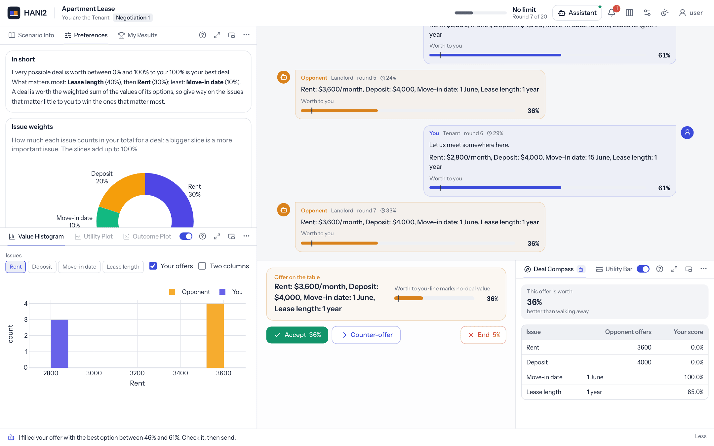
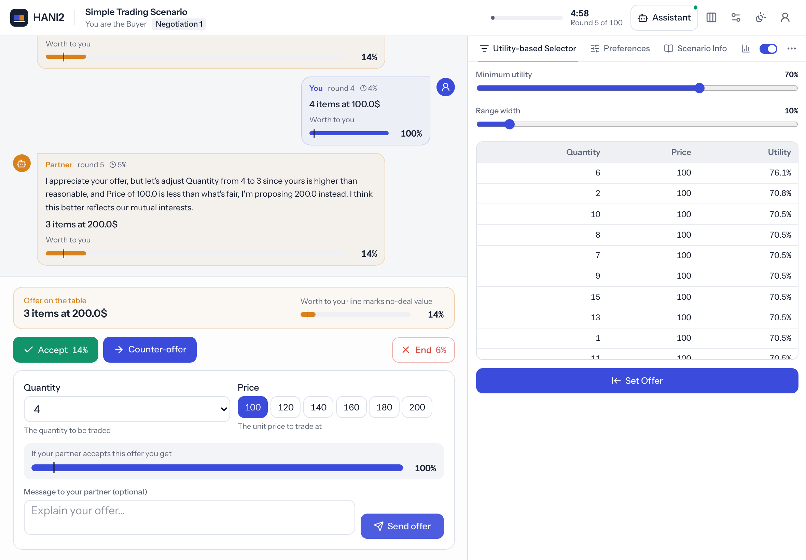
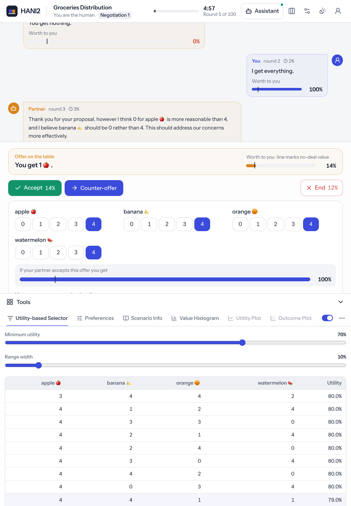
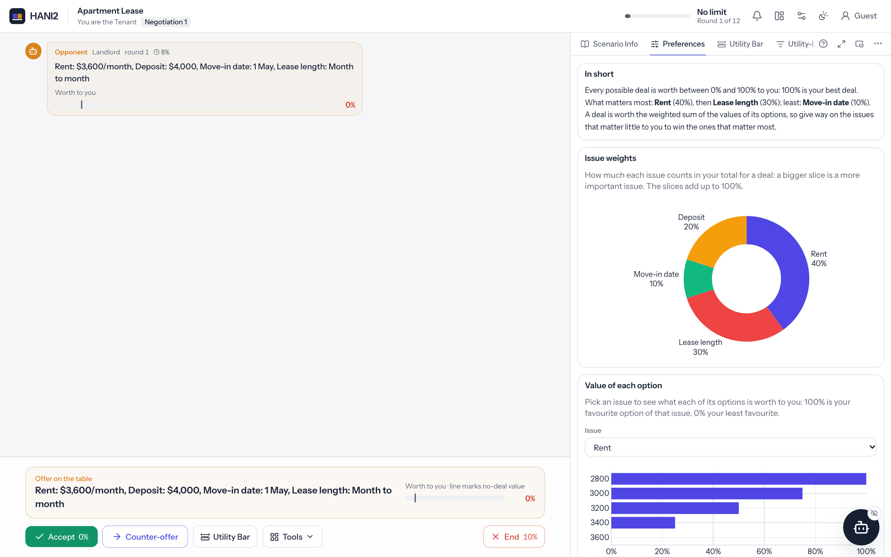
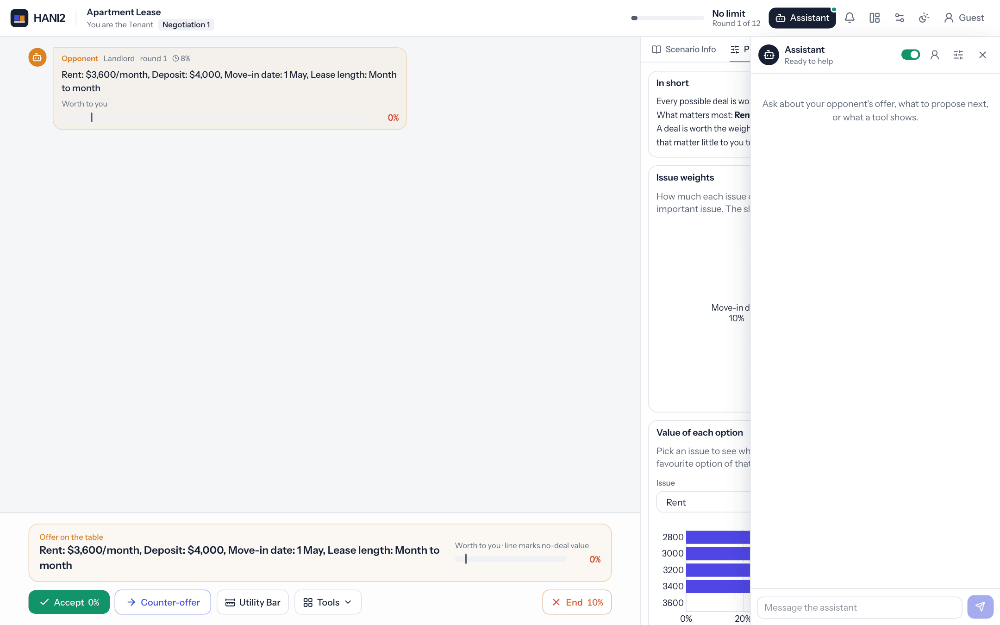

# The interface

This page describes the participant's negotiation page in detail: the same page serves `/app` (logged-in users) and `/play` (the playground and Prolific participants). For a guided first run, see the [quick start](../getting-started/quickstart.md).

## Pages and routes

| Path | What it shows |
| --- | --- |
| `/app` | The negotiation page for a logged-in user. Redirects to `/login` when you are not logged in, and to `/consent` when consent is required and not yet given. |
| `/play` | The negotiation page without an account (also served at `/guest` and `/hanplay`). With `?PROLIFIC_PID=...` it runs a Prolific study session. |
| `/login`, `/register`, `/consent` | Sign-in, account creation and the consent form. |
| `/admin` | The [admin console](admin.md). |
| `/` | Redirects to `/app`, keeping the query string. |

Each browser keeps one session per page. Reloading reconnects to the same session; if the connection drops, a "Reconnecting…" bar appears under the header and the page reconnects on its own. A connection that stays open but stops answering (the page pings the server every 25 seconds) counts as dropped once a ping goes unanswered.

## The header

From left to right the header shows:

- the title (from `title` in `env.json`, default "HANI2");
- the scenario title, "You are the ⟨role⟩", the round label ("Negotiation 2", or "Practice negotiation" in a Prolific practice round), the opponent's name when it may be shown, and an **Admin** badge for administrators;
- the timer: a progress bar, the time left (or "No limit"), and "Round n of N". The timer turns red in the last ten seconds;
- the **Autopilot** button and driver selector, when autopilot is allowed (see [Autopilot](autopilot.md));
- the **Assistant** button, when an Assistant is attached to the session and it appears as a panel (see [The Assistant as a character](#the-assistant-as-a-character)). Its dot is green when the assistant is on, amber while it works and grey when it is off;
- the notifications bell, with the number of unread notifications (see [Notifications](#notifications));
- the layout menu, the **My settings** button, the theme button (system, light, dark), and the account menu with your name, a link to **Administration** for admins, and **Log out** on `/app`. The layout menu, the theme button and the settings button appear only when the participant may change something there (see [Display settings](#display-settings)).

The opponent's (opponent agent's) name appears when the session is in admin mode or when the admin setting `show_opponent_type` is on.

## Layout views

The layout menu offers four views. The current view is part of the session state, so an Assistant can change it too.

| View | Desktop layout |
| --- | --- |
| `full` | A left column with the **upper** and **lower** tool panes. On the right, the thread runs across the top; below it sit the action dock and, next to it, the **side** pane with the offer generators (such as the Utility Bar and the Utility-based Selector), so the tools that fill your offer are beside the offer editor. |
| `simple` | The default. The thread and action dock, plus one tools column with the tools from all three panes: on the right, or on the left with `interface.simple_tools_side: left`. |
| `focus` | The thread and action dock only. The action dock's **Tools** menu (and its button for the first offer generator) opens any tool in a [popup](#open-in-a-popup); when a negotiation starts, the participant's preferences open there, and the view stays the focus view. |
| `bare` | No tools at all: the thread, the action dock and, when the session has one, the Assistant. Tools stay hidden on every device (phones lose their **Tools** tab), and nothing brings them back until the view changes. |

Sessions start in the simple view. Add `?view=full`, `?view=simple`, `?view=focus` or `?view=bare` to the URL to choose the starting view. A study (or project) sets it with `env.json` → `interface.view` (the console: **Participant interface** → *Layout*), and `interface.view_locked: true` fixes it: the layout menu disappears and the Assistant's `set_layout` is refused, so a *no tools* condition stays a no-tools condition (see [`interface`](configuration.md#interface)). A region listed in `layout.collapsed` (`tools` or `side`) is hidden; the Assistant's layout control sets it.

The [Shape the interface](../tutorials/interface.md) tutorial walks through the views, a no-tools study, and what the Assistant can change on the fly.

### Resizing the panes

Drag the thin dividers between the panes to change their sizes: the tools column against the
negotiation, the upper tools against the lower ones, the history against the offer area, and the
offer generators against the offer area (and the assistant when it is docked on wide screens).
A divider highlights under the pointer. Double-click a divider, or focus it and press **Home**,
to return to the default size; with the keyboard, focus a divider with **Tab** and nudge it with
the arrow keys. Panes stop at sensible minimums, so the offer area never becomes too narrow to use.

The sizes are part of the session layout (`layout.sizes`, each a fraction of its container), so they
survive a page reload and an Assistant can set them through its layout control:

| Key | What it sizes |
| --- | --- |
| `tools` | Width of the tools column (full and simple views). |
| `upper` | The upper tools' share of the tools column. |
| `dock` | The offer area's share of the height (the history gets the rest). |
| `side` | The offer generators' share of the row beside the offer area. |
| `assistant` | Width of the docked assistant. |
| `tablet_tools`, `tablet_dock`, `tray` | The tools column, offer area and tools tray on tablets. |

A missing key means the default size. Phones have no dividers.

## Phones and tablets

The page picks one of three layouts from the screen:

| Layout | When | Arrangement |
| --- | --- | --- |
| Desktop | 1024 pixels wide or more with a mouse; touch screens 1400 pixels or wider | The views above. |
| Tablet | 640–1023 pixels wide, or a touch screen narrower than 1400 pixels | **Landscape:** the thread and action dock, with one tools column (all tools as tabs, offer generators first) on the right. **Portrait:** the thread and action dock fill the screen and a **Tools** tray along the bottom expands to show the tools. The assistant slides over from the right. *Focus* hides the tools. |
| Phone | narrower than 640 pixels | A bottom bar with **Negotiate**, **Tools** and, when there is an Assistant, **Assistant**; one of them at a time. |

On tablets and phones buttons and inputs are taller for touch, the autopilot moves into the account menu, and the layout menu offers only *Show the tools* and *Focus* (tablets; none on phones). A participant can force a layout under **Settings → Layout for** (kept in the browser), and `?device=phone`, `?device=tablet` or `?device=desktop` in the URL does the same. The layout in use is stored with every result (`device` and `orientation` columns).

## Tool panes

Tools live in three panes: `upper`, `lower` and `side`. Each tool has a default pane, which you can change in `env.json` (see [Tools](tools.md)). A pane is shown only if it has at least one tool.

### Tabs

Each pane shows its tools as tabs with an icon and a name. Hover a tab to see the tool's description. Clicking a tab makes it the active tool of that pane and refreshes its content. The tabs follow each tool's `order` (smaller first): in the upper pane **Scenario Info** comes first, then **Preferences**, so you read the scenario and then your preferences. Scenario Info is the open tab while a scenario is loaded; when the negotiation starts, your Preferences come to the front (see [below](#your-preferences-when-the-negotiation-starts)).

### Help

The **?** button next to the tabs opens the active tool's help: what the tool shows or does and how it works. It works while the tool is switched off too, so participants can read what a tool does before turning it on. The Assistant reads the same help texts.

Tools are added at different times: some exist from the start, others appear when a scenario loads, when the negotiation starts, or when it ends. Admin-only tools appear only for administrators, and tools not marked for guests do not appear in the playground.

### Enable switch

Next to the tabs is a switch that turns the active tool on or off. A tool that is off shows a lock, its description and a **Turn on ⟨name⟩** button instead of its content, and its tab is dimmed. Permanent tools (such as Preferences and Scenario Info) have no switch. When the admin setting `allow_tool_switch` is off, the switch disappears and every tool shows its content.

### Enlarge and put back

The **⤢** button next to the tabs enlarges the active tool. Depending on the admin setting
**Enlarged tools open as** (`tools.maximize` in `env.json`), it opens in a large window over the
page (`window`, the default) or fills the whole screen (`fullscreen`); `off` removes the button.
While a tool is enlarged its pane shows a **Put it back here** button. **Put back** in the enlarged
view, the close button, or **Esc** returns the tool to the pane it came from. Opening and returning
a tool are logged as `tool_maximized` and `tool_restored` events.

### Open in a popup

The popup button next to the tabs (and **Open in a popup** in the **⋯** menu) opens the active
tool in a small floating window that does not block the page: drag it by its title bar, resize it
from its corner (it remembers where it was), close it with **×** or **Esc**, or enlarge it with
**⤢**. One tool is in the popup at a time. While it is out, its pane shows **Bring it back here**.
On a phone the popup is a sheet along the top of the screen. Opening and closing are logged as
`tool_popup_opened` (with `from`: `pane`, `dock` or `menu`) and `tool_popup_closed` events. See
[Tools in a popup](offer-generators.md#tools-in-a-popup).

### Your preferences when the negotiation starts

When a negotiation starts, your **Preferences** tool comes into view: it becomes the active tab of
its pane (and is shown again if it was hidden) and a collapsed tools column opens. In the focus
view it opens in the [popup](#open-in-a-popup) instead, and the view stays the focus view (close
the popup with **×** or **Esc**). On a tablet in portrait the tools tray opens, and on a phone the
**Tools** tab opens; tap **Negotiate** to return to the offer.

### Move, hide and restore

The **⋯** menu next to the tabs acts on the active tool:

- **Move to top left / bottom left / right** moves the tool to another pane and makes it that pane's active tab. These entries appear only in the full view and only when moving tools is allowed: `allow_moving_tools` in `env.json → negotiation`, set on the admin console's **Participant interface** page for all projects, one project or one study. When it is off the server also refuses the move. The Assistant moves tools only with its **Rearrange tools** ability.
- **Hide this tool** removes its tab. Permanent tools cannot be hidden.

When a pane has hidden tools, a **+** button appears next to the tabs. Hover or focus it to see the hidden tools and click one to bring it back.

The server also supports restoring every hidden tool at once and bringing a tool to the front (`restore` and `focus`); the Assistant uses these (see [Assistant](assistant.md)).

## The history thread

The thread in the middle lists the negotiation:

- **Offer bubbles**: yours on the right, your opponent's on the left. Each shows who made it, the round number, the share of time that had passed, the message (rendered as Markdown), the offer, any extra data the opponent attached, and a small utility gauge of the offer's worth to you. An entry without offer or text reads "No offer".
- **System lines**: centred lines that state how the negotiation ended, green on agreement.
- **Thinking indicator**: "Setting up the negotiation…" or "Your opponent is thinking…" while the opponent moves.

The display settings change the thread: newest on top or at the bottom, your own offers shown or hidden, offers as sentences or as issue chips, and the full history or only your opponent's latest offer.

## The action dock

The action dock under the thread changes with the session's phase.

### Before the negotiation

The dock shows the round label, the scenario title and your role. On the first round it shows the welcome text from `announcements.md`. A Prolific participant sees whether the next round is a practice round or how many counted rounds are done, and a countdown when the study starts the round automatically.

Buttons: **Start negotiation** and, outside Prolific, **Different scenario** (loads another scenario).

Admins see two pickers in a dashed box:

- **Scenario**: a scenario type ("Next in order" or a type) and, after choosing a type, a scenario name, with a **Load** button.
- **Opponent for the next negotiation**: a text field with suggestions from the opponent groups. Empty means a random opponent from the pool. See [Opponents](opponents.md).

Participants see pickers only for what the admin lets them choose
([What participants may choose](configuration.md#what-participants-may-choose); never in a Prolific study):

- **Scenario**: one of the allowed scenario types and, optionally, a named scenario of that type, with a **Load** button.
- **Opponent**: *Assigned automatically* (HANI2's own pick, as without the picker) or one of the allowed opponents.
- **Assistant**: *Assigned automatically* (naming the Assistant HANI2 picked) or one of the allowed Assistants, or *No Assistant* when the admin offers it. The new Assistant replaces the old one at once.

A pick holds for this negotiation only; the next one starts from HANI2's own pick again.

### During the negotiation

The dock shows the **offer on the table** with its utility gauge, then the **Accept**, **Counter-offer** and **End** buttons, and the counter-offer editor when it is open. The buttons work only on your turn; otherwise "Waiting…" appears.

Outside the full view (the simple and focus views, and on tablets and phones), where the offer generators are not next to the dock, two more buttons follow **Counter-offer**: the first offer generator (the **Utility Bar**), which opens in a [popup](#open-in-a-popup) and opens the counter-offer editor, and **Tools**, a menu of every tool, offer generators first, that opens the chosen one in the popup. When a tool in the popup fills the offer, the editor opens so the new offer is in view. The **Tools** menu is also in the dock before and after the negotiation. The bare view has neither.

The utility gauge is a bar from 0% to 100% with a dark tick at your value on disagreement. The fill is blue for your offers and orange for your opponent's; it turns red when the value is below the tick.

The counter-offer editor opens when you press **Counter-offer**, when there is no offer on the table yet, when the display setting "Keep the offer editor open" is on, or when the Assistant highlights the counter-offer controls. It contains:

- one field per issue (buttons for up to six values, a drop-down for longer lists, a number box for numeric ranges), laid out in `n_issue_columns` columns from the scenario (one to three);
- a gauge of what you get if your opponent accepts the draft;
- the message box, when the participant may write messages (admin setting `allow_text_human`);
- **Send offer**. Ctrl+Enter or Cmd+Enter in the message box also sends.

Admins see an extra row: **Text only** (send the message without an offer), **Offer from message** (fill the fields from the message using the LLM) and **Write message** (write a message for the draft using the LLM). See [Language models](llms.md).

While autopilot runs, the dock shows "Autopilot is negotiating for you", the driver's name, and **Take back control**.

### After the negotiation

The dock shows "Agreement reached" and the deal, or "No agreement" and the reason, a gauge of your final utility, any study notice, and **Next negotiation**.

The history ends with a line that says how the negotiation ended:

| Line | When |
|------|------|
| Agreement reached: *the deal* | Someone accepted an offer. |
| You ended the negotiation without agreement. | You pressed **End**. |
| Your opponent ended the negotiation without agreement. | The opponent left. |
| The negotiation timed out without agreement. | The time or round limit ran out. |
| The AI agent failed; the negotiation ended without agreement. | The opponent stopped with an error. |

## Confirmation dialogs

Accepting and ending always go through a dialog.

- **Accept this offer?** shows the offer, a large gauge of what you will receive, and a warning when the offer is worth less than ending the negotiation.
- **End without agreement?** states the value on disagreement you will receive.

The Assistant can open the same dialogs, optionally with a message of its own at the top, so the participant still confirms the action.

## The assistant dock

When an Assistant is attached and appears as a panel, the **Assistant** button opens the dock. On wide screens (1600 pixels and up) it sits beside the page; on narrower desktops it slides over the right edge; on phones it fills the Assistant tab. When it appears as a character, clicking the character opens the same conversation next to it. The character steps aside while the conversation is open and comes back when it is closed.

The dock contains:

- the assistant's name and status ("Ready to help", "Working…" or "Switched off");
- an on/off switch. While it is off, the chat box is disabled and the assistant takes no actions;
- the conversation. Questions the assistant asks are framed, and their answer options appear as buttons; the box then reads "Type your answer…";
- panels the assistant shows inside the dock;
- the message box (Enter sends, Shift+Enter adds a line).

The dock opens by itself when the assistant asks a question or shows a panel in it.

The sliders button opens **Assistant settings**:

- **How much may the assistant do?**: Suggest, Semi or Full. Levels above what the administrator allows are disabled.
- **Abilities**: a switch for every capability the administrator granted.
- **Unprompted messages appear as**: Notifications (toasts), Status board, or Chat.
- **Clear the conversation**.

The administrator decides, per project or study, which of these the participant sees, and whether the on/off switch is shown (`env.json → interface.participant_settings`: `assistant_switch`, `assistant_autonomy`, `assistant_abilities`, `assistant_delivery`; see [`interface`](configuration.md#interface)).

### The Assistant as a character

`assistant_settings.json → presentation.style` (the **Assistant settings** page, per layer) chooses how the Assistant appears:

- `panel` (the default): the **Assistant** button in the header opens the dock;
- `persona`: a round character in the bottom-right corner, with the same status dot. Clicking it opens the conversation in a card next to it, and the character disappears until the card is closed. The header has no Assistant button while the character is shown;
- `both`: the character and the header button. Clicking the character opens the dock, and the character disappears until the dock is closed;
- `choice`: the participant picks Panel, Character or Both in **My settings** (`presentation.choice_default` is the first choice).

The participant can hide the character with the small eye button on its top-right corner, or
with **Show the character** under *Assistant* in **My settings**. While it is hidden, the header
shows the **Assistant** button, even with `persona`, and the Assistant's notifications appear at
the top right. The person button in the Assistant panel's header, or the same setting, brings the
character back.

The Assistant itself can choose how it appears and lock these controls (see
[How the Assistant appears](assistant.md#how-the-assistant-appears)); a control it locks is not shown.

While the character is shown, the Assistant's notifications come out of it as speech bubbles instead of the top-right corner; clicking a bubble opens the conversation. The participant can drag the character anywhere (unless `presentation.persona_movable` is off); where it was put is kept with the session's layout (`persona_x`, `persona_y`). It keeps clear of the offer area and of buttons and fields, moving up until it no longer covers them. Phones always show the Assistant tab instead.

The [Assistant](assistant.md) page explains autonomy, capabilities and proactive messages.

### The Assistant in the tool area

`assistant_settings.json → presentation.place` (**The open Assistant goes** on the **Assistant
settings** page, per layer: global, project or study) chooses where the open conversation goes:

- `beside` (the default): beside the page, as a dock on wide screens (1600 px and more) and
  sliding over the right edge on narrower ones;
- `tools`: in the tool area, in the open tool's place. Opening the Assistant (the header button,
  the character, or a notification) covers the tools; closing it brings back the same tool, with
  its tab and inputs as they were. No second panel opens beside the page, and the character's own
  chat card is not used.

Where `tools` applies:

| View | With `place: tools` |
| --- | --- |
| A tool open in a popup (any view but bare) | The tool in front: the Assistant takes the popup's window, and closing it brings the popup's tool back. |
| Simple (one tools area) | The Assistant fills the tools area. |
| Full | The Assistant fills the tools column (the upper and lower panes); the side pane stays. |
| Focus, bare, or the tools collapsed, with no popup open | No tool is on screen, so the Assistant opens beside the page as with `beside`. |
| Tablet, landscape | The Assistant fills the tools column. |
| Tablet, portrait | The Assistant fills the tool tray while it is open; with the tray closed it slides over the right edge. |
| Phone | Unchanged: the Assistant is always a tab of its own, in the place of the Tools tab (the popup sheet stays as it is). |

While the Assistant covers the tools, the page closes it when a tool has to be seen: when a
negotiation starts and the Preferences tool is revealed, and when the Assistant highlights
something inside a tool. Bringing a tool to the front (`focus_tool`) does not close it: the tool
shows when the participant closes the Assistant. Plots in the hidden tools redraw at their size
when they come back. The Assistant can change the place for its session with
[`set_presentation`](assistant.md#how-the-assistant-appears).

### Agent panels

An Assistant can build its own panels from the same components tools use. A panel has a title and a close button, and appears in one of three places: inside the assistant dock, above the thread ("side"), or as a modal dialog. Closing a modal or a panel tells the server, and the agent receives the panel's button presses.

### Highlights and notes

An Assistant (or a tool) can highlight a part of the page with a pulse, glow or spotlight effect, optionally with a message under it and a dismiss button, and attach short notes (info, tip, warning) under elements such as an issue field. Highlights clear when you act. The names of the elements that can be highlighted are listed on the [Assistant](assistant.md) page.

## The status board

When the assistant writes to the status board, a strip with its text appears at the bottom of the page. Use **Less** and **More** to collapse it to one line or expand it.

## Pinned messages

The Assistant can pin short messages (markdown) above the negotiation, below the header, or at the bottom of the page, above the status board (`pin_message`). Pinned messages are part of the page, so the panes below or above them get shorter instead of being covered; more than a few scroll within a strip of at most a third of the window. A pinned message has an info, success, warning or error colour and stays until the Assistant removes it, the participant closes it with × (when the Assistant allowed that) or a new scenario is loaded. See [Pinned messages](assistant.md#pinned-messages).

## Notifications

Notifications (toasts) appear at the top right: info, success, warning and error. They disappear after `interface.notifications.toast_seconds` (default six seconds; errors at least nine) unless the sender set another duration, and can be dismissed with the × button. A toast from the assistant can include a button that opens the assistant dock. The page shows at most five at a time. When the Assistant appears as a character, its notifications come out of the character instead.

Every notification is also kept in the session. The bell in the header shows how many arrived since you last opened it; opening it lists them all, newest first, with who sent them and when, and **Clear** empties the list. `interface.notifications.center: false` hides the bell.

## Questionnaire

If a per-negotiation questionnaire is configured, it replaces the result after each counted negotiation (not in the playground, and not after a round in which the participant took no action). Questions can be Likert scales with 5 or 7 points (with optional end labels), yes/no buttons, a drop-down, or free text. **Submit answers** checks that required questions are answered. See [Study management](study-management.md) for the file format.

## Utility by issue

With **Colour the utility bars by issue** on, every utility bar (the offer on the table, your counter-offer, the confirmation before accepting, the result and each offer in the history) is split into one coloured segment per issue. A segment's length is what that issue adds to the value of the offer (its weight times the value of the chosen option), so the segments add up to the whole bar. The issues are always in the same order, the most important (largest weight) first, so the same colour means the same issue in every bar and you can compare offers at a glance. The bars in the offer area have a legend with each issue's share; in the history, hover a segment (or the bar) to see it. From the ninth issue on, the issues share one grey segment ("Other").

This works only for linear additive preferences (a weighted sum of one value per issue; every built-in scenario), and only when you see what deals are worth to you and know your whole preferences: in an [information split](information.md) where you know only your weights or only your option values, the bars stay plain and the setting is not shown, since the segments would reveal the rest.

## Prolific completion

In a Prolific session, the dock shows study progress and notices after each round, and starts or loads rounds automatically on timers. When all counted negotiations are done (and the questionnaire answered), the dock shows "You're all done. Thank you!" and a **Finish and submit** button that opens the completion URL. See [Prolific](prolific.md).

## Display settings

The **My settings** drawer (the sliders button) holds only what the current user may change. The administrator decides what that is for every project and study (`env.json → interface.participant_settings`, the console's **Participant interface** page); a setting that is switched off is not shown, and the server refuses the change. The defaults of these settings can be set per layer as well (`interface.prefs`). They are stored in the session, so they apply to every tab of that session.

| Setting | Key | Default | Effect |
| --- | --- | --- | --- |
| Show the whole history | `show_history` | on | Off: the thread shows only your opponent's latest offer and system lines. |
| Show my offers in the history | `show_human_offers` | on | Off: your own offers are not added to the thread. |
| Colour the utility bars by issue | `color_utility_by_issue` | off | See [Utility by issue](#utility-by-issue). |
| Newest offer on top | `last_offer_on_top` | off | Order of the thread. Off: oldest first, and the thread scrolls to the newest message as it arrives. |
| Keep the offer editor open | `offer_panel_always_visible` | off | The counter-offer editor stays open. |
| Offers shown as | `offer_display` | `text` | `text` (sentences) or `table` (issue chips). A scenario with its own history view shows that view either way. |
| Text size | `font_scale` | 1.0 | Scales the page text, from 0.85 to 1.3. |
| Show the scenario's picture | `show_scenario_picture` | on | The picture at the top of the *Scenario Info* tool (also its *Picture* switch). |
| Scenario picture | `scenario_picture_style` | (the scenario's, else `small`) | `small` (beside the story), `large` (above it) or `watermark` (faintly behind it); also the menu beside the *Picture* switch. |
| Open the full scenario description | `open_scenario_description` | off | The *Full description* card of the *Scenario Info* tool starts open when a scenario loads. |
| Layout for | (this browser) | Automatic | Phone, tablet or desktop layout. |
| Theme | (this browser) | Automatic | Light, dark or the system's. |
| The Assistant appears as | `assistant_presentation` | `presentation.choice_default` | Only when the administrator lets the participant choose. |
| (no control) | `compact` | off | Stored but not used by the interface. |

Administrators see every participant setting, with a **hidden from participants** mark on those the current project or study hides. Everything else (timing, negotiation rules, scenarios and opponents, tools, what participants may change) is in Administration, per layer; see [Admin console](admin.md).

## Admin mode

A session is in admin mode when the user is an administrator (never for a Prolific participant), on `/play` and on `/app`. Admin mode shows the opponent's name and the opponent picker, alongside the admin settings drawer, the admin-only tools and the admin row in the counter-offer editor. `?admin=1` in the URL no longer turns admin mode on for other users.
