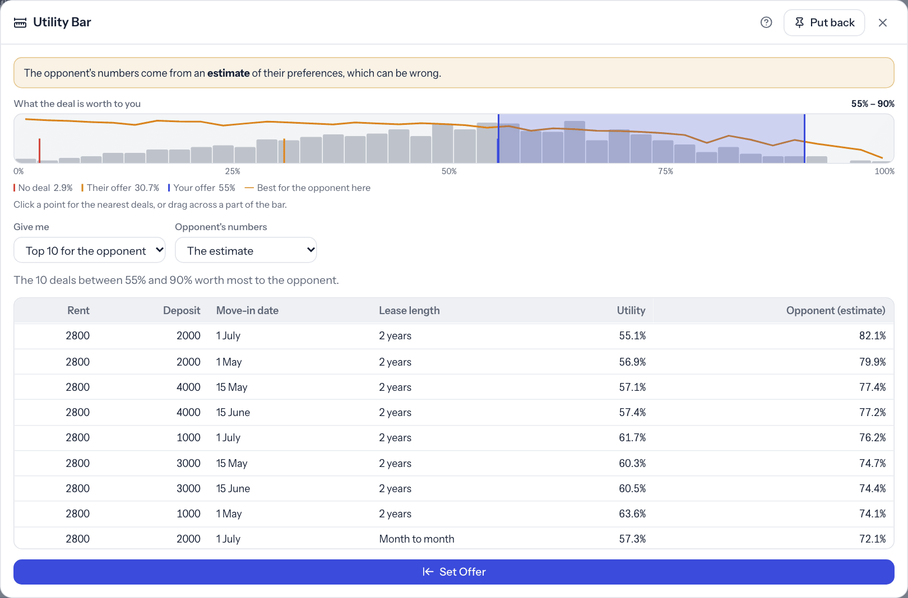
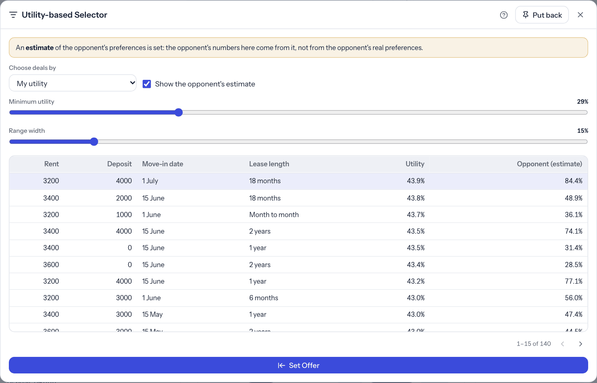
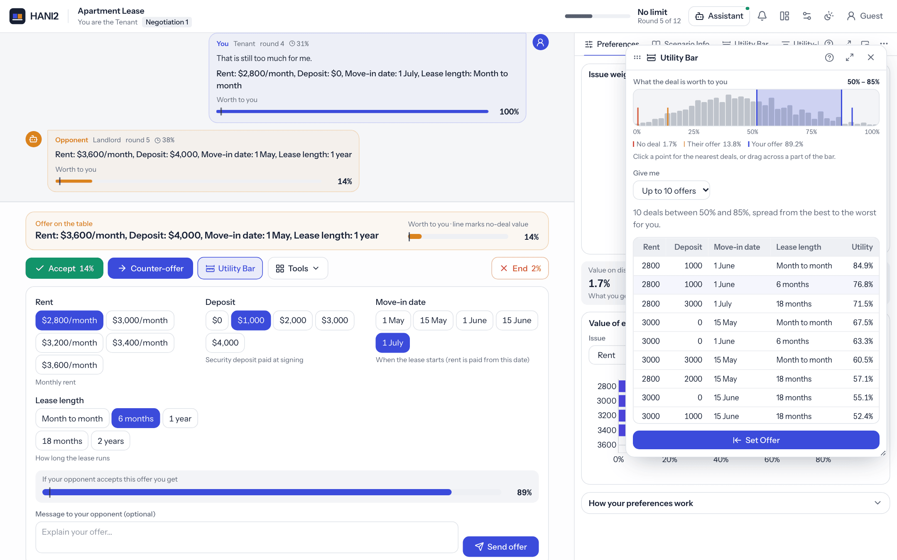

# Offer generators

Offer generators are tools that fill your counter-offer for you. They never send it: the offer
appears in the offer panel, and you check it, change it if you like and press **Send offer**
yourself. HANI2 has four built in, in the side pane next to the offer panel by default:

| Generator | How it picks an offer | Who gets it | Best for |
|-----------|-----------------------|-------------|----------|
| [Utility Bar](#utility-bar) | Click or drag on a bar of what deals are worth to you: one deal, up to ten, all of them, or the best for the opponent | everyone | Seeing where your deals are and picking one by eye, quickly |
| [Utility-based Selector](#utility-based-selector) | A deal from a range of values for you (or, with an estimate, for the opponent) | everyone | Making offers you can accept, conceding step by step |
| [LLM](#llm) | A language model follows an instruction in plain words | admins (can be opened to participants) | Natural-language strategies, an offer together with a message |
| [Random](#random) | Any deal, at random | admins (can be opened to participants) | Exploring the outcome space, testing opponents |

An [Assistant](assistant.md) can use the same generators for you when it has the *Use tools*
ability, and you can [write your own](#writing-your-own).

## Utility Bar

The first generator, and the side pane's open tab when a negotiation starts. It works like the
Utility-based Selector below, the other way round from a utility function: you choose a value and
get deals with it, but graphically.



1. Open the **Utility Bar** tab in the side pane, or, outside the full view, press **Utility Bar**
   in the offer area (see [Tools in a popup](#tools-in-a-popup)).
2. Look at the bar: it runs from 0% (your worst deal) to 100% (your best). The grey columns show
   how many deals there are at each value, the coloured marks your value on disagreement (*No
   deal*), the opponent's offer on the table (*Their offer*) and your current offer (*Your offer*).
3. **Drag** across a part of the bar (for example from 60% to 80%), or **click** a point to get the
   deals *nearest* to that value.
4. Choose what you want under **Give me**:

   | Choice | Drag (a part of the bar) | Click (a point) |
   |--------|--------------------------|-----------------|
   | **Any offer** | one deal from the part, at random; **Another** draws again | the nearest deal |
   | **Up to 10 offers** | up to ten deals spread from the best to the worst of the part | the ten nearest deals |
   | **All offers** | every deal in the part, best for you first | every deal at the nearest value |
   | **Best for the opponent** | the deal in the part worth most to the opponent | the best for the opponent among the ten nearest |
   | **Top 10 for the opponent** | the ten deals in the part worth most to the opponent | the ten nearest, best for the opponent first |

5. Click a row to copy that deal into your counter-offer, or press **Set Offer** for the selected (or
   first) one.

The two opponent choices appear only when the tool knows what deals are worth to the opponent: when
an [estimate of the opponent's preferences](tools.md#an-estimate-of-the-opponents-preferences) is
set (for example by your Assistant), or for those who may see the opponent's real preferences
(administrators, or everyone when `tools.show_opponent_utility` is on). Then a line over the bar
shows the best the opponent gets at each value, and a banner says whether the numbers are the
estimate or the real ones; administrators with an estimate set can switch between them. With a
human opponent only an estimate is ever used.

The bar works with the keyboard too: **Tab** to it, move the selection with the arrow keys
(**Page Up**/**Page Down** for bigger steps), widen or narrow it with **Shift** and an arrow.

**When to use it.** You want to see at a glance where the good deals are, concede by moving the
selection down the bar round by round, or, with an estimate, find the deal the opponent likes most
among those still good for you.

## Utility-based Selector



1. Open the **Utility-based Selector** tab in the side pane.
2. Set **Minimum utility**: the least a deal must be worth to you, in percent of the span from your
   worst to your best deal.
3. Set **Range width**: how far above the minimum to look. 70% and 10% list every deal worth 70-80%
   to you; the default width of 100% lists every deal from the minimum up to your best.
4. Click a row to copy that deal into your counter-offer, or press **Set Offer** to have one picked
   from the range.

The table is sorted best first, can be sorted by any column and is paged for large scenarios.

**When to use it.** You know the least you will accept and want to see which deals reach it, or
you concede step by step: lower the minimum a little every round and pick the deal you like best
among those that are new.

**With an estimate of the opponent.** When an estimate of the opponent's preferences is set (for
example by your Assistant), the selector also shows what each deal is worth to the opponent *by
that estimate*, and **Choose deals by** switches the sliders to the opponent's estimated utility:
set a minimum the opponent will probably accept and pick, among those deals, the one worth most to
you. The estimate can be wrong; a banner reminds you. See [An estimate of the opponent's
preferences](tools.md#an-estimate-of-the-opponents-preferences).


## LLM


1. Open the **LLM** tab.
2. Write an instruction in plain words.
3. Choose what to generate: **Text & offer** (an offer and a message that goes with it), **Text
   only** (a message for the offer you already have) or **Offer only**.
4. Press **Generate** and read the suggestion: the offer with what it is worth to you, and the
   message.
5. Press **Apply to my offer** to copy them into your counter-offer.

Instructions that work well:

| Instruction | What it does |
|-------------|--------------|
| "Propose a fair middle ground" | A balanced offer between the two positions |
| "Improve my last offer slightly for the opponent" | A small concession |
| "Hold firm on the rent, give in on the move-in date" | Trades one issue against another |
| "Counter with a tough offer and explain why politely" | A demanding offer with a friendly message |
| "Write a short, friendly message for this offer" | With **Text only**: a message for your current offer |

The model sees the issues, your preferences, the opponent's current offer and the last turns of
the negotiation, and it is told to return an offer that exists in the scenario. It does not see the
opponent's preferences. The prompt is the `instruction_prompt` template of `llm_settings.json`
(see [Prompt templates](llms.md#prompt-templates)).

**Requirements.** A configured language model (see [Language models](llms.md); by default a local
model through Ollama) and a running negotiation. Without a model the tool shows a warning.

**When to use it.** You think in strategies rather than numbers, want a message that explains your
offer, or want to compare what a language model proposes with your own idea.

## Random


Press **Set Offer** to fill your counter-offer with a random deal; press it again for another.

**When to use it.** Early exploration of what is possible, breaking a deadlock with an unexpected
offer, or checking how an opponent reacts to offers far from the usual path.

## Tools in a popup

Any tool can open in a **popup**: a small window that floats over the page without blocking it, so
the offer area stays usable and you see at once what a generator puts into your counter-offer.

- In a tool pane, press the popup button next to the tabs (or **Open in a popup** in the tool's
  **⋯** menu). The pane shows **Bring it back here** while the tool is out.
- Outside the full view (the simple and focus views, tablets and phones), where the generators are
  not next to the offer area, the offer area has two more buttons next to **Counter-offer**: one
  for the first offer generator (the **Utility Bar**), which also opens the counter-offer editor,
  and **Tools**, a menu of every tool with the offer generators first. Before and after a
  negotiation the **Tools** menu is there too, for example to read your Preferences.



Drag the popup by its title bar and resize it from its corner; it opens where you left it. One tool
is in the popup at a time: opening another takes its place. **Esc** or **×** closes it, **⤢**
enlarges it. On a phone it is a sheet along the top of the screen, above the offer editor. The bare
view has no tools at all, so it has no popup and no launcher.

## Giving the admin-only generators to participants

The LLM and Random tools are admin-only by default, so that they cannot change the conditions of a
study by accident. To offer one to participants, untick **Admins only** next to it under **Tools**
in the admin console, or set `tools.overrides.<name>.admin_only` to `false` in `env.json`. See
[Opening admin-only tools to participants](tools.md#opening-admin-only-tools-to-participants).

## Writing your own

An offer generator is a tool that derives from `hani2.tools.OutcomeSelector`. Override
`get_outcome()` to return an outcome (a tuple with one value per issue, in the scenario's issue
order) and, optionally, `selector_view()` to show controls above the **Set Offer** button the base
class adds:

```python
from hani2.tools import OutcomeSelector, ui


class HalfwayOffer(OutcomeSelector):
    name = "Halfway"
    description = "Offer the deal halfway between your best deal and the opponent's offer."
    button_label = "Meet halfway"

    def selector_view(self):
        return [ui.markdown("Picks the deal whose value for you is halfway between "
                            "your best deal and the opponent's current offer.")]

    def get_outcome(self):
        ufun, offer = self.human_ufun, self.session.partner_offer()
        if ufun is None or offer is None:
            return None
        target = (1.0 + float(ufun(offer))) / 2
        outcomes = ufun.outcome_space.enumerate_or_sample(max_cardinality=5000)
        return min(outcomes, key=lambda o: abs(float(ufun(o)) - target))
```

Save it in the tools folder (`$HANI2_HOME/tools`) and the next session has it. The [tools
tutorial](../tutorials/tools.md#offer-pickers-outcomeselector) explains `OutcomeSelector` and
everything else a tool can do.
