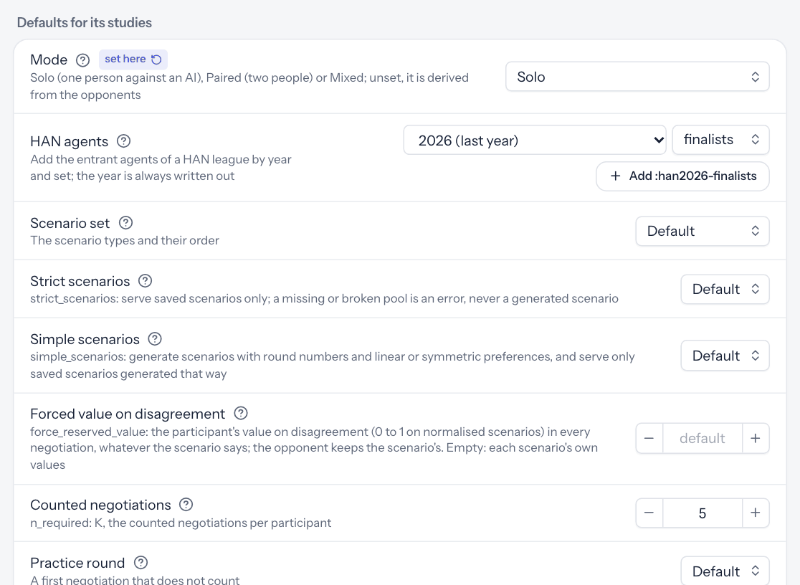
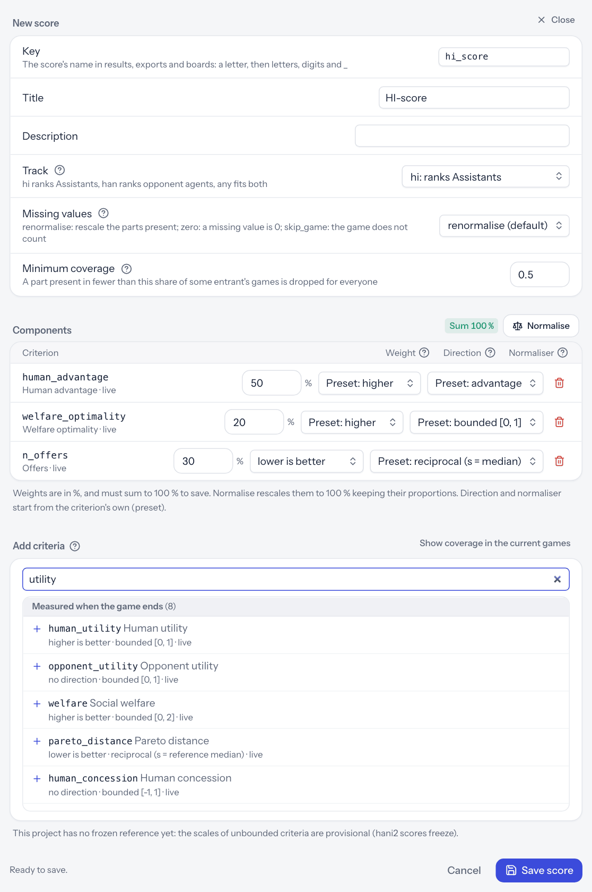

# Project management

One HANI2 server can run many data collections at once, each with its own texts, settings and results. They are organised as *projects* and *studies*. No restart is needed to add one: HANI2 reads the project and study files when a participant arrives.

This page is about projects: what they are, how to create and edit them, and the defaults they give their studies. Running one study (its type, its links, its assignment, its forms and its results) is described in [Study management](study-management.md).

## What a project is

| Term | Meaning | Examples |
|---|---|---|
| **Project** | A long-lived research or competition programme. It owns the participant-facing identity (name, year, organiser, contact, consent text) and the defaults its studies share. Its *kind* says what is evaluated: `opponent` (submitted opponents face humans), `assistant` (submitted assistants help humans) or `none` (plain research). | `HAN2027`, `HI2027` |
| **Study** | One data collection inside a project, with its own results. Its *type* is `prolific` (a Prolific study), `online` (you recruit people and send them a link) or `lab` (in person). See [Study types](study-management.md#study-types). | `hi-2027-01`, `han-lab-kyoto` |
| **Human** | The participant's side of a negotiation. | |
| **Assistant** | The AI helper on the human's side. | |
| **Opponent** | The other side. | |

The built-in project `default` holds every study you do not put in a project. Experiments from earlier versions are studies of this project (see [Migrating from experiments](study-management.md#migrating-from-experiments)).

### Folder layout

```text
$HANI2_HOME/projects/<project>/        default ~/negmas/hani2/projects
├── project.yaml          name, full name, kind, year, organiser, contact, defaults for its studies
├── consent.md            any settings file, shared by the project's studies (optional)
├── announcements.md
├── env.json, assistant_settings.json, questionnaires/, scenarios/, scenario_sets.yaml, ...
└── studies/<study>/
    ├── study.yaml        type, title, dates, Prolific study id, completion code, overrides
    ├── consent.md ...    optional per-study copies of any settings file
    └── results/          per-participant folders, events.db, recordings, group files
```

`HANI2_PROJECTS` moves the projects folder elsewhere.

User accounts are shared by all projects and studies.

## Creating and editing a project

A project can be created and edited in three ways, which all write the same `project.yaml`:

- the admin console's **Projects & Studies** page (see [Admin console](admin.md#projects-studies));
- the command line, `hani2 project create` (see [Command line](#command-line));
- the [admin API](#admin-api), `PUT /api/admin/projects/{project}`.

`create` on an existing project updates the given fields. `hani2 study create` also creates the project when it is missing.

In the admin console, every choice that is not self-explanatory has a **?** after its name, which
opens an explanation of the choice and its values. The [Settings reference](settings-reference.md)
collects the same texts, with the key each choice writes.


### `project.yaml`

```yaml title="projects/HI2027/project.yaml"
full_name: Human-AI Interaction League 2027
short_description: People negotiate with the help of AI assistants.
link: https://example.org/hi2027
year: 2027
kind: assistant            # opponent | assistant | none
organizer: The Negotiation Lab
contact: lab@example.org
defaults:                  # every study of the project starts from these
  n_required: 4            # counted negotiations per participant
  practice: true           # one practice negotiation first
  practice_time_limit: 300
  counted_time_limit: 600
  minutes: 45              # expected maximum duration
  scenario_set: HI2027
  role_rule: auto
  strict_scenarios: true   # only saved scenarios; a missing pool is an error
  force_reserved_value: 0  # the participant's value on disagreement, in every negotiation
  opponents: [BoulwareTBNegotiator]
sponsor: ACME              # any other key is available to texts as {{project_sponsor}}
```

`full_name`, `short_description`, `link`, `year`, `organizer`, `contact` and any key you add yourself fill the [text variables](study-management.md#texts-with-variables) of every study of the project.

### Forcing the value on disagreement

`force_reserved_value` gives the participant (the human) the same value on disagreement in every
negotiation of a project or study, whatever each scenario says. The opponent's value on disagreement
stays as the scenario sets it; when two participants negotiate with each other, each gets their own
study's forced value. It is unset by default, and then every scenario keeps its own values. Set it in `project.yaml` (for all the
project's studies) or `study.yaml` (for one study; a study's value wins, and `0` is a value, not
"unset"). The number is on the scenario's utility scale: 0 to 1 for normalised scenarios, so `0`
means that any agreement is at least as good as none. In the console it is *Forced value on
disagreement* under *Projects*; the field starts empty (each scenario's own values), and its − button
sets it to 0.

The forced value is applied in memory when a scenario loads: saved scenarios are never changed, the
recorded scenario of each negotiation carries the value that was played, and the basic scenario info
records it as `forced_reserved_value`.

A setting given twice in `project.yaml` with different values (at the top level and again under `defaults:`) is refused when the file is saved through the admin API or the command line, and reported (server log, `hani2 project show`) when a hand-edited file has it; the value under `defaults:` is then used.

### What a study inherits

A study starts from its project:

- its settings come, first match wins, from an environment variable, the study's `overrides`, the project's `defaults` and the built-in default (see [`study.yaml`](study-management.md#studyyaml));
- every settings file (consent, welcome text, `env.json`, questionnaires, scenarios, …) placed in the project folder is used by every study that has no copy of its own (see [Settings files per study](study-management.md#settings-files-per-study));
- the project's opponent and Assistant groups are available to all its studies (see [Pools of opponents and Assistants](#pools-of-opponents-and-assistants)).

## Defaults for its studies

The keys of `defaults` may also be written at the top level. They are: `scenario_set`, `n_required`, `practice`, `practice_time_limit`, `counted_time_limit`, `time_limit`, `n_steps`, `minutes`, `role_rule`, `human_roles`, `strict_scenarios` (serve saved scenarios only, see [Strict scenarios](scenarios.md#strict-scenarios)), `simple_scenarios` (round numbers and plain shapes in generated scenarios, on unless switched off, see [Simple scenarios](scenarios.md#simple-scenarios)), `information` (what the participant and the Assistant each know, see [Who knows what](information.md)), `assistant_starts_on` (Prolific and online participants start with the Assistant switched on instead of off), `force_reserved_value` (the participant's value on disagreement in every negotiation of the study, whatever the scenario says; the opponent keeps the scenario's, see [Forcing the value on disagreement](#forcing-the-value-on-disagreement)), `questionnaires` (`false`: no questionnaire at all in this study, see [Where the questionnaire is looked up](study-management.md#where-the-questionnaire-is-looked-up)), `opponents` and `assistants` (the pools below), `scheduling` (how each study assigns them, see [Assignment](#assignment)), `study_mode` (Solo, Paired or Mixed, see [Mode](#mode-solo-paired-or-mixed)) and `pairing` (how people are paired, see [Pairing defaults](#pairing-defaults)).

A study changes any of them under `overrides:` in its `study.yaml`.

### Mode: Solo, Paired or Mixed

`study_mode` says who negotiates with whom. It takes one of three values:

| Mode | Meaning | In an HI project (`kind: assistant`) | In a HAN project (`kind: opponent`) |
|---|---|---|---|
| `solo` | One person per negotiation, against an AI opponent | The human has an Assistant; the opponent is an agent (built-in, `:pan` or HAN entrants) | A human without an Assistant against the entrant agents |
| `paired` | Two people negotiate with each other | Each side has its own Assistant (`opponents: [human+assistant]`) | Two people without Assistants (`opponents: [human]`). It tests no HAN agent, so its results are not ranked |
| `mixed` | A person when someone fits, otherwise an AI opponent | For example a game open to everyone | Rarely useful |

`study_mode` does not replace `opponents`: `opponents` still decides who plays (the human entries
`human` and `human+assistant` are described in [Human opponents](human-opponents.md)). The mode is
your declared intent, and HANI2 checks it against the pool, the Assistant and the project's `kind`:

| `study_mode` | `opponents` must be | Assistant | When `opponents` is missing |
|---|---|---|---|
| `solo` | no `human` / `human+assistant` entry | any (HI: not `[none]` only) | the default pool |
| `paired`, `kind: assistant` | exactly `[human+assistant]` | required, not `[none]` | HANI2 fills in `[human+assistant]` |
| `paired`, `kind: opponent` | exactly `[human]` | `[none]` | HANI2 fills in `[human]` and `assistants: [none]` |
| `paired`, `kind: none` | human entries only | either | `[human]` with `assistants: [none]`, else `[human+assistant]` |
| `mixed` | at least one human entry and one AI entry | any | refused: name the pool |

**When `study_mode` is not set**, the mode is *derived* from `opponents`: no human entry is
`solo`, only human entries is `paired`, both is `mixed`. Projects that never set it keep working
exactly as before; `hani2 project show` and `hani2 study show` print the derived mode with
"(derived from opponents)".

**When the mode and the pool disagree**, a file you save through the command line or the admin
API is refused, and the message names both keys and the pool the mode needs, for example:

```text
study_mode is 'paired' but opponents is [human, :pan]; a Paired HI study (kind: assistant)
needs opponents: [human+assistant]
```

In the admin console the **Mode** row offers Solo, Paired and Mixed, and its empty choice shows
the derived mode ("Derived from the opponents (Solo)"). When the mode and the pool disagree, a red
note under the row says why, and **Save** is refused with the same message.



A file edited by hand that disagrees is reported in the server log, in `hani2 study show` and in
the study's `errors` on the admin console, and **`opponents` wins**: the study runs with the
derived mode. The session's events record that mode, with `study_mode_error: true`. How a study
overrides the mode, and the checks made for each session, are in
[Mode](study-management.md#mode).

```yaml title="projects/HI2027/project.yaml"
kind: assistant
year: 2027
defaults:
  study_mode: solo
  opponents: [":han2027-finalists", ":pan"]
```

### Pairing defaults

The `pairing` block holds the options of studies where people meet (`paired` and `mixed`). A
study's block is merged key by key with its project's, so a study changes only the keys it names:

```yaml
pairing:
  scope: study            # study | project | code: where people meet
  assign: cells           # cells | order | random: how a match is formed
  slack: 1                # a whole number ≥ 0
  cell_scenario: type     # type | name
  allow_same_assistant: false   # may both sides use the same Assistant?
  fallback: ai            # ai | wait | end: when nobody fits in human_opponent_wait seconds
  fallback_opponents: null      # the AI pool of the fallback (AI entries only)
```

| Key | Default | Meaning |
|---|---|---|
| `scope` | `study` in a study that declares `study_mode: paired`, else `project` | Where people meet. `study`: only people of the same study meet. `project`: people of every study of the project meet, so two studies can be paired with each other. `code`: people meet only through a shared `?match=<code>` link; without a code a participant meets nobody (the wait-time fallback applies). A `?match=<code>` link pairs those who share it in every scope, unless `human_opponent_codes` is `false`. |
| `assign` | `cells` in a declared Paired study, else `random` | How the two people of a match are chosen: `cells` balances the match cells (scenario, Assistant at each side), `order` makes everyone follow their planned order strictly, `random` picks at random among the people who fit. |
| `slack` | `1` | How strictly `cells` balances: cells whose count is within `slack` of the emptiest are treated as tied, and chance decides among them. `0` is the strictest, but who meets whom becomes easier to predict. |
| `cell_scenario` | `type` | What "scenario" means in a cell: the scenario type (`type`) or the single scenario (`name`, which multiplies the number of cells by the scenarios per type). |
| `allow_same_assistant` | `false` | Whether both sides of a match may use the same Assistant. With one Assistant in the study's pool it is always allowed (no match could be formed otherwise). |
| `fallback` | `ai` | What happens when nobody fits within `human_opponent_wait` seconds: play an AI opponent with the Assistant already chosen (`ai`), keep waiting (`wait`, the same as `human_opponent_fallback: false`) or skip the slot (`end`: the next Assistant, or the end of the study when none is left). When `human_opponent_fallback` is also set in an `env.json` and the two disagree, the file is refused. |
| `fallback_opponents` | the study's AI pool, else `:pan` | The AI opponents of the fallback. Human entries are refused. |

Every key is checked when a file is saved (unknown keys and values not listed above are refused)
and reported when a hand-edited file has a problem. `assign`, `slack`, `cell_scenario`,
`allow_same_assistant` and `fallback` apply to a study declared `study_mode: paired`, and to any
other study that sets `assign: cells` or `assign: order` in its `pairing` block (for example a
Mixed game); `fallback` also applies wherever it is written. Other studies pair as they always did.
What each choice does, and what it can and cannot guarantee, is explained in
[Paired studies](study-management.md#paired-studies).

### HAN agents by year

The opponents of a study can be the entrant agents of a HAN league, by year and set:
`:han<year>-all`, `:han<year>-qualified`, `:han<year>-finalists` and `:han<year>-winners` (see
[Group tokens](opponents.md#group-tokens)). An HI study can name several years, for example
`opponents: [":han2026-finalists", ":han2027-finalists"]`. Always write the year itself: a project
of `year: 2027` that wants last year's finalists writes `:han2026-finalists`.

Where a year's agents come from:

- the **current year**, set explicitly as `han.current_year` in `env.json` (never taken from the
  clock), comes from that year's **submitted zips** (see
  [HAN agents of the current year](opponents.md#han-agents-of-the-current-year));
- **every other year** comes from the installed `han-agents` package;
- a year that neither covers has no agents: a file naming it is refused when saved ("no agents
  for 2025"), and a hand-edited one is reported, the group expanding to nothing.

In the admin console the **HAN agents** row of the defaults does this for you: choose a year and a
set, and **Add** writes `:han<year>-<set>` into the layer's opponent pool. The years offered are
those the two sources cover, plus the project's year and the year before; "this year" and "last
year" are labels computed from the project's **Year**, and a year that no source covers is greyed
out.

When a year's agents have been packaged into `han-agents`, raise `han.current_year` to the next
year: from then on the earlier year comes from the package. Games already played keep the source
and version they recorded (`opponent_han_year`, `opponent_han_source`, `opponent_han_version`, see
[`results.csv` columns](study-management.md#resultscsv-columns)). `hani2 study show` prints where
each `:han<year>-<set>` entry of a study's pool comes from.

### Pools of opponents and Assistants

A project shares its pools with all its studies:

```
projects/HI2027/
  project.yaml               # opponents: [":finalists"]   assistants: [":entries"]
  groups/finalists.json      # opponent group   {"agents": [...], "syspath": [...]}
  assistant_groups/entries.json   # Assistant group  {"assistants": [...], "syspath": [...]}
  studies/hi-2027-01/
    study.yaml               # may override opponents / assistants
    groups/ assistant_groups/   # optional groups of this study only
    results/
      groups/                # files an outside system drops (they win)
      assignments.json       # each human's index and Assistant
```

A token `:key` is looked up in the study's `results/groups/`, the study folder, the project folder,
the settings folder and finally the built-in groups (see [Group files](opponents.md#group-files)
and [Assistant groups](assistant.md#assistant-groups)). `hani2 groups list --project <P>` lists a
project's groups, and the admin API edits them (see [Admin API](#admin-api)).

### Assignment

A project chooses, for all its studies, how each dimension is assigned to the humans: the
opponents, the Assistants and the scenario types. A study can choose another method per dimension:

```yaml
scheduling:
  opponents: latin_square   # random, cyclic, fixed_order, external
  assistants: balanced      # random_fixed, round_robin, random_each, latin_square, cyclic,
                            # balanced_subset, random_subset, external
  scenarios: by_participant # set_order, random, latin_square, external
  cross: shift              # cross the Assistant with the opponent: shift (default) | none
  assistant_repeats: false  # may a person get one Assistant twice?
```

The Assistant methods fall into three families:

| You want | Assistant method | Each person gets |
|---|---|---|
| One Assistant per person (between-subjects; the game) | `balanced` (default), `random_fixed`, `round_robin` | one Assistant for all their negotiations |
| Every Assistant once (the finals: K = N) | `latin_square` (or `cyclic`) | every Assistant once, in a counterbalanced order |
| K of N Assistants (screening: K < N) | `balanced_subset` (or `random_subset`) | K different Assistants, with totals, positions and pairs balanced |

`n_required` is K, the counted negotiations per person. A method that promises "each Assistant at
most once" refuses a file where K is larger than the number of Assistants, unless
`scheduling.assistant_repeats: true`. When the Assistants change every negotiation and the opponents
use `latin_square` or `cyclic`, `scheduling.cross: shift` (the default) **crosses** them, so that
every Assistant meets every opponent equally often instead of always the same one.

In the admin console, the Scheduling group has a row for each of these. **K of N** compares the
counted negotiations ($K$, `n_required`) with the number of Assistants in the pool ($N$, after the
groups are expanded), and turns orange when $K > N$ under a method that promises each Assistant at
most once while **Repeats** is off: saving is then refused. **Repeats** sets `assistant_repeats` and
**Crossing** sets `cross`.

What these defaults do within a study is described in
[Assigning Assistants, opponents and scenarios](study-management.md#assigning-assistants-opponents-and-scenarios),
and every method, with its formulas and examples, in [Scheduling methods](scheduling.md).

## Scores

### Criteria

A **criterion** is any number HANI2 measures for a negotiation, and that a score can be built
from:

- every numeric column of every metric (outcomes, behaviour, the judge's ratings, the scales of the
  bundled questionnaire and the scores themselves);
- every numeric item (`q_<id>`) and every scale (`scale_<name>`, `scale_<name>_norm`) of the
  questionnaire a project or study shows after each negotiation;
- every numeric item and scale of its post-session questionnaire, as `post_q_<id>` and
  `post_scale_<name>`.

The [Criteria and scores reference](criteria.md) lists every metric column with its direction, its
default normaliser and its cost. Columns that are labels (`status`, `ended_by`, the factor levels,
the condition names) cannot be chosen.

**Levels.** Most criteria have one value per game (`negotiation`). A post-session answer has one
value per person (`participant`). It is credited to the games of that person **only when they used
one Assistant throughout**, for example in a game or a between-subjects study. When a person used
several Assistants, as in finals where everyone meets every finalist, the answer cannot be credited
to any one of them. Such criteria are then marked as not usable for HI scores, with the reason.

**Cost.** `live` criteria are computed when a game ends. `questionnaire` criteria need the
participant's answers. `judge` criteria need the offline language-model judge (`--llm`). A score
counts as `judge` as soon as one of its parts does.

#### Mapping every value to [0, 1]

Before values are weighted into a score, each one is mapped to $[0, 1]$, where 1 is the best value.
Every numeric column has a default **normaliser**, and a score may choose another one for any of its
parts:

| Normaliser | Rule | Default for |
| --- | --- | --- |
| `bounded` `[lo, hi]` | $(x - lo)/(hi - lo)$, clipped | columns with known bounds: `[0, 1]`, `0 or 1`, ratings of 1–7, `[−1, 1]`, utilities, every questionnaire item with the bounds of its type (`likert5`, `likert7`, `yes_no`, `select`, `min` / `max`) |
| `advantage` | clipped to $[0, 1]$: no better than no deal is 0 | `human_advantage`, `opponent_advantage` |
| `reciprocal` | $s/(s + x)$ | unbounded values where lower is better: counts, seconds, tokens, distances, US dollars |
| `saturating` | $x/(x + s)$ | unbounded values where higher is better, and unbounded values without a direction |
| `percentile` | the share of reference games with a lower value (ties count half) | any criterion, on request |
| `clip` `[lo, hi]` | your own bounds | any criterion, on request |

When the direction is `lower`, each rule is turned around ($1 - \cdot$). `reciprocal` and
`saturating` are the same rule seen from the two directions, so a count without a direction
(`n_offers`) becomes `reciprocal` as soon as a score says that fewer is better. Questionnaire items
marked `reverse: true` are already reversed, so a high value always means more of what the item
measures. A scale whose items have different ranges has no bounds for its raw mean; use its `_norm`
column instead.

In project and study files, and in the API, a normaliser is a small mapping:

```yaml
{kind: bounded, lo: 1, hi: 7}
{kind: reciprocal, scale: reference_median}    # or a fixed positive number
{kind: percentile}
{kind: clip, lo: 0, hi: 600}
```

#### The frozen reference

The scale $s$ of `reciprocal` and `saturating` is the **median** of the criterion in a reference set
of games, so the median game scores 0.5. When the median is 0 (most games have no error at all),
the mean is used, and 1 when the mean is 0 too. `percentile` uses the reference's quantiles.

If the reference were simply "all the games so far", every new game would change everyone's past
scores. A project therefore **freezes** its reference once:

```yaml
# project.yaml
defaults:
  normalisation:
    reference:
      studies: [pilot, prolific-01]   # default: every study of the project
      end: 2027-02-28                 # only games started on or before this day
```

```bash
hani2 scores freeze HI2027                       # uses normalisation.reference
hani2 scores freeze HI2027 --studies pilot --end 2027-02-28
hani2 scores freeze HI2027 --llm                 # also the judged criteria (may run the judge)
```

`hani2 scores freeze` evaluates the counted games of those studies: practice rounds and simulated
participants are left out, unless you add `--include-simulated`. It stores, for every criterion, the
number of games, the median, the mean, the minimum and maximum, the scale and 101 quantiles in
`projects/<project>/results/normalisation.json`. The `normalisation` block may also be written at
the top level of `project.yaml`. Freeze again only when you mean to
change the scale for everyone. Until a project has a frozen reference, its scales come from the
current data and are labelled **provisional**.

#### Listing the criteria

```bash
hani2 scores criteria                       # the current study's criteria
hani2 scores criteria HI2027/play --coverage   # with the share of the study's games that have each value
```

Admins get the same list from `GET /api/admin/criteria?project=<project>` or
`?study=<project>/<study>`, with `&coverage=true` for the coverage. Each entry has its `id`, `title`,
`description`, `source`, `level`, `direction`, `normaliser`, `cost` and `coverage`. The response also
gives the normaliser kinds and a summary of the project's reference (whether it is frozen, when, from
which studies and how many games). Coverage is computed from the games without the judge, so judged
criteria and post-session answers show no coverage (`null`) there.

### Defining a score

A **score** is a weighted mean of criteria, each first mapped to $[0, 1]$, so every score is in
$[0, 1]$ too, with 1 as the best value. Define scores in `project.yaml` under `scores:` (at the top
level or under `defaults:`). The key is the score's name in results, exports and boards:

```yaml
# project.yaml
scores:
  hi_score:
    title: HI-score
    description: The team's result, the Assistant's help and how people experienced it
    track: hi                    # hi (ranks Assistants) | han (ranks opponents) | any
    components:
      - {criterion: human_advantage,       weight: 0.30}
      - {criterion: welfare_optimality,    weight: 0.10}
      - {criterion: ja_overall,            weight: 0.15}            # judged by a language model
      - {criterion: hi_team,               weight: 0.15}            # a score inside a score
      - {criterion: scale_tam_usefulness,  weight: 0.10}            # a questionnaire scale
      - {criterion: q_ueq_2,               weight: 0.05}            # one questionnaire item
      - {criterion: irrational_accept,     weight: 0.10}            # direction lower comes from the catalogue
      - {criterion: n_offers, weight: 0.05, direction: lower,
         normaliser: {kind: reciprocal, scale: reference_median}}
    missing: renormalise         # renormalise | zero | skip_game
    min_coverage: 0.5
```

Each component names a criterion and its weight. It may also give:

- a `direction` (`higher` or `lower`). This is **required** when the criterion has none in the
  catalogue (the descriptive columns such as `n_offers` or `negotiation_seconds`, and questionnaire
  items that are not part of a scale and give no `direction`);
- a `normaliser`, which replaces the criterion's default (see [Mapping every value to [0, 1]](#mapping-every-value-to-0-1));
- a `label`, a short text for tables.

`title`, `description`, `track` (default `any`), `missing` (default `renormalise`) and
`min_coverage` (default 0.5) are optional.

**Weights are ≥ 0 and sum to 1** (100 %, to within $10^{-6}$). The admin API and `hani2 scores set`
refuse any other sum, and suggest rescaling (**Normalise**). A weight of 0 keeps a component in the
definition without using it. If a file edited by hand has weights that do not sum to 1, HANI2
rescales them when it reads the file, and writes a warning to the server log and to the project's
or study's `errors` (shown in the admin console and by `hani2 scores check`).

**Names.** A score's key starts with a letter and has only letters, digits and `_`. It must not be
the name of a column (`agreement`, `n_offers_coverage`, …), look like a questionnaire answer
(`q_…`, `scale_…`, `post_…`) or be a built-in score.

**What is checked.** Every criterion must be known: a metric column, an answer of the questionnaires
the project or study uses, or a score. Every component needs a direction and a normaliser, from the
catalogue or its own. No score may contain itself, directly or through other scores. A score with a
problem is left out of the project's scores, and `hani2 scores check` names the problem.

#### Missing values

A game may lack a value: no questionnaire answer, no judge run yet. `missing` says what happens then:

| `missing` | A missing value | Example: `human_advantage` 0.6 (weight 0.5), `ja_overall` missing (weight 0.5) |
| --- | --- | --- |
| `renormalise` (default) | is left out, and the weights of the values present are rescaled to sum to 1 | 0.6 |
| `zero` | counts as 0 | 0.3 |
| `skip_game` | the game gets no value for this score and does not count for it | none |

Whatever the policy, `<score>_coverage` is the share of the weight whose values were present (0.5 in
the example).

#### Coverage across entrants

A component that is present in fewer than `min_coverage` of **some** entrant's games is dropped for
**everyone**, and the remaining weights are rescaled to sum to 1. Every entrant is then scored on
the same parts. If one Assistant's participants skipped the questionnaire, for example, the
questionnaire parts are left out for every Assistant rather than counting only for some. Boards show
the weights in effect and the parts that were dropped.

#### Scores inside scores

A score is already in $[0, 1]$, so it can be a component of another score (`hi_team` above). Its
direction is `higher` and its normaliser `bounded [0, 1]`. Cycles are refused. `hani2 scores show`
also prints the weights **flattened** down to criteria: `hi_team` with weight 0.15 shares its 0.15
among its own parts.

### Built-in scores

Every project has the built-in scores. They are read-only, written in the same format, and their
weights are shown rescaled to sum to 1:

| Score | Track | What it measures |
| --- | --- | --- |
| `utility` | any | the Human side's advantage alone (`human_advantage`) |
| `hi_outcome` | hi | what the human–Assistant team obtained |
| `hi_assistant` | hi | how well the Assistant worked as an Assistant |
| `hi_team` | hi | how well the human–Assistant team worked together |
| `hi_interaction` | hi | the mean of `hi_assistant` and `hi_team` |
| `han_outcome` | han | what the opponent agent obtained (0 when it failed) |
| `han_interaction` | han | how well the opponent agent behaved as an opponent |

The [Criteria and scores reference](criteria.md#source-score) and the
[metric reference](metrics.md) give their parts and weights. To change one, **duplicate** it into
the project, where it can be edited:

```bash
hani2 scores duplicate HI2027 hi_assistant my_assistant
```

The copy starts with the same parts, weights and normalisers. Two rules of the built-ins are not part
of the format and are not copied: `han_outcome` is 0 when the opponent failed, and the HI interaction
scores are empty for sessions without an Assistant.

### Which scores a study uses

`scores_enabled` lists the scores that are computed and shown in a study's boards, results views
and exports. The project sets the default and a study may override it:

```yaml
# project.yaml
scores_enabled: [hi_score, utility, hi_outcome, hi_interaction]
```

Without `scores_enabled`, every built-in score and every score of the project (and of the study) is
enabled. An enabled score is computed together with the scores inside it. A study can also add
scores and redefine the project's scores, key by key (see
[Study management](study-management.md#the-studys-scores)).

### Checking and editing scores

In the admin console, the **Scores** group of a project lists every score. Built-in scores are
read-only and have **Duplicate**; your own have **Edit** and **Remove**. **New score** opens the
score builder:



- pick criteria from the searchable catalogue, grouped by source; each shows its direction, its
  default normaliser, its cost and, on request, its coverage in the current games, and criteria
  that cannot be used are greyed out with the reason;
- give each component a weight in %; the running sum turns green at 100 %, **Save score** works only
  then, and **Normalise** rescales the weights to 100 % keeping their proportions;
- the direction and the normaliser of each component start from the criterion's own (*Preset*);
  a criterion without a direction must be given one.

The builder saves the score at once, through the admin API, with the same checks as
`hani2 scores set`. **Scores enabled** below it is saved with the page.

From the command line:

```bash
hani2 scores list HI2027                 # every score: * enabled, where it is defined, its track
hani2 scores show HI2027/play hi_score   # weights in effect, directions, normalisers, flattened weights
hani2 scores show HI2027/play hi_score --coverage   # and the share of the games with each value
hani2 scores check HI2027 [--coverage]   # exits with 1 when anything is wrong
hani2 scores set HI2027 hi_score -f hi_score.yaml   # add or replace one (refused unless it passes)
hani2 scores remove HI2027 hi_score
hani2 scores enable HI2027 hi_score,utility         # scores_enabled (--default removes it)
```

`check` applies the checks of saving, so weights that do not sum to 1 are a problem there, even
though loading rescales them. With `--coverage` it also evaluates the games (without the judge),
applies the rule for post-session answers and prints how many games have a value for each enabled
score. A score cannot be removed while another score contains it or `scores_enabled` names it.

## Connecting a website

There are two ways to run HANI2.

**Standalone.** HANI2 runs the whole study: create the project and the study, give out the link it prints, and HANI2 shows the consent form and the questionnaires, assigns scenarios and opponents, and ends with the completion code, the Prolific redirect or a thank-you page.

```bash
hani2 project create HI2027 --kind assistant --full-name "Human-AI Interaction League 2027" --year 2027
hani2 study create HI2027/hi-2027-01 --type prolific --title "January run" --completion-code C1A2B3
hani2 --host 0.0.0.0 --no-browser
```

**Driven by an outside system** (for example a trusted website such as a competition's site, which recruits participants and schedules the opponents). Such a system usually starts one HANI2 process per league with `HANI2_EXPERIMENT=<wave>`, `--root-path`, `--assistant on|off` and `--page play`, sends participants to `<root>/play?PROLIFIC_PID=<pid>&group=<key>`, writes `schedule.json` and `groups/<key>.json` into the results folder and sets `PROLIFIC_*` variables. All of this works unchanged: the wave is the default study of that process, its results stay in `$HANI2_EXPERIMENTS/<wave>/results/prolific_<PID>/` with the same files and columns (new columns are only ever added), and the rule is that **an outside system's explicit input wins**: environment variables, `schedule.json`, group files and query parameters always take precedence over what `project.yaml` and `study.yaml` say. HANI2's own project and study settings only fill in what is not given.

## Command line and admin API

### Command line

```bash
hani2 project create NAME [--full-name TEXT] [--kind opponent|assistant|none] [--description TEXT]
                          [--link URL] [--year N] [--organizer TEXT] [--contact TEXT]
                          [--study-mode solo|paired|mixed] [--opponents LIST]
hani2 project list
hani2 project show NAME             # its settings, the mode in use, pairing keys and errors
hani2 han import [--year Y] [--no-check]        # unpack the current year's submitted zips
hani2 han check [--year Y] [--no-import-check]  # list the entries, their sets and whether each imports
hani2 groups list [--project P | --study P/S] [--kind opponent|assistant] [--no-builtin]
hani2 scheduling list [--details]   # the scheduling methods
hani2 scores criteria [P[/S]] [--coverage] [-o file.json]   # the criteria a score can use
hani2 scores freeze P [--studies a,b] [--end YYYY-MM-DD] [--llm] [--include-simulated]
hani2 scores list P[/S] [-o file.json]                # the scores, enabled ones marked *
hani2 scores show P[/S] KEY [--coverage]
hani2 scores check P[/S] [--coverage]
hani2 scores set P[/S] KEY (-f FILE | --json TEXT)
hani2 scores remove P[/S] KEY
hani2 scores enable P[/S] (KEY,KEY,... | --default)
hani2 scores duplicate P[/S] SOURCE KEY
```

The commands for studies (`hani2 study create`, `list`, `show`) are in [Study management](study-management.md#command-line).

### Admin API

These JSON endpoints are for admins only. Project, study and group names may contain only letters, digits, `.`, `_` and `-`. The project's group folder of the `default` project is the settings folder.

A layer `L` is `settings`, `project:<P>` or `study:<P>/<S>`; the old `?study=P/S` and `?project=P` are accepted too. Values "in effect at a layer" are computed for that layer, whatever study the request URL is in. A settings write (PUT, PATCH, DELETE) sent from inside a study (`/s/P/S/api/admin/...`) that names no layer is refused with 409, so the console can never silently write the shared settings while it shows a study.

| Endpoint | Does |
|---|---|
| `GET /api/admin/projects` | The projects with their settings and study names, and the server's default study. |
| `GET /api/admin/projects/{project}` | A project: its settings, `project.yaml` as text, its studies (with participant counts and links), `study_mode_effective` (`mode`, `declared`, `derived`, `mode_error`, `pairing`, `pairing_effective`, `filled`, `errors`) and `errors`. |
| `PUT /api/admin/projects/{project}` | Create or replace `project.yaml`: `{"data": {...}}` or `{"yaml": "..."}`. A mode that disagrees with the pool, a bad `pairing` block or a HAN year no source covers is a 400 naming the problem. Its `scores` get the same checks as the score endpoints below. |
| `GET /api/admin/layers` | The layers (`settings`, `project:P`, `study:P/S`) with their folders, and the study the request is bound to (`bound`). |
| `GET /api/admin/settings/{kind}?layer=L` | `kind`: `env`, `llm`, `assistant`, `autopilot` or a text (`consent`, `announcements`, `scenario_sets`, `scenario_order`). JSON kinds: `{"own", "effective", "inherited"}` (the layer's own file, the values in effect at that layer, and those without its file). Texts: `{"text", "exists", "effective", "source", "source_path"}` (`source`: the layer the text in effect comes from). The old `?study=P/S` / `?project=P` return the layer's raw file, and no parameter the effective settings, as before. |
| `PATCH /api/admin/settings/{kind}?layer=L` | JSON kinds: merge the body into the layer's own file. |
| `PUT /api/admin/settings/{kind}?layer=L` | Replace the layer's own file (texts: `{"text": "..."}`). Without a layer: the settings folder, as before. |
| `DELETE /api/admin/settings/{kind}?layer=L[&key=a.b]` | Remove one dotted key from the layer's own JSON file, or (without `key`) the layer's own file. |
| `GET` / `PUT /api/admin/pools/{kind}?layer=L` | The opponent or Assistant pool set at a layer (`env.json` `opponents`; `defaults.<kind>s` in project.yaml; `overrides.<kind>s` in study.yaml), what it inherits and what it expands to. PUT `{"items": [...]}` rewrites only that key. |
| `/api/admin/library/...` | Scenario types, opponents, Assistants and tools: items, upload, link, remove, groups, the default scenario set, the tools offered and their placement per view. See the [Library API](../reference/library-api.md). |
| `GET /api/admin/scenarios/{name}?layer=L[&scenario=S][&generate=N]` | A type's details: texts, roles, issues and options, sample utilities, its pool, and a `plot_token` for the plot below. |
| `GET /api/admin/scenarios/plot/{token}` | The outcome-space plots of the example those details showed: `plots` (one Plotly figure per pair of roles) and `plot_note`. Fetched apart so the details never wait for it; 404 once the example is no longer kept. |
| `GET /api/admin/criteria[?project=P \| ?study=P/S][&coverage=true]` | The evaluation criteria (metric columns, the answers of the forms in use, scores) with source, level, direction, default normaliser, cost and optional coverage, the normaliser kinds and the project's reference. See [Scores](#scores). |
| `GET /api/admin/scores?project=P` (or `?study=P/S`) | The scores: the built-ins (`builtin`, read-only) and the project's and study's definitions, each with `origin`, `enabled`, its components with their weights in effect (summing to 1), directions and normalisers, and `flattened` (the weights down to criteria); `enabled`, `enabled_set_by`, `problems` and `warnings`. |
| `PUT /api/admin/projects/{project}/scores/{key}` | Add or replace a score in `project.yaml`: the definition as JSON. 400 unless the weights are ≥ 0 and sum to 1 and every check passes. |
| `DELETE /api/admin/projects/{project}/scores/{key}` | Remove it; 409 while another score contains it or `scores_enabled` names it. |
| `POST /api/admin/projects/{project}/scores/{key}/duplicate` | `{"from": "hi_team"}`: copy a score (for example a built-in) as `key`. |
| `PUT /api/admin/projects/{project}/scores_enabled` | `{"enabled": [...]}`, or `{"enabled": null}` for every score. |
| `GET /api/admin/groups?project=P` | The project's opponent and Assistant groups (its folder, its studies, the settings folder and the built-in groups): key, members, `syspath`, description, the group file's `assistant`, source and file. With `?study=P/S` instead: the groups as that study resolves them, `active` marking the file a token resolves to. |
| `GET /api/admin/projects/{project}/groups/{kind}/{key}` | One group file of the project (`kind`: `opponent` or `assistant`, plural accepted). |
| `PUT /api/admin/projects/{project}/groups/{kind}/{key}` | Create or replace it: a list of specs, or `{"description", "syspath", "agents"` (opponents) or `"assistants"`, and for opponent groups `"assistant"` and `"ai_fallback"` (a boolean)`}`. Checked before it is written. |
| `DELETE /api/admin/projects/{project}/groups/{kind}/{key}` | Delete it. |
| `POST /api/admin/templates/preview` | `{"text": "...", "study": "P/S"}` or `{"kind": "consent", "study": "P/S"}`: the rendered text, the unknown variables, and every variable with its value. |

The endpoints for one study (its `study.yaml`, its balance and its assignments) are in [Study management](study-management.md#admin-api).
