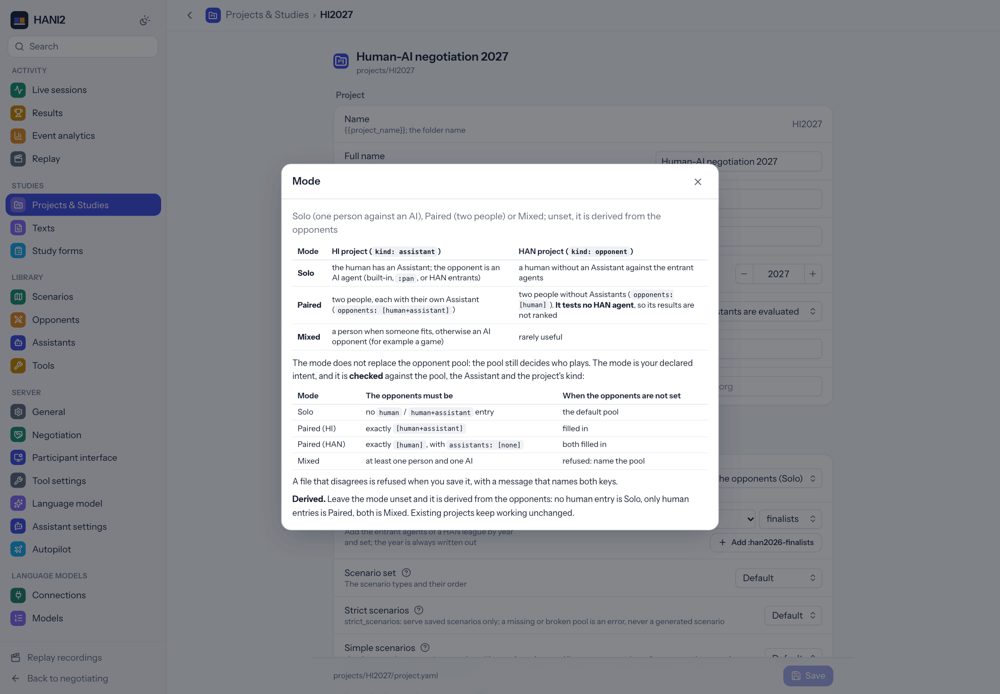
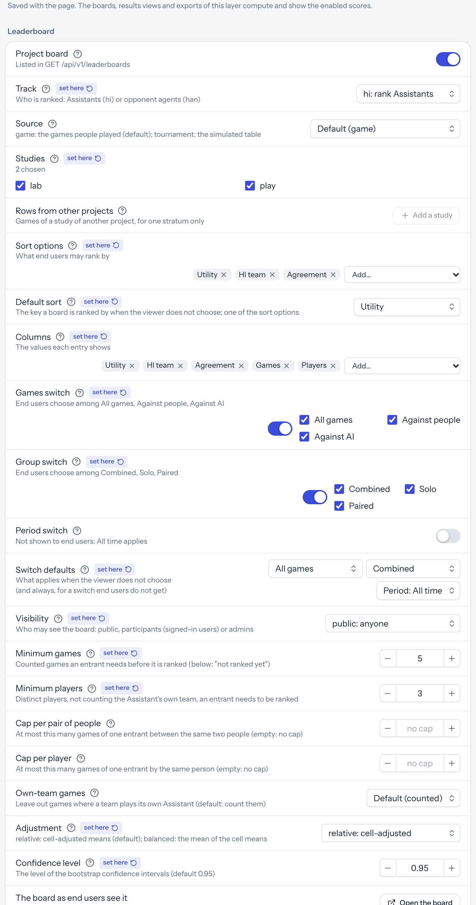
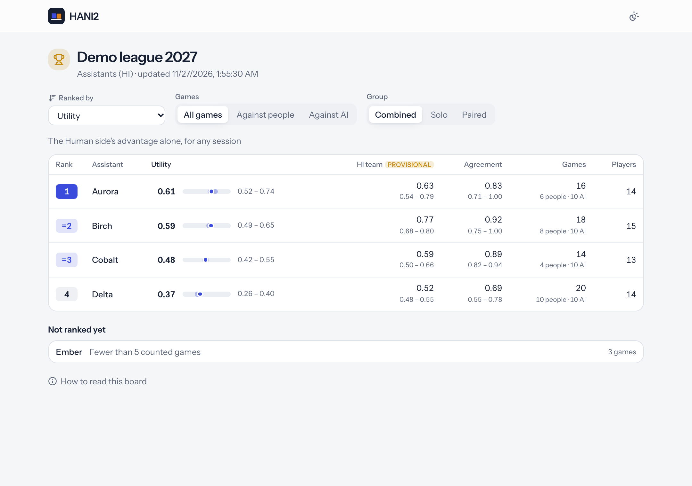
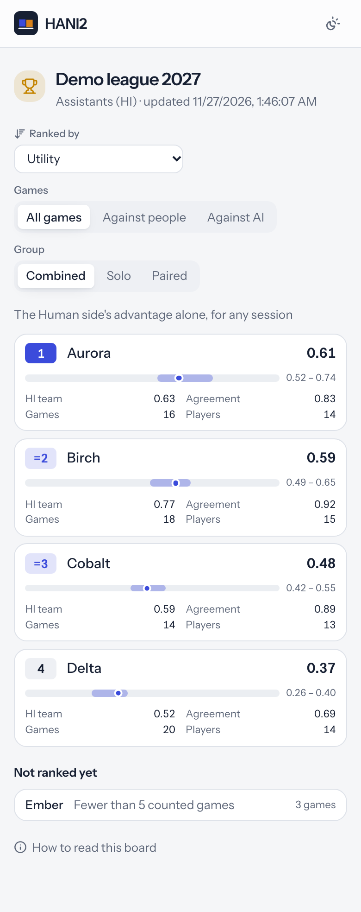
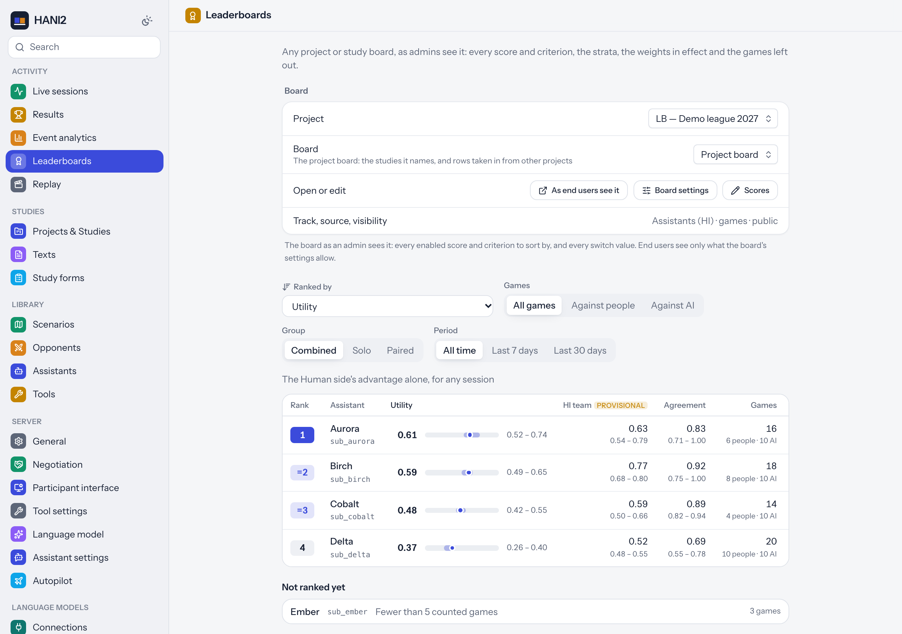
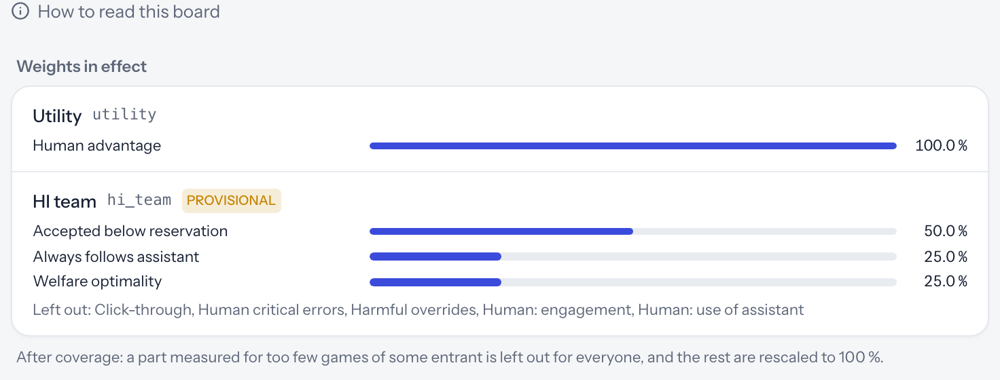

# Project management

One HANI2 server can run many data collections at once, each with its own texts, settings and results. They are organised as *projects* and *studies*. No restart is needed to add one: HANI2 reads the project and study files when a participant arrives.

This page is about projects: what they are, how to create and edit them, and the defaults they give their studies. Running one study (its type, its links, its assignment, its forms and its results) is described in [Study management](study-management.md).

## What a project is

| Term | Meaning | Examples |
|---|---|---|
| **Project** | A long-lived research or competition programme. It owns the participant-facing identity (name, year, organiser, contact, consent text) and the defaults its studies share. Its *kind* says what is evaluated: `opponent` (submitted opponents face humans), `assistant` (submitted assistants help humans) or `none` (plain research). | `HAN2027`, `HI2027` |
| **Study** | One data collection inside a project, with its own results. Its *type* is `prolific` (a Prolific study), `online` (you recruit people and send them a link) or `lab` (in person). See [Study types](study-management.md#study-types). | `hi-2027-01`, `han-lab-kyoto` |
| **Human** | The participant's side of a negotiation. | |
| **Assistant** | The AI helper on the human's side. | |
| **Opponent** | The other side. | |

The built-in project `default` holds every study you do not put in a project. Experiments from earlier versions are studies of this project (see [Migrating from experiments](study-management.md#migrating-from-experiments)).

### Folder layout

```text
$HANI2_HOME/projects/<project>/        default ~/negmas/hani2/projects
├── project.yaml          name, full name, kind, year, organiser, contact, defaults for its studies
├── consent.md            any settings file, shared by the project's studies (optional)
├── announcements.md
├── env.json, assistant_settings.json, questionnaires/, scenarios/, scenario_sets.yaml, ...
└── studies/<study>/
    ├── study.yaml        type, title, dates, Prolific study id, completion code, overrides
    ├── consent.md ...    optional per-study copies of any settings file
    └── results/          per-participant folders, events.db, recordings, group files
```

`HANI2_PROJECTS` moves the projects folder elsewhere.

User accounts are shared by all projects and studies.

## Creating and editing a project

A project can be created and edited in three ways, which all write the same `project.yaml`:

- the admin console's **Projects & Studies** page (see [Admin console](admin.md#projects-studies));
- the command line, `hani2 project create` (see [Command line](#command-line));
- the [admin API](#admin-api), `PUT /api/admin/projects/{project}`.

`create` on an existing project updates the given fields. `hani2 study create` also creates the project when it is missing.

Saving `project.yaml` (all three ways) checks the project's own defaults **and every study of the
project**, each with its overrides merged with the new project file: the study's mode against the
opponent pool it would play, and K ≤ N for the Assistants (see [Mode](study-management.md#checks-and-how-to-fix-the-errors)
and [K sessions per person over N Assistants](study-management.md#k-sessions-per-person-over-n-assistants)).
A change that would break a study is refused, naming the study and the problem:

```text
study HI2027/pairs: study_mode is 'paired' but opponents is [:pan]; a Paired HI study (kind: assistant)
needs opponents: [human+assistant]
```

Only problems the change adds block it: a study whose own file is already wrong is reported by that
study's checks and does not stop an unrelated project edit. The pool editor of the admin console
(`PUT /api/admin/pools/{kind}` on a project or study layer) runs the same checks on the file it
changes.

In the admin console, every choice that is not self-explanatory has a **?** after its name, which
opens an explanation of the choice and its values. The [Settings reference](settings-reference.md)
collects the same texts, with the key each choice writes.



### `project.yaml`

```yaml title="projects/HI2027/project.yaml"
full_name: Human-AI Interaction League 2027
short_description: People negotiate with the help of AI assistants.
link: https://example.org/hi2027
year: 2027
kind: assistant            # opponent | assistant | none
organizer: The Negotiation Lab
contact: lab@example.org
defaults:                  # every study of the project starts from these
  n_required: 4            # counted negotiations per participant
  practice: true           # one practice negotiation first
  practice_time_limit: 300
  counted_time_limit: 600
  minutes: 45              # expected maximum duration
  scenario_set: HI2027
  role_rule: auto
  strict_scenarios: true   # only saved scenarios; a missing pool is an error
  force_reserved_value: 0  # the participant's value on disagreement, in every negotiation
  opponents: [BoulwareTBNegotiator]
sponsor: ACME              # any other key is available to texts as {{project_sponsor}}
```

`full_name`, `short_description`, `link`, `year`, `organizer`, `contact` and any key you add yourself fill the [text variables](study-management.md#texts-with-variables) of every study of the project.

### Forcing the value on disagreement

`force_reserved_value` gives the participant (the human) the same value on disagreement in every
negotiation of a project or study, whatever each scenario says. The opponent's value on disagreement
stays as the scenario sets it; when two participants negotiate with each other, each gets their own
study's forced value. It is unset by default, and then every scenario keeps its own values. Set it in `project.yaml` (for all the
project's studies) or `study.yaml` (for one study; a study's value wins, and `0` is a value, not
"unset"). The number is on the scenario's utility scale: 0 to 1 for normalised scenarios, so `0`
means that any agreement is at least as good as none. In the console it is *Forced value on
disagreement* under *Projects*; the field starts empty (each scenario's own values), and its − button
sets it to 0.

The forced value is applied in memory when a scenario loads: saved scenarios are never changed, the
recorded scenario of each negotiation carries the value that was played, and the basic scenario info
records it as `forced_reserved_value`.

A setting given twice in `project.yaml` with different values (at the top level and again under `defaults:`) is refused when the file is saved through the admin API or the command line, and reported (server log, `hani2 project show`) when a hand-edited file has it; the value under `defaults:` is then used.

### What a study inherits

A study starts from its project:

- its settings come, first match wins, from an environment variable, the study's `overrides`, the project's `defaults` and the built-in default (see [`study.yaml`](study-management.md#studyyaml));
- every settings file (consent, welcome text, `env.json`, questionnaires, scenarios, …) placed in the project folder is used by every study that has no copy of its own (see [Settings files per study](study-management.md#settings-files-per-study));
- the project's opponent and Assistant groups are available to all its studies (see [Pools of opponents and Assistants](#pools-of-opponents-and-assistants)).

## Defaults for its studies

The keys of `defaults` may also be written at the top level. They are: `scenario_set`, `n_required`, `practice`, `practice_time_limit`, `counted_time_limit`, `time_limit`, `n_steps`, `minutes`, `role_rule`, `human_roles`, `strict_scenarios` (serve saved scenarios only, see [Strict scenarios](scenarios.md#strict-scenarios)), `simple_scenarios` (round numbers and plain shapes in generated scenarios, on unless switched off, see [Simple scenarios](scenarios.md#simple-scenarios)), `information` (what the participant and the Assistant each know, see [Who knows what](information.md)), `assistant_starts_on` (Prolific and online participants start with the Assistant switched on instead of off), `force_reserved_value` (the participant's value on disagreement in every negotiation of the study, whatever the scenario says; the opponent keeps the scenario's, see [Forcing the value on disagreement](#forcing-the-value-on-disagreement)), `questionnaires` (`false`: no questionnaire at all in this study, see [Where the questionnaire is looked up](study-management.md#where-the-questionnaire-is-looked-up)), `opponents` and `assistants` (the pools below), `scheduling` (how each study assigns them, see [Assignment](#assignment)), `study_mode` (Solo, Paired or Mixed, see [Mode](#mode-solo-paired-or-mixed)) and `pairing` (how people are paired, see [Pairing defaults](#pairing-defaults)).

A study changes any of them under `overrides:` in its `study.yaml`.

### Mode: Solo, Paired or Mixed

`study_mode` says who negotiates with whom. It takes one of three values:

| Mode | Meaning | In an HI project (`kind: assistant`) | In a HAN project (`kind: opponent`) |
|---|---|---|---|
| `solo` | One person per negotiation, against an AI opponent | The human has an Assistant; the opponent is an agent (built-in, `:pan` or HAN entrants) | A human without an Assistant against the entrant agents |
| `paired` | Two people negotiate with each other | Each side has its own Assistant (`opponents: [human+assistant]`) | Two people without Assistants (`opponents: [human]`). It tests no HAN agent, so its results are not ranked |
| `mixed` | A person when someone fits, otherwise an AI opponent | For example a game open to everyone | Rarely useful |

`study_mode` does not replace `opponents`: `opponents` still decides who plays (the human entries
`human` and `human+assistant` are described in [Human opponents](human-opponents.md)). The mode is
your declared intent, and HANI2 checks it against the pool, the Assistant and the project's `kind`:

| `study_mode` | `opponents` must be | Assistant | When `opponents` is missing |
|---|---|---|---|
| `solo` | no `human` / `human+assistant` entry | any (HI: not `[none]` only) | the default pool |
| `paired`, `kind: assistant` | exactly `[human+assistant]` | required, not `[none]` | HANI2 fills in `[human+assistant]` |
| `paired`, `kind: opponent` | exactly `[human]` | `[none]` | HANI2 fills in `[human]` and `assistants: [none]` |
| `paired`, `kind: none` | human entries only | either | `[human]` with `assistants: [none]`, else `[human+assistant]` |
| `mixed` | at least one human entry and one AI entry | any | refused: name the pool |

**When `study_mode` is not set**, the mode is *derived* from `opponents`: no human entry is
`solo`, only human entries is `paired`, both is `mixed`. Projects that never set it keep working
exactly as before; `hani2 project show` and `hani2 study show` print the derived mode with
"(derived from opponents)".

**When the mode and the pool disagree**, a file you save through the command line or the admin
API is refused, and the message names both keys and the pool the mode needs, for example:

```text
study_mode is 'paired' but opponents is [human, :pan]; a Paired HI study (kind: assistant)
needs opponents: [human+assistant]
```

In the admin console the **Mode** row offers Solo, Paired and Mixed, and its empty choice shows
the derived mode ("Derived from the opponents (Solo)"). When the mode and the pool disagree, a red
note under the row says why, and **Save** is refused with the same message.


A file edited by hand that disagrees is reported in the server log, in `hani2 study show` and in
the study's `errors` on the admin console, and **`opponents` wins**: the study runs with the
derived mode. The session's events record that mode, with `study_mode_error: true`. How a study
overrides the mode, and the checks made for each session, are in
[Mode](study-management.md#mode).

```yaml title="projects/HI2027/project.yaml"
kind: assistant
year: 2027
defaults:
  study_mode: solo
  opponents: [":han2027-finalists", ":pan"]
```

### Pairing defaults

The `pairing` block holds the options of studies where people meet (`paired` and `mixed`). A
study's block is merged key by key with its project's, so a study changes only the keys it names:

```yaml
pairing:
  scope: study            # study | project | code: where people meet
  assign: cells           # cells | order | random: how a match is formed
  slack: 1                # a whole number ≥ 0
  cell_scenario: type     # type | name
  allow_same_assistant: false   # may both sides use the same Assistant?
  fallback: ai            # ai | wait | end: when nobody fits in human_opponent_wait seconds
  fallback_opponents: null      # the AI pool of the fallback (AI entries only)
```

| Key | Default | Meaning |
|---|---|---|
| `scope` | `study` in a study that declares `study_mode: paired`, else `project` | Where people meet. `study`: only people of the same study meet. `project`: people of every study of the project meet, so two studies can be paired with each other. `code`: people meet only through a shared `?match=<code>` link; without a code a participant meets nobody (the wait-time fallback applies). A `?match=<code>` link pairs those who share it in every scope, unless `human_opponent_codes` is `false`. |
| `assign` | `cells` in a declared Paired study, else `random` | How the two people of a match are chosen: `cells` balances the match cells (scenario, Assistant at each side), `order` makes everyone follow their planned order strictly, `random` picks at random among the people who fit. |
| `slack` | `1` | How strictly `cells` balances: cells whose count is within `slack` of the emptiest are treated as tied, and chance decides among them. `0` is the strictest, but who meets whom becomes easier to predict. |
| `cell_scenario` | `type` | What "scenario" means in a cell: the scenario type (`type`) or the single scenario (`name`, which multiplies the number of cells by the scenarios per type). |
| `allow_same_assistant` | `false` | Whether both sides of a match may use the same Assistant. With one Assistant in the study's pool it is always allowed (no match could be formed otherwise). |
| `fallback` | `ai` | What happens when nobody fits within `human_opponent_wait` seconds: play an AI opponent with the Assistant already chosen (`ai`), keep waiting (`wait`, the same as `human_opponent_fallback: false`) or skip the slot (`end`: the next Assistant, or the end of the study when none is left). When `human_opponent_fallback` is also set in an `env.json` and the two disagree, the file is refused. |
| `fallback_opponents` | the study's AI pool, else `:pan` in a declared Paired study (else the built-in default pool) | The AI opponents of the fallback. Human entries are refused. |

Every key is checked when a file is saved (unknown keys and values not listed above are refused)
and reported when a hand-edited file has a problem. `assign`, `slack`, `cell_scenario`,
`allow_same_assistant` and `fallback` apply to a study declared `study_mode: paired`, and to any
other study that sets `assign: cells` or `assign: order` in its `pairing` block (for example a
Mixed game); `fallback` also applies wherever it is written. Other studies pair as they always did.
What each choice does, and what it can and cannot guarantee, is explained in
[Paired studies](study-management.md#paired-studies).

### HAN agents by year

The opponents of a study can be the entrant agents of a HAN league, by year and set:
`:han<year>-all`, `:han<year>-qualified`, `:han<year>-finalists` and `:han<year>-winners` (see
[Group tokens](opponents.md#group-tokens)). An HI study can name several years, for example
`opponents: [":han2026-finalists", ":han2027-finalists"]`. Always write the year itself: a project
of `year: 2027` that wants last year's finalists writes `:han2026-finalists`.

Where a year's agents come from:

- the **current year**, set explicitly as `han.current_year` in `env.json` (never taken from the
  clock), comes from that year's **submitted zips** (see
  [HAN agents of the current year](opponents.md#han-agents-of-the-current-year));
- **every other year** comes from the installed `han-agents` package;
- a year that neither covers has no agents: a file naming it is refused when saved ("no agents
  for 2025"), and a hand-edited one is reported, the group expanding to nothing.

In the admin console the **HAN agents** row of the defaults does this for you: choose a year and a
set, and **Add** writes `:han<year>-<set>` into the layer's opponent pool. The years offered are
those the two sources cover, plus the project's year and the year before; "this year" and "last
year" are labels computed from the project's **Year**, and a year that no source covers is greyed
out.

When a year's agents have been packaged into `han-agents`, raise `han.current_year` to the next
year: from then on the earlier year comes from the package. Games already played keep the source
and version they recorded (`opponent_han_year`, `opponent_han_source`, `opponent_han_version`, see
[`results.csv` columns](study-management.md#resultscsv-columns)). `hani2 study show` prints where
each `:han<year>-<set>` entry of a study's pool comes from.

### Pools of opponents and Assistants

A project shares its pools with all its studies:

```
projects/HI2027/
  project.yaml               # opponents: [":finalists"]   assistants: [":entries"]
  groups/finalists.json      # opponent group   {"agents": [...], "syspath": [...]}
  assistant_groups/entries.json   # Assistant group  {"assistants": [...], "syspath": [...]}
  studies/hi-2027-01/
    study.yaml               # may override opponents / assistants
    groups/ assistant_groups/   # optional groups of this study only
    results/
      groups/                # files an outside system drops (they win)
      assignments.json       # each human's index and Assistant
```

A token `:key` is looked up in the study's `results/groups/`, the study folder, the project folder,
the settings folder and finally the built-in groups (see [Group files](opponents.md#group-files)
and [Assistant groups](assistant.md#assistant-groups)). `hani2 groups list --project <P>` lists a
project's groups, and the admin API edits them (see [Admin API](#admin-api)).

**Self-hosted pools.** With

```yaml
hosted:
  assistants: true      # the Assistant pool: every hosted Assistant registered for the project and switched on
  opponents: false      # the same for opponents
  timeout: 30           # seconds HANI2 waits for a host per call
  max_failures: 3       # failed calls in a row before a hosted opponent walks away
```

in `project.yaml` (or a study's `study.yaml`), the teams' own hosts make up the pool (see
[Self-hosting an Assistant or opponent](self-hosting.md)). An `assistants:` or `opponents:` list
still wins and may name hosted agents itself as `remote:<name>`.

**The mode limits the opponent pool.** In the admin console (Opponents → **Opponents participants
face**), the pool of a project or study that declares a **Mode** offers only the entries that mode
allows:

| Mode | HI project | HAN project | Research (`kind: none`) |
|---|---|---|---|
| Solo | AI agents and groups, no human entry | the same | the same |
| Paired | `human+assistant` only | `human` only | `human` and `human+assistant` |
| Mixed, or no mode declared | everything | everything | everything |

An entry already in the pool that the mode does not allow is shown in red with the reason, and the
pool cannot be saved until it is removed. Without a declared mode the mode is derived from the pool,
so everything is offered. When no file names an opponent pool, the editor checks the mode against
the pool an `env.json` layer (the study's, the project's or the settings folder's) gives, and says
so under the **Mode** row.

### Assignment

A project chooses, for all its studies, how each dimension is assigned to the humans: the
opponents, the Assistants and the scenario types. A study can choose another method per dimension:

```yaml
scheduling:
  opponents: latin_square   # random, cyclic, fixed_order, external
  assistants: balanced      # random_fixed, round_robin, random_each, latin_square, cyclic,
                            # balanced_subset, random_subset, external
  scenarios: by_participant # set_order, random, latin_square, external
  cross: shift              # cross the Assistant with the opponent: shift (default) | none
  assistant_repeats: false  # may a person get one Assistant twice?
```

The Assistant methods fall into three families:

| You want | Assistant method | Each person gets |
|---|---|---|
| One Assistant per person (between-subjects; the game) | `balanced` (default), `random_fixed`, `round_robin` | one Assistant for all their negotiations |
| Every Assistant once (the finals: K = N) | `latin_square` (or `cyclic`) | every Assistant once, in a counterbalanced order |
| K of N Assistants (screening: K < N) | `balanced_subset` (or `random_subset`) | K different Assistants, with totals, positions and pairs balanced |

`n_required` is K, the counted negotiations per person. A method that promises "each Assistant at
most once" refuses a file where K is larger than the number of Assistants, unless
`scheduling.assistant_repeats: true`. When the Assistants change every negotiation and the opponents
use `latin_square` or `cyclic`, `scheduling.cross: shift` (the default) **crosses** them, so that
every Assistant meets every opponent equally often instead of always the same one.

In the admin console, the Scheduling group has a row for each of these. **K of N** compares the
counted negotiations ($K$, `n_required`) with the number of Assistants in the pool ($N$, after the
groups are expanded), and turns orange when $K > N$ under a method that promises each Assistant at
most once while **Repeats** is off: saving is then refused. **Repeats** sets `assistant_repeats` and
**Crossing** sets `cross`.

The rows follow the **Mode** as it is being edited:

- **Solo** and **Mixed** use every row. In Mixed, a game against an AI uses the Assistant method
  as a slot, and a match with a person uses it as a set (below).
- **Paired** has no AI opponent sequence, so the **Opponents** method and **Crossing** show *not
  used* (the AI fallback draws from **Fallback opponents**). The **Assistants** method gives each
  person a **set** of Assistants, and pairing picks from it: one-per-person methods give their one
  Assistant for every match, the at-most-once methods the first K of the person's sequence minus
  those used, `random_each` the whole pool, and `external` the Assistants of the person's
  `schedule.json`. With `scenarios: by_participant` people meet only people of the same scenario
  type; otherwise the joiner takes the host's scenario.
- A Paired **HAN** study plays without Assistants, so its **Assistants** row shows *not used*.

A method that a file sets for a dimension the mode does not use stays shown, with a note that it is
ignored, so that it can be reset. In the **Pairing** group, **How a match is formed** lists
`cells` first in a Paired study (its default) and `random` first in a Mixed one (the game's), and
each empty field shows the value the mode gives.

What these defaults do within a study is described in
[Assigning Assistants, opponents and scenarios](study-management.md#assigning-assistants-opponents-and-scenarios),
and every method, with its formulas and examples, in [Scheduling methods](scheduling.md).

## Scores

### Criteria

A **criterion** is any number HANI2 measures for a negotiation, and that a score can be built
from:

- every numeric column of every metric (outcomes, behaviour, the judge's ratings, the scales of the
  bundled questionnaire and the scores themselves);
- every numeric item (`q_<id>`) and every scale (`scale_<name>`, `scale_<name>_norm`) of the
  questionnaire a project or study shows after each negotiation;
- every numeric item and scale of its post-session questionnaire, as `post_q_<id>` and
  `post_scale_<name>`.

The [Criteria and scores reference](criteria.md) lists every metric column with its direction, its
default normaliser and its cost. Columns that are labels (`status`, `ended_by`, the factor levels,
the condition names) cannot be chosen.

**Levels.** Most criteria have one value per game (`negotiation`). A post-session answer has one
value per person (`participant`). It is credited to the games of that person **only when they used
one Assistant throughout**, for example in a game or a between-subjects study. When a person used
several Assistants, as in finals where everyone meets every finalist, the answer cannot be credited
to any one of them. Such criteria are then marked as not usable for HI scores, with the reason.

**Cost.** `live` criteria are computed when a game ends. `questionnaire` criteria need the
participant's answers. `judge` criteria need the offline language-model judge (`--llm`). A score
counts as `judge` as soon as one of its parts does.

#### Mapping every value to [0, 1]

Before values are weighted into a score, each one is mapped to $[0, 1]$, where 1 is the best value.
Every numeric column has a default **normaliser**, and a score may choose another one for any of its
parts:

| Normaliser | Rule | Default for |
| --- | --- | --- |
| `bounded` `[lo, hi]` | $(x - lo)/(hi - lo)$, clipped | columns with known bounds: `[0, 1]`, `0 or 1`, ratings of 1–7, `[−1, 1]`, utilities, every questionnaire item with the bounds of its type (`likert5`, `likert7`, `yes_no`, `select`, `min` / `max`) |
| `advantage` | clipped to $[0, 1]$: no better than no deal is 0 | `human_advantage`, `opponent_advantage` |
| `reciprocal` | $s/(s + x)$ | unbounded values where lower is better: counts, seconds, tokens, distances, US dollars |
| `saturating` | $x/(x + s)$ | unbounded values where higher is better, and unbounded values without a direction |
| `percentile` | the share of reference games with a lower value (ties count half) | any criterion, on request |
| `clip` `[lo, hi]` | your own bounds | any criterion, on request |

When the direction is `lower`, each rule is turned around ($1 - \cdot$). `reciprocal` and
`saturating` are the same rule seen from the two directions, so a count without a direction
(`n_offers`) becomes `reciprocal` as soon as a score says that fewer is better. Questionnaire items
marked `reverse: true` are already reversed, so a high value always means more of what the item
measures. A scale whose items have different ranges has no bounds for its raw mean; use its `_norm`
column instead.

In project and study files, and in the API, a normaliser is a small mapping:

```yaml
{kind: bounded, lo: 1, hi: 7}
{kind: reciprocal, scale: reference_median}    # or a fixed positive number
{kind: percentile}
{kind: clip, lo: 0, hi: 600}
```

#### The frozen reference

The scale $s$ of `reciprocal` and `saturating` is the **median** of the criterion in a reference set
of games, so the median game scores 0.5. When the median is 0 (most games have no error at all),
the mean is used, and 1 when the mean is 0 too. `percentile` uses the reference's quantiles.

If the reference were simply "all the games so far", every new game would change everyone's past
scores. A project therefore **freezes** its reference once:

```yaml
# project.yaml
defaults:
  normalisation:
    reference:
      studies: [pilot, prolific-01]   # default: every study of the project
      end: 2027-02-28                 # only games started on or before this day
```

```bash
hani2 scores freeze HI2027                       # uses normalisation.reference
hani2 scores freeze HI2027 --studies pilot --end 2027-02-28
hani2 scores freeze HI2027 --llm                 # also the judged criteria (may run the judge)
```

`hani2 scores freeze` evaluates the counted games of those studies: practice rounds and simulated
participants are left out, unless you add `--include-simulated`. It stores, for every criterion, the
number of games, the median, the mean, the minimum and maximum, the scale and 101 quantiles in
`projects/<project>/results/normalisation.json`. The `normalisation` block may also be written at
the top level of `project.yaml`. Freeze again only when you mean to
change the scale for everyone. Until a project has a frozen reference, its scales come from the
current data and are labelled **provisional**.

#### Listing the criteria

```bash
hani2 scores criteria                       # the current study's criteria
hani2 scores criteria HI2027/play --coverage   # with the share of the study's games that have each value
```

Admins get the same list from `GET /api/admin/criteria?project=<project>` or
`?study=<project>/<study>`, with `&coverage=true` for the coverage. Each entry has its `id`, `title`,
`description`, `source`, `level`, `direction`, `normaliser`, `cost`, `coverage`, `group` (its group of similar measures) and `validated` (see the [Metric catalogue](metric-catalog.md)); the response's `groups` lists the groups in order. The response also
gives the normaliser kinds and a summary of the project's reference (whether it is frozen, when, from
which studies and how many games). Coverage is computed from the games without the judge, so judged
criteria and post-session answers show no coverage (`null`) there.

### Defining a score

A **score** is a weighted mean of criteria, each first mapped to $[0, 1]$, so every score is in
$[0, 1]$ too, with 1 as the best value. Define scores in `project.yaml` under `scores:` (at the top
level or under `defaults:`). The key is the score's name in results, exports and boards:

```yaml
# project.yaml
scores:
  hi_score:
    title: HI-score
    description: The team's result, the Assistant's help and how people experienced it
    track: hi                    # hi (ranks Assistants) | han (ranks opponents) | any
    components:
      - {criterion: human_advantage,       weight: 0.30}
      - {criterion: welfare_optimality,    weight: 0.10}
      - {criterion: ja_overall,            weight: 0.15}            # judged by a language model
      - {criterion: hi_team,               weight: 0.15}            # a score inside a score
      - {criterion: scale_tam_usefulness,  weight: 0.10}            # a questionnaire scale
      - {criterion: q_ueq_2,               weight: 0.05}            # one questionnaire item
      - {criterion: irrational_accept,     weight: 0.10}            # direction lower comes from the catalogue
      - {criterion: n_offers, weight: 0.05, direction: lower,
         normaliser: {kind: reciprocal, scale: reference_median}}
    missing: renormalise         # renormalise | zero | skip_game
    min_coverage: 0.5
    needs_assistant: true        # empty for sessions without an Assistant
```

Each component names a criterion and its weight. It may also give:

- a `direction` (`higher` or `lower`). This is **required** when the criterion has none in the
  catalogue (the descriptive columns such as `n_offers` or `negotiation_seconds`, and questionnaire
  items that are not part of a scale and give no `direction`);
- a `normaliser`, which replaces the criterion's default (see [Mapping every value to [0, 1]](#mapping-every-value-to-0-1));
- a `label`, a short text for tables.

`title`, `description`, `track` (default `any`), `missing` (default `renormalise`),
`min_coverage` (default 0.5) and `same_assistant` (default `once`: how a board counts a game where
both people used the same Assistant, see [Which games count](#which-games-count); `skip` leaves such
games out of the score), `zero_if` (default: none) and `needs_assistant` (default `false`, see
[Rules for failures and sessions without an Assistant](#rules-for-failures-and-sessions-without-an-assistant))
are optional.

**Weights are ≥ 0 and sum to 1** (100 %, to within $10^{-6}$). The admin API and `hani2 scores set`
refuse any other sum, and suggest rescaling (**Normalise**). A weight of 0 keeps a component in the
definition without using it. If a file edited by hand has weights that do not sum to 1, HANI2
rescales them when it reads the file, and writes a warning to the server log and to the project's
or study's `errors` (shown in the admin console and by `hani2 scores check`).

**Names.** A score's key starts with a letter and has only letters, digits and `_`. It must not be
the name of a column (`agreement`, `n_offers_coverage`, …), look like a questionnaire answer
(`q_…`, `scale_…`, `post_…`) or be a built-in score.

**What is checked.** Every criterion must be known: a metric column, an answer of the questionnaires
the project or study uses, or a score. Every component needs a direction and a normaliser, from the
catalogue or its own. No score may contain itself, directly or through other scores. A score with a
problem is left out of the project's scores, and `hani2 scores check` names the problem.

#### Missing values

A game may lack a value: no questionnaire answer, no judge run yet. `missing` says what happens then:

| `missing` | A missing value | Example: `human_advantage` 0.6 (weight 0.5), `ja_overall` missing (weight 0.5) |
| --- | --- | --- |
| `renormalise` (default) | is left out, and the weights of the values present are rescaled to sum to 1 | 0.6 |
| `zero` | counts as 0 | 0.3 |
| `skip_game` | the game gets no value for this score and does not count for it | none |

Whatever the policy, `<score>_coverage` is the share of the weight whose values were present (0.5 in
the example).

#### Coverage across entrants

A component that is present in fewer than `min_coverage` of **some** entrant's games is dropped for
**everyone**, and the remaining weights are rescaled to sum to 1. Every entrant is then scored on
the same parts. If one Assistant's participants skipped the questionnaire, for example, the
questionnaire parts are left out for every Assistant rather than counting only for some. Boards show
the weights in effect and the parts that were dropped.

#### Scores inside scores

A score is already in $[0, 1]$, so it can be a component of another score (`hi_team` above). Its
direction is `higher` and its normaliser `bounded [0, 1]`. Cycles are refused. `hani2 scores show`
also prints the weights **flattened** down to criteria: `hi_team` with weight 0.15 shares its 0.15
among its own parts.

#### Rules for failures and sessions without an Assistant

Two optional keys decide, before the components are looked at, whether a game gets the usual value:

| Key | Default | The game's score |
| --- | --- | --- |
| `zero_if: [<criterion>, ...]` | none | **0** (with coverage 1) when one of these criteria is 1 in the game |
| `needs_assistant: true` | `false` | **empty** (no value, no coverage) when the human played without an Assistant |

```yaml
scores:
  my_han_outcome:
    track: han
    components:
      - {criterion: opponent_advantage, weight: 1}
    zero_if: [opponent_failed]        # an opponent agent that failed gets 0
  my_team:
    track: hi
    components:
      - {criterion: irrational_accept,  weight: 0.5}
      - {criterion: jh_engagement,      weight: 0.5}
    needs_assistant: true             # a game without an Assistant says nothing about one
```

Every entry of `zero_if` must be a known criterion (usually a 0/1 column such as `opponent_failed`).
`han_outcome` has `zero_if: [opponent_failed]`; `hi_assistant`, `hi_team` and `hi_interaction` have
`needs_assistant: true`.

### Built-in scores

Every project has the built-in scores. They are read-only, written in the same format, and their
weights are shown rescaled to sum to 1:

| Score | Track | What it measures |
| --- | --- | --- |
| `utility` | any | the Human side's advantage alone (`human_advantage`) |
| `hi_outcome` | hi | what the human–Assistant team obtained |
| `hi_assistant` | hi | how well the Assistant worked as an Assistant |
| `hi_team` | hi | how well the human–Assistant team worked together |
| `hi_interaction` | hi | the mean of `hi_assistant` and `hi_team` |
| `han_outcome` | han | what the opponent agent obtained (0 when it failed) |
| `han_interaction` | han | how well the opponent agent behaved as an opponent |

The [Criteria and scores reference](criteria.md#source-score) and the
[metric reference](metrics.md) give their parts and weights. To change one, **duplicate** it into
the project, where it can be edited:

```bash
hani2 scores duplicate HI2027 hi_assistant my_assistant
```

The copy starts with the same parts, weights, normalisers and rules (`zero_if`, `needs_assistant`),
so until you change it, it gives the same values as the original.

### Which scores a study uses

`scores_enabled` lists the scores that are computed and shown in a study's boards, results views
and exports. The project sets the default and a study may override it:

```yaml
# project.yaml
scores_enabled: [hi_score, utility, hi_outcome, hi_interaction]
```

Without `scores_enabled`, every built-in score and every score of the project (and of the study) is
enabled. An enabled score is computed together with the scores inside it. A study can also add
scores and redefine the project's scores, key by key (see
[Study management](study-management.md#the-studys-scores)).

### Checking and editing scores

In the admin console, the **Scores** group of a project lists every score. Built-in scores are
read-only and have **Duplicate**; your own have **Edit** and **Remove**. **New score** opens the
score builder:


- pick criteria from the searchable catalogue, grouped by source; each shows its direction, its
  default normaliser, its cost and, on request, its coverage in the current games, and criteria
  that cannot be used are greyed out with the reason;
- give each component a weight in %; the running sum turns green at 100 %, **Save score** works only
  then, and **Normalise** rescales the weights to 100 % keeping their proportions;
- the direction and the normaliser of each component start from the criterion's own (*Preset*);
  a criterion without a direction must be given one.

The builder saves the score at once, through the admin API, with the same checks as
`hani2 scores set`. **Scores enabled** below it is saved with the page. Editing a score keeps its
**Zero if** (`zero_if`) and **Needs an Assistant** (`needs_assistant`) rules, which the builder also
sets (see [Rules for failures and sessions without an Assistant](#rules-for-failures-and-sessions-without-an-assistant)).

### Previewing a score

While you build a score, the **Preview** under its components computes it on the games the board of
the project (or of the study) reads, as the board would rank them, and updates a moment after each
change. Nothing is saved:

- **Weights in effect**: each component's share after the coverage rule, summing to 100 %. Weights
  that do not sum to 100 % yet are previewed rescaled.
- **Dropped**: components present in fewer than **Minimum coverage** of some entrant's games, which
  are left out for everyone.
- **Distribution over the games**: a histogram of the score's values over the counted games, in ten
  bins of [0, 1], with the mean, the median and the coverage.
- **Top entrants**: the first five by the score's mean, with the 95 % interval and the games counted.

A score with the track `hi` or `han` is previewed on that track's games. A definition that cannot be
computed (an unknown criterion, a missing direction) shows why instead. The same preview is
`POST /api/admin/scores/preview?project=P` (or `?study=P/S`) with
`{"key": "hi_score", "score": {...}}`: it answers `weights_in_effect`, `dropped`, `histogram`,
`stats`, `games`, `entries` (the top five) and `n_entrants`, or `problems`.

From the command line:

```bash
hani2 scores list HI2027                 # every score: * enabled, where it is defined, its track
hani2 scores show HI2027/play hi_score   # weights in effect, directions, normalisers, flattened weights
hani2 scores show HI2027/play hi_score --coverage   # and the share of the games with each value
hani2 scores check HI2027 [--coverage]   # exits with 1 when anything is wrong
hani2 scores set HI2027 hi_score -f hi_score.yaml   # add or replace one (refused unless it passes)
hani2 scores remove HI2027 hi_score
hani2 scores enable HI2027 hi_score,utility         # scores_enabled (--default removes it)
```

`check` applies the checks of saving, so weights that do not sum to 1 are a problem there, even
though loading rescales them. With `--coverage` it also evaluates the games (without the judge),
applies the rule for post-session answers and prints how many games have a value for each enabled
score. A score cannot be removed while another score contains it or `scores_enabled` names it.

## Leaderboards

A **project board** ranks the entrants of a project over the studies it names: for example the
year's game and its Prolific studies, in one table. A **study board** shows one study. Both are
built by one function with one set of rules, whoever reads them: `hani2 leaderboard show`, the admin
console and the [leaderboard API](#the-leaderboard-api) that a trusted website (for example the
competition's site) reads. A website therefore shows exactly the board HANI2 computes, and keeps no
rules of its own.

| Track | Entrants | Strata |
|---|---|---|
| `hi` | the Assistants: the `entrant` id of their group file, else their spec | `combined` (default), `solo` (AI opponents, including the fallbacks of Paired studies), `paired` (a person on the other side) |
| `han` | the opponent agents | `alone` (default, the official board: people without an Assistant), `vs_team` (people with an Assistant), `both` (the two pooled, labelled as such) |

### Configuring a board

The `leaderboard` block of `project.yaml` configures the project board. A study's `study.yaml`
overrides it key by key for the study's own board (see
[The study's board](study-management.md#the-studys-board)). Every key is optional:

```yaml
leaderboard:
  track: hi                         # hi: entrants are Assistants; han: entrants are opponents
  source: game                      # game (default) | tournament (the simulated table)
  studies: [play, prolific-03]      # project board: which studies feed it (default: all)
  include:                          # rows from other projects, each with its stratum
    - {study: HI2027/play, stratum: vs_team}       # for example on HAN2027's board
  sort_options: [hi_score, utility, agreement]     # what end users may sort by
  default_sort: hi_score
  columns: [hi_score, utility, agreement, games, participants]
  user_options:                     # the switches end users get, with their allowed values
    games:   [all, people, ai]
    stratum: [combined, solo, paired]
    window:  [all, last_30_days]
  defaults: {games: all, stratum: combined, window: all}
  visibility: participants          # public | participants | admins
  rules: {min_games: 10, min_participants: 3, max_games_per_pair: 3,
          max_games_per_participant: 20, exclude_own: false, adjust: relative, ci: 0.95}
  update: pooled                    # pooled (default) | latest | continuous (see below)
```

| Key | Default | Meaning |
|---|---|---|
| `track` | `han` for a project of kind `opponent`, else `hi` | Who is ranked. |
| `source` | `game` | `game`: the games people played. `tournament`: the table of simulated participants (each Assistant's goal rate over the personas), ranked by goal rate only, without switches ([below](#the-game-board-and-the-simulated-table)). |
| `studies` | every study of the project | The studies that feed the project board. Add new ones as they start; a study that does not exist yet is named in the board's warnings. |
| `include` | none | Studies of other projects whose games of one stratum join the board ([below](#rows-from-other-projects)). |
| `sort_options` | the enabled scores of the track | What end users may rank by: enabled scores, and criteria that have a direction. |
| `default_sort` | the first sort option | Must be one of `sort_options`. |
| `columns` | the sort options, `games`, `participants` | The values each entry shows. Scores and criteria come with a mean and a confidence interval; `games`, `participants`, `guests`, `abandon_rate` and `cost_usd` are counts. |
| `user_options` | none | The switches end users get, each with its allowed values. |
| `defaults` | `games: all`, the first stratum, `window: all` | The value of each switch when the viewer does not choose. |
| `visibility` | `participants` | Who may see the board ([below](#visibility)). |
| `rules` | see [Which games count](#which-games-count) | Minimums, caps, own-team games, adjustment, confidence level. |
| `update` | `pooled` | How games combine over time: `pooled`, `latest` or `continuous` ([below](#leaderboard-update-modes)). |

**Sorting.** A score is ranked by its entrant-level mean, and a criterion by its mean in its own
direction (a criterion where lower is better, such as `irrational_accept`, ranks upwards). End
users may sort only by `sort_options`; admins may sort by any enabled score or criterion with a
direction.

**Switches.** `games` is `all`, `people` (games against another person) or `ai` (against an AI
opponent, including fallbacks); `stratum` is one of the track's strata; `window` is `all` or
`last_<n>_days`. End users get only the switches listed in `user_options`, each with only the values
listed there; a switch that is not listed is not shown, and its default applies. Admins may use every
value.

**Checks when saving.** `hani2 project create`, `hani2 study create` and the admin console refuse a
block whose keys are not known, whose switch values or defaults are not allowed, whose
`default_sort` is not one of `sort_options`, or whose `sort_options` and `columns` are not enabled
(`scores_enabled`) in every study the board reads. A study that disables a score its board sorts by
is refused too. A hand-edited file that breaks these rules is still served: what cannot be used is
left out and named in the board's `warnings`.

### Leaderboard update modes

`update` says how a board combines games played at different times:

| `update` | Which games | Use it for |
|---|---|---|
| `pooled` (default) | Every counted game, each weighing the same. | A study that runs once, or entrants whose code is fixed. |
| `latest` | Only the newest **tournament**. Each study of the board is one tournament, and the newest by its latest game replaces the board; an entrant missing from it is not listed. The notes name the tournament, and `excluded` counts the earlier games. | Periodic or aperiodic competitions in which every round replaces the previous ranking. |
| `continuous` | Every counted game, with recent games weighing more. Nothing assumes that an entrant's code stays the same. | Self-hosted agents ([Self-hosting](self-hosting.md)): teams may change their agent at any time, and we cannot see its code. |

A continuous board takes options:

```yaml
leaderboard:
  update: {mode: continuous, method: kalman, drift_sd: 0.1, z: 1.0, change_h: 5}
  # or {mode: continuous, method: decayed, half_life_days: 30, shrinkage: 5}
```

* **`method: kalman`** (default). Each entrant's skill is a level that drifts over time (`drift_sd`
  per 30 days). Every game is a noisy observation of the level. The observation noise and the prior
  come from the board's own games, so an entrant with few games is pulled toward the field.
    * The board ranks by the **lower bound** `mean − z·sd`, so a new entrant, an idle one (its
      uncertainty grows while it does not play) or one that just changed is not ranked above an
      established one on a few lucky games. Use `rank_by: mean` to rank by the mean instead.
    * A **change flag** (a two-sided CUSUM test on the filter's surprises, threshold `change_h`) marks
      a probable new version when the results shift. The estimate then re-learns within a few games
      instead of averaging the old and new versions.
    * A change of the version the entrant declares (`assistant_version` / `opponent_version`, from
      self-hosted agents) does the same. It is only a hint (`version_hint: false` ignores it): a
      declared version never splits an entrant.
* **`method: decayed`**. An exponentially time-decayed mean with half-life `half_life_days`, pulled
  toward the field's mean by `shrinkage` games.

The filter reads each game's **cell-adjusted** value (the same adjustment as `rules.adjust`), so a
change in the mix of scenarios or opponents is not read as a change in the entrant. On a continuous
board each entry's `values[k].mean` and `ci` are the filtered mean and `mean ± z·sd`, and the entry
gains a `rating` field: `mean`, `sd`, `lower`, `score` (what the rank uses), `n_eff`, `first_game`,
`last_game`, `versions` and `changes` (time and kind of each flagged change). The notes say which
entrants were flagged. `min_games`, `min_participants` and the switches work as on every board.

The same rules are available outside HANI2 in the module `hani2.ratings`, which needs only the Python
standard library. Another site can import it, or run
`python -m hani2.ratings '{"mode": "continuous"}' < games.jsonl`, where each line is
`{"entrant", "time", "value", "version"?, "tournament"?}`.

### Setting up a board in the admin console

In **Projects & Studies**, open the project: its **Leaderboard** group edits the `leaderboard`
block, and the study page has the same group for the study's own board. Every row has a `?` that
explains the choice (the same text as in the [Settings reference](settings-reference.md)). Changes
are saved with the page's **Save**.



| Row | What it sets |
|---|---|
| Project board | Turns the project's `leaderboard` block on. With it the board is listed by `GET /api/v1/leaderboards`; without it, the board still exists with the defaults but is not listed. |
| Track, Source | `track` and `source`. |
| Studies | `studies`: every study of the project until you choose some. |
| Rows from other projects | `include`: a study of another project and the one stratum it feeds. |
| Sort options, Default sort | `sort_options` (enabled scores, and criteria with a direction) and `default_sort`, which offers only the sort options. Removing the default from the sort options moves the default to the first remaining one. |
| Columns | `columns`: enabled scores, the counts and any criterion. |
| Games, Group and Period switch | `user_options`. The switch toggles whether end users get it, and the boxes are its allowed values. **Group** is the stratum: Combined, Solo and Paired for HI, Alone, With an Assistant (`vs_team`) and Both for HAN. A switch with a single value is not shown. |
| Switch defaults | `defaults`, offering only each switch's allowed values. |
| Visibility | `visibility`. |
| Minimum games, Minimum players, Cap per pair of people, Cap per player, Own-team games, Adjustment, Confidence level | `rules` (empty caps mean no cap). |
| The board as end users see it | Opens `/s/<project>/leaderboard` (or the study's page) in a new tab. Save first to see a change. |

A row marked **set here** is written in this file; its reset button goes back to what the row
inherits (the defaults for a project, the project's value for a study), which its menu names. The
same checks as on the command line apply when saving, so a block that would break the board is
refused with the reason.

### Rows from other projects

`include` takes games from a study of another project into the board, for **one stratum** only.
The typical use is a HAN board that also shows how this year's HAN agents fared against people
**with** an Assistant, in the HI project's games:

```yaml
# HAN2027/project.yaml
leaderboard:
  track: han
  studies: [play]
  include: [{study: HI2027/play, stratum: vs_team}]
  user_options: {stratum: [alone, vs_team]}
  defaults: {stratum: alone}
```

The official HAN board stays `alone`. The HI games against HAN agents are a stratum of their own,
`vs_team`, whose cells are scenario × Assistant (the Assistant makes a game harder or easier for
the agent). The two are pooled only when a viewer asks for `both`, and that view is labelled as
pooled.

### Which games count

| Rule | Value |
|---|---|
| Games counted | Games against people (Paired matches) and against AI opponents (including the fallbacks of Paired studies), shown apart with the `games` switch and combined by default. |
| Entrant | HI: the row's Assistant, by the `entrant` id of the participant's group file, else its spec. HAN: the opponent agent. |
| Guests | A guest invited by a participant plays with the inviter's Assistant, so their games count for it. `guests` counts them; no name is ever shown. |
| Not counted | Practice rounds; simulated participants; admin, participant-view and playground sessions (`counted` false); system failures; abandoned matches (both rows: they show only in the Assistant's `abandon_rate`). In HI, games the opponent agent broke are not the Assistant's fault and are left out too. |
| Same-Assistant games | A game where both people used the same Assistant (an inviter against their guest) is left out of `utility`, and counts **once** (the mean of its two rows) in other scores, unless the score says `same_assistant: skip`. |
| Minimums | `min_games` counted games (default 10) **and** `min_participants` distinct players who are not the Assistant's own team (default 3). Below either, the entrant is listed under `unranked` ("not ranked yet") with the reason. The minimums count every counted game of the board, whatever the switches show, so an entrant does not drop in and out of the ranking when a viewer changes a switch. |
| Caps | `max_games_per_pair` (games of one entrant between the same two people) and `max_games_per_participant` (games of one entrant by one person); empty means no cap. Games over a cap are left out, the latest first, and counted under `excluded: cap`. |
| Own-team games | Counted. `exclude_own: true` leaves them out (`excluded: own team`). |

Every board says what it left out and why under `excluded` (`practice`, `admin or test session`,
`simulated participant`, `abandoned`, `system failure`, `opponent failure`, `human opponent`, `cap`,
`own team`).

### Confidence intervals and ties

- Values are cell-adjusted (`adjust: relative`, the default): each game's value minus the mean of
  its cell over all entrants, plus the overall mean, so the numbers stay on the values' scale. A
  cell is a scenario with an opponent (Solo games), or a scenario, a side and the opposing Assistant
  (Paired games). This is right for a game, where entrants play different and uneven cells. Planned
  studies, where every entrant plays every cell, can use `adjust: balanced` (the mean of the cell
  means).
- Every value stays within its bounds: a score in [0, 1], and a bounded criterion (a rate such as
  `agreement`, a questionnaire answer) within its own range. The cell adjustment and the bootstrap
  can step past a bound (an agreement rate of 1 in a hard cell would become more than 1), so means
  and interval ends are clipped to the bounds afterwards. The board's `notes` say which values were
  clipped. Criteria without fixed bounds, such as counts and seconds, are not clipped.
- The interval is a percentile bootstrap at the level `ci` (default 0.95) that resamples
  participants. When an entrant has a single participant, it resamples games instead, and the entry
  says `ci_unit: session`.
- An entrant whose interval overlaps the leader's is tied with it: `tied_with_leader` is true, shown
  as "=2". Entrants with the same mean share a rank.
- A score that needs the language-model judge is **provisional** while fewer than 80 % of its games
  were judged. Until a normalisation reference is frozen (`hani2 scores freeze`), scores with
  unbounded criteria are scaled on the current games and are provisional too. The board's `notes`
  say which reference it uses.

### Visibility

| `visibility` | Who may read the board |
|---|---|
| `public` | Anyone, without signing in or a token. |
| `participants` (default) | Signed-in users, and a website with an [API token](#api-tokens) (`leaderboard:read`). An invited guest sees only the board of the study they were invited to. |
| `admins` | Admins, and a website with an API token whose scope holds `leaderboard:admin`. Signed-in users, and tokens with only `leaderboard:read`, get *403*; such tokens do not see these boards in `GET /api/v1/leaderboards` either. |

No board ever contains a user name, the other person's name, who invited a guest or a participant
index: only entrants and counts.

### The leaderboard pages

Every board has a page that needs no other website:

| Page | Board | Who sees it |
|---|---|---|
| `/s/<project>/leaderboard` | the project board | per the project's `visibility` |
| `/s/<project>/<study>/leaderboard` | that study's board | per the study's `visibility` |
| `/leaderboard` | a list of the boards the viewer may see | anyone |

The pages read the same [leaderboard API](#the-leaderboard-api) a website reads, as end users get
it. They offer only the sort options and switches the board allows, so an admin who opens them sees
exactly what everyone else sees. A board for `participants` asks visitors who are not signed in to
sign in, and a board for `admins` tells a participant it is not open to them.



- **Ranked by** lists the sort options. A score marked *provisional* is still waiting for the judge,
  or for a frozen normalisation reference.
- The value the board is ranked by is shown with its confidence interval: the band is the interval
  and the dot is the mean. The other columns show their mean, with the interval under it.
- **=2** marks an entrant that is tied with the leader, because their intervals overlap.
- **Not ranked yet** lists the entrants below the minimums, each with the reason (for example
  "Fewer than 10 counted games").
- **How to read this board** gives the confidence level, the minimums, what was left out (counts
  only) and the board's notes.
- The chosen view is kept in the address (`?sort=hi_team&games=people`), so a link opens the same
  view. A link whose values the board no longer allows opens the board's defaults.
- No user names appear anywhere: only the entrants and counts.

On a phone, each entrant is a card with its rank, its value and interval, and the other columns
under them:

{ width="320" }

### Admin → Leaderboards

**Leaderboards** (in the admin console's Activity group) shows any project or study board as an
admin reads it:

- **Ranked by** offers the board's sort options, every enabled score and every criterion that has a
  direction, grouped by source.
- Every switch offers every value. **Group** shows the strata as tabs: Combined, Solo and Paired for
  HI; Alone, With an Assistant and Both for HAN.
- The entries also show the entrant ids.
- **Weights in effect** shows each score's weights after coverage, the parts left out for
  everyone, and whether the score is provisional.
- **Games left out** shows the counts of `excluded`, with the games and deals in the view.
- **Rules in effect** and **Warnings** show the rest of the board.
- **As end users see it** opens the end-user page. **Board settings** and **Scores** open the
  project or study in Projects & Studies, at its Leaderboard or Scores group.





### Where the numbers come from

A board never re-reads recordings. When a game's row is written, the metrics that need no language
model are computed from its recording in the background and stored in
`<study results>/eval_cache/<recording id>.json`; when the recording is closed (it may then hold the
post-game questionnaire) the entry is computed again. A board reads these files, and computes any
entry that is missing or out of date, so it is right even for games recorded before the cache
existed. Post-session answers are joined onto a participant's games only when they used one
Assistant throughout (see [Questionnaire answers in scores](study-management.md#questionnaire-answers-in-scores)).

```bash
hani2 leaderboard refresh HI2027            # rebuild the cache of every study the board reads
hani2 leaderboard judge HI2027 --limit 200  # run the judge on games not judged yet
hani2 leaderboard show HI2027               # the board as an admin sees it
hani2 leaderboard show HI2027 --as-user --sort utility --games people --json   # what end users get
hani2 leaderboard list                      # every project that has a board
```

`refresh` keeps the judge's values; `judge` adds the judged criteria to the same files (pass
`--judge provider:model` to use one model, `--again` to judge every game again).

### The game board and the simulated table

For an HI project the board ranks the games people played (`source: game`), which is the default.
`source: tournament` shows the table of simulated participants instead: each Assistant's goal rate
(deals worth at least the persona's reservation value) over its valid simulated trials. It stays
available for qualifying rounds.

The simulated table is ranked by `goal_rate` and has no switches, so its `options` contain only
`sort: [goal_rate]` and `defaults: {sort: goal_rate}`, whatever `sort_options` and `user_options`
say. A request with another `sort`, or with `games`, `stratum` or `window`, gets a **400** that says
the simulated table does not take it.

## Connecting a website

There are two ways to run HANI2.

**Standalone.** HANI2 runs the whole study: create the project and the study, give out the link it prints, and HANI2 shows the consent form and the questionnaires, assigns scenarios and opponents, and ends with the completion code, the Prolific redirect or a thank-you page.

```bash
hani2 project create HI2027 --kind assistant --full-name "Human-AI Interaction League 2027" --year 2027
hani2 study create HI2027/hi-2027-01 --type prolific --title "January run" --completion-code C1A2B3
hani2 --host 0.0.0.0 --no-browser
```

**Driven by an outside system** (for example a trusted website such as a competition's site, which recruits participants and schedules the opponents). Such a system usually starts one HANI2 process per league with `HANI2_EXPERIMENT=<wave>`, `--root-path`, `--assistant on|off` and `--page play`, sends participants to `<root>/play?PROLIFIC_PID=<pid>&group=<key>`, writes `schedule.json` and `groups/<key>.json` into the results folder and sets `PROLIFIC_*` variables. All of this works unchanged: the wave is the default study of that process, its results stay in `$HANI2_EXPERIMENTS/<wave>/results/prolific_<PID>/` with the same files and columns (new columns are only ever added), and the rule is that **an outside system's explicit input wins**: environment variables, `schedule.json`, group files and query parameters always take precedence over what `project.yaml` and `study.yaml` say. HANI2's own project and study settings only fill in what is not given.

### The leaderboard API

A website reads boards with plain `GET` requests:

| Endpoint | Returns |
|---|---|
| `GET /api/v1/projects/{project}/leaderboard?sort=&games=&stratum=&window=` | The project board. |
| `GET /api/v1/projects/{project}/studies/{study}/leaderboard?…` | One study's board. |
| `GET /api/v1/leaderboards` | Every project that has a `leaderboard` block, with its track, source, year and visibility, and the visibility of each study's board. Without a sign-in or a token only public boards are listed; `admins` boards are listed only to admins and to tokens with `leaderboard:admin`. |

The parameters are optional: each missing one takes the board's default. A value outside the
board's `sort_options` or `user_options` is refused with **400**, so a website can only show the
views the project allows. An unknown project or study gives 404; a board the caller may not see
gives 401 (no sign-in, no token) or 403 (see [Visibility](#visibility)). Each response carries an
`ETag`; send it back as `If-None-Match` to get a 304 when nothing changed, or cache on
`data_version`.

A signed-in admin gets every enabled score and every switch value. Add `view=user` to get the
board exactly as end users get it, with only the board's sort options and switches (the
[leaderboard pages](#the-leaderboard-pages) always send it). `view=user` only ever takes options
away.

The response (schema `hani2.leaderboard/2`) carries the options the viewer may use, so a website
draws exactly the switches the project allows:

```json
{
  "schema": "hani2.leaderboard/2",
  "project": "HI2027", "study": null, "track": "hi", "source": "game",
  "generated_at": "2027-03-14T09:30:00Z", "data_version": "sha1:4be1…",
  "query": {"sort": "hi_score", "games": "all", "stratum": "combined", "window": "all"},
  "options": {
    "sort": [{"key": "hi_score", "title": "HI-score", "description": "…", "kind": "score"},
             {"key": "utility", "title": "Utility", "kind": "score"},
             {"key": "agreement", "title": "Deals", "kind": "criterion", "direction": "higher"}],
    "games": ["all", "people", "ai"],
    "defaults": {"sort": "hi_score", "games": "all", "stratum": "combined", "window": "all"}
  },
  "columns": ["hi_score", "utility", "agreement", "games", "participants"],
  "scores": {"hi_score": {"weights_in_effect": {"human_advantage": 0.333, "ja_overall": 0.167},
                          "dropped": ["q_ueq_2"], "provisional": false, "title": "HI-score"}},
  "rules": {"min_games": 10, "min_participants": 3, "max_games_per_pair": 3,
            "max_games_per_participant": 20, "exclude_own": false, "adjust": "relative", "ci": 0.95},
  "entries": [
    {"rank": 1, "tied_with_leader": false, "entrant": "sub_0412",
     "assistant": "team42.assistant:Helper", "label": "Helper",
     "values": {"hi_score": {"mean": 0.71, "ci": [0.64, 0.77]},
                "utility":  {"mean": 0.62, "ci": [0.55, 0.69]},
                "agreement": {"mean": 0.88, "ci": [0.80, 0.94]}},
     "games": {"all": 58, "people": 21, "ai": 37}, "participants": 17, "guests": 6,
     "ci_unit": "participant", "abandon_rate": 0.03, "cost_usd": 0.012}
  ],
  "unranked": [{"entrant": "sub_0533", "label": "Coach", "games": {"all": 4}, "reason": "min_games"}],
  "excluded": {"practice": 3, "abandoned": 5, "cap": 12},
  "warnings": [],
  "notes": ["normalisation: the frozen reference of play (games until 2027-03-31)", "…"],
  "visibility": "public"
}
```

| Field | Meaning |
|---|---|
| `options.sort` | The keys the viewer may sort by, with their title, description, kind (`score` or `criterion`) and, for criteria, direction. |
| `options.games`, `options.stratum`, `options.window` | Present only for the switches the viewer may use, with their allowed values. |
| `scores` | For each score shown: the weights in effect after coverage (summing to 1), the components dropped because some entrant had too few games with them, and whether the score is provisional. |
| `entries` | The ranked entrants, best first. On a HAN board, `opponent` replaces `assistant`. `values` hold the mean and the confidence interval of each score and criterion column. `games` counts the entrant's games in the view, split into people and AI. |
| `unranked` | Entrants below a minimum (`min_games`, `min_participants`) or with no value for the sort key (`no_value`). |
| `excluded`, `warnings`, `notes` | What was left out and why; problems with the settings or the data; how the values were computed. |

Admins get the same response with every enabled score among `options.sort` (any criterion with a direction is accepted too) and every switch value.

### API tokens

Boards with `visibility: public` need nothing. For the others, a website sends
`Authorization: Bearer <token>`, where the token is a short-lived HS256 JSON Web Token signed with
the secret it already shares with HANI2 for [sign-in from a trusted website](authentication.md#sign-in-from-a-trusted-website):

| Claim | Value |
|---|---|
| `iss` | The provider's `issuer` (default: its name), as in sign-in tokens. |
| `aud` | `hani2-api` plus this server's root path, for example `hani2-api/hiplay2`. |
| `scope` | Contains `leaderboard:read` (a space-separated string or a list), or `leaderboard:admin` to also read boards with `visibility: admins`. |
| `iat`, `exp` | Issue and expiry times (Unix seconds), at most 120 seconds apart. |

An API token is not single use: mint one per request or per minute. Because the audiences differ,
a sign-in token cannot read the API and an API token cannot sign anyone in; a token that names both
audiences is refused by both. A token without the scope gets 403, and so does a token with only
`leaderboard:read` asking for a board with `visibility: admins`. To try the API by hand:

```bash
TOKEN=$(hani2 leaderboard token mysite)       # the provider's name in auth.sso; --admin: leaderboard:admin
curl -H "Authorization: Bearer $TOKEN" https://hani2.example.org/api/v1/projects/HI2027/leaderboard
```

See [API tokens](authentication.md#api-tokens-for-the-leaderboard-api) for a minting example.

### Group files from a website

A website that invites its users into a study writes a group file per invitation into the study's
results folder (`<project>/studies/<study>/results/groups/<key>.json`) and sends the participant to
the study with `?group=<key>`. Besides the opponents (`agents`), the Assistant (`assistant`) and
`ai_fallback`, three keys describe the session for the results and the boards:

```json
{"agents": ["human+assistant", ":han2026-finalists"],
 "assistant": "team42.assistant:Helper",
 "entrant": "sub_0412",
 "own": true,
 "ai_fallback": true}
```

| Key | Type | Written to | Meaning |
|---|---|---|---|
| `entrant` | text | `assistant_entrant` | The website's id for the Assistant (a submission or team id). It becomes the board's `entrant`, so the website can map entries without parsing specs. |
| `own` | `true` / `false` | `own_assistant` | Whether the participant is on the team that submitted the Assistant. A guest's invitation says `false`. |
| `han_year` | a year | `opponent_han_year` | The HAN year of the AI agents the file names by class path (rather than by a `:han<year>-<set>` group), so their games reach the HAN board's `vs_team` stratum. |

The admin API keeps these keys when a group file is saved through it, and refuses wrong types
(`own: "yes"`, `han_year: "2027"`). Files written by hand are read leniently.

### Seeding projects from a website, and `hani2 project export`

A website can ship the files of its projects (`project.yaml`, each study's `study.yaml`, group
files, questionnaires) and copy them into HANI2's projects folder. Copy **only the files that are
missing** and never overwrite: after the first copy, HANI2's admin console owns the scores and the
leaderboard settings, and every change made there would otherwise be lost on the next start. To
bring the changes back into the website's repository:

```bash
hani2 project export HI2027 --out ~/site/resources/hani2/projects            # writes .../HI2027/
hani2 project export HI2027 --out ~/site/resources/hani2/projects --overwrite
```

`export` copies the configuration only: results, recordings and caches are never copied, and
settings files that may hold keys (`env.json`, `llm_settings.json`, `models.json`) only with
`--with-settings`. Files already in the target folder are kept unless you pass `--overwrite`.

## A competition year, worked through

A competition year has two projects, one per track, and each game is a study of its year's
project, so one project board pools the game and the year's Prolific studies. Earlier years'
projects stay as they are, for the history.

```yaml title="HI2027/project.yaml"
full_name: Human-AI Interaction League 2027
kind: assistant
year: 2027
defaults:
  study_mode: mixed
  opponents: [human+assistant, ":han2027-qualified"]   # this year's HAN agents, from the submitted zips
  scheduling: {assistants: balanced}
  pairing: {scope: study, assign: cells, allow_same_assistant: true, fallback: ai}
scores:
  hi_score:
    title: HI-score
    track: hi
    components:
      - {criterion: human_advantage, weight: 0.6}
      - {criterion: hi_team,         weight: 0.4}
scores_enabled: [utility, hi_score, hi_interaction]
leaderboard:
  track: hi
  source: game
  studies: [play]                       # add Prolific studies as they run
  sort_options: [hi_score, utility]
  default_sort: hi_score
  user_options: {games: [all, people, ai]}
  visibility: public
```

```yaml title="HAN2027/project.yaml"
full_name: Human-Agent Negotiation League 2027
kind: opponent
year: 2027
defaults:
  study_mode: solo
scores_enabled: [han_outcome, han_interaction]
leaderboard:
  track: han
  studies: [play]
  include: [{study: HI2027/play, stratum: vs_team}]   # HI games against HAN agents, as their own stratum
  sort_options: [han_outcome, han_interaction]
  user_options: {stratum: [alone, vs_team]}
  defaults: {stratum: alone}
```

`:han2027-qualified` resolves from this year's submitted zips, so `env.json` must name the current
year and the submissions folder (see [HAN agents by year](#han-agents-by-year)):
`{"han": {"current_year": 2027, "submissions": {"2027": {"dir": "~/anac/_agents_han/2027"}}}}`.

How a game reaches the boards:

1. A participant plays in `HI2027/play` with their team's Assistant, against another person (a
   Paired match) or against an AI opponent, which may be one of this year's HAN agents.
2. The row is written with the Assistant's `assistant_entrant` and `own_assistant` from the group
   file, and, for a HAN agent, `opponent_han_year`; the evaluation cache gets its entry.
3. `HI2027`'s board ranks the Assistants over `play` (and the Prolific studies added to
   `studies`), with the [rules above](#which-games-count).
4. `HAN2027`'s board ranks the HAN agents over `HAN2027/play` in the official `alone` stratum, and
   shows their games against HI teams from `HI2027/play` in `vs_team`, never pooled unless a viewer
   asks for `both`.
5. The website reads both boards through the API, for the projects it names as active, and shows
   them with the switches each project allows.

## Command line and admin API

### Command line

```bash
hani2 project create NAME [--full-name TEXT] [--kind opponent|assistant|none] [--description TEXT]
                          [--link URL] [--year N] [--organizer TEXT] [--contact TEXT]
                          [--study-mode solo|paired|mixed] [--opponents LIST]
hani2 project list
hani2 project show NAME             # its settings, the mode in use, pairing keys and errors
hani2 han import [--year Y] [--no-check]        # unpack the current year's submitted zips
hani2 han check [--year Y] [--no-import-check]  # list the entries, their sets and whether each imports
hani2 groups list [--project P | --study P/S] [--kind opponent|assistant] [--no-builtin]
hani2 scheduling list [--details]   # the scheduling methods
hani2 scores criteria [P[/S]] [--coverage] [-o file.json]   # the criteria a score can use
hani2 scores freeze P [--studies a,b] [--end YYYY-MM-DD] [--llm] [--include-simulated]
hani2 scores list P[/S] [-o file.json]                # the scores, enabled ones marked *
hani2 scores show P[/S] KEY [--coverage]
hani2 scores check P[/S] [--coverage]
hani2 scores set P[/S] KEY (-f FILE | --json TEXT)
hani2 scores remove P[/S] KEY
hani2 scores enable P[/S] (KEY,KEY,... | --default)
hani2 scores duplicate P[/S] SOURCE KEY
hani2 leaderboard show P[/S] [--sort K] [--games G] [--stratum S] [--window W] [--as-user] [--json]
hani2 leaderboard list                  # every project that has a board
hani2 leaderboard refresh P[/S]         # rebuild the evaluation cache from the recordings
hani2 leaderboard judge P[/S] [--judge provider:model] [--limit N] [--again]
hani2 leaderboard token PROVIDER        # an API token, to try the leaderboard API by hand
hani2 project export P --out DIR [--with-settings] [--overwrite]
```

The commands for studies (`hani2 study create`, `list`, `show`) are in [Study management](study-management.md#command-line).

### Admin API

These JSON endpoints are for admins only. Project, study and group names may contain only letters, digits, `.`, `_` and `-`. The project's group folder of the `default` project is the settings folder.

A layer `L` is `settings`, `project:<P>` or `study:<P>/<S>`; the old `?study=P/S` and `?project=P` are accepted too. Values "in effect at a layer" are computed for that layer, whatever study the request URL is in. A settings write (PUT, PATCH, DELETE) sent from inside a study (`/s/P/S/api/admin/...`) that names no layer is refused with 409, so the console can never silently write the shared settings while it shows a study.

| Endpoint | Does |
|---|---|
| `GET /api/admin/projects` | The projects with their settings and study names, and the server's default study. |
| `GET /api/admin/projects/{project}` | A project: its settings, `project.yaml` as text, its studies (with participant counts and links), `study_mode_effective` (`mode`, `declared`, `derived`, `mode_error`, `pairing`, `pairing_effective`, `filled`, `errors`), `editor` and `errors`. `editor.effective` holds what a session would play, resolved from the files without starting one: `assistants` (`entries` as written, `pool` after groups are expanded, `n`, `source`: `study.yaml`, `project.yaml`, `study_mode`, `study`/`project`/`settings assistant_settings.json` or `built-in`), `opponents` (`entries`, `source`: the same, or `study`/`project`/`settings env.json`), `n_required` (`value`, `source`), `assistant_method`, `assistant_repeats` (whether the method may repeat an Assistant), `mode`, `declared`, `derived`, `mode_error`, `repeat_problems` (the K > N message, if any), `process_overrides` (the server's `hani2 --assistants`, `--opponents` and `PROLIFIC_N_REQUIRED`, which replace the files for every session) and `errors`. `editor.pools` is the short form the editor's live checks read: `opponents` (`effective`, `source`: `study`, `project`, `study_mode`, `env` or `default`, and `env`: the `env.json` pool under the files), `assistants` (`effective`, `source`, also `settings`) and `derived_mode`; `editor.inherited` holds the project's `opponents` and `assistants`. A study's GET has the same blocks. |
| `PUT /api/admin/projects/{project}` | Create or replace `project.yaml`: `{"data": {...}}` or `{"yaml": "..."}`. A mode that disagrees with the pool, a bad `pairing` block, a HAN year no source covers, K > N, or a change that would break one of the project's studies (`study P/S: …`) is a 400 naming the problem. Its `scores` get the same checks as the score endpoints below. |
| `GET /api/admin/layers` | The layers (`settings`, `project:P`, `study:P/S`) with their folders, and the study the request is bound to (`bound`). |
| `GET /api/admin/settings/{kind}?layer=L` | `kind`: `env`, `llm`, `assistant`, `autopilot` or a text (`consent`, `announcements`, `scenario_sets`, `scenario_order`). JSON kinds: `{"own", "effective", "inherited"}` (the layer's own file, the values in effect at that layer, and those without its file). Texts: `{"text", "exists", "effective", "source", "source_path"}` (`source`: the layer the text in effect comes from). The old `?study=P/S` / `?project=P` return the layer's raw file, and no parameter the effective settings, as before. |
| `PATCH /api/admin/settings/{kind}?layer=L` | JSON kinds: merge the body into the layer's own file. |
| `PUT /api/admin/settings/{kind}?layer=L` | Replace the layer's own file (texts: `{"text": "..."}`). Without a layer: the settings folder, as before. |
| `DELETE /api/admin/settings/{kind}?layer=L[&key=a.b]` | Remove one dotted key from the layer's own JSON file, or (without `key`) the layer's own file. |
| `GET` / `PUT /api/admin/pools/{kind}?layer=L` | The opponent or Assistant pool set at a layer (`env.json` `opponents`; `defaults.<kind>s` in project.yaml, or the top-level key when the file has it there; `overrides.<kind>s` in study.yaml), what it inherits and what it expands to. PUT `{"items": [...]}` rewrites only that key; in project.yaml and study.yaml a change that the save checks refuse (a mode the pool contradicts, K > N, a project change that breaks one of its studies) is a 400. |
| `/api/admin/library/...` | Scenario types, opponents, Assistants and tools: items, upload, link, remove, groups, the default scenario set, the tools offered and their placement per view. See the [Library API](../reference/library-api.md). |
| `GET /api/admin/scenarios/{name}?layer=L[&scenario=S][&generate=N]` | A type's details: texts, roles, issues and options, sample utilities, its pool, and a `plot_token` for the plot below. |
| `GET /api/admin/scenarios/plot/{token}` | The outcome-space plots of the example those details showed: `plots` (one Plotly figure per pair of roles) and `plot_note`. Fetched apart so the details never wait for it; 404 once the example is no longer kept. |
| `GET /api/admin/scenarios/stats/{token}` | The negmas statistics of the example those details showed ([Scenario statistics](scenarios.md#scenario-statistics)): `status` `ok` with the statistics, `pending` while they are computed in the background (ask again), or `failed` / `timeout` / `too_large` / `disabled` with a `message`. `?force=true` computes them again. |
| `GET /api/admin/criteria[?project=P \| ?study=P/S][&coverage=true]` | The evaluation criteria (metric columns, the answers of the forms in use, scores) with source, level, direction, default normaliser, cost and optional coverage, the normaliser kinds and the project's reference. See [Scores](#scores). |
| `GET /api/admin/scores?project=P` (or `?study=P/S`) | The scores: the built-ins (`builtin`, read-only) and the project's and study's definitions, each with `origin`, `enabled`, its components with their weights in effect (summing to 1), directions and normalisers, and `flattened` (the weights down to criteria); `enabled`, `enabled_set_by`, `problems` and `warnings`. |
| `POST /api/admin/scores/preview?project=P` (or `?study=P/S`) | `{"key": "…", "score": {definition}}`: the score, unsaved, on the board's current games: `weights_in_effect` (after coverage), `dropped`, a ten-bin `histogram` over [0, 1], `stats` (mean, median, coverage), the top five `entries` and `n_entrants`; or `problems`. Nothing is written. See [Previewing a score](#previewing-a-score). |
| `PUT /api/admin/projects/{project}/scores/{key}` | Add or replace a score in `project.yaml`: the definition as JSON. 400 unless the weights are ≥ 0 and sum to 1 and every check passes. |
| `DELETE /api/admin/projects/{project}/scores/{key}` | Remove it; 409 while another score contains it or `scores_enabled` names it. |
| `POST /api/admin/projects/{project}/scores/{key}/duplicate` | `{"from": "hi_team"}`: copy a score (for example a built-in) as `key`. |
| `PUT /api/admin/projects/{project}/scores_enabled` | `{"enabled": [...]}`, or `{"enabled": null}` for every score. |
| `GET /api/admin/groups?project=P` | The project's opponent and Assistant groups (its folder, its studies, the settings folder and the built-in groups): key, members, `syspath`, description, the group file's `assistant`, source and file. With `?study=P/S` instead: the groups as that study resolves them, `active` marking the file a token resolves to. |
| `GET /api/admin/projects/{project}/groups/{kind}/{key}` | One group file of the project (`kind`: `opponent` or `assistant`, plural accepted). |
| `PUT /api/admin/projects/{project}/groups/{kind}/{key}` | Create or replace it: a list of specs, or `{"description", "syspath", "agents"` (opponents) or `"assistants"`, and for opponent groups `"assistant"`, `"ai_fallback"` (a boolean), `"entrant"` (text), `"own"` (a boolean) and `"han_year"` (a year)`}`. Checked before it is written. |
| `DELETE /api/admin/projects/{project}/groups/{kind}/{key}` | Delete it. |
| `GET /api/v1/projects/{project}/leaderboard`, `GET /api/v1/leaderboards` | The project board and the list of boards (also for websites, with an API token): see [The leaderboard API](#the-leaderboard-api). Admins may use every enabled score and switch value. |
| `POST /api/admin/templates/preview` | `{"text": "...", "study": "P/S"}` or `{"kind": "consent", "study": "P/S"}`: the rendered text, the unknown variables, and every variable with its value. |

The endpoints for one study (its `study.yaml`, its balance and its assignments) are in [Study management](study-management.md#admin-api).
