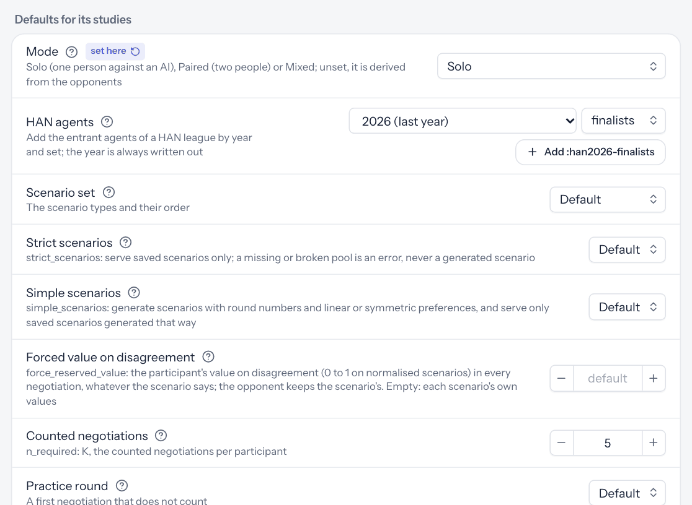

# Study management

A study is one data collection inside a [project](project-management.md), with its own results. This page covers running a study: its type and its links, what it overrides, how it assigns Assistants, opponents and scenarios, the questions asked after every negotiation, and what HANI2 records. For paid online studies, see also [Prolific](prolific.md).

## A study's life

1. **Create** the study: `hani2 study create PROJECT/STUDY` (or **New study** on the admin console's [Projects & Studies](admin.md#projects-studies) page). It prints the links to give participants. The project is created when it is missing.
2. **Configure** it: `study.yaml` and its overrides of the project's defaults (see [`study.yaml` and overrides](#studyyaml-and-overrides)), its texts and forms (see [Forms and questionnaires](#forms-and-questionnaires)) and how it assigns Assistants, opponents and scenarios (see [Assigning Assistants, opponents and scenarios](#assigning-assistants-opponents-and-scenarios)).
3. **Test** it: open the participant link yourself (for a Prolific study, see [Testing locally](prolific.md#testing-locally)), and try a negotiation between two people on one machine with [`hani2 human-trial`](../getting-started/cli.md#hani2-human-trial).
4. **Run** it: start the server (`hani2 --study PROJECT/STUDY` makes it the server's default study) and give out the link.
5. **Monitor** it: see [Monitoring](#monitoring).
6. **Close** it: stop giving out the link. `start` and `end` in `study.yaml` record the study's dates, and its results stay in its own folder (see [Results](#results)).

## Study types

A study's *type* is `prolific`, `online` or `lab`. Every type keeps its files in the study's folder (see [Folder layout](project-management.md#folder-layout)) and is reached at its own addresses.

### URLs

Each study has its own pages:

| URL | Page |
|---|---|
| `/s/<project>/<study>/play` | The playground and the participant entry (`?PROLIFIC_PID=`, `?pid=`, `?code=`). |
| `/s/<project>/<study>/app` | The main app (log in), for example for a lab study with accounts. |
| `/s/<project>/<study>/login`, `/admin`, … | Every other page, within the study. |

Everything a page does from there (sign-in, consent, the negotiation channel) stays in that study. `?study=<project>/<study>` on any page moves it to the study's address, and API calls accept `?study=` too. A URL naming a study that does not exist gets *404*.

`/play` and `/app` without a study use the server's *default study*: the one given with `hani2 --study <project>/<study>` (`HANI2_STUDY`), or with the old `--experiment <name>` (`HANI2_EXPERIMENT`, a study of the `default` project). Without either, results go to `$HANI2_HOME/db` as always.

Behind a reverse proxy, the study path comes after the mount path: `https://example.org/hani/s/HI2027/hi-2027-01/play` with `hani2 --root-path /hani`.

### Prolific

Give Prolific the study URL with Prolific's placeholders:

```text
https://example.org/s/HI2027/hi-2027-01/play?PROLIFIC_PID={}&STUDY_ID={}&SESSION_ID={}
```

`hani2 study create` and `hani2 study show` print it. The flow is the one in the [Prolific guide](prolific.md). The completion link is, first match wins:

1. `PROLIFIC_COMPLETION_URL` (`{pid}` is the participant's ID),
2. an outside system's completion path (`SCMLWEB_BASE_URL` / `SCMLWEB_PROLIFIC_PATH`), when one of them is set,
3. `completion_url` in `study.yaml`,
4. Prolific's completion link for `completion_code` in `study.yaml` (`https://app.prolific.com/submissions/complete?cc=<code>`),
5. the default completion path of the outside system.

A Prolific ID is accepted by every study, whatever its type.

### Online

Send each participant a link with their ID:

```text
https://example.org/s/HAN2027/online-01/play?pid=<PARTICIPANT_ID>
```

`?participant=` works too. The participant's results folder is `participant_<ID>` and the flow is the same as for Prolific (practice, counted negotiations, questionnaires, timers, `schedule.json`). At the end the *Finish* button opens `completion_url` from `study.yaml` (`{pid}` and `{{variables}}` are filled in); without one, the end page shows `end_text`, or a thank-you with the completion code when the study has one. Participants who log in at `/s/<project>/<study>/app` take part with their account instead.

### Lab

Either create accounts for the participants (`hani2 users add`, or in the admin console) and let them log in at `/s/<project>/<study>/app`, or hand out session codes:

```text
https://example.org/s/HAN2027/lab-kyoto/play?code=<SESSION_CODE>
```

A session code works like an online participant ID. A lab study has no completion link: the end page shows `end_text` (or a thank-you).

### Texts with variables

The consent form, the welcome text (`announcements.md`), the page title and subtitle in `env.json`, the end page (`end_text`), `completion_url` and every text of the per-negotiation questionnaire may contain `{{variables}}`. They are filled per session from the session's project and study:

| Variable | Value |
|---|---|
| `project_name` | The project's short name (its folder name). |
| `project_full_name` | `full_name` in `project.yaml` (else the name). |
| `project_short_description` | `short_description` in `project.yaml`. |
| `project_link` | `link` in `project.yaml`. |
| `project_year` | `year` in `project.yaml`. |
| `study_name` | The study's short name. |
| `study_title` | `title` in `study.yaml` (else the name). |
| `study_type` | `prolific`, `online` or `lab`. |
| `study_link` | `link` in `study.yaml`. |
| `study_year` | `year` in `study.yaml`, else the year of `start`, else the project's year. |
| `organizer` | `organizer` in `study.yaml`, else in `project.yaml`. |
| `contact` | `contact` in `study.yaml`, else in `project.yaml`. |
| `n_required` | Counted negotiations per participant. |
| `minutes` | The expected maximum duration in minutes. |
| `completion_code` | `PROLIFIC_COMPLETION_CODE`, else `completion_code` in `study.yaml`. |
| `agent`, `Agent` | The party the questionnaires ask about: `assistant` or `opponent` (`Assistant`, `Opponent`). `questionnaire_agent` of the study or its project, else `opponent` in a HAN project (`kind: opponent`) and `assistant` otherwise. See [Questionnaires about the Assistant or the opponent](study-forms.md#questionnaires-about-the-assistant-or-the-opponent). |
| `project_<key>`, `study_<key>` | Any other key of `project.yaml` / `study.yaml` (and of their defaults / overrides). |

So one consent text can serve every study of a project:

```markdown title="projects/HI2027/consent.md"
# Consent: {{project_full_name}} ({{study_title}})

You will do {{n_required}} negotiations, about {{minutes}} minutes in total.
Questions? Write to {{contact}}.
```

A placeholder HANI2 does not know is left as written, so a typo shows up in the text. Prolific's own placeholders such as `{}` are never touched. The admin API previews a text for a study and lists its unknown variables (see [Admin API](project-management.md#admin-api)).

### Consent per study

With `auth.enforce_consent` on, a logged-in participant consents once per study. HANI2 records, in the user's metadata, which study, when, and a hash of the consent text they accepted. A new study, or a changed consent text, asks again. Consent given before projects existed still counts for the server's default study, so existing users are not asked again there.

Participants who arrive with a Prolific ID, an online participant ID or a session code do not pass through the consent page. To ask them for consent in the session itself, switch on `auth.participant_consent` for the project or study (see [Study forms](study-forms.md#consent-for-study-participants)).

## `study.yaml` and overrides

### `study.yaml`

```yaml title="projects/HI2027/studies/hi-2027-01/study.yaml"
type: prolific             # prolific | online | lab
title: January 2027 run
start: 2027-01-05
end: 2027-01-31
prolific_study_id: 65a0c0ffee
completion_code: C1A2B3
# completion_url: https://example.org/thanks?id={pid}   # online studies: where participants go at the end
# end_text: Thank you! Your code is {{completion_code}}. # the end page's text
overrides:                 # the project's defaults this study changes
  n_required: 3
wave: 1                    # any other key is available to texts as {{study_wave}}
```

Settings of a study come, first match wins, from: an environment variable set by whoever starts HANI2 (`PROLIFIC_N_REQUIRED`, `PROLIFIC_MAX_MINUTES`, …), the study's `overrides`, the project's `defaults`, and the built-in default.

Two settings merge instead of replacing the project's value: `scheduling` merges per dimension,
and `pairing` key by key (a study that writes `pairing: {assign: order}` keeps the project's
`scope`, `fallback`, …). `hani2 study create` updating an existing study merges them with the file
in the same way.

A setting given twice in `study.yaml` or `project.yaml` with different values (at the top level
and again under `overrides:` / `defaults:`) is refused when the file is saved through the admin
API or the command line, and reported (server log, `hani2 study show`, the admin study page's
`errors`) when a hand-edited file has it; the value under `overrides:` / `defaults:` is then used.

### Settings files per study

Every settings file is looked up per session, first match wins:

1. the study folder,
2. the project folder (the `default` project has none: its layer is the settings folder),
3. the settings folder (`$HANI2_HOME/settings`),
4. the defaults bundled with HANI2.

JSON files (`env.json`, `assistant_settings.json`, …) are merged in the same layers, so a study's `env.json` only needs the keys it changes. Scenarios come from the study's `scenarios/`, then `HANI2_SCENARIOS_BASE`, then the project's `scenarios/`, then the settings folder. The questionnaire after each negotiation comes from `questionnaires/per_negotiation.yaml` in the study and then the project folder (after the environment variables and `env.json`, see [Where the questionnaire is looked up](#where-the-questionnaire-is-looked-up)).

User accounts are shared by all studies.

## Mode

A study runs in one of three modes: **Solo** (one person against an AI opponent), **Paired** (two
people negotiate with each other) or **Mixed** (a person when someone fits, else an AI opponent).
The project sets the default and a study overrides it:

```yaml title="projects/HI2027/studies/pairs/study.yaml"
type: online
title: Teams against teams
overrides:
  study_mode: paired        # opponents: [human+assistant] is filled in (an HI project)
  pairing: {scope: study}
```

What each mode means in an HI and in a HAN project, which pool each needs and the keys of the
`pairing` block are in [Mode: Solo, Paired or Mixed](project-management.md#mode-solo-paired-or-mixed)
and [Pairing defaults](project-management.md#pairing-defaults). Without `study_mode`, the mode is
derived from `opponents`, and nothing changes for existing studies.

### Checks, and how to fix the errors

The study's mode is checked against its pool after the project's defaults and the study's
overrides are merged, so a study cannot contradict its project's mode silently. The pool checked
is the one a session of the study would play, first match wins:

1. `opponents` in `study.yaml`, else in `project.yaml`;
2. what a Paired study fills in (`[human+assistant]` or `[human]`): it wins over `env.json`, as in a
   session;
3. `opponents` in `env.json`: the study folder's, else the project folder's, else the settings
   folder's (see [Settings files per study](#settings-files-per-study));
4. the built-in pool.

So a Solo study is refused when its project folder's `env.json` names `human+assistant`, and a
Mixed study may take its pool from `env.json`. When the pool comes from an `env.json`, the message
ends with where, for example `(the opponents come from project env.json)`: fix that file, or name
the pool in `study.yaml`. `hani2 --opponents` (`HANI2_OPPONENTS`) replaces the
pool for every session of one server: it is not a setting of the study, so it is never a reason to
refuse a file, but `hani2 study show` prints a `WARNING` when it contradicts the study's mode.
`hani2 study show` also prints the pools in use and where each comes from (`pools (in use)`).

| Message | Fix |
|---|---|
| `study_mode is 'solo' but opponents [...] lists human+assistant` | Remove the human entries, or set `study_mode: paired` (people only) or `mixed` (both) |
| `a Paired HI study (kind: assistant) needs opponents: [human+assistant]` | Write `opponents: [human+assistant]`, or leave `opponents` out and HANI2 fills it in |
| `a Paired HAN study (kind: opponent) needs opponents: [human]` | The same with `[human]`; people play without an Assistant (`assistants: [none]`, also filled in) |
| `... but assistants is [none]; each side needs an Assistant` | An HI study needs an Assistant: name the Assistants or remove `assistants: [none]` |
| `study_mode is 'mixed' but no opponents are given; name the pool` | Mixed needs a pool with a person and an AI, for example `[human+assistant, ":pan"]` |
| `pairing: unknown key ...`, `pairing.scope must be one of ...` | Use the keys and values listed in [Pairing defaults](project-management.md#pairing-defaults) |
| `pairing.fallback is 'wait' but human_opponent_fallback is true` | Keep one of the two settings |
| `opponents: :han2025-all: no agents for 2025 (...)` | Name a year that `han-agents` covers, or the current year (`han.current_year`), see [HAN agents by year](project-management.md#han-agents-by-year) |

On save (`hani2 study create`, the admin API's `PUT`, **Save** in the admin console) such a file
is refused (a 400 from the API). The study page of the admin console shows the problem under its
**Mode** row before you save, from the study's overrides and the project's
defaults. The study page has the same rows as the project's defaults, each with its **?**; an
empty field keeps the project's value:



A hand-edited file is reported in the server log, by `hani2 study show` and in the study's
`errors`, and `opponents` wins: the study runs with the derived mode.

Saving the **project** re-checks its studies too: a project change that would make one of its
studies contradict itself (for example new project `opponents: [":pan"]` that a Paired study would
inherit) is refused with a message that names the study, such as `study HI2027/pairs: study_mode is
'paired' but opponents is [:pan]; …`. Only problems the change would add count: a study whose own
file is already wrong does not block an unrelated project edit (fix the study itself).

### Checks for each session

When the study **declares** `study_mode`, what a page or an outside system brings for one session
is checked too:

- **Group files** (`?group=<key>`) whose `agents` do not fit the mode: in a Paired study the file's
  AI entries are dropped (a file listing only AI agents is ignored, and the study's pool is used);
  in a Solo study a file with a `human` or `human+assistant` entry is ignored, and the study's pool
  is used. A Mixed study takes the file as it is.
- **`schedule.json` slots** whose `agent_class_name` does not fit: a human entry in a Solo study, or
  an AI agent in a Paired study, is ignored, and the study's own pool is used.
- Each case prints a warning in the server log and adds an `error` event to the session.
- An admin's `?opponents=` link is a test link and is never checked.

A study that does not set `study_mode` takes group files and slots as before.

## Assigning Assistants, opponents and scenarios

Within a study HANI2 assigns, from the pools the study inherits from its project (see [Pools of opponents and Assistants](project-management.md#pools-of-opponents-and-assistants)):

- **Assistants** fixed per human and balanced across the study's humans (fewest assigned first,
  ties in pool order; admins and playground guests not counted; drop-outs counted). See
  [Fixed per human, balanced](assistant.md#fixed-per-human-balanced).
- **Opponents** in a balanced Latin-square order over the study's opponent pool, by participant
  index. See [Latin squares](opponents.md#latin-squares).
- **Scenario types** by participant index over the active scenario set; each negotiation takes the
  participant's next slot of that type.

These are the default [scheduling methods](scheduling.md). A study (or its project, for all its
studies) can choose another method per dimension, and set two options:

```yaml
scheduling:
  opponents: latin_square   # random, cyclic, fixed_order, external
  assistants: balanced      # random_fixed, round_robin, random_each, latin_square, cyclic,
                            # balanced_subset, random_subset, external
  scenarios: by_participant # set_order, random, latin_square, external
  cross: shift              # cross the Assistant with the opponent: shift (default) | none
  assistant_repeats: false  # may a person get one Assistant twice?
```

`hani2 scheduling list --details` explains each one with examples; `hani2 study create
--opponent-scheduling M --assistant-scheduling M --scenario-scheduling M` sets them. The methods
used are recorded in the `opponent_scheduling`, `assistant_scheduling` and `scenario_scheduling`
columns.

Participants are counted per study (their index is kept in the study's `assignments.json`), so
each study is balanced on its own. A `schedule.json` (and a group file named in the URL) still wins
over all of this. The assigned Assistant, its group and the opponent's group are written to every
results row (`assistant`, `assistant_group`, `assistant_class`, `assistant_error`,
`opponent_group`, plus the three `*_scheduling` columns), to the `scenario_started` event and to
the recordings.

### K sessions per person over N Assistants

Each person plays **K** counted negotiations (`n_required`), and the pool has **N** Assistants.
Which Assistant method to use depends on how K compares with N and on what you want to compare:

| Design | Method | What each person gets |
|---|---|---|
| Between-subjects: one Assistant per person | `balanced`, `random_fixed`, `round_robin` | the same Assistant in all K negotiations |
| Every Assistant once (K = N) | `latin_square` | every Assistant once, in the order of a row of a balanced Latin square |
| K of N (K < N), compared within each person | `balanced_subset` | K different Assistants, chosen when the person arrives |
| K of N, cheap and random | `random_subset` | the first K of a random order of the N |
| Anything, drawn at random | `random_each` | a random Assistant every negotiation (repeats possible) |
| An outside system decides | `external` | what the person's `schedule.json` names |

**Each Assistant at most once.** `latin_square`, `cyclic`, `balanced_subset`, `random_subset`
and `external` promise that a person never gets the same Assistant twice. That needs K ≤ N, so
saving a study or its project (with `hani2 study create`, `hani2 project create`, the admin console
or the admin API) where K > N is refused. N is the size of the Assistant pool a session would use,
after groups are expanded, first match wins:

1. `assistants` in `study.yaml`, else in `project.yaml`;
2. `[none]`, which a Paired HAN study fills in (a study without Assistants is never a repeat);
3. `agent_class` in `assistant_settings.json`: the study folder's, else the project folder's, else
   the settings folder's, else the built-in Assistant. This is one Assistant, so N = 1, and the
   message ends with where it comes from, for example `(the Assistants come from built-in)`.

A project that sets `scheduling.assistants: latin_square` and `n_required: 4` but names no Assistants
is therefore refused. K is `n_required`, or `PROLIFIC_N_REQUIRED` when the server sets it.
`hani2 --assistants` (`HANI2_ASSISTANTS`, or `--assistant`) replaces the pool for every session of
one server and is not part of the study's files: it is never a reason to refuse a save, but
`hani2 study show` prints a `WARNING` when K > N for that pool. A project save that would make
K > N in one of its studies (fewer project Assistants, a larger `n_required`) is refused and names
the study.

The message:

```text
scheduling.assistants is 'latin_square' with n_required = 6 negotiations but only 5 Assistants
(…): each Assistant is used at most once per human. Lower n_required, add Assistants, or set
scheduling.assistant_repeats: true
```

Fix it by lowering `n_required`, adding Assistants, or allowing repeats with
`scheduling.assistant_repeats: true` (the Assistants then wrap around). A study whose file already
broke the rule before it was checked keeps running: it gets a warning in the server log, in
`hani2 study show` and in `hani2 study balance`, and its Assistants wrap around. `random_each`
repeats by nature and is allowed unless you set `assistant_repeats: false`.

**When an Assistant leaves the pool during the study** (you remove it from `assistants`, or from an
Assistant group the study names), the promise still holds. Each person's plan is made again around what
they have already done:

- the negotiations they already played stay as they were;
- each open slot gets its planned Assistant while it is still in the pool and unused, else the next
  Assistant they have **not** used yet (the Assistants of their counted results rows and, in a
  Paired study, `used_assistants` in `assignments.json`);
- if fewer unused Assistants are left than open slots, `assistant_repeats: true` wraps around, and
  otherwise the person **finishes early** with the completion link. The server log says why, and a
  `finished_early` event (`component = scheduling`) is recorded (once per person while the server runs).

Only a pool that lost an Assistant ends a person's study early. A study whose pool was smaller than
K from the start warns and wraps, as described above. The pool each person started with is kept as
`assistant_pool` in `assignments.json`.

A `schedule.json` that
names one Assistant in two slots is used as written but flagged (`external:repeat` in the
`assistant_scheduling` column and a `scheduling_repeat` error event).

### Position and co-occurrence balance

Two kinds of balance matter when each person sees several Assistants:

- **Position**: each Assistant should appear equally often as the first, second, … negotiation,
  so that learning and fatigue do not favour one Assistant. `latin_square` and `cyclic` balance it
  exactly over every full block of people; `balanced_subset` keeps the counts within one of each
  other as long as it can.
- **Co-occurrence**: with K < N, each person compares only some of the Assistants. Every *pair* of
  Assistants should be used by the same person about equally often, otherwise any within-person
  comparison (paired differences, Bradley–Terry) leans on some pairs much more than on others. The
  first K columns of a Latin square always put the same neighbours together, so for K < N use
  `balanced_subset`. It chooses each new person's K Assistants and their order to keep, in this
  order, the totals, the pair counts and the position counts as even as possible, and stores the
  plan in `assignments.json` (`assistant_plan`), so a reload or a later visit continues it.

### Crossing Assistants with opponents

If both the Assistants and the opponents follow the same Latin square over pools of the same size,
Assistant 1 always meets opponent 1, Assistant 2 always meets opponent 2, and so on. The effect of
an Assistant then cannot be told apart from the effect of its opponent. `scheduling.cross: shift`
(the default) prevents this: when the Assistants change every negotiation and the opponents use
`latin_square` or `cyclic`, each block of participants gets its opponents shifted by one more
place. Over enough people every Assistant meets every opponent equally often, and the opponents'
own position and order balance is kept. With 5 Assistants and 5 opponents, 50 participants complete
the design, with every (Assistant, opponent) pair 10 times.

- With `balanced_subset`, the Assistants are planned together with the person's opponent sequence,
  so the (Assistant, opponent) pairs even out too.
- With `scenarios: latin_square`, the scenario type gets its own shift, so it is confounded with
  neither the Assistant nor the opponent.
- Pools of different sizes, and the `random_*` methods, are balanced only approximately;
  `hani2 study balance` shows the real counts.
- **Running studies never change.** Each person's rule is stored in `assignments.json` (`cross`)
  the first time they are seen. Changing `cross` later only affects people who arrive afterwards,
  and people who joined a study before crossing existed keep `none` (so does everyone who joins
  that study later, unless its file sets `cross`).
- With `cross: none`, HANI2 warns about the confounding in the log and with a
  `scheduling_confounded` event.

The formulas and an example table are in
[Crossing Assistants with opponents](scheduling.md#crossing).

### Schedules from an outside system: who owns the plan

An outside system (for example a recruiting website) can write a `schedule.json` into each
participant's results folder. Whatever a slot names (`agent_class_name`, `assistant`,
`scenario_type`, `scenario_index`, `time_limit`) is used as given. The recommended split is that
**HANI2 owns the plan**: the outside system writes only what it must fix (for example the scenario
type), or no schedule at all, and leaves `assistant` and `agent_class_name` empty. HANI2 then fills
the open slots with the study's methods and the crossing above, so the K-of-N and crossing rules are
implemented once:

```json
{"version": 2, "negotiations": [
  {"slot": 0, "scenario_type": "Trade"},
  {"slot": 1, "scenario_type": "Trade"},
  {"slot": 2, "scenario_type": "Trade"}
]}
```

If the outside system writes complete slots instead, it owns the plan, and HANI2 only checks it (an
Assistant named twice is flagged as `external:repeat`). Participants who already started with
HANI2's older rotation for open slots (their folder holds `fallback_rotation.txt`) keep that
rotation until they finish.

The full rules of every method are in [Scheduling methods](scheduling.md).

## Paired studies

In a Paired study two people negotiate with each other, each with their own Assistant in an HI
project (`opponents: [human+assistant]`) or both without one in a HAN project
(`opponents: [human]`). Fairness is then decided when two people are paired, and the unit is the
**match**, not the person. This section describes how a study declared `study_mode: paired` pairs
people; the keys are in [Pairing defaults](project-management.md#pairing-defaults). What the
participants see (the waiting room, turns, leaving) is in [Human opponents](human-opponents.md).

### Match cells

Every match falls in one **cell**:

$$
\text{cell} = (\text{scenario},\ \text{Assistant at side 0},\ \text{Assistant at side 1})
$$

written `"<scenario>|<A>@0|<B>@1"`, for example `Trade|teamA.Helper@0|teamB.Coach@1`. The sides are
the two utility functions of the scenario, so a match has one cell, the same in both people's rows.
By default *scenario* is the scenario type (`pairing.cell_scenario: type`); the single scenario that
was played is recorded but not balanced. `cell_scenario: name` balances single scenarios too, which
multiplies the number of cells by the scenarios per type. In a HAN Paired study, where nobody has an
Assistant, a cell is just the scenario (`Trade|none@0|none@1`).

With N Assistants, S scenario types and no same-Assistant matches there are $S \cdot N(N-1)$ cells:
60 for 5 Assistants and 3 types. With K = 5 matches per person and two people per match,
50 participants play 125 matches, about 2 per cell.

The counts are kept in `<study results>/match_cells.json`:

```json
{"version": 1,
 "cells":    {"Trade|teamA.Helper@0|teamB.Coach@1": {"completed": 2, "match_ids": ["…", "…"], "type": "Trade"}},
 "inflight": {"7f3a…": {"cell": "Trade|teamA.Helper@0|teamC.Pal@1", "since": "2027-…", "expires": 1801234567.0}},
 "positions": {"teamA.Helper": [3, 2, 4, 1, 2]}}
```

- **Only completed matches fill a cell.** A match is completed when both rows were written, neither
  is abandoned and the status is not `erred` (a deal, no deal in time and a refusal all count).
- A match that is **being played** is *in flight*: it counts when the next match is chosen, so two
  people arriving at the same moment do not both take the emptiest cell. A match whose two people were
  separated before the start, an abandoned match and an erred one release their entry and fill
  nothing. An entry older than the time limit plus 10 minutes is dropped.
- AI games (the fallback below) never fill a cell.
- `positions` counts, for each Assistant, how often it was a person's 1st, 2nd, … Assistant in a
  completed match.

Each person's use is kept in `assignments.json`: `used_assistants` lists `[assistant, match_id]` for
every negotiation they started. An Assistant counts as **used once the negotiation has started**
(both pressed Start), even when the match is abandoned later: the person has seen it, and "at most
once" is about exposure. The cell, however, counts only completed matches.

### Each person's set of Assistants

In a Paired study the study's `scheduling.assistants` method gives each person a **set** of
Assistants they may still play, with a preferred order:

| Method | The person's set |
|---|---|
| `balanced`, `random_fixed`, `round_robin` | Their one fixed Assistant, for every match (a person always plays their own Assistant, as in a game) |
| `latin_square`, `cyclic`, `balanced_subset`, `random_subset` | The first K of their sequence, without the ones already used. The order is a preference, not a promise. After an Assistant left the pool, the open slots are filled only from Assistants they have not used |
| `random_each` | All N, with repeats |
| `external` | The Assistants of their `schedule.json` slots (their order is a preference) |

An Assistant fixed for the page (the group file's `assistant`, the person's own pick, an admin's
`?assistant=`) is the whole set. With `scheduling.assistant_repeats: true` the sequence wraps around
instead of running out.

### How a match is formed

`pairing.assign` chooses the rule:

| `assign` | Rule | Use |
|---|---|---|
| `cells` (the default) | The cell-aware choice below | Evaluation studies, games |
| `order` | Each person follows their planned order strictly: two people fit only when their *next* planned Assistants form an allowed pair | Small, scripted lab sessions. It thins the pool a lot |
| `random` | Chance, among the people who fit | Back-compatible pairing |

With `cells`:

1. **The host commits.** Someone who finds nobody to join waits as a *host*. They commit **one**
   Assistant of their set now, and the scenario type: the pair with the fewest completed and
   in-flight matches that have this Assistant in this type, then the fewest uses of the Assistant at
   the person's position, then the preferred order, then the scenario method's own pick. Their
   Assistant is live while they wait. With `scenarios: by_participant` the person's own type is
   kept; so is a scenario the person chose or a schedule named.
2. **The joiner chooses, and binds late.** Someone who arrives looks at every waiting host that
   fits (same lobby, the right scenario type, not just separated), and at every Assistant of their
   own set that is not the host's (unless `allow_same_assistant`). Each choice is scored by, in this
   order: the cell's completed and in-flight matches, the Assistant's count at the joiner's position,
   the size of the host's set (the most constrained host first, which avoids dead ends at the end of
   a study), the size of the joiner's set, and chance. Counts within `pairing.slack` (default 1) of
   the lowest are treated as equal, so nobody can aim at a particular person. Only then is the
   joiner's Assistant started.
3. The chosen cell is put in flight, both Assistants are marked used when the negotiation starts,
   and the cell is filled when both rows are written.

**Scenarios.** The joiner always plays the host's scenario: the scenario is decided per match, and
the joiner's own scenario plan is recorded as `scenario_scheduling: host`. With
`scenarios: by_participant` (one scenario type per person), a joiner fits **only hosts of their own
type**, which divides the people waiting for each person by the number of types. With any other
scenario method, the host picks the type as in step 1.

**Same-Assistant matches.** `pairing.allow_same_assistant` is `false` by default: a match of an
Assistant against itself says nothing about it compared with the others. Set it to `true` when two
people must be able to share one, as in a game where an invited guest plays with the inviter's
Assistant. A study whose pool has a single Assistant always allows it.

**Where people meet.** A Paired study pairs its people among themselves (`pairing.scope: study`),
because its cell counts belong to it. With `scope: project`, people from several studies of the
project meet; each match is then counted in the host's study and marked `cross_study` in both rows.

### When nobody fits

The typical dead end is a person with one Assistant left while everyone waiting has only that
Assistant left too. After `human_opponent_wait` seconds, `pairing.fallback` applies:

- **`ai`** (the default): the person plays their committed Assistant against an AI opponent from
  `pairing.fallback_opponents` (else the study's AI pool, else `:pan`). The Assistant is now
  **used** for them: they spent the time, and are paid for it. The row has `study_mode = paired`,
  `opponent_kind = agent` and `pairing = fallback`, and fills no cell.
- **`wait`**: keep waiting, the same as `human_opponent_fallback: false`. For supervised lab
  sessions only. The *Play an AI opponent instead* button is not offered.
- **`end`**: the slot is skipped. The person moves on to their next Assistant (the skipped one is
  not used, and is listed under `skipped_assistants` in `assignments.json`), or finishes early with
  the completion link when none is left.

A person who has used every Assistant planned for them also finishes, even with fewer than K
counted negotiations (for example after abandoned matches, or when Assistants left the pool and
too few unused ones are left), with a `finished_early` event. Only a one-Assistant pool, or
`assistant_repeats: true`, gives a person an Assistant again.

### What is guaranteed and what is only best effort

| Guarantee | Paired | Why |
|---|---|---|
| Each Assistant at most once per person | **Hard** | The joiner chooses only from their own set, and the host commits only from theirs; a pool that changes during the study refills a set only from Assistants the person has not used |
| No same-Assistant match (when not allowed) | **Hard** | A filter at pairing |
| A match fills at most one cell, and only when completed | **Hard** | See [Match cells](#match-cells) |
| Totals per Assistant within ±1 | Best effort | Depends on who is waiting at the same moment |
| Cell balance | Best effort, greedy | The same reason |
| Position balance | Best effort | The joiner's pick depends on whom it meets |
| Order and carry-over balance | **Not guaranteed** | Pairing reorders each person's set |
| Every person completes all K with people | **Not guaranteed** | Arrivals: the last person waiting can be left with nobody to meet |

`hani2 study balance` shows how far the balance got (see [Monitoring](#monitoring)).

The agreed final evaluation (every finalist once, a Latin-square order, nobody against a person) is
a Solo study, so none of this changes it.

## Designs, ready to copy

Each block is a complete `study.yaml` for a project of the right `kind`; settings the project
already gives can be left out.

### The finals: every finalist once, crossed with HAN finalists

Every participant uses every finalist Assistant once, in a counterbalanced order, against the HAN
finalists, crossed so that no Assistant is tied to one opponent. With 5 finalists on each side,
50 participants complete the design.

```yaml title="projects/HI2027/studies/finals/study.yaml"
type: prolific
title: The finals
overrides:
  study_mode: solo
  assistants: [":hi2027-finalists"]   # N = 5 Assistants
  opponents: [":han2026-finalists"]   # 5 HAN agents (or ":pan")
  n_required: 5                       # K = N
  practice: true
  scheduling:
    assistants: latin_square
    opponents: latin_square
    cross: shift                      # the default; written out for clarity
```

### K-of-N screening

Each participant tries 3 of 8 Assistants; totals, positions and the pairs used by one person are
balanced, and the opponents are crossed with the Assistants.

```yaml title="projects/HI2027/studies/screening/study.yaml"
type: prolific
title: Screening
overrides:
  study_mode: solo
  assistants: [":hi2027-qualified"]   # N = 8
  opponents: [":pan"]
  n_required: 3                       # K = 3 < N
  scheduling:
    assistants: balanced_subset
    opponents: latin_square
```

### A HAN Solo study

People without an Assistant negotiate against the HAN entrants, each in a counterbalanced order.

```yaml title="projects/HAN2027/studies/main/study.yaml"
type: prolific
title: Negotiate with AI agents
overrides:
  study_mode: solo
  assistants: [none]
  opponents: [":han2027-qualified"]
  n_required: 5
  scheduling:
    opponents: latin_square
```

### An HI Solo study that also plays HAN agents

The opponents of an HI study can be HAN entrants. Each row then records the HAN agent's group, year
and build (`opponent_group`, `opponent_han_year`, `opponent_han_source`, `opponent_han_version`), so
the same games can be read as games of those agents too. On the HAN board they form their own
stratum, `vs_team`, next to the official `alone` board and never pooled with it unless you ask
(see [Strata](evaluation.md#strata-solo-paired-and-han-against-teams)):

```bash
hani2 replay leaderboard projects/HI2027/studies/hi-vs-han --track han --stratum vs_team
```

```yaml title="projects/HI2027/studies/hi-vs-han/study.yaml"
type: online
title: Assistants against this year's HAN agents
overrides:
  study_mode: solo
  assistants: [":hi2027-finalists"]
  opponents: [":han2027-finalists", ":han2026-finalists"]
  n_required: 5
  scheduling:
    assistants: latin_square
    opponents: latin_square
```

### A Paired HI study

Two people negotiate with each other, each with an Assistant. Each person plays 4 of the 5
finalists, one per match, never the same one twice and never against the same Assistant; the matches
are spread over the cells (scenario type × the two Assistants).

```yaml title="projects/HI2027/studies/paired/study.yaml"
type: prolific
title: Negotiate with another person
overrides:
  study_mode: paired                  # opponents: [human+assistant] is filled in
  assistants: [":hi2027-finalists"]   # N = 5
  n_required: 4                       # K = 4
  scheduling:
    assistants: balanced_subset       # each person's set: 4 of the 5
  pairing:
    assign: cells
    slack: 1
    allow_same_assistant: false
    fallback: ai                      # nobody fits in time: an AI opponent
    fallback_opponents: [":pan"]
```

How long a person waits before the fallback is `human_opponent_wait` (seconds, default 120) in the
study's `env.json`, under `negotiation` (see [Human opponents](human-opponents.md#when-nobody-comes-or-someone-leaves)).

### The game

Signed-in players use their own team's Assistant (a guest uses the inviter's), meet other players
when someone is waiting and an AI otherwise. Matches are balanced over the opposing Assistant, the
scenario and the side; an inviter and their guest may share an Assistant.

```yaml title="projects/HI2027/studies/play/study.yaml"
type: online
title: Play
overrides:
  study_mode: mixed
  opponents: [human+assistant, ":han2027-qualified"]
  scheduling: {assistants: balanced}  # players without a team get one, balanced
  pairing: {scope: study, assign: cells, allow_same_assistant: true, fallback: ai}
```

To look for a person first in every round, set `human_opponents_first: true` in the study's
`env.json`, under `negotiation`. Because the block sets `assign: cells`, matches are balanced in this
Mixed study too; each player's set is their one Assistant, so only the opponent's Assistant, the
scenario and the side are balanced.

### Why a HAN Paired study ranks nothing

In a HAN project, `study_mode: paired` pairs two people without Assistants (`opponents: [human]`,
`assistants: [none]`). No HAN agent plays, so its rows have no entrant and are never ranked: the HAN board counts them
under *excluded: human opponent*. It
exists for completeness, for example to measure how people negotiate with each other on the same
scenarios.

```yaml title="projects/HAN2027/studies/people/study.yaml"
type: lab
title: People against people
overrides:
  study_mode: paired                  # opponents: [human] and assistants: [none] are filled in
  pairing: {fallback: wait}           # a supervised session: keep waiting for a person
```

## Forms and questionnaires

A study can ask for consent and show a pre-questionnaire, a questionnaire after every negotiation and a post-session questionnaire. [Study forms](study-forms.md) describes all of them and how the admin console edits them; the per-negotiation questionnaire and the pre-questionnaire are described in full below.

### Per-negotiation questionnaires

A questionnaire can follow every negotiation. It is a YAML file:

```yaml title="per_negotiation.yaml"
version: "1"
title: "After this negotiation"
intro: "Two quick questions before we continue."
questions:
  - id: satisfaction_with_outcome
    text: "How satisfied are you with the **outcome** of this negotiation?"
    type: likert5
    required: true
    labels:
      1: "Not at all"
      5: "Extremely"
  - id: partner_cooperativeness
    text: "How cooperative did your opponent feel?"
    type: select
    required: true
    options: ["Very competitive", "Somewhat competitive", "Neutral", "Somewhat cooperative", "Very cooperative"]
  - id: comments
    text: "Anything else you want to tell us? (optional)"
    type: text
    required: false
```

| Field | Meaning |
|-------|---------|
| `title` | The heading of the form (default "A few questions"). |
| `intro` | A line of text under the heading. |
| `questions` | The questions, in order. A file without questions is ignored. |
| `questions[].id` | The column name in the answers CSV. |
| `questions[].text` | The question, in Markdown. |
| `questions[].type` | One of the types below. |
| `questions[].required` | The participant cannot submit without answering. |
| `questions[].labels` | For Likert questions: labels for the lowest (`1`) and highest (`5` or `7`) points. |
| `questions[].options` | For `select` questions: the choices. |

Question types:

| Type | Shown as | Stored value |
|------|----------|--------------|
| `likert5` | Buttons 1–5 | The number |
| `likert7` | Buttons 1–7 | The number |
| `yes_no` | Yes and No buttons | `yes` or `no` |
| `select` | A drop-down list of `options` | The chosen option |
| `text` | A text area | The text |

Likert and yes/no questions start with nothing selected, so the participant must pick an answer to a required one.

#### Where the questionnaire is looked up

A study (or project) with `questionnaires: false` in `study.yaml` / `project.yaml`, or `"questionnaires": false` in its `env.json`, shows no questionnaire at all: no pre-questionnaire, no per-negotiation one and no post-session one, whatever the environment variables below name.

Otherwise HANI2 uses the first of these files that exists and has questions (a file with `enabled: false` switches the questionnaire off and ends the search; see [Study forms](study-forms.md#switching-a-form-off)):

1. The file in the `HANI2_PER_NEG_YAML` environment variable.
2. The file in the `PROLIFIC_PER_NEG_YAML` environment variable.
3. The questionnaire named by `"questionnaire"` in `env.json`.
4. `<study>/questionnaires/per_negotiation.yaml` (the experiment folder), when a study is active.
5. `<project>/questionnaires/per_negotiation.yaml`, for a study of a project.
6. `~/negmas/hani2/settings/questionnaires/per_negotiation.yaml`.

Every text of the questionnaire (title, intro, questions, labels, options) may use the [`{{variables}}`](#texts-with-variables) of the study's texts.

Instead of a path, the first three can name a questionnaire: `evaluation` is
`settings/questionnaires/evaluation.yaml`, or the one bundled with HANI2 — the
[evaluation questionnaire](evaluation.md#subjective-metrics) (UEQ, TAM, opponent perception).

Two optional keys per question feed the [subjective metrics](evaluation.md#subjective-metrics):
`scale` (the score the item belongs to; add `reverse: true` for reversed items) and
`requires: support_agent` (ask only when an assistant took part).

`hani2 setup` writes an example to `settings/questionnaires/per_negotiation.example.yaml`. Copy or rename it to `per_negotiation.yaml` to turn the questionnaire on.

The admin console edits the questionnaire of every layer on the **Study forms** page, which also adds complete predefined questionnaires (UEQ, TAM, the Subjective Value Inventory, NASA-TLX, SUS, …) to a form. A post-session questionnaire and consent for Prolific participants are described in [Study forms](study-forms.md).

#### When it is shown

In normal sessions the questionnaire appears after a negotiation in which the participant took at least one action (an offer or an acceptance) and the opponent did not fail. It is never shown in the guest playground. Prolific participants have their own rules (see [Prolific](prolific.md)).

While the questionnaire is open the participant cannot load the next negotiation. Submitting it with a required question unanswered shows a warning.

#### Answers

Answers are appended to `<results>/<user>/negotiation_questionnaires.csv`. Each row has these columns, followed by one column per question `id`:

| Column | Meaning |
|--------|---------|
| `mechanism_id` | The negotiation, matching `mechanism_id` in `results.csv`. |
| `scenario` | The scenario name. |
| `agent_type` | The opponent's spec. |
| `practice` | Whether it was a practice round. |
| `shown_at`, `submitted_at` | ISO timestamps. |
| `duration_seconds` | Time spent on the form. |
| `project`, `study` | The study the answers belong to. |

If you add questions during a study, HANI2 rewrites the file with the extra columns and keeps the earlier rows.

### Pre-questionnaire and participant types

A **pre-questionnaire** is shown once to each participant, after their first scenario loads and
before the negotiation can start. Its main use is the **participant type**: one answer (for example
how much negotiating experience they have) is stored with every result of that participant, and
the leaderboard is then also shown **per participant type**. Novices are not ranked against
professional negotiators, and an Assistant can be compared on easy and on hard participants.

It is off unless you configure one. HANI2 uses the first of:

1. the file (or bundled name) in `HANI2_PRE_YAML`;
2. the questionnaire named by `"pre_questionnaire"` in `env.json` (`expertise` is bundled);
3. `<study>/questionnaires/pre_questionnaire.yaml`, then the project's, then
   `settings/questionnaires/pre_questionnaire.yaml` (`enabled: false` in one of them switches it
   off, see [Study forms](study-forms.md#switching-a-form-off)).

It has the same format as the per-negotiation questionnaire, plus a `participant_type` block that
names the question and maps answers to types (an unmapped answer is used as it is):

```yaml
title: "Before you start"
participant_type:
  question: expertise
  map: {"Never": novice, "A few times": novice, "Regularly": experienced, "It is part of my job": expert}
questions:
  - id: expertise
    text: "How often do you negotiate (prices, contracts, salaries, …)?"
    type: select
    required: true
    options: ["Never", "A few times", "Regularly", "It is part of my job"]
```

The answers are saved in the participant's folder as `pre_questionnaire.json` (answers, type,
timestamps, project and study) and in the recording (a `pre_questionnaire` record). They are not
written to `negotiation_questionnaires.csv` and do not feed the subjective metrics. The type is in
the `participant_type` column of every later result. Administrators, playground guests and
[simulated participants](simulation.md) never get the pre-questionnaire. A simulated participant's
type is its persona's difficulty (`simulated-easy`, `simulated-hard`).

### Questionnaire answers in scores

Every numeric answer can be used in a score: `q_<id>` for each item and `scale_<name>` /
`scale_<name>_norm` for each scale of the per-negotiation questionnaire, and `post_q_<id>` /
`post_scale_<name>` for the post-session questionnaire. Free-text answers cannot. Each item is mapped to
$[0, 1]$ using the bounds of its type (`likert5`, `likert7`, `yes_no`, `select`, or `min` / `max`).
Items marked `reverse: true` are already reversed.

A per-negotiation answer belongs to its game. A post-session answer is given once per person, so it is
credited to that person's games **only when they used one Assistant throughout**. In a design where
people meet several Assistants, such as finals where everyone meets every finalist, post-session answers
cannot be used in HI scores. To rate each Assistant, ask the questions after each negotiation instead.
See [Project management: scores](project-management.md#scores) and run
`hani2 scores criteria <project>/<study>` to list a study's criteria.

## Monitoring

- The admin console's study page (**Projects & Studies**, then the study) shows the number of participants and of recorded negotiations, how many counted humans each Assistant of the pool has, and every assignment (see [Admin console](admin.md#projects-studies)).
- Open the console at `/s/<project>/<study>/admin` (or use **Open in this study**) to see the study's results, events and recordings.
- `hani2 study balance <project>/<study>` prints how balanced the assignment came out, from the counted negotiations so far: the negotiations per Assistant, Assistant × position, the pairs of Assistants used by the same person, Assistant × opponent and Assistant × scenario type (each with its spread, the largest minus the smallest count), the people who got one Assistant twice, how many completed all K, each person's crossing rule and the warnings about the study's files. `--json` prints the same as JSON.
- In a Paired or Mixed study (or one with matches between people) the report has a second part, the
  Paired balance: the completed matches per cell and how many planned cells are still empty (with
  the spread over the planned cells), the matches in flight, the completed matches per Assistant,
  Assistant × position, the pairs of Assistants used by the same person, the same-Assistant matches,
  the AI fallbacks, the Assistants skipped because nobody could be paired (`fallback: end`) and the
  people with fewer than K counted negotiations (still playing, or left with nobody to meet).
- The study page shows the Paired part too, as the **Paired balance** group: the completed and in-flight matches, the planned cells still empty and their spread, the AI fallbacks, the same-Assistant matches, the people below K and the matches per Assistant. **Every cell** opens a table per scenario (the Assistant on side 0 against side 1), **Assistant × position** the positions, and **People below K** the list of those people.
- `GET /api/admin/projects/{project}/studies/{study}/balance` and `.../assignments` return the same as JSON (see [Admin API](#admin-api)); the Paired part is under `paired` (`null` for a Solo study).

## Results

Everything is written under the *results root*: `~/negmas/hani2/db` (`$HANI2_HOME/db`), or `<study>/results` for a session of a study (an experiment's `<experiment>/results`).

```text
<results>/
├── events.db                        # the event log (SQLite)
├── groups/<key>.json                # optional agent group files
└── <user>/                          # one folder per participant
    ├── results.csv                  # one row per negotiation
    ├── logs/<mechanism id>.csv      # the full offer trace
    ├── scenarios/<mechanism id>/    # the scenario exactly as negotiated
    ├── mechanisms/<mechanism id>.json
    ├── negotiation_questionnaires.csv
    ├── last_scenario.txt            # the participant's scenario counter
    └── llm_logs/<mechanism id>.jsonl  # only with HANI2_LLM_LOG=1
```

The folder name is the user name: the account name for logged-in users, `guest_<id>` for each playground browser, `prolific_<PID>` for Prolific participants and `participant_<ID>` for participants of an online or lab study. Playground visitors therefore do not share a folder. Prolific participants have a few extra files, described in [Prolific](prolific.md). For `llm_logs/`, see [Language models](llms.md).

### Results per study

Every row of `results.csv` and of `negotiation_questionnaires.csv`, every event (`events.db`) and every recording carries `project` and `study` columns. The returning-participant check, the practice round, `prolific_session.json`, `schedule.json` and the opponent rotation all live in the study's `results/` folder, so they never mix across studies. The admin console's results, events and recordings show the server's default study; add `?study=<project>/<study>` to the API calls, or open the admin page at `/s/<project>/<study>/admin` to see a study's results, events and recordings. Settings edited there are saved in the layer chosen at the top of each page (the study by default); see [Layers](admin.md#layers-where-a-setting-is-saved).

### The trace logs

`logs/<mechanism id>.csv` has one row per action with the columns `index`, `time`, `relative_time`, `step`, `negotiator`, `offer`, `responses`, `state`, `text` and `data`. `text` is the message that came with the offer.

`mechanisms/<mechanism id>.json` records the negotiation protocol settings: `id`, `n_steps`, `time_limit`, `pend`, `pend_per_second`, `step_time_limit`, `negotiator_time_limit`, `end_on_no_response`, `one_offer_per_step` and `n_outcomes`.

### `results.csv` columns

Each finished negotiation adds one row. The columns fall into these groups.

**Scenario selection**

| Column | Meaning |
|--------|---------|
| `index` | The participant's scenario counter for this load. |
| `load_index` | The slot used in the pool (empty for generated scenarios). |
| `load_path` | The scenario folder (empty for generated scenarios). |
| `scenario_name` | The scenario folder name, or the generated scenario's name. |
| `generated` | Whether the scenario was generated on the fly. |
| `scenario_type` | The scenario type (category). |

**Participants**

| Column | Meaning |
|--------|---------|
| `scenario` | The outcome space name. The leaderboard groups by this column. |
| `human_index` | The participant's utility function index. |
| `human_id` | The participant's negotiator name, for example `Seller (You)`. |
| `user` | The user name. |
| `agent_type` | The opponent's spec, for example `BoulwareTBNegotiator`. |

**Outcome**

| Column | Meaning |
|--------|---------|
| `agreement` | The agreed outcome, or empty. |
| `human_utility` | The participant's utility for the agreement (the reservation value without one). |
| `human_advantage` | `(utility − reserved) / (max − reserved)` for the participant. |
| `agent_utility` | The opponent's utility. |
| `welfare` | `human_utility + agent_utility`. |
| `status` | `success`, `broken` (someone ended it), `timedout`, `erred`, `ended` or `agent_failed`. |
| `ended_by` | `human` or `agent`: who ended a broken negotiation, or who accepted the final offer. |
| `agent_error` | The opponent's error, when `status` is `agent_failed`. |
| `ended_at` | When the negotiation ended. |
| `mechanism_name`, `mechanism_id` | The negotiation's identifiers. |

For an agreement, `ended_by` is `human` when the participant accepted and `agent` when the opponent accepted the participant's offer.

**Study bookkeeping**

| Column | Meaning |
|--------|---------|
| `practice` | Whether this was a practice round. |
| `n_human_actions` | How many offers the participant made (at least 1 for an agreement). |

**Timing**

| Column | Meaning |
|--------|---------|
| `load_at`, `start_at` | When the scenario was loaded and when the negotiation started. |
| `load_to_start_seconds` | Time spent on the start screen. |
| `duration_seconds` | Time from start to end. |
| `per_round_times` | A JSON list of the time the participant took for each of their actions, in units of relative time. |

**Interface and assistance**

| Column | Meaning |
|--------|---------|
| `view_mode` | The layout in use at the end (`full`, `simple` or `focus`). |
| `view_source` | `query` when the layout came from the `?view=` URL parameter, else `default`. |
| `user_agent` | The browser's user agent string. |
| `device` / `orientation` | The layout in use (`desktop`, `tablet` or `phone`) and `landscape` or `portrait`. |
| `support_agent` | Whether the Assistant acted (sent a message or changed something) during this negotiation. |
| `autopilot` | Whether the autopilot was switched on during this negotiation. |
| `assistant` | The Assistant assigned for this negotiation (its spec), empty without one. See [Assistant pools and assignment](assistant.md#assistant-pools-and-assignment). |
| `assistant_group` | The Assistant group it came from, if any. |
| `assistant_class` | The class that actually ran (`module.Class`). |
| `assistant_error` | Why the assigned Assistant could not be started, if it failed. |
| `assistant_condition` | `on` (an Assistant ran), `none` (the no-Assistant arm), `off` (switched off in the settings) or `error`. See [Ablations](ablations.md). |
| `oracle` | Whether the Assistant knew the opponent's utility function (the `opponent_utility` capability). |
| `opponent_info_tools` | Whether the participant's tools could show the opponent's utilities (admins, or `tools.show_opponent_utility`). |
| `autopilot_driver` | Who drove the seat when autopilot was used (`Assistant` or a negotiator); empty otherwise. |
| `assistant_color` / `assistant_icon` | The Assistant's colour and icon in this negotiation when `interface.vary_appearance.assistant` is on, else empty. See [A different look in each negotiation](interface.md#a-different-look-in-each-negotiation). |
| `opponent_color` / `opponent_icon` | The same for the opponent (`interface.vary_appearance.opponent`); a human opponent's icon is still recorded although the page shows the person icon. |
| `opponent_group` | The opponent group the opponent came from (`?group=`, a single group token), if any. |
| `opponent_han_year` | The HAN year of the AI opponent when it is a HAN entrant (from a `:han<year>-<set>` group, or from the `han_year` of the group file that names it by class path), else empty. |
| `opponent_han_source` | Where that agent came from: `submissions` (the current year's submitted zips), `han-agents` (the package) or `group-file` (a group file with `han_year`). |
| `opponent_han_version` | Which build played: the sha256 of the submitted zip, or the `han-agents` version. |
| `opponent_scheduling`, `assistant_scheduling`, `scenario_scheduling` | The [scheduling method](scheduling.md#recorded-in-the-results) that chose the opponent, the Assistant and the scenario type (`external` for `schedule.json`, empty when HANI2 did not schedule it). In a Paired study the joiner's `scenario_scheduling` is `host` (it plays the host's scenario), and a host whose scenario type was chosen to balance the cells has `cells`. |
| `project`, `study` | The project and study of the session (`default` and an empty study without one). Added after the other columns in files from earlier versions. |

**Mode and pairing**

| Column | Meaning |
|--------|---------|
| `opponent_kind` | What actually happened: `agent` (an AI opponent, also an AI fallback in a Paired study), `human` or `human+assistant` (another participant without or with an Assistant). |
| `match_id` | The match, shared by both rows of a match between two people. |
| `opponent_user` | The other participant's user name. |
| `abandoned` | Who left a match between two people: `self`, `opponent` or empty. |
| `invited_by` | Who invited a guest, else empty. |
| `counted` | Whether the game counts for boards and balance: `false` for admins, admins in participant view, the playground and test runs. |
| `study_mode` | The planned mode of the study: `solo`, `paired` or `mixed` (empty outside a study). |
| `pairing` | How the match was formed: `cells`, `order`, `random`, `code` (a shared `?match=` link) or `fallback` (nobody fitted, an AI played); empty for an AI game that was planned as one. |
| `match_cell` | The match's cell, `"<scenario>|<A>@0|<B>@1"`, the same in both rows; empty for AI games. |
| `side` | 0 or 1: the participant's utility function index (the same as `human_index`). |
| `opponent_assistant` | The other side's Assistant (its spec, or `none`); empty for AI games. |
| `opponent_assistant_entrant` | The other side's `assistant_entrant`. |
| `opponent_participant` | The other side's participant index in their study (pseudonymous). |
| `assistant_entrant` | The entrant id of the participant's Assistant, from the group file's `entrant` key (empty without one). |
| `own_assistant` | `true` when the participant plays their own team's Assistant, `false` when not (the group file's `own` key), empty when the group file does not say. |
| `assistant_position` | The position of this Assistant in the participant's plan, from 0: the counted negotiation in a Solo study, the number of Assistants used before in a Paired one (empty outside a study, for admins and guests). |
| `plan_size` | K: the counted negotiations per person (`n_required`). |
| `cross_study` | Whether the two people of a match came from two studies (the match is counted in the host's study). |

**Final mechanism state.** The fields of the negmas `SAOState` at the end, for example `step`, `time`, `relative_time`, `broken`, `timedout`, `has_error`, `error_details`, `erred_negotiator`, `current_offer`, `current_proposer`, `n_acceptances` and `current_data`.

**Mechanism settings.** The public fields of the negmas negotiator-mechanism interface, for example `n_outcomes`, `n_steps`, `time_limit`, `pend`, `pend_per_second`, `step_time_limit`, `negotiator_time_limit`, `end_on_no_response`, `one_offer_per_step` and `allow_none_with_data`.

**Optimality.** How close the agreement is to the scenario's reference points, from negmas: `pareto_optimality`, `nash_optimality`, `kalai_optimality`, `modified_kalai_optimality`, `max_welfare_optimality`, `ks_optimality` and `modified_ks_optimality`. These are missing when they cannot be computed (for example for continuous outcome spaces).

The exact state and settings columns depend on the installed negmas version. Read the CSV with a tool that matches columns by name, such as pandas.

### Reading results

The admin console shows every row from every participant under *Results*, newest first, with a *Choose columns* picker, a searchable table, a leaderboard and a *Download CSV* button (`/api/admin/results.csv`, all participants in one file). See [Admin console](admin.md).

To analyse results in Python:

```python
from pathlib import Path

import pandas as pd

root = Path.home() / "negmas" / "hani2" / "db"
df = pd.concat(pd.read_csv(f) for f in root.glob("*/results.csv"))
print(df.groupby("agent_type")["human_utility"].mean())
```

#### Reading Paired results

A match between two people writes two rows, one per participant, with the same `match_id` and
`match_cell`. Each row reads the match from its own side: `side` is the participant's side,
`assistant` their Assistant, `opponent_assistant` the other side's, and `opponent_participant` the
other person's participant index in their study. Keep these rules when you analyse them:

- **Each row is an observation for its own Assistant.** An Assistant takes part in a match once, so
  its own mean already counts every match once.
- **Negotiation-level measures** (agreements, welfare, durations) are the same in both rows. Count
  them **once per `match_id`**, or every match is counted twice.
- **A same-Assistant match** (both sides with one Assistant, for example an inviter and their guest
  in a game) says nothing about that Assistant compared with the others. Count it as **one**
  observation, the mean of its two rows. Paired evaluation studies do not form such matches unless
  `pairing.allow_same_assistant` is on.
- **Abandoned matches** count for neither side: when one row has `abandoned` set, leave out both.
- **AI fallbacks** (`pairing = fallback`, `opponent_kind = agent`) are Solo games, even though
  `study_mode` is `paired`. They have no `match_id` and fill no cell.
- **The cell** of a Paired row is (scenario, `side`, opposing Assistant), and of a Solo row
  (scenario, opponent). A board balances over these cells, so the two kinds never mix inside a cell.
- **The two rows are not independent.** The default confidence intervals resample participants,
  which treats the two people of a match as independent and so slightly understates the
  uncertainty. Resampling matches instead (`--ci-unit match`) is the sensitivity check.

`hani2 replay leaderboard` applies all of these. It ranks each stratum on its own (`--stratum solo`,
`paired`, or `combined`, the default), and `--head-to-head` adds a ranking from the Paired matches
alone, where the two Assistants of a match are compared directly. See
[Strata](evaluation.md#strata-solo-paired-and-han-against-teams).

```bash
hani2 replay leaderboard projects/HI2027/studies/paired --track hi --stratum paired --head-to-head
hani2 replay leaderboard projects/HI2027/studies/paired --track hi --ci-unit match   # sensitivity check
```

In Python, deduplicate by match before computing negotiation-level measures:

```python
paired = df[df["match_id"].fillna("") != ""]
per_match = paired.drop_duplicates("match_id")
print(per_match["agreement"].notna().mean(), per_match["welfare"].mean())  # agreement rate, mean welfare
```

The leaderboard score of a participant is computed per scenario name: drop the worst result, average the best three of the rest, and score 0 for scenarios with fewer than two results. The score is the average over scenarios, times 100.

The leaderboard ranks human participants only and also comes stratified by `participant_type`
(from the [pre-questionnaire](#pre-questionnaire-and-participant-types)). Rows with
`mode = simulated` (users `sim_…`, see [Simulated participants](simulation.md)) are never ranked
with them. They have their own *Qualifying round* table, per Assistant and persona, with the goal
rate and pass^k. Rows written before the `mode` column existed count as human.

Five columns say who sat in the human seat: `mode` (`main`, `guest`, `simulated`, …),
`participant_type`, and for simulated participants `persona`, `goal_met` (a deal worth at least
the persona's reservation value) and `sim_invalid` (why the trial does not count, empty when it
does).

### The event log

HANI2 records what happens in an append-only SQLite database, `<results>/events.db`. Logging never interrupts the application; failures are printed to the server log. Set `HANI2_EVENTS=0` to switch it off.

The database has two tables:

- `events`: `id`, `session_id`, `user`, `experiment`, `event_type`, `timestamp` (UTC, ISO format), `component`, `action`, `value` (JSON), `scenario_id`, `round_number`, `utility_value`, `duration_ms`, `project` and `study`.
- `sessions`: one row per browser session, with `id`, `user`, `experiment`, `mode`, `start_time`, `end_time`, `ip`, `user_agent`, `project` and `study`.

An events database from an earlier version gets the `project` and `study` columns the first time HANI2 opens it.

The server writes these event types:

| `event_type` | When | Notable fields |
|--------------|------|----------------|
| `session_start` | A session is created. | `value.mode` |
| `login`, `logout`, `login_failed` | Password or OAuth sign-in and sign-out. | `user`; `value.oauth` for OAuth |
| `scenario_loaded` | A scenario is loaded. | `scenario_id` |
| `scenario_started` | A negotiation starts. | `value.partner` (wire name, the old name of the opponent) |
| `counter_offer` | The participant sends an offer. | `value.offer`, `value.text`, `utility_value` |
| `offer_accepted` | The participant accepts. | `utility_value`, `round_number` |
| `negotiation_ended` | The participant clicks End (`action` = `end_by_human`), and again when any negotiation finishes (`value` holds the summary). | `utility_value` |
| `tool_interaction` | The participant uses a tool. | `component` (tool name), `action` (`input:<field>` or the action name) |
| `tab_changed` | The participant switches tool tab. | `component` |
| `support_agent` | The participant chats with the assistant, or the assistant acts. | `component`, `action`, `value` |

`session_id` is the session key: `main:<user>`, `guest:<id>` or `prolific:<PID>`.

You can query the database directly:

```bash
sqlite3 ~/negmas/hani2/db/events.db \
  "select event_type, count(*) from events group by event_type"
```

#### Event analytics in the admin console

The *Event analytics* section of the admin console shows:

- a bar chart of events by type,
- a chart of activity per hour (the last 168 hours with events),
- a searchable table of the latest 2000 events, filtered by user, event type and date range,
- recent sessions,
- an *Export CSV* button that downloads the whole `events` table (`/api/admin/events.csv`).

The same data is available from the API at `/api/admin/events` (parameters `user`, `session_id`, `types` as a comma-separated list, `since`, `until`, `limit`, `offset`) and `/api/admin/events/summary`. Both need an admin login.

## Experiments

An *experiment* is a self-contained folder with its own scenarios, texts, questionnaire and results. Running HANI2 with an experiment keeps the data of one study apart from everything else on the server. It is the study `default/<name>` (see [Migrating from experiments](#migrating-from-experiments)).

### Creating an experiment

```bash
hani2 experiment create pilot
```

This creates `~/negmas/hani2/experiments/pilot/` (the experiments root is `$HANI2_HOME/experiments`, or the directory in `HANI2_EXPERIMENTS`):

```text
experiments/pilot/
├── consent.md                      # copied from your settings
├── announcements.md                # copied from your settings
├── scenario_order.txt              # copied from your settings
├── questionnaires/
│   └── per_negotiation.yaml        # a working example questionnaire
├── scenarios/                      # a copy of your scenarios directory
└── results/                        # everything the study records
```

The text files are copied from the settings folder (or the bundled defaults), and `scenarios/` is a copy of your current scenarios directory, or of the bundled samples when you have none. Existing files are kept; pass `--force` to overwrite them.

Unlike the settings folder, a new experiment has an active per-negotiation questionnaire. Delete `questionnaires/per_negotiation.yaml` if you do not want one.

### Running an experiment

```bash
hani2 --experiment pilot
# or
HANI2_EXPERIMENT=pilot hani2
```

`hani2 experiment list` shows every experiment and how many participants have results in it. The experiment is the server's default study; every other study is still reachable at `/s/<project>/<study>/`.

### What an experiment changes

While an experiment is active:

- **Settings files.** Any settings file placed in the experiment folder takes priority over the one in the settings folder: `env.json`, `llm_settings.json`, `assistant_settings.json`, `autopilot_settings.json`, `consent.md`, `announcements.md`, `scenario_order.txt` and `scenario_sets.yaml`. For the JSON files, the experiment's file is merged over the settings-folder file, which is merged over the bundled defaults. Files you do not add are read from the settings folder as usual.
- **Scenarios** come from `<experiment>/scenarios`.
- **The questionnaire** comes from `<experiment>/questionnaires/per_negotiation.yaml`.
- **Results** go to `<experiment>/results` instead of `~/negmas/hani2/db`. This includes the per-participant folders, the event log and the agent group files (`results/groups/`).
- **Events** carry the experiment name in their `experiment` column, and the `project` and `study` columns.

User accounts are shared by all experiments.

The same applies to every study of a project, with the project folder as an extra layer between the study and the settings folder (see [Settings files per study](#settings-files-per-study)).

The admin console always saves to the settings folder (the admin API can also write to a study's or project's folder). If the experiment folder has its own copy of a file (for example `consent.md`), that copy wins and edits made in the admin console do not show up until you edit or delete the copy. See [Configuration reference](configuration.md) for the full precedence rules.

### Migrating from experiments

Nothing has to move. An experiment folder `$HANI2_EXPERIMENTS/<name>/` (default `~/negmas/hani2/experiments`) is the study `default/<name>`, read where it is:

| Before | Now |
|---|---|
| `hani2 experiment create NAME` | Still works; the result is the study `default/NAME`. `hani2 study create default/NAME` adds a `study.yaml` to it. |
| `hani2 --experiment NAME`, `HANI2_EXPERIMENT` | Still work: the default study of the server. `hani2 --study default/NAME` is the same. |
| `hani2 experiment list` | Still works; `hani2 study list` shows experiments as `default/<name>`. |
| One process per experiment | Optional: one server reaches every study at `/s/<project>/<study>/`. |
| The `experiment` column of events and recordings | Still filled; `project` and `study` are added. |

To move an experiment into a project, create the study (`hani2 study create HI2027/wave1`) and move the experiment's files into `projects/HI2027/studies/wave1/`, keeping its `results/` folder. Move texts shared by several studies (for example `consent.md`) up to the project folder.

## The study's scores

A study uses the project's scores (see [Project management: scores](project-management.md#scores)).
In `study.yaml` it can add its own, redefine one of the project's **by key**, drop one with
`key: null`, and choose which scores it shows:

```yaml
# study.yaml
scores:
  quick_check:                            # this study only
    track: hi
    components:
      - {criterion: human_advantage, weight: 0.7}
      - {criterion: q_satisfaction,  weight: 0.3, direction: higher}
  hi_score:                               # replaces the project's hi_score in this study
    track: hi
    components:
      - {criterion: human_advantage, weight: 1}
  old_score: null                         # the project's old_score is not used here
scores_enabled: [hi_score, quick_check, utility]
```

A redefined score replaces the project's definition as a whole: its components are not merged.
`scores_enabled` in the study replaces the project's list; without it the study uses the project's
list, or, when the project has none, every score. The study's boards, results views and exports
show the enabled scores.

The same checks apply as for a project: weights that sum to 1, known criteria (including the answers
of the study's own questionnaires), a direction where the criterion has none, no cycles, and the rule
for post-session answers: when some participant of the study used more than one Assistant, an HI
score cannot use a post-session answer (run `hani2 scores check <project>/<study> --coverage`). On the
study page of the admin console, the **Scores** group lists the project's scores and the study's
own; **Redefine here** opens a project score in the score builder and saves it to `study.yaml` (see
[Checking and editing scores](project-management.md#checking-and-editing-scores)), and **Scores
enabled** chooses the study's list. Check and edit a study's scores with the same commands, giving
`<project>/<study>`:

```bash
hani2 scores list HI2027/play
hani2 scores set HI2027/play quick_check -f quick_check.yaml
hani2 scores enable HI2027/play hi_score,quick_check,utility
```

### The study's board

Every study has a board of its own: the games of that study alone, ranked with the same rules as
the project board (see [Leaderboards](project-management.md#leaderboards)). It uses the project's
`leaderboard` block, and `study.yaml` overrides it **key by key** (`rules`, `user_options` and
`defaults` merge per key, so you can change one rule and keep the others):

```yaml
# study.yaml of HI2027/prolific-03
leaderboard:
  default_sort: hi_score
  user_options: {stratum: [combined, solo]}
  visibility: admins                     # the study's board stays internal while it runs
  rules: {min_games: 5, adjust: balanced} # a planned study: every Assistant plays every cell
```

Set it on the study's page in **Projects & Studies**: the study's **Leaderboard** group has the
same rows as the project's (see
[Setting up a board in the admin console](project-management.md#setting-up-a-board-in-the-admin-console)).
Each row offers the project's value as the inherited one, and **set here** marks what the study
overrides. The study's page for end users is `/s/<project>/<study>/leaderboard` (see
[The leaderboard pages](project-management.md#the-leaderboard-pages)). Admins can open any study's
board in **Leaderboards**, with every score, criterion and stratum.

A study board ignores `studies` and `include`: it always shows its own study. Its `sort_options`
and `columns` must be enabled in the study (`scores_enabled`); saving a study whose scores no longer
include what its board (or the project board that reads it) sorts by is refused, naming the key.

```bash
hani2 leaderboard show HI2027/prolific-03                       # as an admin sees it
hani2 leaderboard show HI2027/prolific-03 --as-user --json     # what the API serves to end users
hani2 leaderboard refresh HI2027/prolific-03                    # rebuild its evaluation cache
curl -H "Authorization: Bearer $TOKEN" \
     https://hani2.example.org/api/v1/projects/HI2027/studies/prolific-03/leaderboard
```

## Command line and admin API

### Command line

```bash
hani2 study create PROJECT/STUDY [--type prolific|online|lab] [--title TEXT] [--completion-code CODE]
                                 [--completion-url URL] [--prolific-study-id ID] [--link URL]
                                 [--start DATE] [--end DATE] [--n-required N] [--end-text TEXT] [--base-url URL]
                                 [--opponent-scheduling M] [--assistant-scheduling M] [--scenario-scheduling M]
                                 [--study-mode solo|paired|mixed] [--opponents LIST]
hani2 study list [PROJECT]
hani2 study show PROJECT/STUDY [--base-url URL]   # settings, scheduling, mode, pairing, HAN sources, errors
hani2 study balance PROJECT/STUDY [--json]        # totals, positions, pairs and crossing so far
hani2 leaderboard show PROJECT/STUDY [--sort K] [--games G] [--stratum S] [--window W] [--as-user] [--json]
hani2 leaderboard refresh PROJECT/STUDY            # rebuild the study's evaluation cache
hani2 leaderboard judge PROJECT/STUDY [--judge provider:model] [--limit N]
hani2 --study PROJECT/STUDY         # the default study of this server
hani2 experiment create|list ...    # see Experiments above
```

`create` on an existing study updates the given fields. `study create` also creates the project when it is missing, and prints the links to give participants. The links start with `--base-url`, else `HANI2_PUBLIC_URL`, else `public_url` in `env.json`, else `http://localhost:5006` plus the root path. A bare study name (`hani2 study create pilot`) is a study of the `default` project.

The commands for projects, groups and scheduling methods are in [Project management](project-management.md#command-line).

### Admin API

These JSON endpoints are for admins only; the conventions (names, layers) are those of the [project admin API](project-management.md#admin-api).

| Endpoint | Does |
|---|---|
| `GET /api/admin/projects/{project}/studies/{study}` | A study: its settings, `study.yaml` as text, its links, `study_mode_effective` (the mode in use, the declared and derived ones, `mode_error`, the merged `pairing` keys, `pairing_effective` and what was `filled` in), `editor` (what the editor needs to check live; `editor.effective` is described with the [project endpoint](project-management.md#admin-api)) and `errors`. |
| `PUT /api/admin/projects/{project}/studies/{study}` | Create or replace `study.yaml` (the project is created when missing). What the GET adds (`path`, `links`, `participants`, `results_rows`, `scheduling_effective`, `study_mode_effective`, `errors`, …) is dropped, so a client may send back what it read; a mode that disagrees with the pool is a 400; the top-level `scheduling` wins over the copy under `overrides`, and an empty `scheduling` (`{}`) inherits every dimension again (the same holds for a project). |
| `PUT` / `DELETE /api/admin/projects/{project}/studies/{study}/scores/{key}` | Add, redefine or remove a score in `study.yaml` (the same checks as for a [project](project-management.md#admin-api)). |
| `POST /api/admin/projects/{project}/studies/{study}/scores/{key}/duplicate` | `{"from": "..."}`: copy a score into the study. |
| `PUT /api/admin/projects/{project}/studies/{study}/scores_enabled` | `{"enabled": [...]}`, or `null` for the project's choice. `GET /api/admin/scores?study=P/S` lists the study's scores. |
| `GET /api/admin/projects/{project}/studies/{study}/balance` | The study's Assistant pool and how many counted humans each Assistant has, with every assignment (each with its `cross` rule and `assistant_plan`), and under `solo` the report of `hani2 study balance`. |
| `GET /api/admin/projects/{project}/studies/{study}/assignments` | The study's `assignments.json`. |
| `GET /api/v1/projects/{project}/studies/{study}/leaderboard` | The study's board (for admins: every enabled score and switch value). See [The leaderboard API](project-management.md#the-leaderboard-api). |
