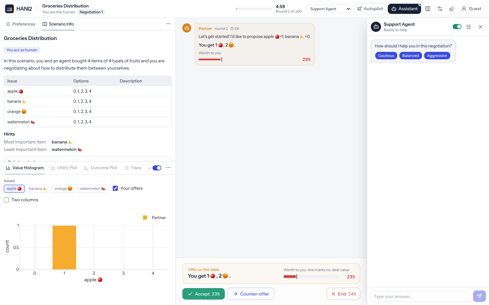

# Support agent

The support agent is an assistant that sits next to the participant while they negotiate. It lives in the **Assistant** dock on the right of the negotiation desk, and it can also reach the participant outside the dock: through notifications, the status board under the action panel, highlights and notes on the interface, layout changes and small panels it builds itself.

Every session gets its own agent. The default agent is driven by a language model that calls functions (send a toast, fill the offer, highlight a button, and so on). You can replace it with your own Python class, with or without a language model. The [support agent tutorial](../tutorials/support-agent.md) builds nine such agents step by step.



## What the agent can do

Depending on the capabilities you grant and the autonomy level, the agent can:

- chat with the participant and ask them questions with answer buttons;
- pop up notifications (toasts) and write a persistent recommendation on the status board;
- show, hide, enable, focus, reorder and move the analysis tools between panes;
- fill the counter-offer fields and write the message to the partner;
- send a counter-offer, accept the partner's offer or end the negotiation, either directly or through the participant's confirmation dialog;
- spotlight parts of the interface (buttons, issues, tool tabs, panes) with a short callout;
- attach notes to issues and other elements;
- switch the layout between the full, simple and focus views, collapse regions and resize the tools column;
- show interactive panels built from the same components as tools, and react when the participant clicks their buttons.

It also has a built-in safety net: when the participant edits a draft offer worth less than their reserved value, the agent warns them (see [Built-in reserved-value warning](#built-in-reserved-value-warning)).

## Turning the agent on

Who gets an agent is decided when a session is created. The first setting found wins:

1. The `HANI2_SUPPORT_AGENT` environment variable. `hani2 --support-agent on|off|auto` sets it for you.
2. The `mode` key in `support_agent_settings.json`.

| Value | Who gets the agent |
|-------|--------------------|
| `on` | Everyone (the default). |
| `off` | Nobody. The Assistant button is not shown. |
| `auto` | Admins only. |

The environment variable also accepts `1`, `true`, `yes` and `enabled` for `on`; `0`, `false`, `no` and `disabled` for `off`; and `admin` or `admins` for `auto`.

```bash
hani2 --support-agent auto       # only admins see the assistant
HANI2_SUPPORT_AGENT=off hani2    # the same switch as an environment variable
```

The participant can switch their agent off and on with the switch in the dock header. A switched-off agent does not answer chat messages, does not speak up on its own and does not react to events. Prolific participants start with the agent switched off; they can still turn it on.

!!! note
    The agent is created once per session. A changed setting or a new `agent_class` applies to sessions created afterwards. Restart `hani2` (sessions live in memory) to pick up changes during development.

## Settings

The agent reads `support_agent_settings.json` from the settings folder (`~/negmas/hani2/settings` by default, or the active experiment folder). Your file is merged over the bundled defaults, so it only needs the keys you change. You can also edit these settings in the admin console under **Support agent**. See the [configuration reference](configuration.md) for how settings files are found.

| Key | Default | Meaning |
|-----|---------|---------|
| `mode` | `"on"` | Who gets the agent: `on`, `off` or `auto` (admins only). |
| `agent_class` | `null` | Your agent class as `"module:Class"` or `"module.Class"`. `null` uses the built-in LLM agent. |
| `provider` | `"ollama"` | The litellm provider of the agent's language model (`openai`, `anthropic`, `ollama`, ...). |
| `model` | `"qwen3:4b-instruct"` | The model name for that provider. |
| `api_key_env` | `"OPENAI_API_KEY"` | Name of the environment variable that holds the API key. The key is passed only when the variable is set. |
| `api_base` | `null` | Optional base URL of the model endpoint. |
| `temperature` | `0.3` | Sampling temperature. |
| `max_tokens` | `2000` | Maximum tokens per completion. |
| `max_tool_iterations` | `6` | Maximum model calls per turn. Each call may run several functions. |
| `autonomy` | `"full"` | The admin's autonomy ceiling: `suggest`, `semi` or `full`. |
| `capabilities` | all `true` | The admin grant: one boolean per capability (see below). Missing keys default to `true`. |
| `proactive` | all `false` | `on_negotiation_started`, `on_action_requested`, `on_negotiation_ended`: whether the agent speaks up unprompted on each event. |
| `system_prompt` | built in | The default agent's instructions. An empty value restores the built-in prompt. |

The [language models](llms.md) page explains providers, API keys and local models with Ollama.

## Capabilities

A capability is one thing the agent may do. Each capability that is not effective is removed from the list of functions offered to the language model, and calling it anyway returns an error.

| Key | Label in the UI | What it allows | Functions it unlocks |
|-----|-----------------|----------------|----------------------|
| `chat` | Chat | Talk in the assistant dock and ask questions | `message_user`, `ask_user` |
| `toast` | Notifications | Pop up short notifications | `send_toast` |
| `tool_enable` | Enable tools | Switch analysis tools on or off | `set_tool_enabled` |
| `tool_visibility` | Show / hide tools | Show, hide and focus tool tabs | `set_tool_visible`, `focus_tool` |
| `tool_order` | Rearrange tools | Reorder tools and move them between panes | `move_tool` |
| `fill_offer` | Fill the offer | Put values in the counter-offer fields | `set_offer` |
| `fill_text` | Write the message | Write the message to the partner | `set_message_text` |
| `submit_counter` | Send counter-offers | Send a counter-offer | `submit_counter_offer` |
| `accept` | Accept | Accept the partner's offer | `accept_offer` |
| `end` | End | End the negotiation | `end_negotiation` |
| `highlight` | Highlight | Spotlight parts of the interface with a short note | `highlight`, `clear_highlights` |
| `annotate` | Annotate | Attach notes to issues, offers and other elements | `annotate` |
| `layout` | Change the layout | Switch views and resize or collapse regions | `set_layout` |
| `panels` | Custom panels | Show interactive panels (cards, tables, buttons) | `show_panel`, `close_panel` |

The agent always has `get_negotiation_state` and `show_on_board`. It has `list_tools` whenever at least one of `tool_enable`, `tool_visibility` or `tool_order` is effective.

Capabilities gate the functions offered to the model and `ToolDispatcher.execute`. The helper methods on `SupportAgent` (`highlight()`, `annotate()`, `set_layout()`, `show_panel()` and so on) call the session directly and are not gated. A custom agent that calls them should check `self.capabilities.has(...)` itself if it wants to respect the participant's choices.

## Autonomy

Autonomy decides how far the agent may go on the three negotiation decisions.

| Level | Send a counter-offer | Accept or end |
|-------|----------------------|---------------|
| `suggest` | Fills the offer and message, then highlights the Send button. The participant sends. | Highlights the button. The participant decides. |
| `semi` | Sends it. | Opens the accept or end confirmation dialog. The participant approves or cancels. |
| `full` | Sends it. | Executes immediately. |

The function descriptions given to the model change with the level, so the model knows whether a call will execute, ask for confirmation, or only highlight. Under every level, these functions return an error when it is not the participant's turn.

The participant sees the same three levels in the assistant settings (the sliders icon in the dock header) as **Suggest**, **Semi** and **Full**.

## Admin grant and participant choices

Two layers decide what the agent may do:

- The **admin grant** is the ceiling: the `capabilities` and `autonomy` settings.
- The **participant's choices** live in the assistant settings dialog (the sliders icon in the dock header). Under **Abilities** the participant can switch any granted capability off; under **How much may the assistant do?** they can pick a lower autonomy level.

The effective capability set is the intersection: a capability is effective only if the admin granted it and the participant has not switched it off. Capabilities the admin did not grant are not listed, and autonomy levels above the admin's are disabled. The effective autonomy is the lower of the two levels. Both start equal to the admin grant. The same dialog has **Clear the conversation**, which empties the chat and resets the model conversation.

In code, `self.capabilities` is a `CapabilityState`:

```python
from hani2.support_agent import Autonomy, Capability, CapabilityState

c = CapabilityState({"chat": True, "accept": True, "end": False}, "semi")
c.has(Capability.CHAT)                 # True
c.set_user_capability("end", True)
c.has("end")                           # False: users cannot widen the grant
c.set_user_autonomy("full")
c.autonomy                             # Autonomy.SEMI: the lower level wins
c.autonomy_allows_execute(Capability.ACCEPT)   # False (needs full)
c.autonomy_allows_confirm(Capability.ACCEPT)   # True (semi or higher)
```

## Proactive messages

The agent can speak without being asked when one of three events happens:

| Event | When |
|-------|------|
| `negotiation_started` | The participant pressed Start and the negotiation is running. |
| `action_requested` | It is the participant's turn. |
| `negotiation_ended` | The negotiation finished (agreement, timeout or someone ended it). |

Turn each one on in `proactive` (for example `{"proactive": {"on_action_requested": true}}`). On an enabled event, the default agent asks `proactive_note(event)` for a short instruction, adds the current negotiation state, and runs one model turn. If the agent is already busy with another turn, the event is skipped.

The participant chooses where the agent's unprompted replies appear, under **Unprompted messages appear as** in the assistant settings: **Notifications** (the default), **Status board** or **Chat**. Replies to the participant's own chat messages always go to the chat.

## Built-in reserved-value warning

When the participant edits the counter-offer on their turn and the draft is worth less than their reserved value, the agent:

- shows a warning toast with a **Discuss with the assistant** button;
- adds a warning note to the offer editor (if `annotate` is effective);
- writes a recommendation on the status board.

It warns once until the draft is fixed, and again on the next turn. This happens in `on_draft_changed`; override that method to change or remove it.

## Attribution and logging

Every function the agent runs through its dispatcher is logged to the event log as a `support_agent` event with `{"actor": "agent", ...}` and the function name as the action (for example `set_offer`, `accept_executed`, `accept_confirm_requested` or `recommend_accept`). Chat messages the participant sends to the agent are logged as `support_agent` events with `actor` `human` and action `user_message`.

The first logged agent action marks the session, and every negotiation result saved afterwards has `support_agent` set to true in `results.csv`. A negotiation where autopilot was used has `autopilot` set to true. See [Studies and results](studies.md) for the full results format.

Helper calls made directly on `SupportAgent` (such as `self.highlight(...)` or `self.post(...)`) are not logged this way. Call `self.dispatcher.execute(name, args)` when you want the action attributed.

## Writing your own agent

Subclass `SupportAgent`, put the module on Python's path, and point `agent_class` at it:

```python
# my_agent.py
from hani2.support_agent import SupportAgent


class MyAgent(SupportAgent):
    name = "Coach"

    def handle_user_message(self, text: str) -> None:
        ctx = self.context()
        self.post(f"The partner's offer is worth {ctx['partner_offer_utility']:.0%} to you.")
```

```json
{"agent_class": "my_agent:MyAgent"}
```

```bash
PYTHONPATH=$PWD hani2 --page play
```

`agent_class` accepts `module:Class` or a dotted `package.module.Class`. The class must subclass `SupportAgent`. If it cannot be imported, is not a subclass, or its constructor raises, the server prints a warning and uses the default agent instead:

```text
[hani2] WARNING: could not load custom agent_class 'my_agent:MyAgent' (No module named 'my_agent'); using the default agent
```

A ready-to-copy starting point lives in `examples/agent_template` in the source repository (`my_agent.py`, `settings.example.json` and an offline test).

### Threading

Agent code runs in worker threads, never on the server's event loop. It may block on a language model or on `ask_user()` without freezing the interface. Use `run_on_doc(fn)` to read or change session state atomically; it runs `fn` under the session lock and returns its result. Hold it briefly.

### Methods to override

| Method | Called when | Default |
|--------|-------------|---------|
| `build_system_prompt() -> str` | At construction | Returns `settings["system_prompt"]`. |
| `make_dispatcher() -> ToolDispatcher` | At construction | Builds `dispatcher_class(self)`. |
| `handle_user_message(text)` | The participant sends a chat message | Answers a pending question, otherwise runs a model turn with the current state attached. |
| `on_event(event_name, nmi=None)` | `negotiation_started`, `action_requested`, `negotiation_ended` | Runs autopilot turns, then proactive turns if enabled. Call `super().on_event(...)` if you still want those. |
| `proactive_note(event_name) -> str \| None` | Before a proactive turn | A short instruction per event. Return `None` to stay silent. |
| `on_draft_changed(draft)` | The participant edits the counter-offer | The reserved-value warning. |
| `on_panel_action(panel_id, action, payload)` | A button in one of the agent's panels is clicked | Sends `(panel <id>) clicked <action>` to the model. |
| `_complete(tools, force_action=False) -> dict` | Each model call | One `litellm.completion`. Replace it to use another backend; return `{"role": "assistant", "content": ..., "tool_calls": [...]}`. |

`on_event` receives the participant's negotiator interface (`nmi`) when a negotiation exists, or `None`.

### Class attributes

| Attribute | Default | Meaning |
|-----------|---------|---------|
| `name` | `"Support Agent"` | The name shown in the dock header and on chat messages. |
| `dispatcher_class` | `ToolDispatcher` | The dispatcher class. Set it to your subclass to add functions. |

### Helpers you can call

| Helper | What it does |
|--------|--------------|
| `post(text, user=None)` | Post a chat message (markdown) from the agent. |
| `toast(message, level="info")` | Pop up a notification. `level` is `info`, `success`, `warning` or `error`. |
| `show_on_board(text, append=False)` | Write markdown to the status board, replacing or appending. |
| `message_user(text, channel="chat")` | Reach the participant now on `chat`, `toast` or `board`. |
| `ask_user(question, options=None, timeout=180.0) -> str \| None` | Ask a question in the chat, with optional answer buttons, and block until the participant answers by button or by typing. Returns `None` on timeout, under autopilot, or if another question is pending. |
| `highlight(target, message=None, style="pulse", duration=None)` | Spotlight an element (see [Highlight targets](#highlight-targets)). |
| `clear_highlights(target=None)` | Remove one highlight or all of them. |
| `annotate(target, text, kind="info")` | Attach a note to an element. `text=None` removes it. |
| `set_layout(view=..., sizes=..., collapsed=...)` | Change the layout (see [Layout](#layout)). |
| `focus_tool(name)` | Bring a tool's tab to the front, showing and enabling it. |
| `show_panel(panel_id, title, components, placement="assistant")` | Show or replace a panel made of `hani2.tools.ui` components. |
| `close_panel(panel_id=None)` | Close one panel, or all of them. |
| `context() -> dict` | The live negotiation snapshot (see [The context snapshot](#the-context-snapshot)). |
| `run_on_doc(fn, timeout=30.0)` | Run `fn` atomically with respect to the session state. |
| `set_user_enabled(on)` | Switch the agent on or off, like the dock switch. |
| `set_proactive_delivery(channel)` | Set the delivery of unprompted replies: `toast`, `board` or `chat`. |
| `warn_if_draft_below_reserved()` | The reserved-value warning, callable from your own `on_draft_changed`. |

### Attributes

| Attribute | Meaning |
|-----------|---------|
| `session_state` | The session's state dictionary. Holds `actions`, `tool_controller`, `user`, `user_path`, `scenario`, `mechanism`, `human_ufun` and more. |
| `session` | The `NegotiationSession` object. |
| `settings` | The loaded `support_agent_settings.json`. |
| `capabilities` | The `CapabilityState` (admin grant and participant choices). |
| `dispatcher` | The `ToolDispatcher` instance. |
| `messages` | The model conversation, starting with the system message. |
| `user_enabled` | Whether the participant has the agent switched on. |
| `autopilot` | Whether the agent is driving the autopilot. |
| `busy` | Whether a model turn is running. |
| `user_proactive_delivery` | Where unprompted replies go: `toast`, `board` or `chat`. |

## The function dispatcher

`ToolDispatcher` holds the functions the language model may call. Each entry has an optional capability gate, a handler that takes the argument dictionary and returns a JSON-serialisable dictionary, and a callable that returns the function schema.

| Member | Purpose |
|--------|---------|
| `ToolDispatcher(runtime)` | `runtime` is the agent. Available as `self.runtime`. |
| `register_extra_tools()` | Override this hook to add your functions. Called at the end of `__init__`. |
| `register(name, handler, schema, capability=None)` | Add or replace a function. `schema` is a zero-argument callable returning the schema. `capability=None` means always available. |
| `schemas() -> list[dict]` | The schemas of the currently effective functions, as sent to the model. |
| `execute(name, args) -> dict` | Run a function by name. Returns `{"ok": False, "error": ...}` for unknown names or capabilities that are not effective. |
| `caps` | Shortcut for `runtime.capabilities`. |
| `ss` | Shortcut for `runtime.session_state`. |

Build schemas with `make_function_schema(name, description, properties, required)`, which returns an OpenAI-style function tool:

```python
from hani2.support_agent import SupportAgent, ToolDispatcher, make_function_schema
from hani2.support_agent import Capability


class MyTools(ToolDispatcher):
    def register_extra_tools(self) -> None:
        self.register(
            "suggest_price",
            self._suggest_price,
            lambda: make_function_schema(
                "suggest_price",
                "Fill the Price field with a value.",
                {"price": {"type": "number"}},
                ["price"],
            ),
            capability=Capability.FILL_OFFER,
        )

    def _suggest_price(self, args: dict) -> dict:
        return self.runtime.run_on_doc(lambda: self.ss["actions"]["set_offer"]({"Price": args["price"]}))


class MyAgent(SupportAgent):
    dispatcher_class = MyTools
```

### Built-in functions

| Function | Arguments | Gate |
|----------|-----------|------|
| `get_negotiation_state` | none | always |
| `show_on_board` | `content` (markdown or HTML), `append` | always |
| `list_tools` | none | any of `tool_enable`, `tool_visibility`, `tool_order` |
| `send_toast` | `message`, `level` (`info`, `success`, `warning`, `error`) | `toast` |
| `message_user` | `text`, `channel` (`chat`, `toast`, `board`) | `chat` |
| `ask_user` | `question`, `options` | `chat` |
| `set_tool_enabled` | `name`, `enabled` | `tool_enable` |
| `set_tool_visible` | `name`, `visible` | `tool_visibility` |
| `focus_tool` | `name` | `tool_visibility` |
| `move_tool` | `name`, `position` (0-based), `pane` (`upper`, `lower`, `side`) | `tool_order` |
| `set_offer` | `outcome` (issue name to value) | `fill_offer` |
| `set_message_text` | `text` | `fill_text` |
| `submit_counter_offer` | `outcome`, `message` (both optional) | `submit_counter` |
| `accept_offer` | none | `accept` |
| `end_negotiation` | none | `end` |
| `highlight` | `target`, `message`, `style` (`pulse`, `glow`, `spotlight`), `duration` (seconds) | `highlight` |
| `clear_highlights` | `target` | `highlight` |
| `annotate` | `target`, `text`, `kind` (`info`, `success`, `warning`, `tip`) | `annotate` |
| `set_layout` | `view` (`full`, `simple`, `focus`), `collapsed`, `sizes` | `layout` |
| `show_panel` | `panel_id`, `title`, `markdown`, `table` (list of row objects), `buttons` (`label`, `action`), `placement` (`assistant`, `side`, `modal`) | `panels` |
| `close_panel` | `panel_id` | `panels` |

Tool names are matched case-insensitively, and a partial name also matches (`"utility"` finds `Utility Plot`). Issue names in `set_offer` are matched the same way, and values are checked against the issue; unknown issues and invalid values are reported back in `unrecognised`.

## The action API

`session_state["actions"]` is a dictionary of callables shared by the agent and tools. Call them through `run_on_doc` from agent code.

| Key | Signature | What it does |
|-----|-----------|--------------|
| `set_offer` | `(outcome: dict) -> dict` | Fill the counter-offer fields. Returns `ok`, `applied` and `unrecognised`. |
| `set_text` | `(text: str) -> dict` | Write the message to the partner. Fails when the participant's text is disabled. |
| `get_offer` | `() -> dict` | The current draft offer. |
| `get_partner_offer` | `() -> tuple \| None` | The partner's offer on the table, as an outcome tuple. |
| `can_act` | `() -> bool` | Whether it is the participant's turn. |
| `context` | `() -> dict` | The context snapshot below. |
| `highlight` | `(key, message=None, **kw) -> dict` | Spotlight an element. |
| `accept` | `(confirm=True)` | With `confirm=True`, open the accept confirmation dialog; with `False`, accept now. |
| `end` | `(confirm=True)` | The same for ending the negotiation. |
| `reject_counter` | `() -> dict` | Send the current draft offer and message as a counter-offer. |

## The context snapshot

`context()` (and the `context` action, and `get_negotiation_state`) returns:

| Key | Meaning |
|-----|---------|
| `issues` | One entry per issue: `name`, plus `min` and `max` for numeric ranges or `values` for discrete issues. |
| `partner_offer` | The partner's offer on the table as `{issue: value}`, or `None`. |
| `partner_offer_utility` | Its utility for the participant, or `None`. |
| `partner_message` | The text that came with it, or `None`. |
| `draft_offer` | The participant's current draft. |
| `draft_offer_utility` | Its utility, or `None` while a field is empty. |
| `draft_message` | The draft message to the partner. |
| `reserved_value` | The participant's value on disagreement. |
| `is_my_turn` | Whether the participant may act now. |
| `phase` | `idle`, `ready`, `starting`, `running`, `ended`, `questionnaire` or `finished`. |
| `step` | The current negotiation step. |
| `n_steps` | The step limit, if any. |
| `relative_time` | Progress from 0 to 1. |
| `time_left` | Seconds left, if there is a time limit. |
| `history` | The last offers (up to 14 entries), each with `by` (`you` or `partner`), `offer`, `message` and `utility`. |
| `result` | The result after the negotiation ends, otherwise `None`. |
| `tools` | The names of the session's tools. |

Utilities are the participant's own and are never shown to the partner. The default system prompt tells the model not to reveal them in messages.

## Interface control

### Highlight targets

`highlight` and `annotate` take a target name. These are defined in `hani2.session.ANCHORS`:

| Target | Element |
|--------|---------|
| `accept` | The Accept button |
| `reject` | The Reject / counter-offer button |
| `end` | The End negotiation button |
| `send` | The Send counter-offer button |
| `offer` | The counter-offer editor |
| `message` | The message box |
| `partner_offer` | The partner's current offer |
| `history` | The negotiation history |
| `history:last` | The latest history entry |
| `timer` | The countdown / progress area |
| `issue:<name>` | One issue field in the counter-offer editor |
| `tool:<name>` | A tool tab |
| `pane:upper`, `pane:lower`, `pane:side` | A tool pane |

Highlight styles are `pulse` (the default), `glow` and `spotlight`, which dims everything else. With a `duration` in seconds the highlight fades; without one it stays until the participant acts or dismisses it. Highlights are cleared whenever the participant acts and when a new scenario loads. A new highlight on the same target replaces the old one.

Notes added with `annotate` stay until removed (`text=None`) or until a new scenario loads. Their `kind` is `info`, `success`, `warning` or `tip`.

### Layout

`set_layout` accepts:

- `view`: `full` (all panes), `simple` (history, offer and one tools area) or `focus` (only the negotiation; tools hidden);
- `collapsed`: a list of regions to collapse, any of `tools`, `history`, `side`;
- `sizes`: fractions such as `{"tools": 0.4}` (the width share of the tools column).

### Panels

A panel is a titled card made of [`hani2.tools.ui`](tools.md) components. `placement` decides where it appears:

| Placement | Where |
|-----------|-------|
| `assistant` | Inside the assistant dock, under the chat. The dock opens automatically. |
| `side` | Above the action panel. |
| `modal` | A dialog over the page. |

Showing a panel with an existing `panel_id` replaces it. The participant can close any panel with its close button. Buttons in a panel call `on_panel_action(panel_id, action, payload)` with the button's `action` and `payload`. Input components (sliders, selects and so on) render in panels but their changes are not sent back to the agent; use buttons for interaction.

```python
from hani2.tools import ui

self.show_panel(
    "plan",
    "Your plan",
    [
        ui.markdown("Hold firm on **Price** for two more rounds."),
        ui.row(ui.button("Sounds good", "ok", variant="primary"), ui.button("Change it", "change")),
    ],
    placement="side",
)
```

## How a model turn works

When the default agent handles a chat message, a proactive event or a panel click, it:

1. appends the message to its conversation, with the current context snapshot as JSON;
2. calls the model with the effective function schemas;
3. runs every function the model calls and appends the results;
4. repeats until the model answers without calling a function, or `max_tool_iterations` is reached.

The final text goes to the chat (or, for proactive turns, to the participant's chosen delivery channel). Only one turn runs at a time; a chat message that arrives during a turn gets the reply "I'm still working on the previous request". For Ollama models, function calls and results are flattened into plain text messages, because Ollama's chat format drops them.

## Related pages

- [Autopilot](autopilot.md) lets the agent make every decision.
- [Build a support agent](../tutorials/support-agent.md) walks through nine example agents.
- [Python API](../reference/api.md) has the generated reference for `hani2.support_agent`.
