# Tools

Tools are the tabbed views around the negotiation desk: your preferences, the scenario description, plots of the offers, a table of the trace, outcome pickers and your results. Each tool is a small Python object that lives for one browser session. It receives the negotiation lifecycle callbacks and describes its UI with the declarative components in `hani2.tools.ui`. The web app renders that description; tool authors never write JavaScript.

This page lists the built-in tools and shows how to configure which tools a deployment offers. To write your own, follow the [tools tutorial](../tutorials/tools.md); to add one, save its file in the tools folder (`$HANI2_HOME/tools`, see [Adding tools](#adding-tools)). How tools look and behave for participants (tabs, the enable switch, moving and hiding) is described in [The interface](interface.md).

## Panes

Every tool lives in one of three panes:

| Pane | Where it appears |
|------|------------------|
| `upper` | The tab strip at the top left of the desk |
| `lower` | The tab strip at the bottom left |
| `side` | The tab strip on the right, next to the action panel |

A tool's class sets its default pane. Participants can move a tool to another pane from the tool's menu (unless an admin switched off `allow_moving_tools`), an admin can change the default in `env.json`, and an Assistant with the `tool_order` capability can move tools too.

## When tools appear

The `timing` attribute decides when a tool is created for a session:

| Timing | The tool is added |
|--------|-------------------|
| `always` | When the session is created (the page opens) |
| `load` | When the first scenario is loaded |
| `start` | When the first negotiation starts |
| `end` | When the first negotiation ends |

A tool is created once per session and stays for the rest of it; later scenarios reuse the same object and call its lifecycle hooks again.

## Built-in tools

| Name | Pane | Timing | On by default | Who gets it | What it shows |
|------|------|--------|---------------|-------------|---------------|
| Scenario Info | upper | load | yes (permanent) | everyone | The scenario title, a "You act as ..." badge, the short description, a table of issues with their options and per-role descriptions, the hints for your role, and the long description in a collapsible card. |
| Preferences | upper | load | yes (permanent) | everyone | A summary with your hints (collapsible, on top), a donut chart (or one bar) of your issue weights, a bar chart of the value of every option of the selected issue, your value on disagreement, and a collapsible explanation of how a deal's value is computed. |
| Briefing | upper | load | yes | when the participant has a private briefing or decisions only they make ([Who knows what](information.md)) | The participant's private instructions and limits, and which issues and actions only they decide. |
| Past Negotiations | upper | load | yes | when the participant holds past negotiations ([Who knows what](information.md)) | The past negotiations in this scenario that the participant holds: a table of them, and for the one picked its offers in a chart and a table. It says how many more the Assistant holds. |
| Market Research | upper | load | yes | when the participant gets market research ([Who knows what](information.md)) | What parties like the opponent usually want: typical issue weights, the option of each issue most often liked best, the most likely best deal and the usual value on disagreement. |
| My Results | upper | always | yes (permanent) | logged-in users (not guests) | Your score (per scenario, your best results without the worst, averaged over scenarios), the number of negotiations and agreements, a per-scenario score table and a searchable table of every negotiation you finished, with a column picker. Practice rounds appear in the table but not in the score or counts. |
| Value Histogram | lower | start | yes | everyone | How often each value of the selected issues was offered by you and by the opponent. Bar charts for discrete issues with at most 25 values, histograms otherwise. Options: which issues, include your offers, two columns. |
| Utility Plot | lower | start | no | everyone | The utility (for you) of every offer over time, one line per party, with a dotted line labelled *No deal* at your value on disagreement. You can choose the X axis (relative time, step, time) and Y axis. Admins (or everyone, see below) can also plot the opponent's utility. |
| Negotiation Plot | lower | load | yes | admins only; everyone while an [estimate of the opponent](#an-estimate-of-the-opponents-preferences) is set | The negotiation in utility space: every outcome placed by its utility for you (x) and for the opponent (y), the Pareto frontier, the Nash and Kalai points, dotted lines at both sides' values on disagreement, both parties' offer trajectories and the agreement. Options: show all outcomes, the frontier, the Nash/Kalai points. |
| Outcome Plot | lower | start | no | everyone | The offers placed in the outcome space: any two issues, relative time or step on the axes, with an option to hide your own offers. |
| Trace | lower | start | no | everyone | A table of every offer: step, relative time, who made it, the offer, the message and its utility for you. Admins (or everyone, see below) can add an "Opponent utility" column. |
| Utility Bar | side | start | yes | everyone | The first offer generator. Click or drag on a bar of your utility (0-100%, with how many deals there are at each value and marks at your value on disagreement, the opponent's offer and your offer) and get one deal from that part, up to ten, all of them, or (with an [estimate of the opponent](#an-estimate-of-the-opponents-preferences), or for admins) the best or the top ten for the opponent. A click gives the deals nearest to that value. Clicking a row puts it into your counter-offer; **Send offer** sends it. See [Utility Bar](offer-generators.md#utility-bar). |
| Utility-based Selector | side | start | yes | everyone | Two sliders choose a utility range (minimum and width, in percent of the span from your worst to your best outcome, so un-normalized utility functions work too). The width starts at 100%, so by default the range runs from the minimum up to your best outcome. A table lists the outcomes in that range, best first; clicking a row puts it into your counter-offer, and **Send offer** sends the picked deal as your offer. While an [estimate of the opponent](#an-estimate-of-the-opponents-preferences) is set, it can also show the opponent's estimated utility and choose deals by it. |
| LLM | side | start | yes | admins only | Write an instruction in plain words ("propose a fair middle ground"), choose text and offer, text only or offer only, and let the configured language model write a suggested offer and message. **Set offer** copies them into the counter-offer; **Send offer** sends them. |
| Random | side | start | yes | admins only | **Generate** fills the counter-offer with a random outcome; **Send offer** sends it. |
| All Results | upper | always | yes | admins only | Every participant's results, a leaderboard and the full results table (practice rounds are not scored or ranked). |
| Opponent Preferences | upper | load | yes | admins only | The opponent's private preferences, in the same layout as Preferences. |

Every tool has a help text that says what it does and how it works. Participants read it from the **?** button next to the tool's tabs, and an Assistant with **Use tools** gets it at the top of what `read_tool` returns.

Any tool can also open in a [popup](interface.md#open-in-a-popup), where it has the same buttons as in its pane. When an offer generator's **Send offer** sends the offer from the popup, the popup closes; when the send is refused, the popup stays open with the reason. See [Tools in a popup](offer-generators.md#tools-in-a-popup).

"Permanent" tools have no enable switch and cannot be hidden. Tools that are off by default still show their tab; their view is not computed until the participant (or the Assistant) switches them on.

"Admins only" means a logged-in admin account. `?admin=1` in the URL changes nothing for other users.

### Opening admin-only tools to participants

Every admin-only tool can be given to all participants: in the admin console under **Tools**, untick **Admins only** next to the tool (this writes `tools.overrides.<name>.admin_only = false` in `env.json`). Tick **Participants see opponent utilities** (`tools.show_opponent_utility`) to let everyone show the opponent's utility in the Utility Plot and Trace. Both apply to sessions started after saving. Keep in mind that Opponent Preferences, Negotiation Plot and the opponent-utility options reveal the opponent's private preferences, and All Results shows other participants' results.

### An estimate of the opponent's preferences

An estimate of the opponent's utility function can be set for a negotiation: by the Assistant
(`set_opponent_estimate`, see [Estimating the opponent](assistant.md#estimating-the-opponent)), by
Python code with `session.set_opponent_estimate(ufun)`, or straight on the human's negmas negotiator
(`private_info["opponent_ufun"]`, which negmas exposes as `Negotiator.opponent_ufun`). It lasts
until the next scenario loads. While one is set:

- **Negotiation Plot.** A participant who does not have the tool gets it, beside the other plots
  (marked as added by the Assistant when the Assistant set the estimate). It places every deal by
  its value for the participant and by the opponent's *estimated* value, scaled from 0% to 100%,
  with the Pareto frontier (dashed), Nash and Kalai points and both sides' offers computed from
  the estimate. A yellow **Estimate** banner says so, and the y axis reads *Opponent utility
  (estimate)*. This copy never shows the real preferences and goes away when the estimate is
  cleared. Those who have the tool anyway (admins, or everyone when an admin opened it) see the
  estimate by default too, and switch to the real preferences with **Opponent's side**; the
  banner then reads **Real preferences**, as it does whenever no estimate is set.
- **Utility-based Selector.** A banner says an estimate is set. The table gets an *Opponent
  (estimate)* column (**Show the opponent's estimate**), and **Choose deals by** switches the
  sliders and the order of the table to the opponent's estimated utility, while the
  *Utility* column keeps showing what each deal is worth to the participant. Picking a row fills
  only the issues.

None of this appears while no estimate is set. A participant who may not see what deals are worth
to them ([Who knows what](information.md)) does not get the plot, and `tools.disabled` or a study's
`offer` list that leaves out the Negotiation Plot keeps it away as well.

The Utility-based Selector needs the inverse of your utility function. When the scenario folder contains a cached inverter (`inverter_h<index>.pkl`, created by `hani2 generate`; see [Scenarios](scenarios.md)) and it matches the utility function, the tool uses it; otherwise it computes one when the negotiation starts.

The LLM tool uses the language model configured in `llm_settings.json` (see [Language models](llms.md)). When the model is not configured it shows a warning instead of failing.

## The tools one by one

Every screenshot below shows a tool enlarged (its **Enlarge** button), during a negotiation in the
Apartment Lease scenario. In the pane a tool looks the same, only narrower. The screenshots are
made by `scripts/screenshots/make_screenshots.py` in the source repository.

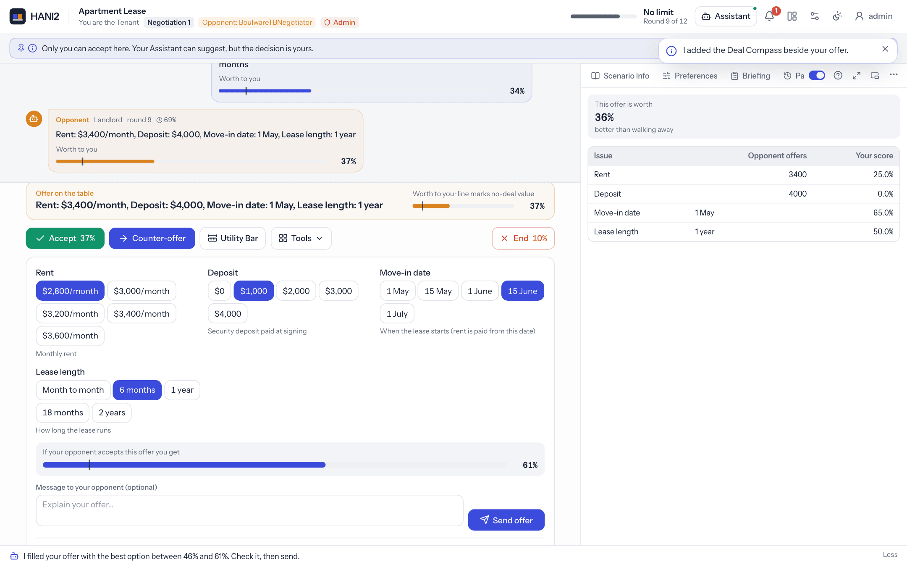

### Preferences

**Everyone, always (permanent).** Your preferences in the current scenario: on top, a collapsible
*In short* card with a summary, your role's hints and an arrow per issue (up: the more, the better;
down: the less, the better; meeting arrows: best at one value); then a donut chart (or, with
`tools.weights_chart: bar`, one thin bar) of the issue weights (how much each issue matters to you), a bar chart of what every option of the issue
picked in **Issue** is worth to you, your value on disagreement (what you get if there is no deal)
and a collapsible explanation of how a deal's value is computed from the two. The value of a deal is
the weighted sum of its options' values, so it is what the history, the offer panel and the other
tools show as "worth to you".

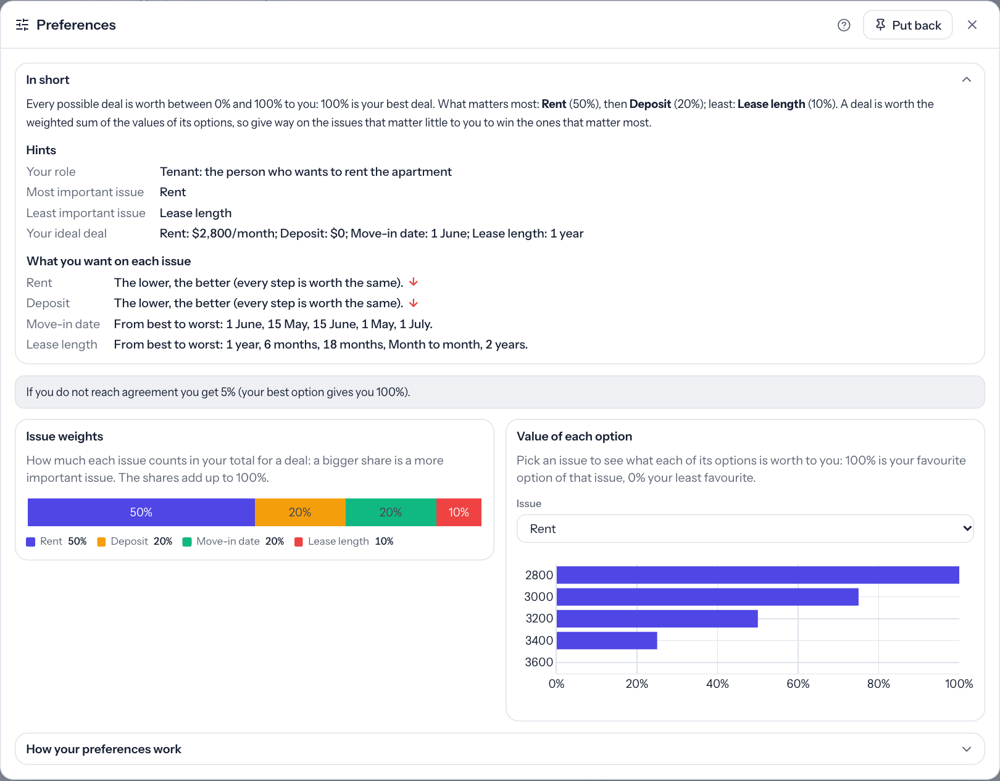

In a study that splits information ([Who knows what](information.md)) the tool shows only the part
of the preferences you know: the weights, the values or neither.

### Scenario Info

**Everyone, always (permanent).** The scenario: its title, a **You act as ...** badge with your
role, the short description and the scenario's picture, a table of the issues with their options
and descriptions, the hints for your role (your most and least important issue, your ideal deal) and
the long description in a collapsible card. **Picture** switches the picture off and the drop-down
next to it shows it small, large or as a watermark.

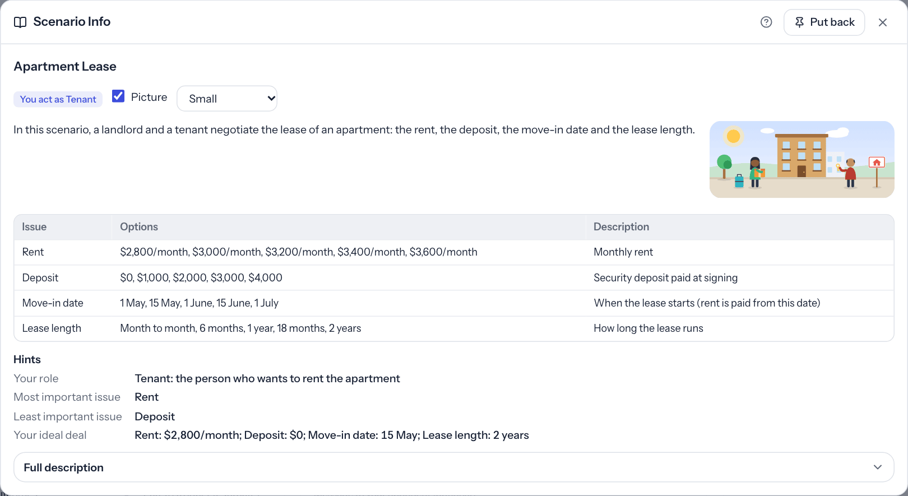

### Briefing

**The participant, when they have a private briefing or decisions only they make.** Private
instructions for your side, such as a limit someone you negotiate for has set, and the issues and
actions (accept, send, end) only you may decide. The line under the briefing says whether your
Assistant knows it. See [Private briefings](information.md#private-briefings-and-hidden-constraints).

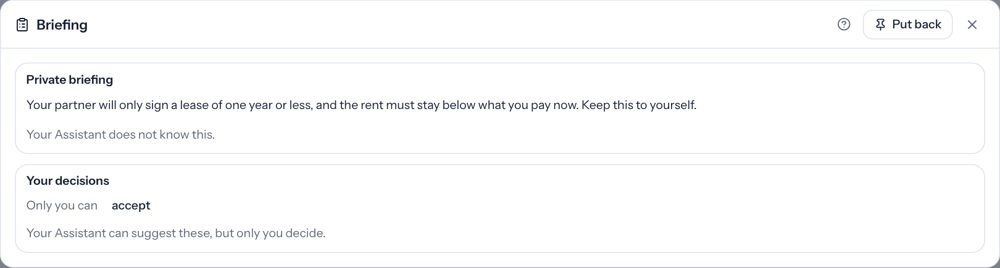

### Past Negotiations

**The participant, when they hold past negotiations in this scenario.** A table of the earlier
negotiations you hold (result, rounds, the styles both sides played, what your side got) and, for
the one picked under **Show negotiation**, its result, a chart of how both sides' offers moved
(worth to your side) and every offer in a collapsible table. It says how many more your Assistant
holds. See [Past negotiations](information.md#past-negotiations).

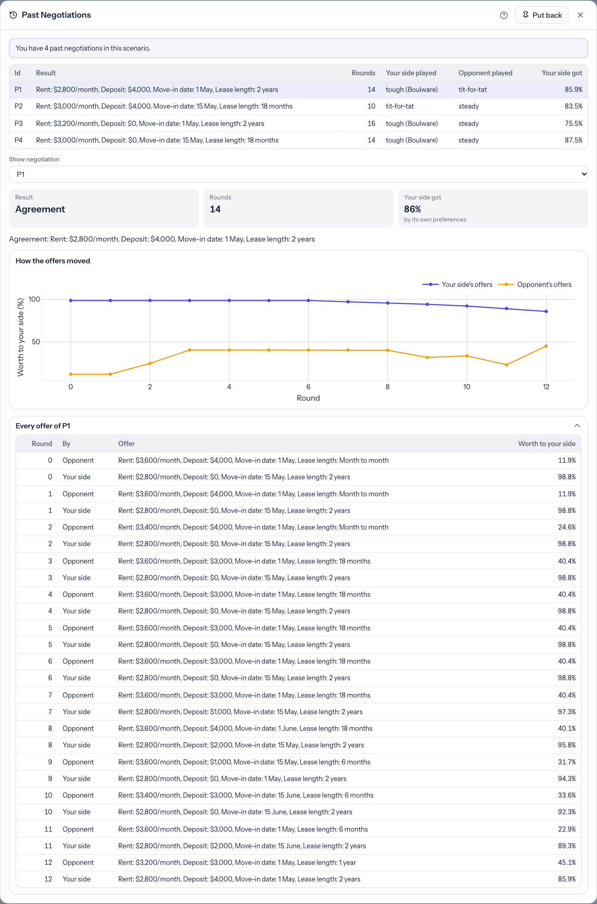

### Market Research

**The participant, when market research is given to them.** What parties like your opponent
usually want, from a number of comparable profiles: the typical weight of every issue and its
spread, the option most often liked best and how often, their most likely best deal and their usual
value on disagreement. See [Market research](information.md#market-research).

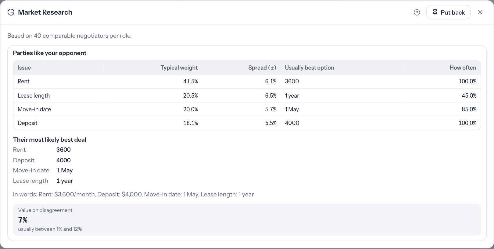

### My Results

**Logged-in users (not guests and Prolific participants).** Your score, the number of negotiations and
agreements, a table of scores per scenario
and a searchable table of every negotiation you finished. **Columns** picks the columns of the last
table (the [results columns](study-management.md#resultscsv-columns)). Practice rounds appear in the table but not in the score
or the counts.

The score takes, for every scenario, the mean of your best results (up to three) leaving out your
worst one, so a scenario counts only from your second negotiation in it, and averages that over the
scenarios, times 100. With one negotiation per scenario the score is 0.

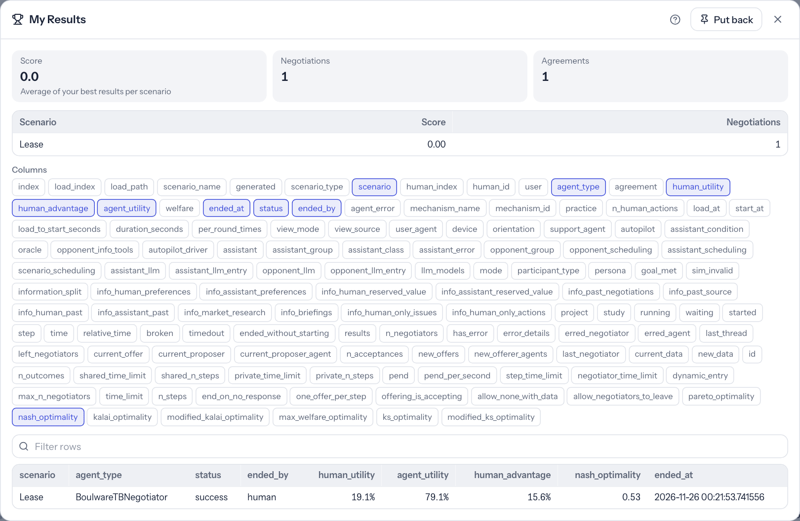

### Value Histogram

**Everyone, from the start of the negotiation.** How often each option of the selected issues was
offered by you and by the opponent. Issues with up to 25 options get a bar per option, others a
histogram. **Issues** picks the issues, **Your offers** includes or leaves out your own offers and
**Two columns** puts the charts side by side.

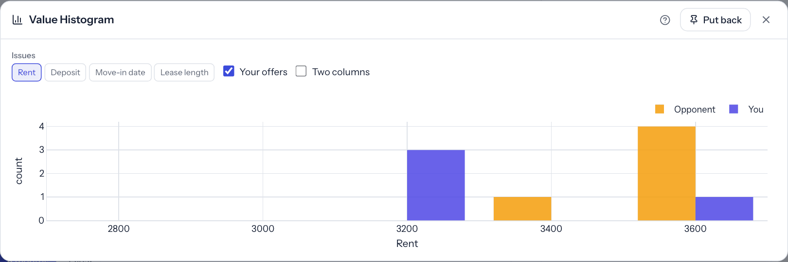

### Utility Plot

**Everyone, from the start; off by default.** What every offer so far is worth to you, one line for
each side, with a dotted **No deal** line at your value on disagreement. **X axis** is the round,
the relative time or seconds, and **Y axis** your utility. **Show opponent utility** adds the
opponent's utility; only admins see it, unless an admin opened opponent utilities to participants
(see [below](#opening-admin-only-tools-to-participants)).

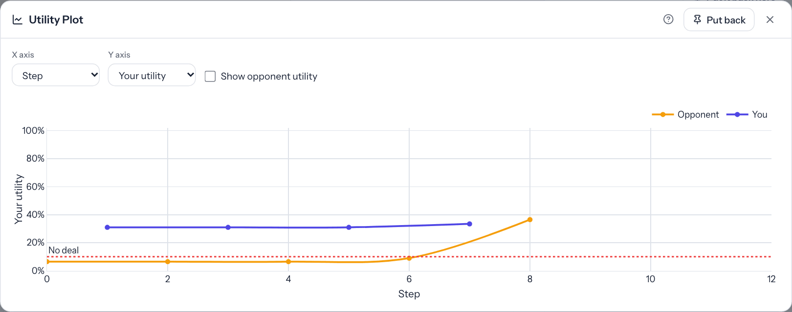

### Outcome Plot

**Everyone, from the start; off by default.** The offers placed by their options: any two issues
(or the round or relative time) on the axes, one trajectory per side. **Show your offers** hides
your own trajectory.

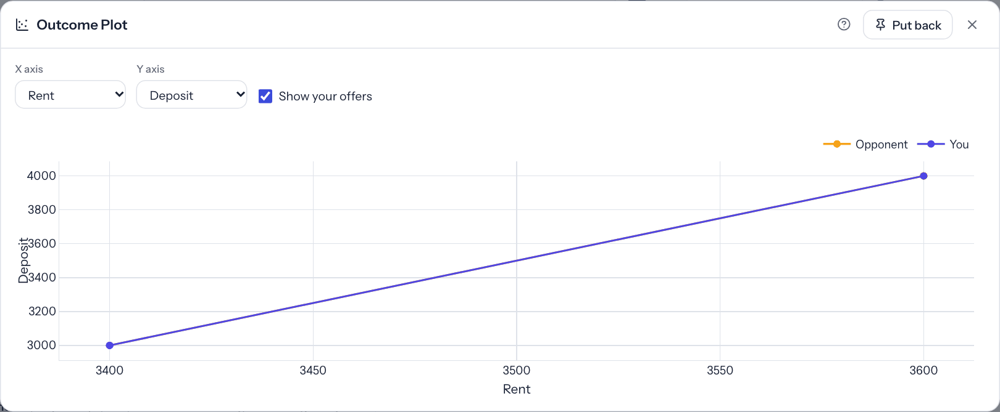

### Trace

**Everyone, from the start; off by default.** Every offer in a table: the round, the relative time,
who made it, the offer, its message and what it is worth to you. **Show opponent utility** adds the
opponent's utility, with the same rule as the Utility Plot.

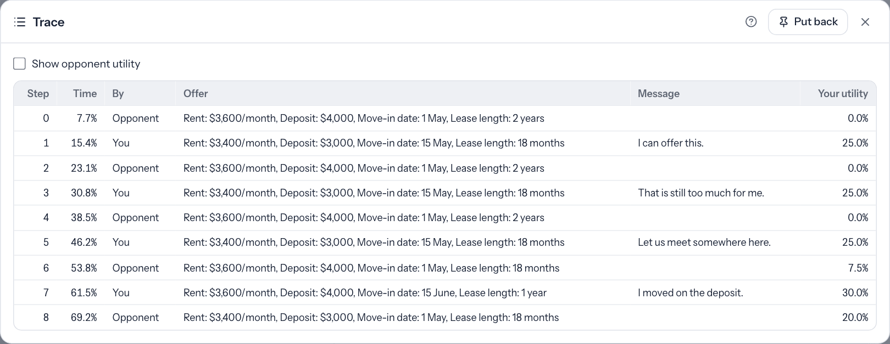

### Utility Bar

**Everyone, from the start; the side pane's open tab.** A bar of what deals are worth to you, from
0% to 100%: drag across a part of it, or click a point for the nearest deals, and choose **Any
offer**, **Up to 10 offers**, **All offers**, **Best for the opponent** or **Top 10 for the
opponent** (the last two only with an [estimate of the opponent](#an-estimate-of-the-opponents-preferences),
or for those who may see the real preferences). Click a row to copy it into your counter-offer, then
press **Send offer** to send it at once, with your message. See [Utility Bar](offer-generators.md#utility-bar).

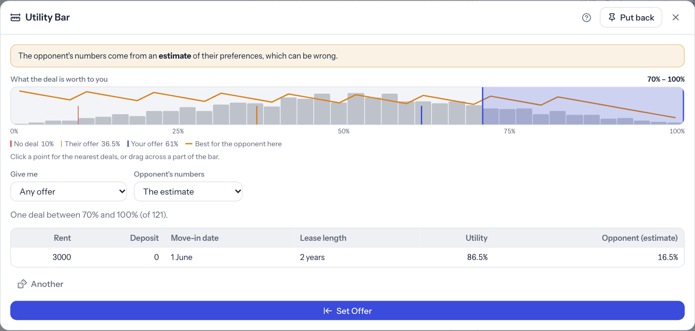

### Utility-based Selector

**Everyone, from the start.** The deals whose value for you lies in a range you choose, best first.
**Minimum utility** and **Range width** set the range in percent of the span from your worst to your
best deal (70% and 10% list every deal worth 70-80% to you); the width starts at 100%, so the range
runs from the minimum up to your best deal. Click a row to copy that deal into your counter-offer,
then press **Send offer** to send it at once, with your message, or change it in the counter-offer
and send it from there. See [Sending from the tool](offer-generators.md#sending-from-the-tool).

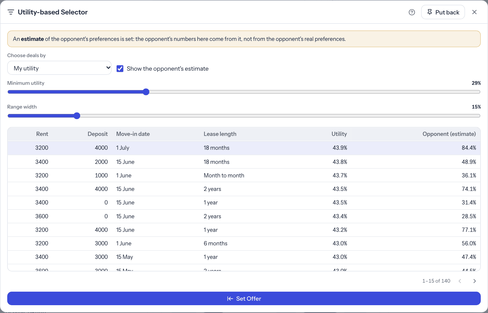

With an [estimate of the opponent](#an-estimate-of-the-opponents-preferences), the selector also
shows the opponent's estimated utility of every deal and can choose deals by it (below). See also
[Offer generators](offer-generators.md).

### Negotiation Plot

**Admins; everyone while an estimate of the opponent is set.** The negotiation in utility space:
every possible deal as a grey dot placed by its value for you (x) and for the opponent (y), the
Pareto frontier (green: deals where neither side can gain without the other losing), the Nash and
Kalai points (two standard fair compromises), both sides' offers so far, the agreement (a red ring)
and both sides' values on disagreement (dotted lines). **All outcomes**, **Pareto frontier** and
**Nash / Kalai** show or hide those layers. A banner above the chart says whether the opponent's
side uses its **real** preferences or an **estimate**.

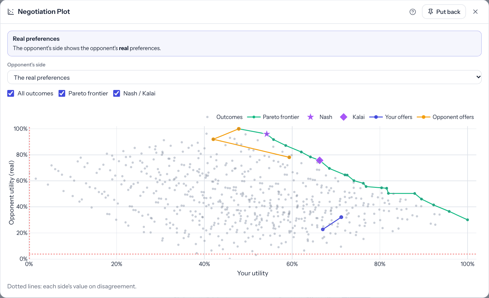

### Opponent Preferences

**Admins only.** The opponent's private preferences, in the same layout as Preferences: issue
weights, option values and the opponent's value on disagreement.

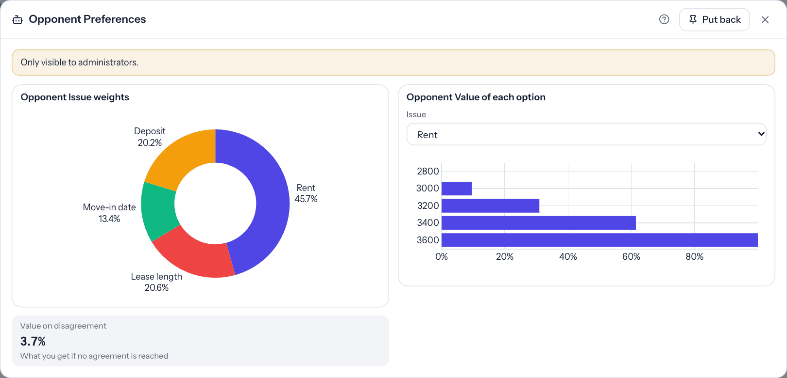

### All Results

**Admins only.** Everyone's results: the score, the negotiations and agreements, the scores per
scenario, a leaderboard of the human participants and the full results table with a column picker
(with a `user` column). Practice rounds are neither scored nor ranked.

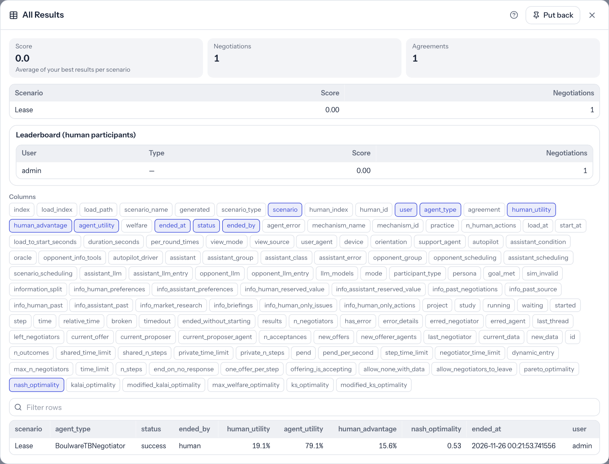

### LLM

**Admins only.** Write an instruction in plain words ("propose a fair middle ground on the rent"),
or nothing for **Recommend an offer**, choose **Text & offer**, **Text only** or **Offer only**, and
press **Generate**: your Assistant (when you have one) or the configured language model suggests an
offer and a message, shown with what the offer is worth to you. **Set
offer** copies them into your counter-offer; **Send offer** sends them as your offer right away. Without a configured model the tool shows a
warning. See [Offer generators](offer-generators.md#llm) and [Language models](llms.md).

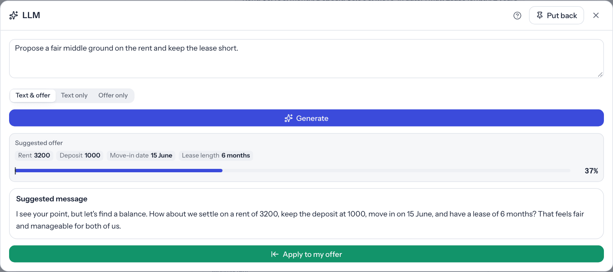

### Random

**Admins only.** **Generate** fills your counter-offer with a random deal, and **Send offer** sends it. Useful to explore the
outcome space or to test an opponent.

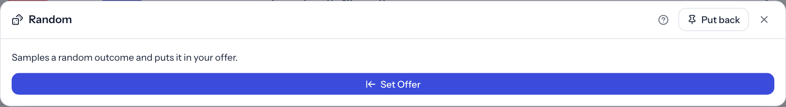

### An estimate of the opponent: what changes

With an estimate set (see [An estimate of the opponent's
preferences](#an-estimate-of-the-opponents-preferences)), a participant gets the Negotiation Plot
drawn with the estimate. The yellow **Estimate** banner, the axis title *Opponent utility
(estimate)* and the dashed frontier mark it as a guess:

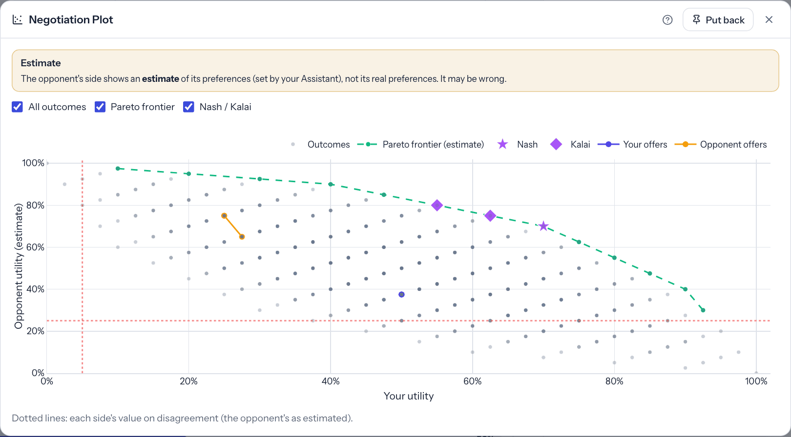

An admin sees the same by default and switches with **Opponent's side** between the estimate and
the real preferences:

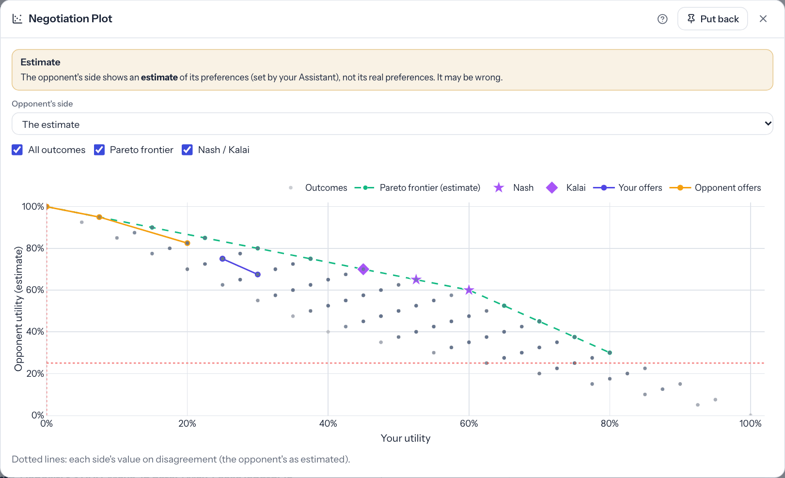

The Utility-based Selector gets a banner, an *Opponent (estimate)* column and **Choose deals by**:

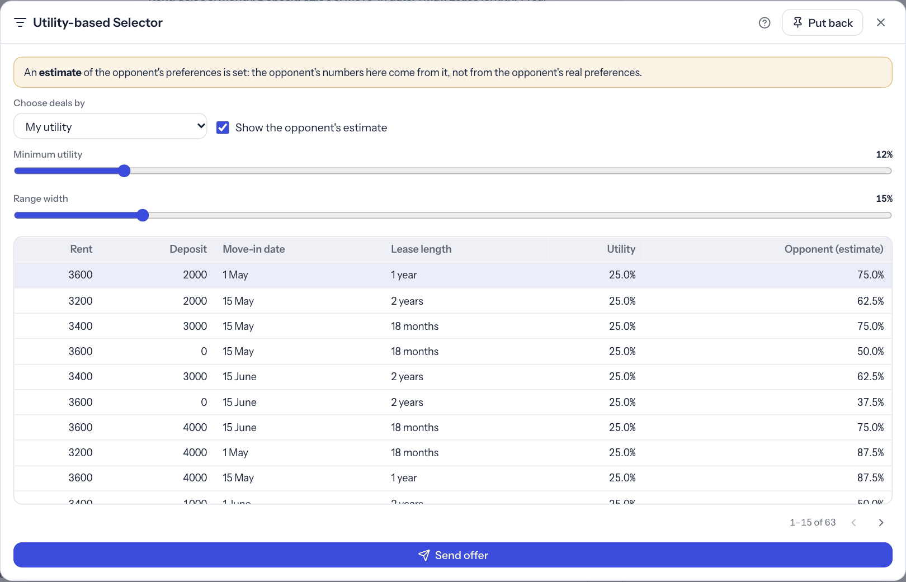

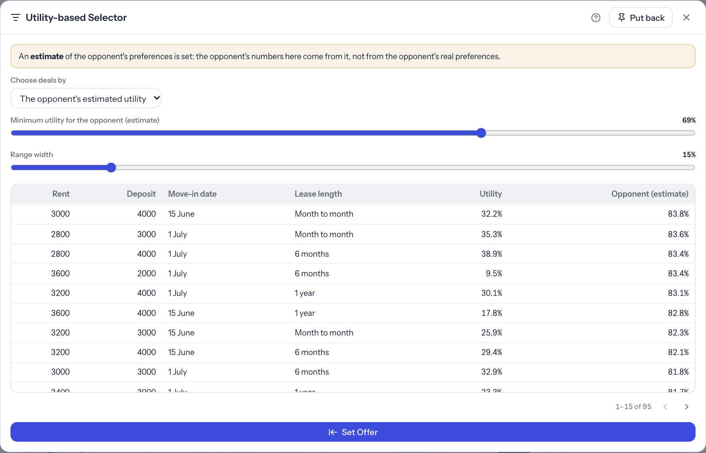

### Using admin-only tools

Admin-only tools are created only for a logged-in admin account: the `admin` user, an account with
the admin role (`hani2 users add NAME --admin`, or the admin console) or an account whose email is
in `admin.emails` (see [Admins](authentication.md#admins)). Log in as an admin and they appear in
their panes like any other tool. `?admin=1` in the URL does not make anyone an admin. To give an
admin-only tool to participants, see [Opening admin-only tools to
participants](#opening-admin-only-tools-to-participants).

## Example tools

The `examples/tools` folder of the source repository holds five tools that show how tools are
written; the [tools tutorial](../tutorials/tools.md) builds them step by step. Copy a file into the
tools folder (or start the server with `hani2 --tools examples/tools`) to use them.

### Offer Counter

How many offers each side has made: the smallest possible tool (`offer_counter.py`).

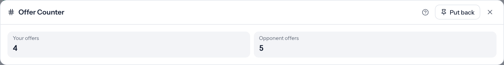

### What If

Pick an option for every issue and see what that deal is worth to you, then **Use as my offer**
(`what_if.py`): an interactive tool with inputs and a button.

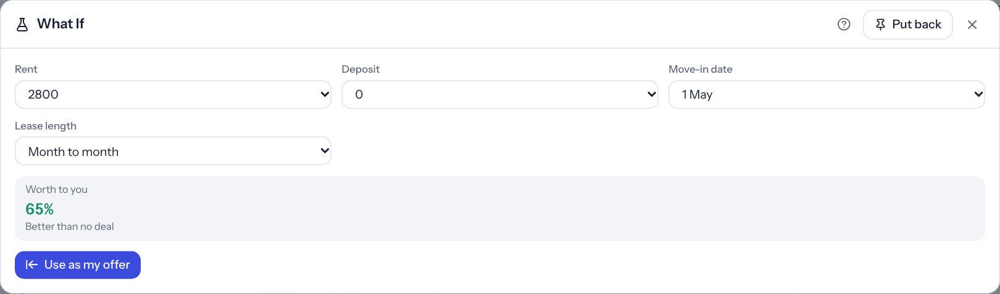

### Concession Tracker

What the opponent's offers are worth to you over time, how fast it concedes and where its offers are
heading (`concession_tracker.py`): a live chart.

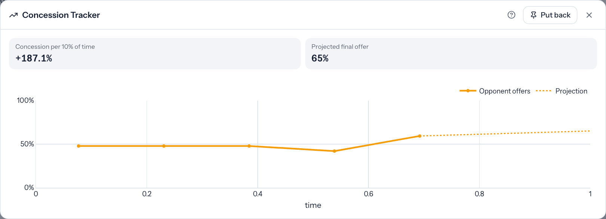

### Summary

**Summarise** asks the language model for a short summary of the negotiation so far
(`negotiation_summary.py`): a tool built on `LLMTool`.

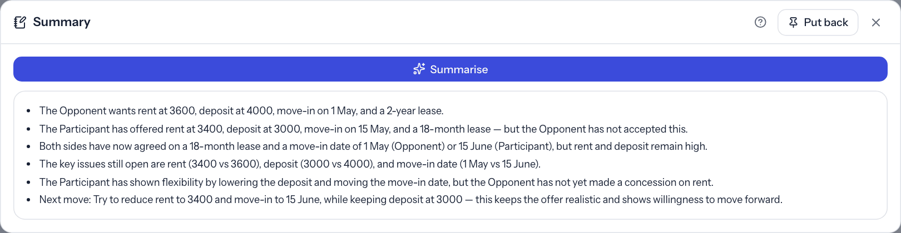

### Ask the AI

Type any question about the negotiation and press **Ask** (`ask_ai.py`): an `LLMTool` with its own
input.

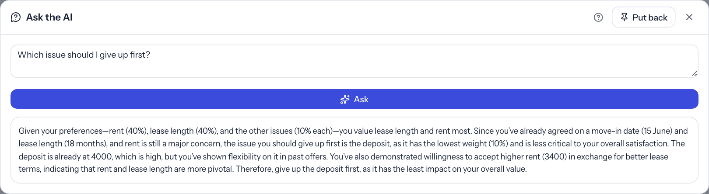

### Deal Compass

What the opponent's offer is worth to you, issue by issue. It belongs to the level 10 Assistant of
the [Assistant tutorial](../tutorials/assistant.md#level-10-bring-and-use-tools), which adds it to
the screen when the negotiation starts (`timing = "agent"`); the small mark on its tab says an
Assistant added it.

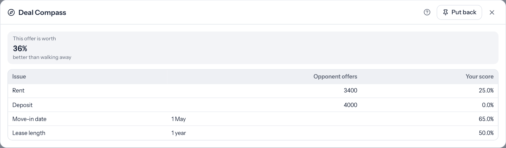

## Adding tools

Save a tool's Python file in the **tools folder**, `$HANI2_HOME/tools` (by default `~/negmas/hani2/tools`), and every new session gets the tools it defines. No restart is needed: changed files are read again when the next session starts. `hani2 tools new "My Tool"` creates a file there to start from, `hani2 tools list` shows every tool and where it comes from, and `hani2 tools path` shows the folders searched. More folders can be added with `hani2 --tools DIR` or `tools.paths` in `env.json`. The [tools tutorial](../tutorials/tools.md) explains how to write the file, and the `examples/tools` folder of the repository holds five examples, including two that use a language model.

You can also add a tool through the [library](library.md): `hani2 library add tools offer_counter.py`
(or a `.zip`, or `--link` to a file or folder that stays where it is), for every study or only for
one project or study (`--layer project:P`, `--layer study:P/S`). The admin API does the same
([Library API](../reference/library-api.md)).

## Tool groups

Every tool belongs to groups: the ones its class lists in `groups` (for example
`groups = ("visualization",)`), plus `admin` for admin-only tools, `assistant` for tools with
timing `"agent"` and `all`. The built-in tools are in `information` (Preferences, Opponent
Preferences, Scenario Info, Trace, My Results, All Results), `visualization` (Utility Plot,
Negotiation Plot, Outcome Plot, Value Histogram) and `recommendation` (Utility-based Selector,
LLM, Random; every `OutcomeSelector` is in it). You can define your own groups, made of tools and
other groups, in `tools.yaml`, and choose the tools a study offers with `offer`:

```yaml title="projects/HI2027/tools.yaml"
groups:
  core: ["@information", "Utility-based Selector"]
offer: ["@core", "Utility Plot"]
```

Without `offer` every tool is offered, as before. See
[Tool groups](library.md#tool-groups).

## Placement per view

The page has a full, a simple and a focus view. A tool can sit in another pane, at another
place, or be hidden, depending on the view: set `placement` on the class
(`placement = {"simple": {"pane": "upper", "visible": False}}`) or per tool in `tools.yaml`. A
view not given uses the tool's `pane` and `order`, shown. When the view changes, every tool moves
to its place in the new view; where the participant moved or hid a tool is remembered per view.
Tools without a placement never move. See
[Where tools go in each view](library.md#where-tools-go-in-each-view).

## Configuring tools in env.json

The `"tools"` section of `env.json` (see [Configuration reference](configuration.md)) controls which tools exist and their defaults. It has these keys:

```json
{
  "tools": {
    "paths": ["/srv/study/tools"],
    "extra": ["my_package.tools:WhatIf", "my_package.tools.OfferCounter"],
    "disabled": ["Trace", "Outcome Plot"],
    "overrides": {
      "Utility Plot": {"enabled": true, "pane": "side"},
      "Value Histogram": {"order": 1}
    }
  }
}
```

`paths`
:   Folders (or single `.py` files) to load tools from, in addition to `$HANI2_HOME/tools`.

`extra`
:   A list of tool classes to add. Each entry is an import path, `module:Class` or `module.Class`, or a file and class, `path/to/file.py:Class`. A folder or a `.py` file without a class name loads every tool in it, like `paths`. The class must be a subclass of `hani2.tools.Tool`; otherwise the server prints `[hani2] could not load tool ...` and skips it. The module must be importable by the server process, so put it in an installed package or start the server with its folder on `PYTHONPATH`.

`disabled`
:   Tool names to remove. Matching ignores case. Disabled tools are not created at all, for anyone.

`overrides`
:   A mapping from a tool's name (case-insensitive) to new defaults. The accepted keys are:

    | Key | Meaning |
    |-----|---------|
    | `pane` | `upper`, `lower` or `side` |
    | `timing` | `always`, `load`, `start` or `end` |
    | `enabled` | Default state of the enable switch |
    | `admin_only` | Only admins get the tool |
    | `guest` | Whether playground and Prolific sessions get the tool |
    | `order` | Sort key inside the pane (smaller first) |
    | `at_front` | Make this the selected tab of its pane when it appears. Defaults to true when `order` is 0 or 1. |

Tools are collected in this order: the built-in tools, then tools published by installed packages through the `hani2.tools` entry-point group, then classes registered with `hani2.tools.register_tool`, then the tool folders, then the `extra` list. A class that appears twice is added once, and when two tools share a name the first one wins (the server log names the one it ignored). `disabled` and `overrides` then apply to all of them, so you can also disable or move a tool that a package provides.

The server reads this section each time a session reaches a timing, so a change reaches new sessions and any timing an existing session has not reached yet. Tools a session already created stay as they are.

### Publishing tools from a package

A package can make its tools available without touching `env.json` by declaring an entry point in the `hani2.tools` group in its `pyproject.toml`:

```toml
[project.entry-points."hani2.tools"]
what_if = "my_package.tools:WhatIf"
```

After `pip install` of that package, every session gets the tool (subject to `disabled` and `overrides`).

## Who sees what

When a session reaches a tool's timing, a tool is created for it unless:

- the tool is `admin_only` and the session does not belong to an admin account, or
- the tool has `guest = false` and the session is a playground or Prolific session (`/play`).

Two settings of `env.json → negotiation` also affect tools; the admin console sets them on the Participant interface page, for all projects, a project or a study (see [Admin console](admin.md#participant-interface)):

- `allow_tool_switch`: when off, participants do not see the enable switch, and tools that are off by default render anyway.
- `allow_moving_tools`: when off, the "Move to ..." entries disappear from the tool menu and move requests are ignored.

## Tools and the Assistant

The Assistant sees the list of tools in its context and, depending on its capabilities, can switch tools on or off (`tool_enable`), hide and show them (`tool_visibility`) and move them or bring one to the front (`tool_order`). Both the participant's buttons and the agent go through the same server-side controller, so permanent tools cannot be hidden or switched off by either.

With **Use tools** (`tool_use`) the agent can also read any tool's help text and what it shows, as text, and operate its inputs, buttons and selectable tables, exactly as the participant would; whatever the tool then does to the offer follows the agent's own permissions. With **Add tools** (`tool_add`) it can put new tools on the screen during the session: its own tools, tools from its `toolbox` setting, registered tools the participant does not have yet, and tools whose `timing` is `"agent"` (these appear only when an agent adds them). A tool added this way carries a small assistant mark on its tab. See [Tools the agent can find, use and add](assistant.md#tools-the-agent-can-find-use-and-add).

## Extra tools from the command line

`hani2 --tools package.module:Class,path/to/file.py:Class` loads extra tools when the server starts (each class is imported first, so a typo stops the server with an error). An entry can also be a folder or a `.py` file, which loads every tool in it and, like the tools folder, re-reads changed files for new sessions, and `hani2 experiment create NAME --tools ...` saves them in an experiment. Use it for tools submitted by competition teams.

## How tools are rendered

Only the tools the participant can see are computed: the front tab of each pane and an enlarged tool. A hidden tool is brought up to date when its tab is opened. Tools are computed in their own worker threads, never on the server's main loop, so a slow tool does not delay the rest of the page; in the browser, charts are drawn when the browser is idle and only when on screen.

## When a tool fails

A tool is code, and code submitted by a team or a study designer may raise an error or never
finish. A failing tool never breaks the session, the negotiation, the other tools or the page: its
failure is shown **in that tool's own tab only**, and everything else carries on.

| What fails | What the tool's tab shows |
| --- | --- |
| Creating the tool, or its `init` | The failure, for the rest of the session. The tool keeps its tab but is not called again. |
| Its `view` raises | The failure, until a later render works. |
| Its `view` takes longer than `tools.render_timeout` seconds (20 by default) | That it took too long. The tool is not rendered again until that render returns, so a hanging tool never holds up the other tools or sessions. |
| A hook (`scenario_loaded`, `negotiation_started`, `action_executed`, …), an input or a button | The tool's normal view under an error banner, until the same call works again. A failing button also shows a notification, as before. |

Participants only read that the tool is not working right now. Administrators also see the error
type, the message and, folded away, the traceback. Every failure is written to the server log and
recorded as an `error` event once per kind of failure. When the Assistant tries to use a tool that
failed to start or is stuck rendering, it is told the tool is not working right now.

A tool file (or `tools.extra` entry, entry point or library entry) that cannot even be imported
gives no tab at all. The admin console lists such files at the top of the **Tools** page of the
library, with the error, until the file is fixed (`GET /api/admin/library/tools/load-errors`).

**Built-in tools.** HANI2's own tools (classes defined in the `hani2` package) get the same
treatment by default. For debugging HANI2 itself, set `tools.isolate_builtin` to `false` (*Catch
built-in tool failures* on the **Tools** settings page): then their errors surface as they used
to (printed in the server log, a render error shown with its message to everyone) and they have
no time limit. Running sessions pick up a change of either setting within a few seconds. Tools from the tools folder, `--tools`, `tools.extra`, entry points and the library
are always guarded, even when they subclass a built-in tool.
