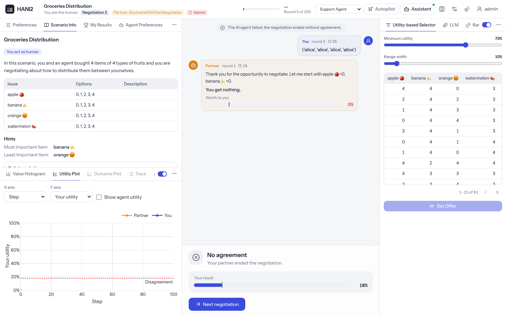
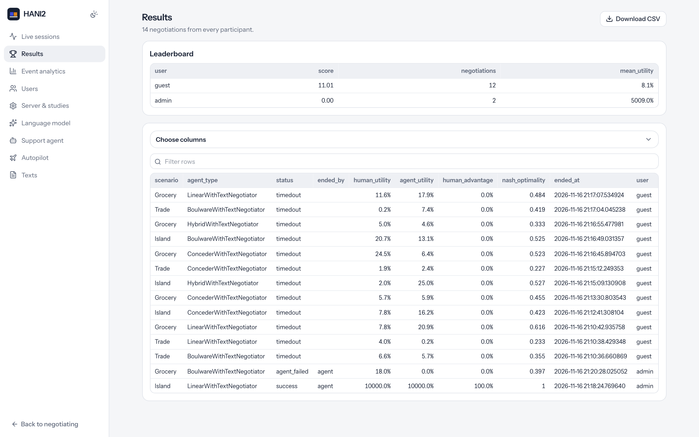

# HANI2

HANI2 is a web interface for human–agent negotiation studies. People negotiate in the browser against automated agents built with [negmas](https://github.com/yasserfarouk/negmas), optionally helped by an AI support agent, while HANI2 records every offer, message, click and questionnaire answer. It is used to run the human–agent negotiation and hybrid intelligence tracks of the [ANAC competition](https://anac.cs.brown.edu).

HANI2 is a Python package with a FastAPI backend and a React frontend that ships pre-built inside the wheel. One command starts everything on one port.



## Features

- **Negotiation desk.** The partner's offer is on the table with its value to you. You accept it, send a counter-offer with an optional message, or end the negotiation; accepting and ending ask for confirmation. Utility gauges show what each offer is worth, with a tick at your no-deal value, and the history reads like a conversation. Three layouts (full, simple, focus) and a phone layout.
- **Tools.** Preferences, scenario information, utility and outcome plots, value histograms, the offer trace, a utility-based offer picker and more, in tabbed panes that participants can rearrange. Write your own tools in Python with a small component API; no frontend code needed.
- **Support agent.** An assistant docked next to the negotiation. It chats, keeps a status board, highlights and annotates parts of the interface, rearranges tools, shows its own interactive panels, fills in offers and, with permission, acts. Admins decide what it may do; participants can narrow that further. Subclass it to build your own agent.
- **Autopilot.** Let the support agent or any negotiator play the human's seat, for demonstrations and testing.
- **Any opponent.** Any negmas or Genius negotiator, LLM negotiators from negmas-llm, your own classes, and named groups of them, chosen per server, per session or per link.
- **Studies.** Self-contained experiments, post-negotiation questionnaires, results CSV files with outcome and timing columns, and an event log with analytics.
- **Prolific.** A no-login flow keyed by the Prolific ID, with practice rounds, counted rounds and the completion link.
- **Admin console.** Live sessions, results and leaderboard, event analytics, users, and every setting, editable in the browser.
- **Any language model.** Local models through Ollama or any provider supported by litellm, separately for the assistant and for LLM opponents.
- **Accounts.** Password login, GitHub and Google OAuth, or no login at all, with an optional consent form.

## Quick start

```bash
pip install hani2
hani2 setup
hani2
```

Your browser opens `http://localhost:5006/app`. Log in as `user` / `userpass`, or as `admin` / `adminpass` for the admin tools. The same port serves:

| URL | What |
| --- | --- |
| `/app` | The negotiation interface for logged-in users. |
| `/play` | The playground: no login. Prolific participants use `/play?PROLIFIC_PID=...`. |
| `/admin` | The admin console. |

The assistant and LLM opponents need a language model. The defaults expect [Ollama](https://ollama.com) with `qwen3:4b-instruct`:

```bash
ollama pull qwen3:4b-instruct
```



## Where to go next

- [Installation](getting-started/installation.md) and the [quick start](getting-started/quickstart.md) walk through a first negotiation.
- [The interface](guide/interface.md) describes what participants see.
- [Studies and results](guide/studies.md) and [Prolific](guide/prolific.md) explain how to run an experiment.
- [Build a support agent](tutorials/support-agent.md) and [Build a tool](tutorials/tools.md) are hands-on tutorials.
- [Configuration reference](guide/configuration.md) lists every setting and environment variable.

HANI2 is free software under the AGPL-3.0-or-later license. The source is at [github.com/autoneg/hani2](https://github.com/autoneg/hani2).
