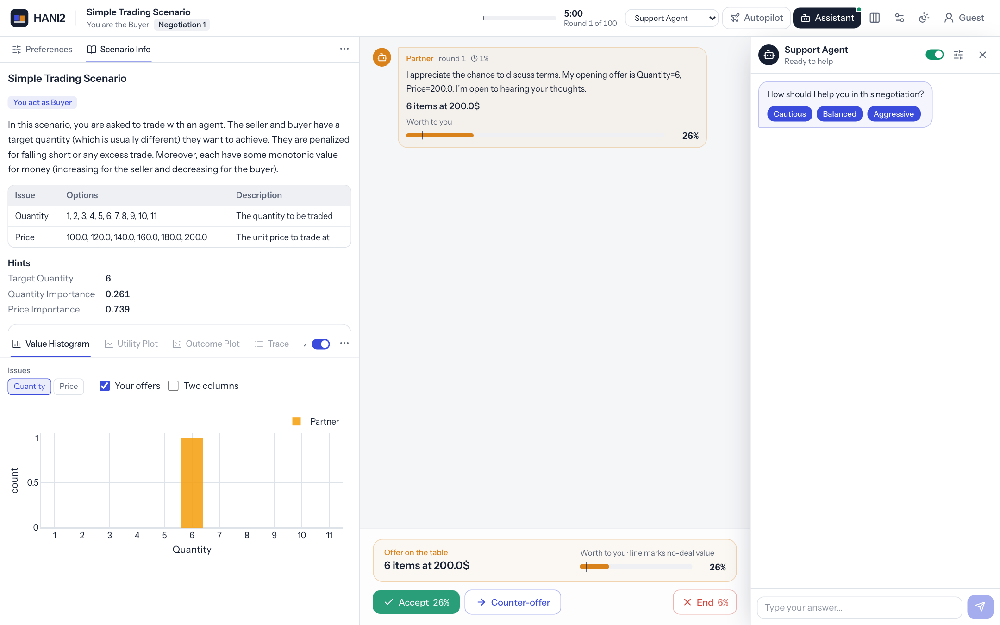
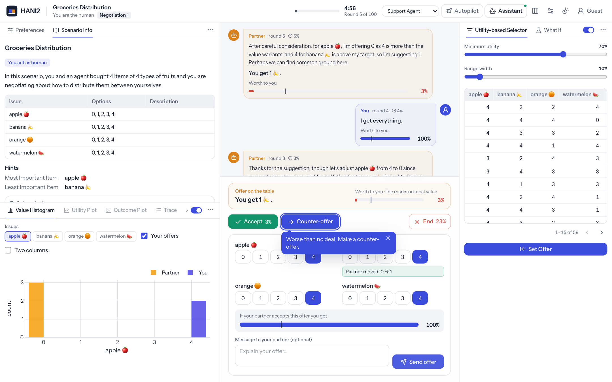
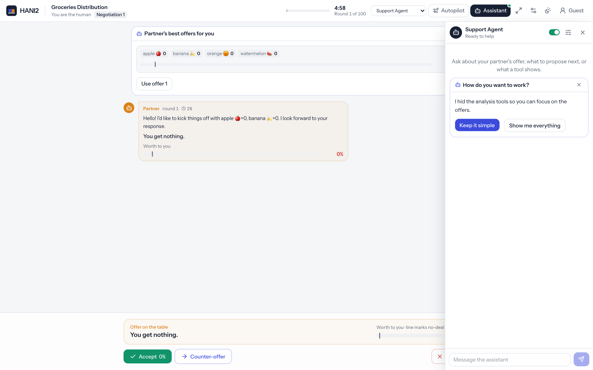
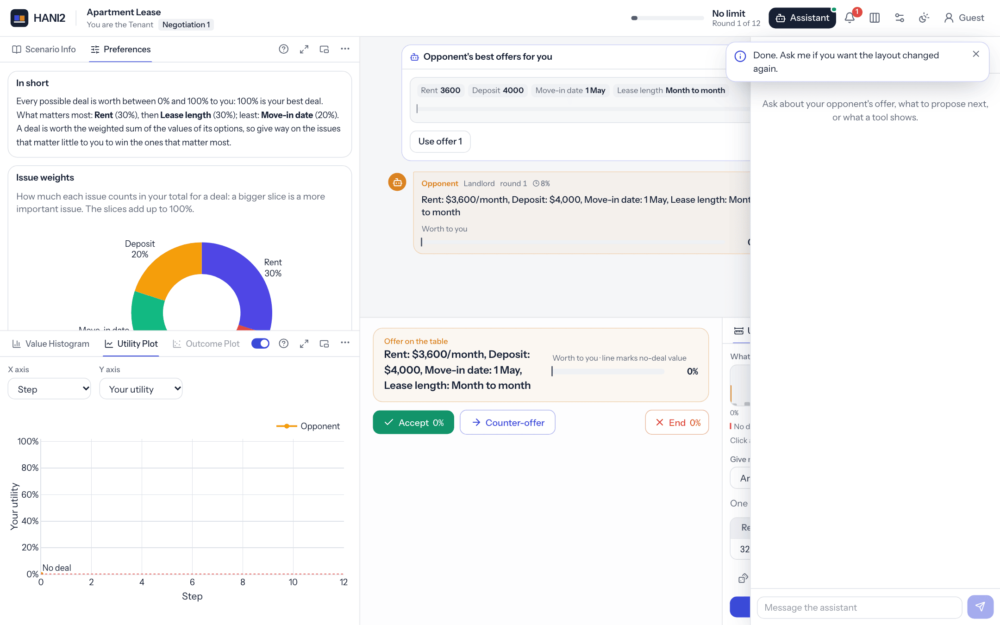

# Build an Assistant

This tutorial builds a negotiation Assistant in ten small steps. You start with an agent that echoes what the participant types and finish with one that points at the interface, rearranges it and builds its own interactive panels. Most levels need no language model at all; levels 3, 4, 5 and 7 use one.

| Level | You build | Needs an LLM |
|-------|-----------|--------------|
| 0 | Nothing yet: install HANI2 and meet the default agent | yes, to chat with the default agent |
| 1 | An echo agent | no |
| 2 | Rules that read the live negotiation | no |
| 3 | An LLM coach with your own persona | yes |
| 4 | A custom function the model can call | yes |
| 5 | A proactive deal coach | yes |
| 6 | An agent that controls the tools | no |
| 7 | An agent that asks the participant a question | yes, for the coaching |
| 8 | Highlights and notes on the interface | no |
| 9 | Layout changes and a custom interactive panel | no |

Every level is a real file in `examples/support_agent_tutorial` in the source repository, and every one is covered by the test suite. The [Assistant guide](../guide/assistant.md) is the reference for everything used here.

## Level 0: set up

Install HANI2 and create the settings folder:

```bash
pip install hani2
hani2 setup
```

`hani2 setup` creates `~/negmas/hani2/settings` with default settings, two accounts and sample scenarios. Set `HANI2_HOME` before running it to use another folder.

Get the example files from the source repository:

```bash
git clone https://github.com/autoneg/hani2
cd hani2/examples/support_agent_tutorial
```

Start the server and open the playground, which needs no login:

```bash
hani2 --page play
```

Your browser opens `http://localhost:5006/play`. Press **Start** to begin a negotiation, then press **Assistant** in the header to open the assistant dock. This is the default agent.

The default agent needs a language model. Out of the box it uses `qwen3:4b-instruct` through a local [Ollama](https://ollama.com) server:

```bash
ollama pull qwen3:4b-instruct
```

With Ollama running, ask the assistant "What do you think of this offer?". It answers with the live negotiation state in front of it. Without a model you see a "Assistant error" message in the chat; that is fine for levels 1, 2, 6, 8 and 9. To use a hosted model instead, see [Language models](../guide/llms.md).

### How to run each level

Each level is a class in a module in this folder. To run one:

1. Open `~/negmas/hani2/settings/assistant_settings.json` and set `agent_class` to the level's `module:Class`, for example:

    ```json
    {
      "agent_class": "level1_hello:HelloAgent"
    }
    ```

    The file is merged over the defaults, so you may keep the other keys `hani2 setup` wrote or delete them.

2. From inside `examples/support_agent_tutorial`, start the server with this folder on Python's path:

    ```bash
    PYTHONPATH=$PWD hani2 --page play
    ```

3. Press **Start**, then open the **Assistant**.

Restart the server after every change to the settings or the code. Sessions and their agents live in memory and are created once per session, so a running server keeps using the agent it already built.

Levels 4, 5 and 7 import from earlier levels (`from level3_llm_coach import COACH_PROMPT`), so keep all the files together in the folder on `PYTHONPATH`.

## Level 1: echo

The smallest possible agent overrides one method. `handle_user_message` runs every time the participant sends a chat message; `post` writes a message into the chat.

```python
--8<-- "examples/support_agent_tutorial/level1_hello.py"
```

Run it with `"agent_class": "level1_hello:HelloAgent"`, open the assistant and type "hi". The agent answers "Hello! You said: hi".

`handle_user_message` replaces the whole chat turn, so this agent never calls a language model. It runs in a worker thread, so it may take as long as it needs without freezing the page.

**Try this:** add `name = "Echo"` as a class attribute and watch the dock header and the chat change. Then switch the assistant off with the switch in the dock header: the message box is disabled, and the session never calls your method while the agent is off.

## Level 2: rules that read the negotiation

Now the agent looks at the negotiation. `session_state["actions"]["context"]` returns a snapshot with the issues, the opponent's offer and its utility for the participant, the reserved value, the draft offer and the recent history.

```python
--8<-- "examples/support_agent_tutorial/level2_rules.py"
```

Run it with `"agent_class": "level2_rules:RulesAgent"`. Start a negotiation, wait for the opponent's first offer and ask anything. The agent replies with the offer, what it is worth to you and a one-line verdict.

Two things to note:

- The agent reads state through `run_on_doc`. It runs the function under the session lock, so the snapshot is consistent even while the opponent is moving. `self.context()` is a shortcut for the same call.
- Utilities and the reserved value are numbers between 0 and 1 for the participant only.

**Try this:** add a line that lists the opponent's last three offers from `ctx["history"]` (entries with `by == "partner"`; `partner` is the wire name, the old name of the opponent), with their utilities.

## Level 3: an LLM coach

The built-in agent already runs a language model with function calling. To give it your own persona, override `build_system_prompt`.

```python
--8<-- "examples/support_agent_tutorial/level3_llm_coach.py"
```

Set the model in the same settings file:

```json
{
  "agent_class": "level3_llm_coach:CoachAgent",
  "provider": "ollama",
  "model": "qwen3:4b-instruct"
}
```

For a hosted model, set `provider`, `model` and `api_key_env` (the name of the environment variable that holds your key), for example `"provider": "openai", "model": "gpt-4o-mini", "api_key_env": "OPENAI_API_KEY"`.

Each chat message reaches the model with the current negotiation state attached as JSON, so the prompt does not have to ask for it. The model can also call every function the admin granted: fill the offer, highlight a button, show a panel and so on.

**Try this:** ask "Fill in a counter-offer for me". The coach calls `set_offer` and the fields change. Then set `"autonomy": "suggest"` and ask it to accept: instead of accepting, it highlights the Accept button. Set `"capabilities": {"accept": false}` and the model no longer sees the accept function at all.

## Level 4: a function of your own

Language models are poor at arithmetic. Do the numbers in code and let the model explain them. A `ToolDispatcher` subclass registers new functions in `register_extra_tools`; the agent uses it through `dispatcher_class`.

```python
--8<-- "examples/support_agent_tutorial/level4_tools.py"
```

Run it with `"agent_class": "level4_tools:ToolCoachAgent"`. Ask "Should I accept?" The model calls `assess_partner_offer`, receives a verdict with the offer's utility, the reserved value and a target that relaxes over time, and explains it.

`register` takes the function name, a handler that receives the argument dictionary and returns a JSON-serialisable dictionary, a callable returning the schema (`make_function_schema` builds it) and a capability. `capability=None` makes the function always available; pass a `Capability` to tie it to one the admin can grant or the participant can switch off.

**Try this:** add an `issue` argument (`{"issue": {"type": "string"}}`) and return the opponent's value on that issue, then ask the coach about a single issue.

## Level 5: a proactive deal coach

So far the agent only speaks when spoken to. `proactive_note` lets it speak up on negotiation events. Return a short instruction for the events you care about and `None` for the rest.

```python
--8<-- "examples/support_agent_tutorial/level5_deal_coach.py"
```

Proactive turns are off by default. Turn on the event in the settings:

```json
{
  "agent_class": "level5_deal_coach:DealCoach",
  "proactive": {"on_action_requested": true}
}
```

Now, on every one of your turns, the coach assesses the opponent's offer and gives a one-sentence recommendation. By default it arrives as a notification. In the assistant settings (the sliders icon in the dock header), **Unprompted messages appear as** switches it to the status board or the chat.

**Try this:** also enable `on_negotiation_ended` and return a debrief instruction for `negotiation_ended`. Then set `"autonomy": "suggest"` and watch the coach fill the offer and highlight Send without sending.

## Level 6: controlling the tools

Agents can rearrange the participant's analysis tools. This one starts simple, hiding the advanced plots, and brings them back as the negotiation develops. It needs no model: it calls the same functions an LLM would, through `self.dispatcher.execute`, so its actions are logged as the agent's.

```python
--8<-- "examples/support_agent_tutorial/level6_guided.py"
```

Run it with `"agent_class": "level6_guided:GuidedAgent"`. When you press Start, the Value Histogram, Utility Plot, Outcome Plot and Trace tabs disappear and the agent explains why in the chat. On your second turn the Utility Plot returns with a notification and a plan on the status board; on the third, everything is back.

`on_event` receives `negotiation_started`, `action_requested` and `negotiation_ended`. Overriding it replaces the default behaviour (proactive turns and autopilot), which is what this agent wants. `message_user(text, channel=...)` sends to `chat`, `toast` or `board`.

**Try this:** use `move_tool` to move the Utility Plot into the side pane on the second turn: `self.dispatcher.execute("move_tool", {"name": "Utility Plot", "pane": "side"})`.

## Level 7: asking the participant

`ask_user(question, options)` posts a question in the chat with answer buttons and waits for the answer. The participant can press a button or type a reply. The call blocks the agent's worker thread, not the interface.

```python
--8<-- "examples/support_agent_tutorial/level7_asking.py"
```

Run it with `"agent_class": "level7_asking:AskingCoach"` and keep `"proactive": {"on_action_requested": true}`. When you press Start, the assistant dock opens with the question "How should I help you in this negotiation?" and three buttons. The answer sets the coaching style and is added to the model conversation, so later advice follows it. Every other event goes to the level 5 coach through `super().on_event(...)`.



`ask_user` returns `None` when the participant does not answer within the timeout (180 seconds by default), under autopilot, or while another question is pending. Always handle `None`.

**Try this:** ask a follow-up question when the negotiation ends ("Was my advice useful?" with "Yes" and "No") and log the answer with `self.post`.

## Level 8: highlights and notes

The agent can point at the interface. `highlight(target, message, style=...)` spotlights an element with a short callout; `annotate(target, text, kind=...)` attaches a note that stays until removed. Targets include the buttons (`accept`, `reject`, `end`, `send`), `partner_offer`, `offer`, `history`, `timer`, `issue:<name>` and `tool:<name>`.

```python
--8<-- "examples/support_agent_tutorial/level8_spotlight.py"
```

Run it with `"agent_class": "level8_spotlight:SpotlightAgent"`. On each of your turns the agent marks every issue the opponent moved on with a "Opponent moved" note, and spotlights the button it recommends with a one-line reason: Reject when the offer is worse than no deal, Accept (with a glow) when it is good enough for the time left, otherwise the opponent's offer.



Highlights are cleared when the participant acts and replaced when the agent highlights the same target again. The participant can dismiss one with its close button. Notes stay until the agent removes them by passing `text=None`, or a new scenario loads.

**Try this:** add `duration=5` to the highlight so it fades after five seconds, or use `style="spotlight"` to dim everything else.

## Level 9: layout and custom panels

The last agent reshapes the page. `set_layout(view=...)` switches between the `full`, `simple` and `focus` views. `show_panel(panel_id, title, components, placement=...)` shows a panel built from the same `hani2.tools.ui` components tools use, and `on_panel_action` receives button clicks.

```python
--8<-- "examples/support_agent_tutorial/level9_panels.py"
```

Run it with `"agent_class": "level9_panels:PanelAgent"`. When you press Start:

1. The layout switches to the focus view, hiding the tools.
2. A **How do you want to work?** panel appears in the assistant dock, which opens on its own. **Keep it simple** switches to the simple view; **Show me everything** restores the full view and brings the Utility Plot to the front. Either way the panel closes and a notification confirms it.

    
3. On each of your turns a **Opponent's best offers for you** panel above the action panel lists the three opponent offers worth most to you, each with a **Use offer** button. Clicking one copies the offer into your counter-offer and highlights Send.



The button's `payload` travels back to `on_panel_action`, which is how the panel knows which offer was chosen. `placement` is `assistant` (in the dock), `side` (above the action panel) or `modal` (a dialog). Showing a panel with the same `panel_id` replaces it. See [Build a tool](tools.md) for every component you can use.

**Try this:** add a `ui.table(...)` of the opponent's last five offers to the best-offers panel, or move the welcome panel to `placement="modal"`.

## Level 10: bring and use tools

An agent can bring tools of its own and operate the participant's tools. This agent ships a
*Deal Compass*, a small tool with `timing = "agent"`, so nobody sees it until the agent adds it
when the negotiation starts. On every turn it then uses the participant's **Utility-based
Selector**: it sets the minimum-utility slider a little above the opponent's offer and picks the
best row, which fills the counter-offer.

```python
--8<-- "examples/support_agent_tutorial/level10_toolsmith.py"
```

Run it with `"agent_class": "level10_toolsmith:ToolsmithAgent"`, or
`hani2 --assistant examples/support_agent_tutorial/level10_toolsmith.py:ToolsmithAgent`.
When you press Start:

1. A **Deal Compass** tab appears beside your offer, marked as added by the assistant, with a
   notification. It shows what the opponent's offer is worth to you, issue by issue.
2. On each of your turns, the Utility-based Selector's slider moves, its best row is selected and
   your counter-offer fields fill in. The status board says what it did.

The agent never looks inside the selector. `use_tool` works from what the tool shows: input names,
button actions and selectable tables, the same things `read_tool` reports. That is why a tool
written for people needs no extra code for an agent, and why the built-in LLM agent can use tools
it has never seen (it has the `read_tool` and `use_tool` functions).

The selector's **Set Offer** and row selection fill the offer, so the agent needs `fill_offer` as
well as `tool_use`. Switch **Fill the offer** off in the assistant's settings and the selector still
moves, but your offer stays as it is.

**Try this:** read the compass with `self.read_tool("Deal Compass")["text"]` and post its first line
to the status board, or remove the compass with `self.remove_tool("Deal Compass")` once the
negotiation ends.

## Testing agents offline

`hani2.testing.make_session` builds a complete headless session, with a scenario, an opponent and your agent, without a browser or a server. It writes everything to a temporary `HANI2_HOME` unless you pass `home=`.

```python
from hani2.testing import make_session


def test_level8_points_at_a_button():
    s = make_session(agent_class="level8_spotlight:SpotlightAgent", opponent="BoulwareTBNegotiator")
    s.start()
    s.wait_for_turn()       # the opponent moved; it is the participant's turn
    s.wait_agent_idle()     # the agent's on_event finished
    assert s.highlights[-1]["target"] in ("reject", "accept", "partner_offer")


def test_level1_echo():
    s = make_session(agent_class="level1_hello:HelloAgent")
    s.user_chat("hi there")
    assert s.chat[-1]["text"] == "Hello! You said: hi there"
```

Run the tests from the folder that holds your agent (pytest puts the test file's folder on `sys.path`), or add the folder to `sys.path` in a `conftest.py`.

`make_session` takes these keyword arguments:

| Argument | Default | Meaning |
|----------|---------|---------|
| `agent_class` | `None` | Your agent as `module:Class`. Overrides the settings file for this session only. |
| `assistant_settings` | `None` | Other Assistant settings for this session, such as `{"autonomy": "suggest"}`. `support_settings` is its old name and still works. |
| `opponent` | `"BoulwareTBNegotiator"` | The opponent. `partner` is its old name and still works. |
| `scenario_type` | `"Trade"` | The scenario type to load. |
| `n_steps` | `20` | The step limit. |
| `time_limit` | `None` | The time limit in seconds. |
| `user` | `"tester"` | The user name. |
| `mode` | `"main"` | `main` or `guest`. |
| `is_admin` | `False` | Whether the user is an admin. |
| `home` | `None` | The `HANI2_HOME` to use. |
| `query` | `None` | Query parameters, as if from the URL. |
| `load` | `True` | Whether to load a scenario immediately. |

The returned session has the session's own methods (`start`, `send_counter`, `accept`, `end`, `user_chat`, `set_draft`, `snapshot`, ...) plus waiting helpers:

| Helper | Waits until |
|--------|-------------|
| `wait(predicate, timeout=30.0)` | `predicate()` is true. Returns whether it became true. |
| `wait_for_turn(timeout=30.0)` | It is the participant's turn, or the negotiation is over. |
| `wait_until_done(timeout=60.0)` | The negotiation has ended. |
| `wait_agent_idle(timeout=30.0)` | The Assistant finished its current turn. |
| `play_counters(n, text=None)` | Sends `n` counter-offers as the participant. |

Everything the browser would receive is recorded in `s.hub.messages`; `s.hub.of_type("toast")` filters by message type. The agent itself is `s.support_agent`, and you can call its dispatcher directly: `s.support_agent.dispatcher.execute("assess_partner_offer", {})`.

### Testing LLM agents without a model

To test an LLM agent deterministically, replace `Assistant._complete` with a function that returns scripted replies. Each reply is a dictionary in the same shape the real method returns:

```python
import json

from hani2.assistant import Assistant
from hani2.testing import make_session


def test_coach_fills_the_offer(monkeypatch):
    s = make_session(agent_class="level3_llm_coach:CoachAgent", assistant_settings={"autonomy": "suggest"})
    s.start()
    s.wait_for_turn()
    issue = s.issues[0]
    value = list(issue.all)[-1]
    replies = [
        {"role": "assistant", "content": "", "tool_calls": [{
            "id": "1", "type": "function",
            "function": {"name": "set_offer", "arguments": json.dumps({"outcome": {issue.name: value}})},
        }]},
        {"role": "assistant", "content": "I filled in an offer for you."},
    ]
    monkeypatch.setattr(Assistant, "_complete", lambda self, tools, force_action=False: replies.pop(0))
    s.user_chat("help me")
    assert s.draft[issue.name] == value
    assert s.chat[-1]["text"] == "I filled in an offer for you."
```

The `examples/agent_template` folder has a copyable agent with a matching offline test (`test_my_agent.py`).

## Troubleshooting

**The Assistant shows an error instead of my agent.** The class could not be loaded or created, so the session runs without an Assistant: a red banner and a toast say why, and the server log shows a line like:

```text
[hani2] ERROR: cannot import the Assistant 'level1_hello:HelloAgent': ModuleNotFoundError: No module named 'level1_hello' (from agent_class in assistant_settings.json)
```

Check that you started `hani2` from the folder holding the module with `PYTHONPATH=$PWD`, that the name is `module:Class` (or `module.Class`), and that the class subclasses `Assistant`. An exception in your constructor fails the same way, with a traceback in the log. HANI2 never swaps in the built-in Assistant silently; `hani2 --assistant <class>` checks the class before the server starts.

**My change has no effect.** Restart the server. Each session builds its agent once, and sessions stay in memory.

**There is no Assistant button.** The agent is off for this session: check `mode` in the settings and `--assistant` or `HANI2_ASSISTANT`. With `auto`, only admins get an agent.

**The agent does not react to events.** It is switched off in the dock header (Prolific participants start with it off), or, for the default `on_event`, the matching `proactive` flag is false or `proactive_note` returned `None`.

**"Assistant error" in the chat.** The model call failed. Check that Ollama is running and the model is pulled, or that the environment variable named in `api_key_env` is set. The server log has the full traceback.

**"I'm still working on the previous request".** Only one model turn runs at a time. Wait for the current one to finish, or lower `max_tool_iterations`.

**Autopilot does not move.** Check that autopilot is allowed (`autopilot_settings.json`), that the driver is `Assistant`, and that the agent has the `submit_counter`, `accept` and `end` capabilities. See [Autopilot](../guide/autopilot.md).
