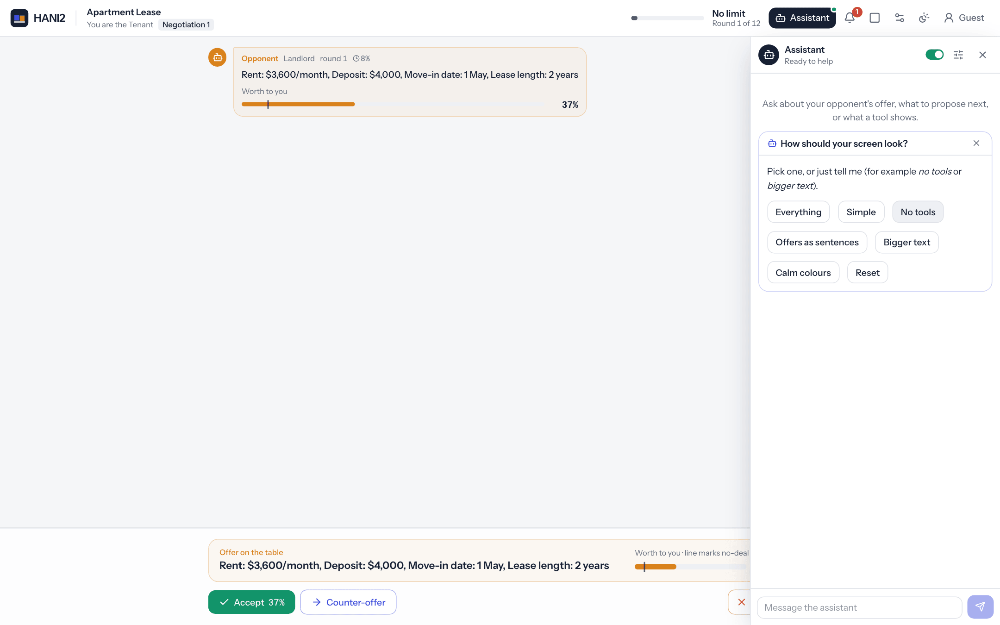
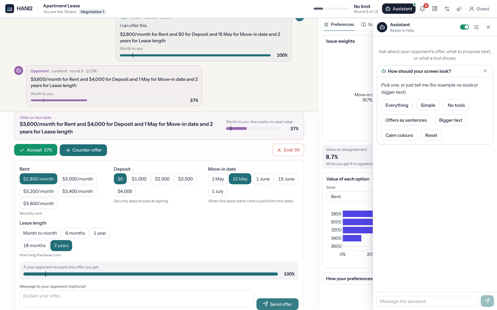

# Shape the interface

The negotiation screen is not fixed. A study can strip it down to the offers alone, a participant
can switch views, and the Assistant can rebuild the screen while they negotiate: switch views,
rewrite how offers read and restyle the page. This tutorial goes through each of these in turn.
Steps 1 and 2 need no code. Steps 3 to 5 use the built-in Assistant, or ten lines of Python.

| Step | You set up | Who changes it |
|------|------------|----------------|
| 1 | The four views | the participant (layout menu), the URL |
| 2 | A no-tools study | the study's `env.json` |
| 3 | An Assistant that switches views | the Assistant (`layout`) |
| 4 | Offers that read differently from the scenario's default | the Assistant (`offer_display`) |
| 5 | Display settings and a style sheet | the Assistant (`interface`) |
| 6 | Limits: what nobody may change | the study and the admin grant |

## Step 1: the four views

Open the layout menu in the header (the icon next to the notification bell). It offers:

| View | What it shows |
|------|---------------|
| **Full** | Every tool pane: tools on the left, offer generators beside the offer area. |
| **Simple** | The history and the offer area, plus one tools column with every tool. |
| **Focus** | The history and the offer area. Opening a tool brings the tools back. |
| **Bare** | No tools at all: the history, the offer area (accept, counter-offer, end) and, when the session has one, the Assistant. |



The URL picks the starting view: `/play?view=bare`. Phones have no simple view; in the bare and
focus views their **Tools** tab disappears too.

## Step 2: a no-tools study

To compare negotiating with and without tools, give each condition its own study and fix the view
in the no-tools one:

```json title="projects/Tools2027/studies/no-tools/env.json"
{"interface": {"view": "bare", "view_locked": true}}
```

```json title="projects/Tools2027/studies/with-tools/env.json"
{"interface": {"view": "full"}}
```

`view` is where every session starts. `view_locked` keeps it there: the layout menu disappears,
the server refuses view changes from the participant, and the Assistant's `set_layout` returns
*the study fixes the view*. Administrators are never locked, so you can still open a tool while you
check the study.

Whether an Assistant appears is a separate setting. For participants who must negotiate
alone, as in the Human-Agent Negotiation league, switch it off (see
[Running without an Assistant](../guide/assistant.md#running-without-an-assistant)):
the screen is then just the history and the offer area. With the Assistant on, as in the
Hybrid Intelligence league, the bare view keeps the Assistant's panel or character, so the
Assistant becomes the participant's only help.

Without `view_locked`, `view` is only a default: participants and the Assistant may switch away.

## Step 3: an Assistant that switches views

The built-in Assistant has the `layout` ability on by default. Ask it in the chat:

- *"Too much on the screen, hide the tools."* → it calls `set_layout` with `view: "bare"` (or
  `focus`);
- *"Show me everything again."* → `view: "full"`;
- *"Just one tools column, please."* → `view: "simple"`.

A Python Assistant calls the same helper:

```python
from hani2.support_agent.runtime import SupportAgent


class Calm(SupportAgent):
    def on_event(self, event_name: str, nmi=None) -> None:
        if event_name == "negotiation_started":
            self.set_layout(view="bare")         # start with nothing but the offers

    def handle_user_message(self, text: str) -> None:
        res = self.set_layout(view="simple" if "tools" in text.lower() else "bare")
        self.post("Done." if res["ok"] else f"I can't: {res['error']}")
```

Always check `res["ok"]`. In a study with `view_locked` the call fails, and the participant should
hear why.

## Step 4: offers that read your way

A scenario decides how its offers read, through `offer_template`, `issue_format`, `value_labels`
and `issue_widget` in its `_info.yaml` (see [Scenarios](../guide/scenarios.md)), or a
`display.py`. The Assistant can override these for one session without touching the scenario. With the
`offer_display` ability, ask the built-in Assistant:

- *"Write the offers as sentences."* → `set_offer_display` with an `offer_template` such as
  `"{Quantity} units at {Price} each"`;
- *"Show the price in dollars."* → `issue_format: {"Price": "${:,}"}`;
- *"Use a slider for the quantity."* → `issue_widget: {"Quantity": "slider"}`;
- *"Show the offers as chips."* → `offer_display: "table"`;
- *"Go back to normal."* → `reset: true`.

From Python:

```python
self.set_offer_display(offer_template="{Quantity} units at {Price} each",
                       issue_format={"Price": "${:,}"})
self.set_offer_display(reset=["issue_format"])   # undo one key
self.set_offer_display(reset=True)               # undo everything
```

The change shows everywhere at once, including the offers already in the history, the offer on
the table, the result and notifications. Only the wording changes; the values stay the same. Mistakes
come back as errors that a language model can correct: an unknown issue, a placeholder that is not
an issue, a format that does not take one value, an unknown widget. The overrides end when the next
scenario loads.

## Step 5: display settings and a style sheet

With the `interface` ability the Assistant changes the participant's own display settings and
adds a style sheet:

```python
self.set_interface(prefs={"font_scale": 1.25, "last_offer_on_top": True})
self.set_interface(custom_css="""
:root { --you: 32 110 120; --opponent: 150 100 170; }
[data-region=dock] { background: rgb(250 247 240); }
[data-anchor=history] { font-size: 1.05em; }
""")
self.set_interface(custom_css="")                # remove the style sheet
```

`prefs` takes the settings of the participant's **My settings** drawer: `show_history`,
`show_human_offers`, `last_offer_on_top`, `offer_panel_always_visible`, `offer_display`,
`font_scale` (0.7 to 1.6), `show_scenario_picture` and `scenario_picture_style`.

The style sheet can target `[data-region=header]`, `[data-region=dock]`, `[data-region=tools]`,
`[data-anchor=history]`, `[data-anchor=accept]`, `[data-anchor=end]`, `[data-anchor=offer]`,
`[data-anchor="issue:Price"]`, and the colour variables on `:root`, which are space-separated RGB
values. Two checks keep the page usable:

- the server refuses `url()`, `@import`, `!important` and sheets over 8000 characters;
- the page drops a sheet that hides Accept, End, Counter-offer or the offer editor, and records a
  `custom_css_rejected` event.



The built-in Assistant does the same when asked: *"bigger text"*, *"newest offer on top"*,
*"make it less colourful"*.

[Level 11 of the Assistant tutorial](assistant.md#level-11-the-interface-they-ask-for) puts steps
3 to 5 together in one agent with a panel of choices.

## Step 6: what nobody may change

Three layers decide what can change, from the study down to the participant:

1. **The study's `env.json` → `interface`.** `view_locked` fixes the view. Each
   `participant_settings.<key>: false` hides that control from participants, and also stops the
   Assistant changing it: `set_interface` reports it under `refused`.
2. **The admin grant in `assistant_settings.json` → `capabilities`.** Switch off `layout`,
   `offer_display` or `interface`, and the Assistant does not get the function at all:

    ```json title="projects/Tools2027/studies/no-tools/assistant_settings.json"
    {"capabilities": {"layout": false, "offer_display": false, "interface": false}}
    ```

3. **The participant's own ability switches** (when the study allows them) can switch these
   abilities off again, never on.

The session recording keeps the language model's function calls with their arguments and
results, and the replay shows the screen as the participant saw it.

## Test it offline

```python
from hani2.testing import make_session

s = make_session(agent_class="level11_interface:InterfaceAgent")
s.start()
s.wait_for_turn()
s.support_agent.on_panel_action("screen", "bare", {})
assert s.layout["view"] == "bare"
assert s.support_agent.set_offer_display(offer_template="{Quantity} at {Price}")["ok"]
```

See [Testing agents offline](assistant.md#testing-agents-offline) for running sessions without a
browser.
