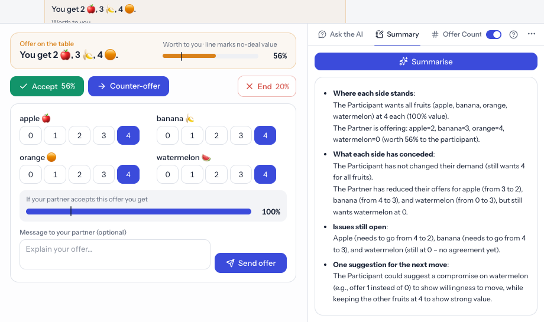

# Build a tool

This tutorial builds five tools step by step: a few numbers, an interactive form, a live chart and two tools that use a language model, one that summarises the negotiation and one that answers the participant's questions. All five are in `examples/tools` in the repository, so you can run them as you read. By the end you will know the `Tool` and `LLMTool` classes, their lifecycle hooks, the UI components, how to react to the participant's input, how to write the help text behind a tool's **?** button, how to register a tool, how the Assistant uses it and how to test it without a browser.

The [Tools](../guide/tools.md) guide lists the built-in tools and the `env.json` options. The generated [Python API](../reference/api.md) reference has every docstring.

## Set up

You need a working installation (`pip install hani2`, then `hani2 setup`).

**The tools folder.** The quickest way to add a tool is to save its file in the tools folder, `~/negmas/hani2/tools` (or `$HANI2_HOME/tools`). Every `.py` file there is loaded, and every `Tool` subclass the file defines becomes available to new sessions: no settings to edit and no `PYTHONPATH`. `hani2 tools path` prints the folders that are searched.

`hani2 tools new` writes a ready-to-edit tool into that folder:

```bash
hani2 tools new "Deal Summary" --llm      # a tool that asks the language model
hani2 tools new "Offer Counter"           # a plain tool
hani2 tools list                          # every tool, and where it comes from
```

To follow this tutorial with the example files instead, point the server at the examples folder of a source checkout (or at a folder of your own) with `--tools`:

```bash
hani2 --tools examples/tools --page play
```

`--tools` takes a comma-separated list of folders, `.py` files (every tool in them) and single classes (`module:Class` or `path/to/file.py:Class`). Folders can also be listed in `env.json` as `"tools": {"paths": ["/path/to/my-tools"]}`. The playground at `/play` needs no login.

A tool file can import other modules in its own folder. Files whose name starts with `_` or `test_` are skipped, and so are classes whose name starts with `_` or that set `abstract = True`, which leaves room for helper base classes. A file that sets `TOOLS = [...]` contributes exactly the classes in that list. If a file fails to import, the server prints `[hani2] could not load tools from ...` in its log and carries on without it.

**Edit, then open a new session.** Tool files are read again when they change, so you do not need to restart the server: save the file, then start a fresh session (log out and in again, or open `/play` in a private window). A running session keeps the tool objects it already created.

## Step 1: a tool that shows numbers

The smallest useful tool reads the negotiation trace and shows two numbers.

```python title="examples/tools/offer_counter.py"
--8<-- "examples/tools/offer_counter.py"
```

A tool is a subclass of `hani2.tools.Tool`. The class attributes describe it, and `view()` returns its UI as a list of components from `hani2.tools.ui`. Here `ui.stats` lays out two `ui.stat` tiles side by side.

`self.trace()` returns the mechanism's full trace: one row per offer, empty before the negotiation starts. Each row is a sequence with these fields:

| Index | Field | Meaning |
|-------|-------|---------|
| 0 | `time` | Seconds since the negotiation started |
| 1 | `relative_time` | Progress towards the deadline, from 0 to 1 |
| 2 | `step` | The negotiation round |
| 3 | `negotiator` | The id of the negotiator who made the offer |
| 4 | `offer` | The offer, a tuple with one value per issue (may be `None` for a message without an offer) |
| 5 | `responses` | The responses to the offer |
| 6 | `state` | The negotiation state after the offer |
| 7 | `text` | The message sent with the offer, if any |
| 8 | `data` | Any extra data sent with the offer |

`self.session_state["human_id"]` is the id of the participant's negotiator, so `row[3] == me` tells you who made the offer.

You never call `view()` yourself. The server calls it whenever the tool needs to be redrawn, and every lifecycle hook asks for a redraw by default. The Offer Counter therefore updates after every offer without any extra code.

### The class attributes

| Attribute | Default | Meaning |
|-----------|---------|---------|
| `name` | the class name | The tab title. It must be unique among the session's tools. |
| `description` | `""` | One line shown as the tab tooltip, on the "switched off" placeholder, and to the Assistant. |
| `help` | `""` | Markdown explaining what the tool does and how it works. The participant reads it from the tool's **?** button and the Assistant reads it with `read_tool`. Falls back to `description`. See [Help text](#help-text). |
| `icon` | `"wrench"` | A [lucide](https://lucide.dev/icons/) icon name in kebab case, such as `"chart-line"`. |
| `pane` | `"upper"` | The default pane: `"upper"`, `"lower"` or `"side"`. |
| `timing` | `"start"` | When the tool appears: `"always"` (page open), `"load"` (scenario loaded), `"start"` (negotiation started), `"end"` (negotiation finished) or `"agent"` (only when an Assistant adds it). |
| `permanent` | `False` | Always on: no enable switch, and it cannot be hidden. |
| `admin_only` | `False` | Only sessions of admin accounts get the tool. |
| `guest` | `True` | Whether playground and Prolific sessions get the tool. |
| `enabled` | `True` | The default state of the enable switch. A switched-off tool shows its tab, but `view()` is not called until it is switched on. |
| `order` | `100` | Sort key inside the pane (smaller first). Tools with `order` 0 or 1 become the selected tab of their pane when they appear. |
| `agent_hint` | `""` | Advice for an Assistant on when and how to use the tool. |
| `needs_totals` | `False` | The tool shows what deals are worth to the participant. It is not offered in a round where the participant knows only part of their preferences (see [Who knows what](../guide/information.md)). |
| `private_information` | `False` | The tool shows the participant's own information. While the participant and the Assistant know different things, the Assistant cannot read or use it. Override `private_now(self) -> bool` to refuse it only when it shows something the Assistant does not know. |

Override `available(self) -> bool` to offer a tool only in some rounds: an unavailable tool is
hidden from the participant and the Assistant. `self.information` is the round's
information split (see [Who knows what](../guide/information.md)).

An admin can override `pane`, `timing`, `enabled`, `admin_only`, `guest` and `order` per deployment in `env.json`, without changing your code (see [Tools](../guide/tools.md)).

## Step 2: an interactive tool

The second tool lets the participant pick a value for every issue, shows what that deal is worth to them, and copies it into their counter-offer with one click.

```python title="examples/tools/what_if.py"
--8<-- "examples/tools/what_if.py"
```


Three things are new.

**Inputs are bound by name.** `ui.select(issue.name, options, value, label=...)` creates a drop-down whose name is the issue's name. When the participant changes it, the browser sends the new value to the server and the tool's `on_input(name, value)` runs. The default `on_input` stores the value in `self.values[name]` and redraws the tool, so `view()` only needs to read `self.values`. Pass the current value back into the component (`self.values.get(issue.name, options[0])`) so the view shows what the participant chose.

**Buttons carry an action.** `ui.button("Use as my offer", "use", ...)` calls `on_action("use", payload)` when clicked. The payload contains the button's own `payload` dict merged with the current values of every input in the view.

**Tools can act on the offer.** `self.set_offer(...)` fills the participant's counter-offer editor. It does not send the offer: the participant still reviews it and presses Send. `self.toast(...)` shows a short notification.

The tool uses `timing = "load"`, so it appears as soon as a scenario is loaded and the participant can explore deals before the negotiation starts. The button is disabled until then, because `session_state["negotiation_running"]` is false.

The verdict uses `self.human_ufun.reserved_value`, the participant's value on disagreement. A deal worth less than that is worse than walking away.

### Handling input yourself

Override `on_input` when the default is not what you want. For example, a text area that should not redraw the tool on every key press:

```python
def on_input(self, name, value):
    self.values[name] = value  # store only; no refresh while the user types
```

Sliders send their value when the participant releases the handle; select, radio, checkbox, switch, number and text inputs send on every change.

### Tables with clickable rows

`ui.table(rows, on_select="pick")` makes rows clickable. A click calls `on_action("pick", {"row": <row dict>, "index": <int>})`. Pass `selected=<index>` to highlight the chosen row on the next render. A plain tool can fill the offer from a row like this (the built-in Utility-based Selector does the same through `OutcomeSelector.pick`, see [below](#offer-pickers-outcomeselector)):

```python
def on_action(self, action, payload):
    if action == "pick":
        row = payload.get("row") or {}
        self.values["selected"] = payload.get("index")
        self.set_offer({k: v for k, v in row.items() if k != "Utility"})
        self.refresh()
```

## Step 3: a live chart

The third tool plots the utility (for the participant) of the opponent's offers over time and projects the trend to the deadline, so the participant can see how fast the opponent concedes.

```python title="examples/tools/concession_tracker.py"
--8<-- "examples/tools/concession_tracker.py"
```

`ui.plot` accepts any Plotly figure, either a `plotly.graph_objects.Figure` or a figure dict. The web app applies its own fonts and light or dark colours, so keep the layout minimal. `hani2.tools.plotting` has helpers that give your plots the same look as the built-in ones:

| Name | What it is |
|------|------------|
| `base_layout(height=260, legend=True, **kw)` | A layout dict with the standard margins, a horizontal legend above the plot, transparent backgrounds and `hovermode="closest"`. Extra keyword arguments are merged in. Use it as `fig.update_layout(**base_layout(240, xaxis=...))`. |
| `HUMAN_COLOR` | The colour used for the participant (`#4f46e5`). |
| `AGENT_COLOR` | The colour used for the opponent (`#f59e0b`). |
| `NEUTRAL_COLOR` | A neutral grey (`#64748b`). |
| `SEQUENCE` | A list of six colours for categorical series, starting with the two party colours. |
| `party_color(name, human_id)` | `HUMAN_COLOR` when `name` is the participant's id, else `AGENT_COLOR`. |
| `trace_frame(trace, issues=None)` | The trace as a pandas DataFrame with the columns `time`, `relative_time`, `step`, `negotiator`, `offer`, `responses`, `state`, `text` and `data`; with `issues`, one extra column per issue holding that issue's value in each offer. |
| `TRACE_COLUMNS` | The tuple of those column names. |

The tracker needs no hook of its own: `action_requested` runs every time it becomes the participant's turn, and the base implementation redraws the tool.

## Step 4: a tool that uses a language model

The fourth tool asks the language model for a summary of the negotiation so far: where each side stands, who conceded what, which issues are open and what to try next.

```python title="examples/tools/negotiation_summary.py"
--8<-- "examples/tools/negotiation_summary.py"
```



`hani2.tools.LLMTool` is a `Tool` that does the plumbing of an LLM call for you. It shows a button; pressing it sends the prompt to the configured model on a background thread, shows *Thinking...* on the button meanwhile, and then shows the reply as Markdown. Errors (no model configured, a network failure) appear as a red alert, and a note tells the participant how many offers came in since the answer. A new negotiation clears the old answer.

The tool only says what to ask. By default the model receives `prompt`, then the issues with their options, then the negotiation so far as text, one line per offer:

```text
Opponent: Price=10, Quantity=1 (worth 32% to the participant) - "Take it or leave it"
Participant: Price=6, Quantity=3 (worth 81% to the participant)
```

The model is the one set in `llm_settings.json` (see [Language models](../guide/llms.md)), the same as for the rest of the app. Run Ollama locally or set an API key, start a negotiation, make a few offers and press **Summarise**.

`LLMTool` attributes, on top of those of `Tool`:

| Attribute | Default | Meaning |
|-----------|---------|---------|
| `prompt` | `""` | The instructions for the model. |
| `system` | `None` | Extra instructions placed before the prompt. |
| `include_transcript` | `True` | Add the offers so far to the prompt. |
| `max_turns` | `40` | How many of the latest offers the transcript keeps. |
| `button_label` | `"Ask the AI"` | The button's text. |
| `busy_label` | `"Thinking..."` | The button's text while the model works. |
| `empty_text` | `"Press the button ..."` | Shown before the first answer. |
| `needs_offers` | `False` | Keep the button disabled until the first offer. |

It defaults to `pane = "side"`, `timing = "start"` and the `sparkles` icon. After a run, `self.answer` holds the reply, `self.error` the error message and `self.busy` is true while the model works.

## Step 5: an LLM tool with its own input

The last tool lets the participant ask any question about the negotiation. It adds a text area, refuses to run without a question, and sends the participant's preferences along with the question.

```python title="examples/tools/ask_ai.py"
--8<-- "examples/tools/ask_ai.py"
```

Three methods of `LLMTool` are overridden:

| Method | Default | Override it to |
|--------|---------|----------------|
| `controls_view()` | no components | Add inputs above the button. Their values are in `self.values`, and they travel with the button click, so they are up to date when the model is asked. |
| `check()` | `None` | Return an error message to stop before calling the model, for example when an input is empty. |
| `build_prompt()` | `prompt` + `context_text()` | Decide exactly what the model sees. `context_text()` returns the issues and the transcript. |

Two more can be useful: `postprocess(reply)` turns the raw reply into the text to show (for example to strip a preamble), and `answer_view(answer)` returns the components that show it (by default a card with Markdown).

`self.session.llm_context().get_ufun_description()` describes the participant's preferences in words. Keep in mind that whatever you put in the prompt is sent to the model provider.

### Calling the model from any tool

Any tool can call the model directly with `self.ask_llm(prompt, system=None, **settings)`. It returns the reply as a string and raises on failure. Keyword arguments override single settings of `llm_settings.json` for that call, for example `self.ask_llm(prompt, temperature=0)`. The call blocks, so make it from a background job, as described in [Long-running work](#long-running-work). Code outside tools can use `hani2.llm_service.complete(prompt, system=None, **settings)`, which does the same.

`self.transcript(max_turns=None)` returns the negotiation so far in the text format shown above, ready to go into a prompt.

## Help text

Every tool should explain itself. The `help` attribute is Markdown that says **what the tool shows or does** and **how it works or how to use it**. Participants open it with the small **?** button at the right end of the tool's tab strip; it works even while the tool is switched off. The Assistant reads the same text, so it can explain the tool or decide when it helps.

```python
class ConcessionTracker(Tool):
    description = "The utility of the opponent's offers for you, and a projection to the deadline."
    help = """
    **What it shows.** What each of your opponent's offers is worth to you over time, and a
    dotted line projecting that trend to the deadline.

    **How it works.** The concession rate is the change in value between the opponent's first
    and latest offers, divided by the time between them. ...
    """
```

Indentation is removed for you (`Tool.help_text()` returns the cleaned text). Keep `description` to one line: it is the tab tooltip and the summary in tool lists. Write `help` for the participant, not for developers: say what the numbers mean and which controls do what, mention anything the tool sends elsewhere (such as to a language model), and say when it is admin-only or off by default. All built-in tools have a help text, and `hani2 tools list` flags tools that do not.

## Lifecycle hooks

Override any of these methods to react to the negotiation. All of them except `init` and `action_to_execute` call `self.refresh()` by default, so call `super()` (or `self.refresh()`) when you override them and want a redraw.

| Hook | Called |
|------|--------|
| `init(session_state)` | Once, when the tool is created. |
| `scenario_loaded(session_state, scenario)` | After each scenario is loaded. |
| `negotiation_started(session_state, nmi)` | When a negotiation starts. |
| `action_requested(session_state, nmi)` | Every time it becomes the participant's turn. |
| `action_to_execute(session_state, nmi, action)` | Just before the participant's action (an `SAOResponse`) is executed. |
| `action_executed(session_state, nmi, action)` | After the participant's action is executed. |
| `negotiation_ended(session_state, nmi)` | When a negotiation ends. |

`nmi` is the participant's view of the negotiation (a negmas `SAONMI`), for example `nmi.n_steps` or `nmi.time_limit`. Use it to reset per-negotiation state, as the built-in Utility-based Selector does:

```python
def negotiation_started(self, session_state, nmi):
    self._inverter = None
    super().negotiation_started(session_state, nmi)
```

Hooks run on server threads. Keep them quick; for slow work, see [Long-running work](#long-running-work).

## What a tool can read and do

Properties:

| Property | Value |
|----------|-------|
| `session` | The `NegotiationSession` that owns the tool. |
| `session_state` | The session's state dict (`human_id`, `negotiation_running`, `scenario_dir`, `user`, `is_practice_round` and more). |
| `scenario` | The loaded negmas `Scenario`, or `None`. |
| `mechanism` | The running negmas mechanism, or `None` before the negotiation starts. |
| `issues` | The scenario's issues (empty before a scenario is loaded). |
| `human_index` | The participant's index in the scenario. |
| `human_ufun` | The participant's utility function. |
| `agent_ufun` | The opponent's utility function. Show it only to admins. |
| `is_admin` | Whether the session belongs to an admin account. |
| `values` | The current values of the tool's inputs, by name. |
| `params` | Keyword arguments given to the constructor (empty for tools created by the server). |
| `enabled` | Whether the tool is switched on. |

Methods:

| Method | What it does |
|--------|--------------|
| `trace()` | The mechanism's full trace as a list of rows (see step 1). |
| `context()` | The live negotiation snapshot, the same dict the Assistant sees (see below). |
| `outcome_dict(outcome)` | Turns an outcome tuple into `{issue name: value}`. |
| `set_offer(outcome)` | Fills the participant's counter-offer. Accepts a tuple or a dict of issue name to value; returns `{"ok": ..., "applied": ..., "unrecognised": ...}`. Issue names are matched exactly, then ignoring case, then by substring. |
| `set_text(text)` | Fills the message box. Returns `{"ok": False, ...}` when an admin switched off human messages. |
| `toast(message, level="info")` | Shows a notification. Levels: `info`, `success`, `warning`, `error`. |
| `refresh()` | Asks the server to redraw the tool. Several calls in quick succession are merged into one redraw. |

`context()` returns these keys: `issues` (each with `name` and either `min` and `max` or `values`), `partner_offer`, `partner_offer_utility`, `partner_message`, `draft_offer`, `draft_offer_utility`, `draft_message`, `reserved_value`, `is_my_turn`, `phase`, `step`, `n_steps`, `relative_time`, `time_left`, `history` (the last offers, each with `by`, `offer`, `message` and `utility`), `result` and `tools`.

A tool can also react when the participant edits the counter-offer by defining `draft_changed(self, session_state, draft)`. It is optional and not part of the base class; the server calls it, when present, with the new draft as `{issue name: value}`.

## Offer pickers: OutcomeSelector

Many tools exist to suggest an offer. `hani2.tools.OutcomeSelector` packages that pattern: override `get_outcome()` to return an outcome tuple, and optionally `selector_view()` to show controls above the button. The base class appends a full-width **Set Offer** button that is enabled while the negotiation runs and calls `set_offer(self.get_outcome())`.

```python
from hani2.tools import OutcomeSelector, ui


class BestForMe(OutcomeSelector):
    name = "Best for me"
    description = "Fill the offer with your best outcome."
    button_label = "Use my best deal"

    def selector_view(self):
        return [ui.markdown("Puts your favourite outcome into the offer.")]

    def get_outcome(self):
        return self.human_ufun.best() if self.human_ufun is not None else None
```

`OutcomeSelector` defaults to `pane = "side"` and the `wand-sparkles` icon. Override `can_set()` to change when the button is enabled, and `button_label` to rename it. The built-in Random, Utility Bar and Utility-based Selector tools are `OutcomeSelector` subclasses.

### Picking fills, the button sends

When picking a deal in the tool (a table row, a point on a chart) already fills the counter-offer, a **Set Offer** button has nothing left to do. Set `sends_offer = True` and call `self.pick(offer, index)` when the participant picks one: the button becomes **Send offer** (`send_label`) and sends the picked deal as the participant's offer, with the message they typed, exactly like the **Send offer** button under the counter-offer. The Utility Bar and the Utility-based Selector work this way.

```python
class Shortlist(OutcomeSelector):
    name = "Shortlist"
    sends_offer = True

    def selector_view(self):
        rows = [self.outcome_dict(o) for o in self.shortlist()]
        return [ui.table(rows, on_select="pick", selected=self.values.get("selected"))]

    def on_action(self, action, payload):
        if action == "pick":
            return self.pick(payload.get("row") or {}, payload.get("index"))
        return super().on_action(action, payload)
```

| Method | What it does |
|--------|--------------|
| `pick(offer, index=None)` | Fill the counter-offer with `offer` and remember it as the picked deal (row `index` stays highlighted). |
| `picked_outcome()` | The picked deal, or `None`. A change to the counter-offer that no longer matches it, a new negotiation and a sent offer forget it; call `unpick()` when your inputs change the list. |
| `send_blocker()` | Why the button cannot send now (the negotiation is not running, not the participant's turn, text-only mode, nothing picked), or `None`. The button is disabled and shows it as its tooltip; override it to add your own conditions. |
| `send_outcome()` | Send the picked deal (the button's `send_offer` action). An Assistant pressing the button needs *Send counter-offers*, as for any other send. |

## Long-running work

`view()` and the hooks block the session while they run. For slow work, such as calling a language model, run it in the background with `self.session.submit(fn)`, show a busy state, and call `self.refresh()` when the result is ready. `LLMTool` and the built-in LLM tool follow this pattern:

```python
def on_action(self, action, payload):
    if action == "generate":
        self.busy = True
        self.refresh()
        self.session.submit(self._generate)   # runs on a worker thread

def _generate(self):
    try:
        self.result = slow_call()
    finally:
        self.busy = False
        self.refresh()
```

## Errors

If `view()` raises, the tool shows a red alert with the error message instead of its content, and the traceback is printed in the server log. If `on_action` raises, the participant sees an error toast. Errors in hooks are printed in the server log and do not stop the negotiation.

## Register the tool

Every way of registering a tool makes it available to every new session, where both the participant and the Assistant can use it. Choose the one that fits:

**In a tools folder.** Save the file in `$HANI2_HOME/tools`, or in a folder given with `hani2 --tools`, `HANI2_TOOLS` or `env.json` → `tools.paths`, as in the [set-up section](#set-up). Best while you develop a tool and for a single deployment.

**With the decorator.** In your own launcher script, decorate the class with `register_tool` (or call `register_tool(MyTool)`) before the server starts sessions:

```python
from hani2.tools import Tool, register_tool, ui


@register_tool
class Hello(Tool):
    name = "Hello"
    help = "Shows a greeting."

    def view(self):
        return [ui.markdown("Hello!")]
```

**In env.json or on the command line.** List the class in `tools.extra` as `module:Class`, `module.Class` or `path/to/file.py:Class`, or pass it with `hani2 --tools` (comma-separated; folders and whole `.py` files work too). A module path must be importable by the server (installed, or on `PYTHONPATH`).

**In a package.** Publish the tool through the `hani2.tools` entry-point group in your package's `pyproject.toml`:

```toml
[project.entry-points."hani2.tools"]
what_if = "my_tools.what_if:WhatIf"
offer_counter = "my_tools.offer_counter:OfferCounter"
```

Once the package is installed in the same environment as HANI2, every session gets the tools. Admins can still disable them or change their defaults in `env.json`.

Tool names must be unique. When two sources offer a tool with the same name, the first one wins (built-in tools, then packages, then `register_tool`, then tool folders, then `extra`) and the server log says which one was ignored.

## Make your tool usable by an Assistant

You do not have to do anything: an Assistant with the **Use tools** capability reads any tool
as text and operates its inputs, buttons and selectable tables (see
[Assistant](../guide/assistant.md#tools-the-agent-can-find-use-and-add)). A few habits make
that work better:

- Write a clear `description`; the agent sees it in `list_tools`.
- Write a `help` text (see [Help text](#help-text)). `read_tool` starts with it, so the agent can
  explain the tool to the participant, and it gets the help even for a tool that is switched off.
- Add an `agent_hint` saying when the tool helps and what to press, for example
  `"Set 'target' to the utility you want, then press Find."`
- Give inputs and actions meaningful names (`min_util`, `find`), and labels on sliders and selects.
- Put the key result in a `ui.stat` or a short table; charts are only summarised for the agent.
- Change the negotiation only through the tool helpers (`set_offer`, `set_text`) or the session's
  methods. When the agent presses your button, those calls follow the agent's permissions.

- A tool that works in the background should have a `busy` attribute that is true while it works,
  as `LLMTool` does. `use_tool` waits for it to become false (up to 60 seconds, the agent's
  `tool_wait`) before it reads the tool, so the agent gets the answer, not "Thinking...". For
  example, `use_tool(name="Summary", action="ask")` returns the summary.

To control exactly what the agent reads, override `describe_for_agent(max_chars)` and return text.

Set `timing = "agent"` for a tool that should appear only when an Assistant adds it, then
register it as usual or pass it on the command line:

```bash
hani2 --tools my_tools/compass.py:DealCompass
```

## Test the tool

`hani2.testing.make_session` creates a headless session, without a browser or a server, and loads a scenario. It writes everything under a temporary `HANI2_HOME` unless you pass `home=`. You can create a tool directly from the session's state and drive it:

```python
from hani2.testing import make_session
from what_if import WhatIf


def test_what_if_fills_the_offer():
    s = make_session()            # a Trade scenario against BoulwareTBNegotiator
    s.start()
    s.wait_for_turn()
    tool = WhatIf(s.ss)
    issue = s.issues[0]
    last = list(issue.all)[-1]
    tool.on_input(issue.name, last)
    view = tool.render()
    assert view[1]["type"] == "stat"
    tool.on_action("use", {})
    assert s.draft[issue.name] == last
```

`render()` is what the server calls: it returns the list of component dicts from `view()`, or a single error alert if `view()` raised. Check its output to test what the participant will see.

To test a tool that calls the language model, replace `hani2.llm_service.complete` with a stub, so the test needs no model:

```python
import time

from hani2.testing import make_session
from negotiation_summary import NegotiationSummary


def test_summary(monkeypatch):
    monkeypatch.setattr("hani2.llm_service.complete", lambda prompt, **kw: "- Price is open")
    s = make_session()
    s.start()
    s.wait_for_turn()
    tool = NegotiationSummary(s.ss)
    tool.on_action("ask", {})
    while tool.busy:
        time.sleep(0.05)
    assert tool.answer == "- Price is open"
```

To test registration and pane placement as well, write an `env.json` into the test home before you create the session, then find the tool through the session's tool controller:

```python
import json

from hani2.testing import make_session


def test_tool_is_registered(tmp_path):
    settings = tmp_path / "settings"
    settings.mkdir()
    (settings / "env.json").write_text(json.dumps({"tools": {"extra": ["what_if:WhatIf"]}}))
    s = make_session(home=str(tmp_path))
    tool = s.tool_controller.find("What If")
    assert tool is not None and s.tool_state(tool)["pane"] == "side"
    tid = s.tool_state(tool)["id"]
    s.tool_input(tid, s.issues[0].name, list(s.issues[0].all)[0])   # as the browser would
    assert s.render_tool(tid)["view"]
```

Useful parts of the test session:

- `make_session(opponent=..., scenario_type="Trade", n_steps=20, time_limit=None, is_admin=False, mode="main", query=None, load=True)`: `opponent` is the opponent spec, `is_admin=True` gives the session the admin-only tools, and `mode="guest"` simulates the playground.
- `s.start()`, `s.wait_for_turn()`, `s.play_counters(n)` (send the current draft `n` times), `s.accept()`, `s.end()` and `s.wait_until_done()` drive the negotiation.
- `s.tool_input(tid, name, value)` and `s.tool_action(tid, action, payload)` deliver input exactly as the browser does.
- `s.hub.messages` records every message the browser would have received, and `s.hub.of_type("toast")` filters them by type.

Make sure the folder with your tool module is importable in the tests, for example with a `conftest.py` that adds it to `sys.path`.

## Component reference

Every helper in `hani2.tools.ui` returns a plain dict (a `Component`) that the web app renders. Arguments that are `None` are left out. Values are passed through `jsonable`, so numpy numbers, tuples and NaN are safe.

### Text and status

| Function | Renders |
|----------|---------|
| `markdown(text, *, size=None)` | GitHub-flavoured Markdown, tables included. `size`: `sm`, `md` or `lg`. |
| `text_block(text, *, muted=False)` | A plain paragraph; `muted` makes it grey. |
| `heading(text, level=3)` | A heading; levels 1 and 2 are largest, 4 and above smallest. |
| `alert(text, kind="info", title=None)` | A coloured box with Markdown text. `kind`: `info`, `success`, `warning`, `error` or `neutral`. |
| `badge(text, kind="neutral")` | A small label. `kind`: `primary`, `success`, `warning`, `error` or `neutral`. |
| `stat(label, value, *, hint=None, kind=None)` | A tile with a label, a large value and an optional hint. `kind` `success`, `error` or `warning` colours the value. |
| `stats(*items)` | A responsive row of `stat` tiles. |
| `kv(data, title=None)` | A two-column list of keys and values from a dict or a list of pairs. |
| `progress(value, label=None, kind=None)` | A progress bar; `value` from 0 to 1. `kind` `success` or `error` changes the colour. |
| `outcome(values, utility=None, label=None)` | A compact outcome card: one chip per issue, plus a utility gauge (with the participant's value on disagreement marked) when `utility` is given. |
| `issue(name, *, widget=None, label=None)` | The default editor field of one issue. Only in a scenario's [custom offer controls](../guide/scenarios.md#showing-offers); elsewhere it renders nothing. |
| `html(content)` | Sanitised HTML: only plain HTML tags and attributes are kept (no scripts, event handlers, forms, SVG/MathML, `<style>` or `javascript:`/`data:` links). Prefer `markdown`. |
| `image(src, dark_src=None, alt="", max_height=None)` | A picture from any URL the browser can load (also `data:` URLs); `dark_src` replaces it in the dark theme. The Assistant reads `alt`. |
| `divider()` | A horizontal rule. |

### Plots and tables

| Function | Renders |
|----------|---------|
| `plot(fig, *, height=None, key=None)` | A Plotly figure (a `Figure` or a figure dict). `height` overrides the figure height in pixels. `key` is accepted but the web app does not use it. |
| `table(rows, columns=None, *, on_select=None, page_size=25, formats=None, selected=None, max_height=None, searchable=False, sortable=True, dense=True)` | A paged data table. `rows` is a list of dicts or a pandas DataFrame; `columns` picks and orders the columns (default: all, in order of appearance). `on_select` makes rows clickable and names the action. `formats` maps a column to `percent` (0.5 shows as 50.0%), `float` (two decimals), `int` or `text`. `selected` highlights a row index. `max_height` limits the height in pixels. `searchable` adds a search box; `sortable` lets column headers sort. `dense` is accepted but the web app does not use it. |

### Inputs

Every input has a `name`. Changing it calls the tool's `on_input(name, value)`.

| Function | Renders |
|----------|---------|
| `select(name, options, value=None, *, label=None, disabled=False)` | A drop-down. |
| `multiselect(name, options, value=(), *, label=None)` | A set of toggle chips; the value is a list. |
| `radio(name, options, value=None, *, label=None)` | A segmented control. |
| `slider(name, min, max, value, *, step=1, label=None, suffix=None)` | A slider with the value shown next to the label, followed by `suffix` (for example `"%"`). Sends its value on release. |
| `range_bar(name, value=None, *, min=0, max=100, step=1, label=None, suffix="%", density=None, overlay=None, overlay_label=None, marks=None, hint=None)` | A bar on which the user clicks a point or drags out a range; the value is `[lo, hi]` (`lo == hi` for a click), sent on release. `density`: column heights drawn across the bar (e.g. how many outcomes lie in each part); `overlay`: a line over it, values 0-1, named `overlay_label`; `marks`: points such as `{"value": 40, "label": "No deal", "kind": "bad"}` (`kind`: neutral, you, opponent, good, bad, warn). Arrow keys move the selection, Shift and an arrow widens it. The Utility Bar is built on it. |
| `number(name, value, *, min=None, max=None, step=None, label=None)` | A number field. An empty field sends `None`. |
| `checkbox(name, value, *, label=None)` | A checkbox. |
| `switch(name, value, *, label=None)` | A toggle (rendered like a checkbox). |
| `text(name, value="", *, label=None, placeholder=None)` | A single-line text field. |
| `textarea(name, value="", *, label=None, placeholder=None, rows=3)` | A multi-line text field. |

`options` for `select`, `multiselect` and `radio` can be:

- a list of values, each used as its own label: `["Low", "High"]`;
- a dict of label to value: `{"Text and offer": "both", "Text only": "text_only"}`;
- a list of dicts with `value` and an optional `label`.

### Buttons

| Function | Renders |
|----------|---------|
| `button(label, action, *, payload=None, variant="secondary", icon=None, disabled=False, full=False, tooltip=None, empty_label=None, empty_input=None)` | A button that calls `on_action(action, payload)`, with the current input values merged into `payload`. `variant`: `primary`, `secondary`, `success`, `danger` or `ghost`. `icon` is a lucide icon name. `full` stretches it to the full width. `tooltip` is shown on hover (also while disabled, for example to say why). `empty_label` is shown instead of `label` while the input named `empty_input` is empty; it follows the typing in the browser (the LLM tool's **Recommend an offer**). |

### Layout

| Function | Renders |
|----------|---------|
| `row(*children, gap=3, wrap=True, align=None)` | Children side by side, wrapping on narrow panes unless `wrap=False`. `align`: `end` or `center` (default top). `None` children are skipped. |
| `column(*children, gap=3)` | Children stacked vertically. |
| `grid(*children, cols=2, gap=3)` | A responsive grid; with `cols` above 1 it fits as many columns of at least 260 pixels as the pane allows and collapses to one column on narrow panes. |
| `card(*children, title=None, collapsible=False, collapsed=False)` | A bordered card with an optional title. A collapsible card opens and closes when its title is clicked; `collapsed` sets the initial state. |

`gap` is in steps of a quarter of the base font size (3 is 0.75 rem).

### Helpers

| Name | What it is |
|------|------------|
| `Component` | The type of every component: `dict[str, Any]`. |
| `jsonable(x)` | Converts numpy values, tuples, sets, dates and other objects to JSON-friendly values. NaN becomes `None` and infinity becomes `"inf"` or `"-inf"`. |

The same components build the custom panels an Assistant can show with `show_panel`; see the [Assistant tutorial](assistant.md).
