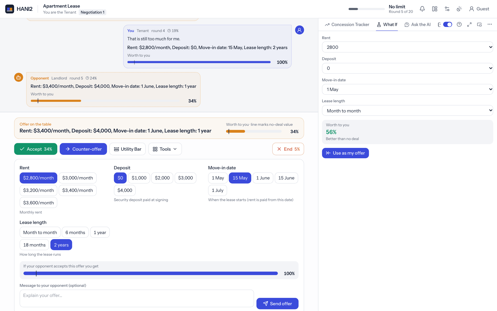

# Build a tool

This tutorial builds three tools step by step, from a few numbers to an interactive form and a live chart. All three are in `examples/tools` in the repository, so you can run them as you read. By the end you will know the `Tool` class, its lifecycle hooks, the UI components, how to react to the participant's input, how to register a tool and how to test it without a browser.

The [Tools](../guide/tools.md) guide lists the built-in tools and the `env.json` options. The generated [Python API](../reference/api.md) reference has every docstring.

## Set up

You need a working installation (`pip install hani2`, then `hani2 setup`). Work in a folder of your own, or in `examples/tools` of a source checkout:

```bash
mkdir my-tools && cd my-tools
```

Tools are registered by import path. Add them to the `"tools"` section of `~/negmas/hani2/settings/env.json` (or `$HANI2_HOME/settings/env.json`):

```json
{
  "tools": {
    "extra": ["offer_counter:OfferCounter", "what_if:WhatIf", "concession_tracker:ConcessionTracker"]
  }
}
```

Keep the other keys of `env.json` as they are. Then start the server with your folder on the Python path, so it can import the modules:

```bash
PYTHONPATH=$PWD hani2 --page play
```

The playground at `/play` needs no login. If an entry in `extra` cannot be imported, the server prints `[hani2] could not load tool '...'` in its log and starts without it.

Tools are created when a session first reaches their timing. After you change a tool's code, restart the server and reload the page with a fresh session (log out and in again, or open `/play` in a private window), because a running session keeps the tool objects it already created.

## Step 1: a tool that shows numbers

The smallest useful tool reads the negotiation trace and shows two numbers.

```python title="examples/tools/offer_counter.py"
--8<-- "examples/tools/offer_counter.py"
```

A tool is a subclass of `hani2.tools.Tool`. The class attributes describe it, and `view()` returns its UI as a list of components from `hani2.tools.ui`. Here `ui.stats` lays out two `ui.stat` tiles side by side.

`self.trace()` returns the mechanism's full trace: one row per offer, empty before the negotiation starts. Each row is a sequence with these fields:

| Index | Field | Meaning |
|-------|-------|---------|
| 0 | `time` | Seconds since the negotiation started |
| 1 | `relative_time` | Progress towards the deadline, from 0 to 1 |
| 2 | `step` | The negotiation round |
| 3 | `negotiator` | The id of the negotiator who made the offer |
| 4 | `offer` | The offer, a tuple with one value per issue (may be `None` for a message without an offer) |
| 5 | `responses` | The responses to the offer |
| 6 | `state` | The negotiation state after the offer |
| 7 | `text` | The message sent with the offer, if any |
| 8 | `data` | Any extra data sent with the offer |

`self.session_state["human_id"]` is the id of the participant's negotiator, so `row[3] == me` tells you who made the offer.

You never call `view()` yourself. The server calls it whenever the tool needs to be redrawn, and every lifecycle hook asks for a redraw by default. The Offer Counter therefore updates after every offer without any extra code.

### The class attributes

| Attribute | Default | Meaning |
|-----------|---------|---------|
| `name` | the class name | The tab title. It must be unique among the session's tools. |
| `description` | `""` | One line shown as the tab tooltip, on the "switched off" placeholder, and to the support agent. |
| `icon` | `"wrench"` | A [lucide](https://lucide.dev/icons/) icon name in kebab case, such as `"chart-line"`. |
| `pane` | `"upper"` | The default pane: `"upper"`, `"lower"` or `"side"`. |
| `timing` | `"start"` | When the tool appears: `"always"` (page open), `"load"` (scenario loaded), `"start"` (negotiation started), `"end"` (negotiation finished) or `"agent"` (only when a support agent adds it). |
| `permanent` | `False` | Always on: no enable switch, and it cannot be hidden. |
| `admin_only` | `False` | Only sessions of admin accounts get the tool. |
| `guest` | `True` | Whether playground and Prolific sessions get the tool. |
| `enabled` | `True` | The default state of the enable switch. A switched-off tool shows its tab, but `view()` is not called until it is switched on. |
| `order` | `100` | Sort key inside the pane (smaller first). Tools with `order` 0 or 1 become the selected tab of their pane when they appear. |
| `agent_hint` | `""` | Advice for a support agent on when and how to use the tool. |

An admin can override `pane`, `timing`, `enabled`, `admin_only`, `guest` and `order` per deployment in `env.json`, without changing your code (see [Tools](../guide/tools.md)).

## Step 2: an interactive tool

The second tool lets the participant pick a value for every issue, shows what that deal is worth to them, and copies it into their counter-offer with one click.

```python title="examples/tools/what_if.py"
--8<-- "examples/tools/what_if.py"
```



Three things are new.

**Inputs are bound by name.** `ui.select(issue.name, options, value, label=...)` creates a drop-down whose name is the issue's name. When the participant changes it, the browser sends the new value to the server and the tool's `on_input(name, value)` runs. The default `on_input` stores the value in `self.values[name]` and redraws the tool, so `view()` only needs to read `self.values`. Pass the current value back into the component (`self.values.get(issue.name, options[0])`) so the view shows what the participant chose.

**Buttons carry an action.** `ui.button("Use as my offer", "use", ...)` calls `on_action("use", payload)` when clicked. The payload contains the button's own `payload` dict merged with the current values of every input in the view.

**Tools can act on the offer.** `self.set_offer(...)` fills the participant's counter-offer editor. It does not send the offer: the participant still reviews it and presses Send. `self.toast(...)` shows a short notification.

The tool uses `timing = "load"`, so it appears as soon as a scenario is loaded and the participant can explore deals before the negotiation starts. The button is disabled until then, because `session_state["negotiation_running"]` is false.

The verdict uses `self.human_ufun.reserved_value`, the participant's value on disagreement. A deal worth less than that is worse than walking away.

### Handling input yourself

Override `on_input` when the default is not what you want. For example, a text area that should not redraw the tool on every key press:

```python
def on_input(self, name, value):
    self.values[name] = value  # store only; no refresh while the user types
```

Sliders send their value when the participant releases the handle; select, radio, checkbox, switch, number and text inputs send on every change.

### Tables with clickable rows

`ui.table(rows, on_select="pick")` makes rows clickable. A click calls `on_action("pick", {"row": <row dict>, "index": <int>})`. Pass `selected=<index>` to highlight the chosen row on the next render. The built-in Utility-based Selector uses this to fill the offer from a row:

```python
def on_action(self, action, payload):
    if action == "pick":
        row = payload.get("row") or {}
        self.values["selected"] = payload.get("index")
        self.set_offer({k: v for k, v in row.items() if k != "Utility"})
        self.refresh()
```

## Step 3: a live chart

The third tool plots the utility (for the participant) of the partner's offers over time and projects the trend to the deadline, so the participant can see how fast the partner concedes.

```python title="examples/tools/concession_tracker.py"
--8<-- "examples/tools/concession_tracker.py"
```

`ui.plot` accepts any Plotly figure, either a `plotly.graph_objects.Figure` or a figure dict. The web app applies its own fonts and light or dark colours, so keep the layout minimal. `hani2.tools.plotting` has helpers that give your plots the same look as the built-in ones:

| Name | What it is |
|------|------------|
| `base_layout(height=260, legend=True, **kw)` | A layout dict with the standard margins, a horizontal legend above the plot, transparent backgrounds and `hovermode="closest"`. Extra keyword arguments are merged in. Use it as `fig.update_layout(**base_layout(240, xaxis=...))`. |
| `HUMAN_COLOR` | The colour used for the participant (`#4f46e5`). |
| `AGENT_COLOR` | The colour used for the partner (`#f59e0b`). |
| `NEUTRAL_COLOR` | A neutral grey (`#64748b`). |
| `SEQUENCE` | A list of six colours for categorical series, starting with the two party colours. |
| `party_color(name, human_id)` | `HUMAN_COLOR` when `name` is the participant's id, else `AGENT_COLOR`. |
| `trace_frame(trace, issues=None)` | The trace as a pandas DataFrame with the columns `time`, `relative_time`, `step`, `negotiator`, `offer`, `responses`, `state`, `text` and `data`; with `issues`, one extra column per issue holding that issue's value in each offer. |
| `TRACE_COLUMNS` | The tuple of those column names. |

The tracker needs no hook of its own: `action_requested` runs every time it becomes the participant's turn, and the base implementation redraws the tool.

## Lifecycle hooks

Override any of these methods to react to the negotiation. All of them except `init` and `action_to_execute` call `self.refresh()` by default, so call `super()` (or `self.refresh()`) when you override them and want a redraw.

| Hook | Called |
|------|--------|
| `init(session_state)` | Once, when the tool is created. |
| `scenario_loaded(session_state, scenario)` | After each scenario is loaded. |
| `negotiation_started(session_state, nmi)` | When a negotiation starts. |
| `action_requested(session_state, nmi)` | Every time it becomes the participant's turn. |
| `action_to_execute(session_state, nmi, action)` | Just before the participant's action (an `SAOResponse`) is executed. |
| `action_executed(session_state, nmi, action)` | After the participant's action is executed. |
| `negotiation_ended(session_state, nmi)` | When a negotiation ends. |

`nmi` is the participant's view of the negotiation (a negmas `SAONMI`), for example `nmi.n_steps` or `nmi.time_limit`. Use it to reset per-negotiation state, as the built-in Utility-based Selector does:

```python
def negotiation_started(self, session_state, nmi):
    self._inverter = None
    super().negotiation_started(session_state, nmi)
```

Hooks run on server threads. Keep them quick; for slow work, see [Long-running work](#long-running-work).

## What a tool can read and do

Properties:

| Property | Value |
|----------|-------|
| `session` | The `NegotiationSession` that owns the tool. |
| `session_state` | The session's state dict (`human_id`, `negotiation_running`, `scenario_dir`, `user`, `is_practice_round` and more). |
| `scenario` | The loaded negmas `Scenario`, or `None`. |
| `mechanism` | The running negmas mechanism, or `None` before the negotiation starts. |
| `issues` | The scenario's issues (empty before a scenario is loaded). |
| `human_index` | The participant's index in the scenario. |
| `human_ufun` | The participant's utility function. |
| `agent_ufun` | The partner's utility function. Show it only to admins. |
| `is_admin` | Whether the session belongs to an admin account. |
| `values` | The current values of the tool's inputs, by name. |
| `params` | Keyword arguments given to the constructor (empty for tools created by the server). |
| `enabled` | Whether the tool is switched on. |

Methods:

| Method | What it does |
|--------|--------------|
| `trace()` | The mechanism's full trace as a list of rows (see step 1). |
| `context()` | The live negotiation snapshot, the same dict the support agent sees (see below). |
| `outcome_dict(outcome)` | Turns an outcome tuple into `{issue name: value}`. |
| `set_offer(outcome)` | Fills the participant's counter-offer. Accepts a tuple or a dict of issue name to value; returns `{"ok": ..., "applied": ..., "unrecognised": ...}`. Issue names are matched exactly, then ignoring case, then by substring. |
| `set_text(text)` | Fills the message box. Returns `{"ok": False, ...}` when an admin switched off human messages. |
| `toast(message, level="info")` | Shows a notification. Levels: `info`, `success`, `warning`, `error`. |
| `refresh()` | Asks the server to redraw the tool. Several calls in quick succession are merged into one redraw. |

`context()` returns these keys: `issues` (each with `name` and either `min` and `max` or `values`), `partner_offer`, `partner_offer_utility`, `partner_message`, `draft_offer`, `draft_offer_utility`, `draft_message`, `reserved_value`, `is_my_turn`, `phase`, `step`, `n_steps`, `relative_time`, `time_left`, `history` (the last offers, each with `by`, `offer`, `message` and `utility`), `result` and `tools`.

A tool can also react when the participant edits the counter-offer by defining `draft_changed(self, session_state, draft)`. It is optional and not part of the base class; the server calls it, when present, with the new draft as `{issue name: value}`.

## Offer pickers: OutcomeSelector

Many tools exist to suggest an offer. `hani2.tools.OutcomeSelector` packages that pattern: override `get_outcome()` to return an outcome tuple, and optionally `selector_view()` to show controls above the button. The base class appends a full-width **Set Offer** button that is enabled while the negotiation runs and calls `set_offer(self.get_outcome())`.

```python
from hani2.tools import OutcomeSelector, ui


class BestForMe(OutcomeSelector):
    name = "Best for me"
    description = "Fill the offer with your best outcome."
    button_label = "Use my best deal"

    def selector_view(self):
        return [ui.markdown("Puts your favourite outcome into the offer.")]

    def get_outcome(self):
        return self.human_ufun.best() if self.human_ufun is not None else None
```

`OutcomeSelector` defaults to `pane = "side"` and the `wand-sparkles` icon. Override `can_set()` to change when the button is enabled, and `button_label` to rename it. The built-in Random and Utility-based Selector tools are `OutcomeSelector` subclasses.

## Long-running work

`view()` and the hooks block the session while they run. For slow work, such as calling a language model, run it in the background with `self.session.submit(fn)`, show a busy state, and call `self.refresh()` when the result is ready. The built-in LLM tool follows this pattern:

```python
def on_action(self, action, payload):
    if action == "generate":
        self.busy = True
        self.refresh()
        self.session.submit(self._generate)   # runs on a worker thread

def _generate(self):
    try:
        self.result = slow_call()
    finally:
        self.busy = False
        self.refresh()
```

## Errors

If `view()` raises, the tool shows a red alert with the error message instead of its content, and the traceback is printed in the server log. If `on_action` raises, the participant sees an error toast. Errors in hooks are printed in the server log and do not stop the negotiation.

## Register the tool

There are two ways to make a tool available.

**In env.json or on the command line.** List the class in `tools.extra` as `module:Class`, `module.Class` or `path/to/file.py:Class`, as in the set-up section, or pass it with `hani2 --tools`. This is the quickest way for a single study. The module must be importable by the server.

**In a package.** Publish the tool through the `hani2.tools` entry-point group in your package's `pyproject.toml`:

```toml
[project.entry-points."hani2.tools"]
what_if = "my_tools.what_if:WhatIf"
offer_counter = "my_tools.offer_counter:OfferCounter"
```

Once the package is installed in the same environment as HANI2, every session gets the tools. Admins can still disable them or change their defaults in `env.json`.

## Make your tool usable by a support agent

You do not have to do anything: a support agent with the **Use tools** capability reads any tool
as text and operates its inputs, buttons and selectable tables (see
[Support agent](../guide/support-agent.md#tools-the-agent-can-find-use-and-add)). A few habits make
that work better:

- Write a clear `description`; the agent sees it in `list_tools`.
- Add an `agent_hint` saying when the tool helps and what to press, for example
  `"Set 'target' to the utility you want, then press Find."`
- Give inputs and actions meaningful names (`min_util`, `find`), and labels on sliders and selects.
- Put the key result in a `ui.stat` or a short table; charts are only summarised for the agent.
- Change the negotiation only through the tool helpers (`set_offer`, `set_text`) or the session's
  methods. When the agent presses your button, those calls follow the agent's permissions.

To control exactly what the agent reads, override `describe_for_agent(max_chars)` and return text.

Set `timing = "agent"` for a tool that should appear only when a support agent adds it, then
register it as usual or pass it on the command line:

```bash
hani2 --tools my_tools/compass.py:DealCompass
```

## Test the tool

`hani2.testing.make_session` creates a headless session, without a browser or a server, and loads a scenario. It writes everything under a temporary `HANI2_HOME` unless you pass `home=`. You can create a tool directly from the session's state and drive it:

```python
from hani2.testing import make_session
from what_if import WhatIf


def test_what_if_fills_the_offer():
    s = make_session()            # a Trade scenario against BoulwareTBNegotiator
    s.start()
    s.wait_for_turn()
    tool = WhatIf(s.ss)
    issue = s.issues[0]
    last = list(issue.all)[-1]
    tool.on_input(issue.name, last)
    view = tool.render()
    assert view[1]["type"] == "stat"
    tool.on_action("use", {})
    assert s.draft[issue.name] == last
```

`render()` is what the server calls: it returns the list of component dicts from `view()`, or a single error alert if `view()` raised. Check its output to test what the participant will see.

To test registration and pane placement as well, write an `env.json` into the test home before you create the session, then find the tool through the session's tool controller:

```python
import json

from hani2.testing import make_session


def test_tool_is_registered(tmp_path):
    settings = tmp_path / "settings"
    settings.mkdir()
    (settings / "env.json").write_text(json.dumps({"tools": {"extra": ["what_if:WhatIf"]}}))
    s = make_session(home=str(tmp_path))
    tool = s.tool_controller.find("What If")
    assert tool is not None and s.tool_state(tool)["pane"] == "side"
    tid = s.tool_state(tool)["id"]
    s.tool_input(tid, s.issues[0].name, list(s.issues[0].all)[0])   # as the browser would
    assert s.render_tool(tid)["view"]
```

Useful parts of the test session:

- `make_session(partner=..., scenario_type="Trade", n_steps=20, time_limit=None, is_admin=False, mode="main", query=None, load=True)`: `partner` is the opponent spec, `is_admin=True` gives the session the admin-only tools, and `mode="guest"` simulates the playground.
- `s.start()`, `s.wait_for_turn()`, `s.play_counters(n)` (send the current draft `n` times), `s.accept()`, `s.end()` and `s.wait_until_done()` drive the negotiation.
- `s.tool_input(tid, name, value)` and `s.tool_action(tid, action, payload)` deliver input exactly as the browser does.
- `s.hub.messages` records every message the browser would have received, and `s.hub.of_type("toast")` filters them by type.

Make sure the folder with your tool module is importable in the tests, for example with a `conftest.py` that adds it to `sys.path`.

## Component reference

Every helper in `hani2.tools.ui` returns a plain dict (a `Component`) that the web app renders. Arguments that are `None` are left out. Values are passed through `jsonable`, so numpy numbers, tuples and NaN are safe.

### Text and status

| Function | Renders |
|----------|---------|
| `markdown(text, *, size=None)` | GitHub-flavoured Markdown, tables included. `size`: `sm`, `md` or `lg`. |
| `text_block(text, *, muted=False)` | A plain paragraph; `muted` makes it grey. |
| `heading(text, level=3)` | A heading; levels 1 and 2 are largest, 4 and above smallest. |
| `alert(text, kind="info", title=None)` | A coloured box with Markdown text. `kind`: `info`, `success`, `warning`, `error` or `neutral`. |
| `badge(text, kind="neutral")` | A small label. `kind`: `primary`, `success`, `warning`, `error` or `neutral`. |
| `stat(label, value, *, hint=None, kind=None)` | A tile with a label, a large value and an optional hint. `kind` `success`, `error` or `warning` colours the value. |
| `stats(*items)` | A responsive row of `stat` tiles. |
| `kv(data, title=None)` | A two-column list of keys and values from a dict or a list of pairs. |
| `progress(value, label=None, kind=None)` | A progress bar; `value` from 0 to 1. `kind` `success` or `error` changes the colour. |
| `outcome(values, utility=None, label=None)` | A compact outcome card: one chip per issue, plus a utility gauge (with the participant's value on disagreement marked) when `utility` is given. |
| `html(content)` | Sanitised HTML. Prefer `markdown`. |
| `divider()` | A horizontal rule. |

### Plots and tables

| Function | Renders |
|----------|---------|
| `plot(fig, *, height=None, key=None)` | A Plotly figure (a `Figure` or a figure dict). `height` overrides the figure height in pixels. `key` is accepted but the web app does not use it. |
| `table(rows, columns=None, *, on_select=None, page_size=25, formats=None, selected=None, max_height=None, searchable=False, sortable=True, dense=True)` | A paged data table. `rows` is a list of dicts or a pandas DataFrame; `columns` picks and orders the columns (default: all, in order of appearance). `on_select` makes rows clickable and names the action. `formats` maps a column to `percent` (0.5 shows as 50.0%), `float` (two decimals), `int` or `text`. `selected` highlights a row index. `max_height` limits the height in pixels. `searchable` adds a search box; `sortable` lets column headers sort. `dense` is accepted but the web app does not use it. |

### Inputs

Every input has a `name`. Changing it calls the tool's `on_input(name, value)`.

| Function | Renders |
|----------|---------|
| `select(name, options, value=None, *, label=None, disabled=False)` | A drop-down. |
| `multiselect(name, options, value=(), *, label=None)` | A set of toggle chips; the value is a list. |
| `radio(name, options, value=None, *, label=None)` | A segmented control. |
| `slider(name, min, max, value, *, step=1, label=None, suffix=None)` | A slider with the value shown next to the label, followed by `suffix` (for example `"%"`). Sends its value on release. |
| `number(name, value, *, min=None, max=None, step=None, label=None)` | A number field. An empty field sends `None`. |
| `checkbox(name, value, *, label=None)` | A checkbox. |
| `switch(name, value, *, label=None)` | A toggle (rendered like a checkbox). |
| `text(name, value="", *, label=None, placeholder=None)` | A single-line text field. |
| `textarea(name, value="", *, label=None, placeholder=None, rows=3)` | A multi-line text field. |

`options` for `select`, `multiselect` and `radio` can be:

- a list of values, each used as its own label: `["Low", "High"]`;
- a dict of label to value: `{"Text and offer": "both", "Text only": "text_only"}`;
- a list of dicts with `value` and an optional `label`.

### Buttons

| Function | Renders |
|----------|---------|
| `button(label, action, *, payload=None, variant="secondary", icon=None, disabled=False, full=False, tooltip=None)` | A button that calls `on_action(action, payload)`, with the current input values merged into `payload`. `variant`: `primary`, `secondary`, `success`, `danger` or `ghost`. `icon` is a lucide icon name. `full` stretches it to the full width. |

### Layout

| Function | Renders |
|----------|---------|
| `row(*children, gap=3, wrap=True, align=None)` | Children side by side, wrapping on narrow panes unless `wrap=False`. `align`: `end` or `center` (default top). `None` children are skipped. |
| `column(*children, gap=3)` | Children stacked vertically. |
| `grid(*children, cols=2, gap=3)` | A responsive grid; with `cols` above 1 it fits as many columns of at least 260 pixels as the pane allows and collapses to one column on narrow panes. |
| `card(*children, title=None, collapsible=False, collapsed=False)` | A bordered card with an optional title. A collapsible card opens and closes when its title is clicked; `collapsed` sets the initial state. |

`gap` is in steps of a quarter of the base font size (3 is 0.75 rem).

### Helpers

| Name | What it is |
|------|------------|
| `Component` | The type of every component: `dict[str, Any]`. |
| `jsonable(x)` | Converts numpy values, tuples, sets, dates and other objects to JSON-friendly values. NaN becomes `None` and infinity becomes `"inf"` or `"-inf"`. |

The same components build the custom panels a support agent can show with `show_panel`; see the [support agent tutorial](support-agent.md).
