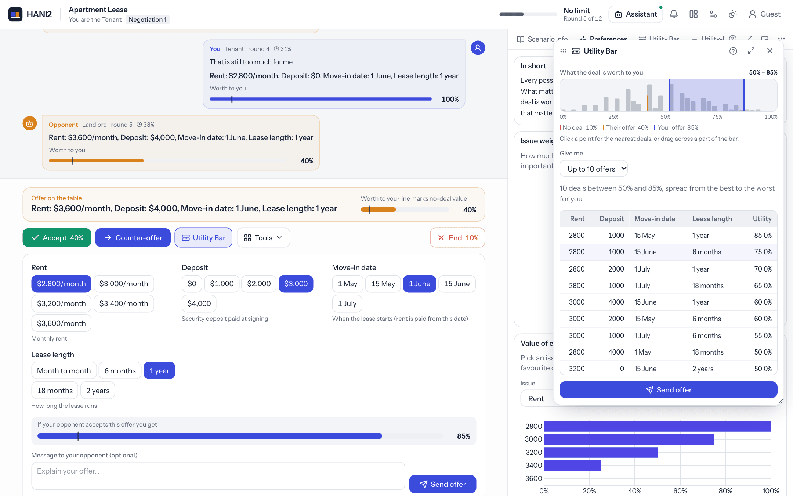
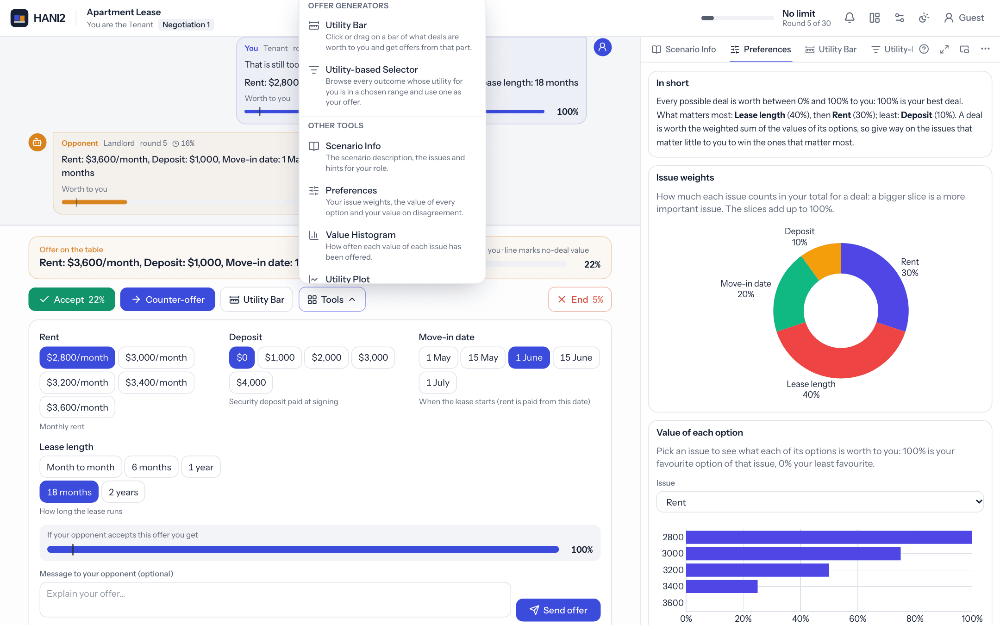
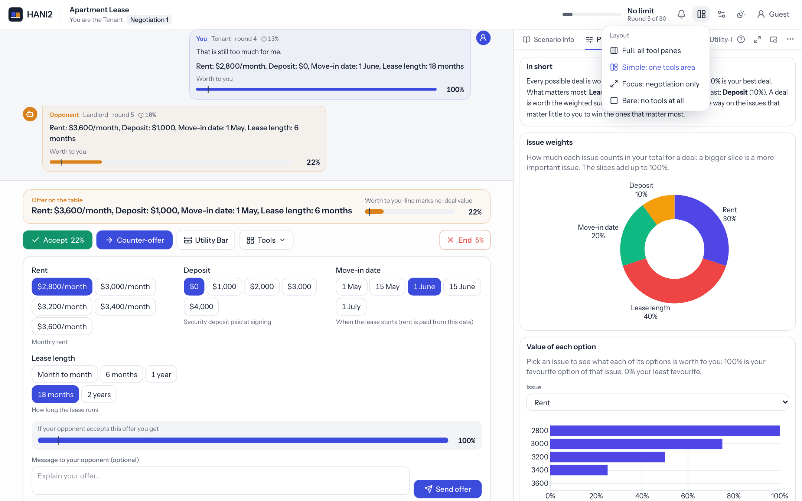
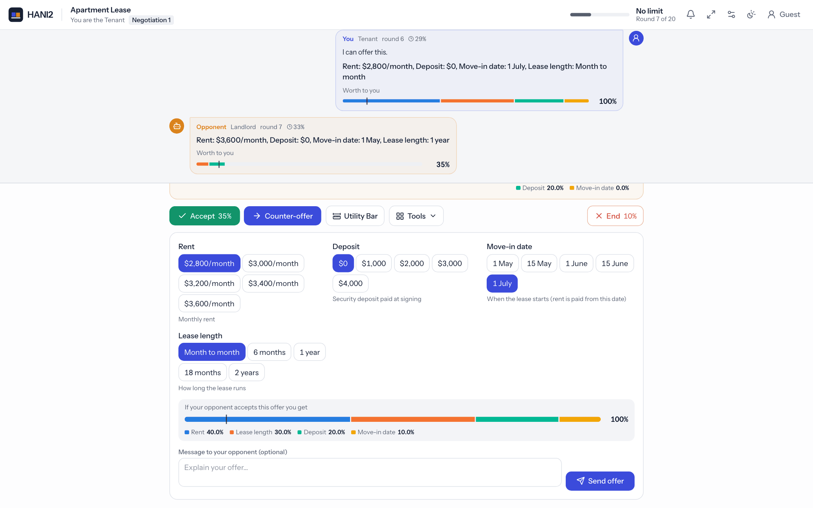
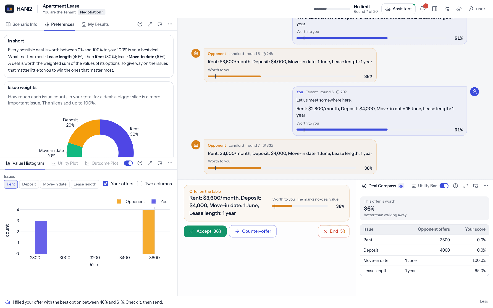
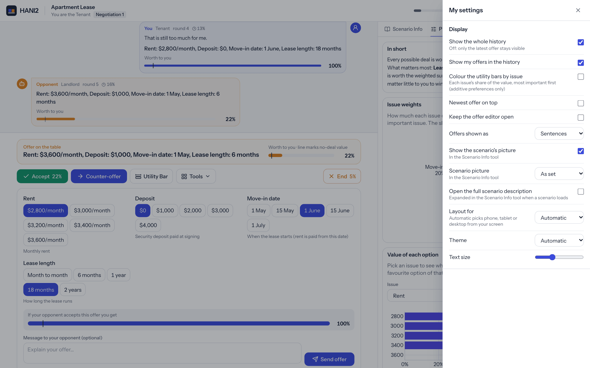
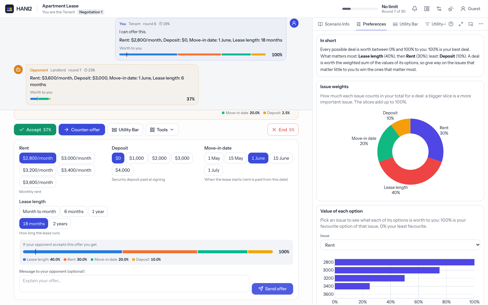

# Negotiating against an AI: advanced

This walkthrough continues [Against an AI: the basics](han-basics.md). You know how to read an
offer, make a counter-offer, accept and end. Here you learn the tools that help you find good
offers quickly, how to change the page to suit you, and a few habits that lead to better deals.

!!! tip "Watch the video"
    A narrated video of this walkthrough: **YOUTUBE-LINK-PLACEHOLDER (HAN advanced)**

A quick reminder of the words: an **offer** is one option for every **issue**; its **utility**
("Worth to you") is how much you like it, from 0% to 100%; the **value on disagreement** is what
you get without a deal; the **deadline** is the last round (or the end of the time limit).

## 1. Find offers with the Utility Bar

Picking one option per issue by hand is slow when there are many possible deals. The **Utility
Bar** works the other way round: you say how much you want, and it finds deals that give it.

Press **Utility Bar** in the offer area. It opens in a small window that you can move and resize,
and the page under it stays usable.

- The bar runs from 0% (left) to 100% (right) of what deals are worth to you. The grey columns show
  how many possible deals lie at each value: tall columns mean many deals.
- Coloured lines mark your **value on disagreement** (*No deal*), the other side's latest offer
  (*Their offer*) and your own latest offer (*Your offer*).
- **Drag** across the part of the bar you want, or **click** one point for the nearest deals.
- **Give me** chooses what you get from that part: one deal, up to ten, or all of them.
- Click a row of the table to choose that deal: it goes into your counter-offer, and the editor
  opens with it, so you can check or change it. Then press **Send offer**.

A good habit: start high (the right end of the bar) and move left slowly as the deadline
approaches. Never go left of the *No deal* line: such a deal is worse than no deal at all.

## 2. Open any tool from the Tools menu

**Tools**, next to the Utility Bar button, lists every tool, the ones that build offers first. The
chosen tool opens in the same small window.

The tools you will use most:

| Tool | What it does |
|------|--------------|
| **Scenario Info** | The story, the issues and options, and hints. |
| **Preferences** | What each issue and option is worth to you, and your value on disagreement. |
| **Utility Bar** | Deals by how much they are worth to you (above). |
| **Utility-based Selector** | A table of deals within a range of values, sorted best first. |
| **Value Histogram** | How often each option appeared in the offers so far. |
| **Utility Plot**, **Outcome Plot**, **Trace** | The negotiation so far as charts and a list (switched off until you turn them on). |

Tools in the right-hand column work the same way: click a tab to switch. The buttons at the top
right of a tool explain it (**?**), enlarge it, or open it in the small window.

The [Tools](../guide/tools.md) page shows every tool in detail.

## 3. Read the other side's moves

You never see the other side's preferences, but its offers tell you a lot:

- If its offers keep the same option on an issue round after round, that issue probably matters to
  it. Give way there only in exchange for something you care about.
- If it changes an issue easily, that issue probably matters little to it: ask for more there.
- The **Value Histogram** counts the options in its offers, so you can see this at a glance.

Your own offers say something too. Moving a little on each turn shows that you are willing to deal
without giving everything away.

## 4. Watch the deadline

The header shows the round ("Round 7 of 12") and, when there is a time limit, the time left; the
bar fills as time passes and turns red near the end. Many AI opponents concede more as the deadline
approaches, but when it passes without agreement you get only your value on disagreement. If the
offer on the table is better than no deal and time is almost up, accepting is often the right move.

## 5. Change how the page looks

### Views

The **Layout** button in the header switches between views:

| View | What you see |
|------|--------------|
| **Simple** (the default) | The offers and the offer area, with one tools column on the right. |
| **Full** | Two tool panes on the left, and the tools that build offers next to the offer area. |
| **Focus** | Only the offers and the offer area. The Tools menu opens any tool in the small window. |
| **Bare** | No tools at all. |

Drag the thin lines between the parts of the page to resize them; double-click one to reset it.

### My settings

The sliders button in the header opens **My settings**:

- **Colour the utility bars by issue** splits every bar into one coloured part per issue, the most
  important issue first. You see at once which issues make an offer good or bad for you.
- **Newest offer on top** turns the history around.
- **Offers shown as** sentences or as small chips, one per issue.
- **Keep the offer editor open**, **Text size** and the scenario's **picture**.

Your study may hide some of these settings.

## 6. After the negotiation

When the negotiation ends, the offer area shows the result and what it is worth to you, and the
history ends with a line that says how it ended. **My Results** (a tool) lists your negotiations so
far with your scores. **Next negotiation** loads the next one, often with a new scenario and a new
opponent.

## On other devices

On a tablet the tools sit in a column or in a tray at the bottom; on a phone the page has two tabs,
**Negotiate** and **Tools**. Everything else works the same way.

## Words used on this page

| Word | Meaning |
|------|---------|
| Utility Bar | A tool that finds deals by how much they are worth to you. |
| Concede | Give way: offer a deal that is better for the other side than your last one. |
| View | How much of the page the tools take: simple, full, focus or bare. |
| Popup | The small window a tool opens in, above the page. |
