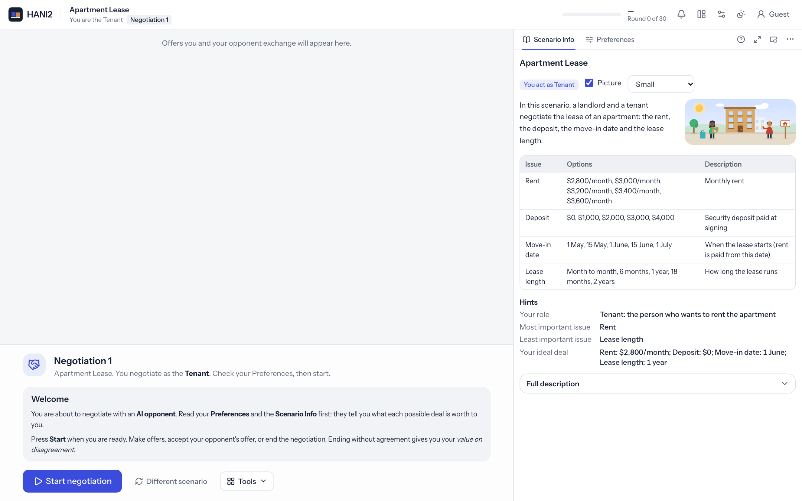
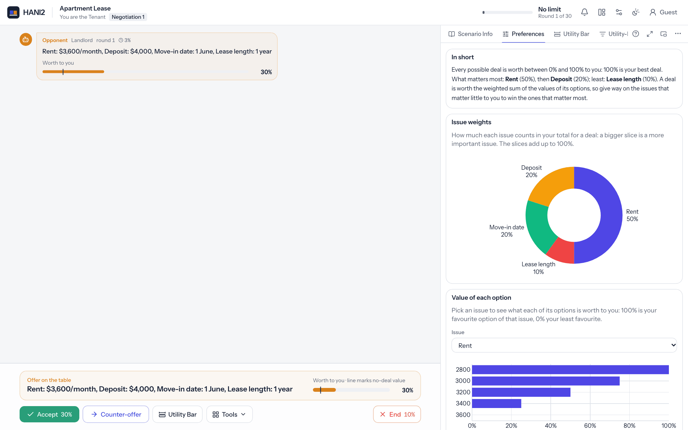
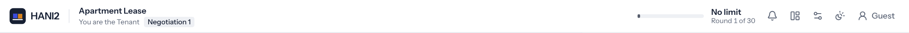
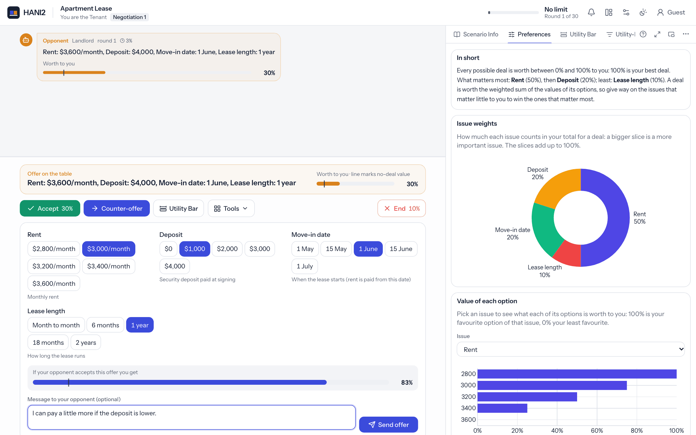
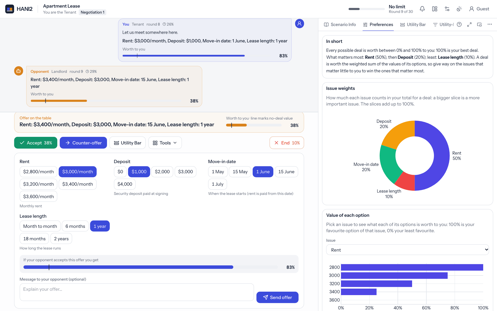
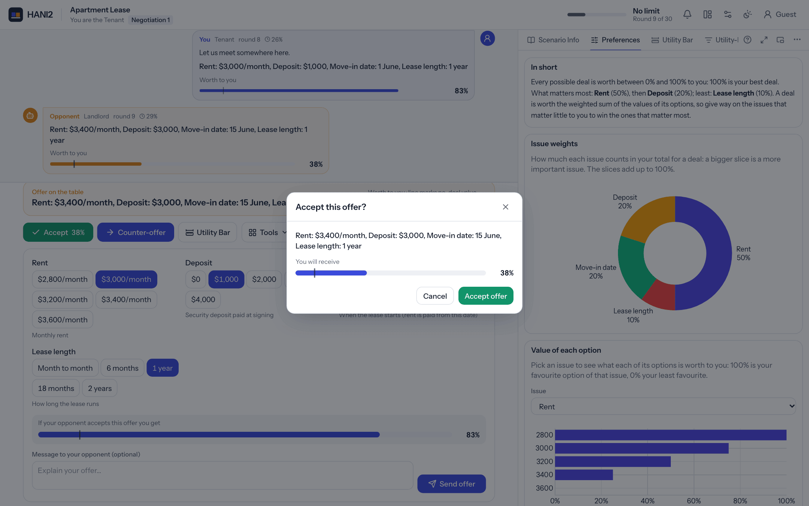
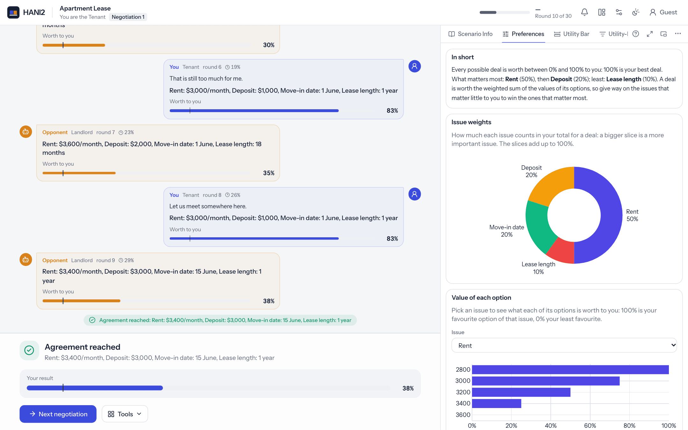
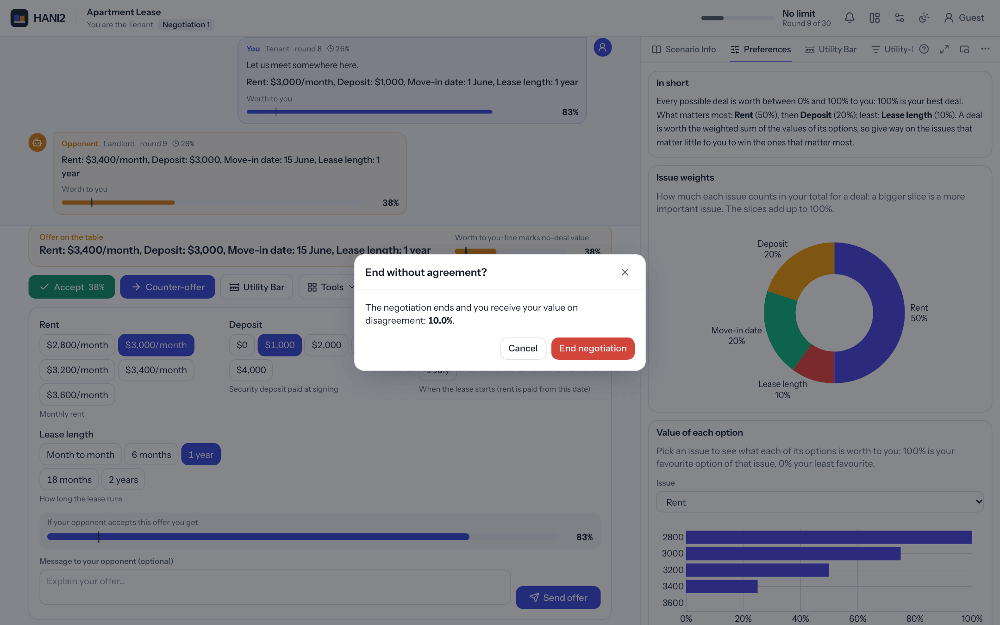

# Negotiating against an AI: the basics

This walkthrough is for you if you have never negotiated with a computer before, or never
negotiated at all. It shows the negotiation page step by step, explains every word you will
meet on it, and ends with your first deal. It takes about ten minutes.

You will negotiate against an **AI opponent**: a computer program that plays the other side. Nobody
helps you here; the page itself has everything you need. (If your study gives you an Assistant,
read [With an Assistant: the basics](hi-basics.md) next.)

!!! tip "Watch the video"
    A narrated video of this walkthrough: **YOUTUBE-LINK-PLACEHOLDER (HAN basics)**

## What a negotiation is

A **negotiation** is a conversation in which two sides try to agree on a deal. Here the two sides
take turns. On your turn you can:

- **accept** the deal the other side proposed, and the negotiation ends with that deal;
- make a **counter-offer**: propose a deal of your own, which the other side then answers;
- **end** the negotiation without a deal.

A deal is made of several **issues**, the questions both sides must settle. In the example on this
page, a landlord and a tenant agree on four issues of an apartment lease: the rent, the deposit,
the move-in date and the lease length. Each issue has a few **options** to choose from, such as a
rent of $2,800 or $3,000 a month. An **offer** is one option for every issue.

## 1. Before you start

When the page opens, the negotiation has not started yet.

- At the bottom left, the **welcome text** says who you negotiate with and what to do. The
  **Start negotiation** button starts the negotiation.
- On the right, the **Scenario Info** tells the story: who you are (here, the *Tenant*), who the
  other side is, every issue with its options, and a few **hints** such as the issue that
  matters most to you.

Read the Scenario Info, then press **Start negotiation**.

## 2. What deals are worth to you

As soon as the negotiation starts, the **Preferences** tab opens on the right. It tells you how
much you like each possible deal.

- **Utility** is the word for how much a deal is worth to you, from **0%** (the worst deal for you)
  to **100%** (your best deal). The page writes it as "Worth to you".
- **Issue weights**: some issues matter more to you than others. A bigger slice of the ring is a
  more important issue, and the slices add up to 100%.
- **Value of each option**: for one issue at a time, what each of its options is worth to you.
- The **value on disagreement** is what you get if there is no deal at all, written under the
  charts ("If you do not reach agreement you get ..."). A deal worth less than that is worse than
  no deal.

The numbers are round on purpose (steps of 5% and 10%), so you can add them up in your head.

## 3. The page during the negotiation

The page has four parts:

1. **The header** at the top shows the scenario, your role, the **deadline** and the round.
2. **The history** in the middle lists every offer, the other side's on the left (orange) and
   yours on the right (blue).
3. **The offer area** under the history shows the **offer on the table** (the other side's latest
   offer) and the buttons **Accept**, **Counter-offer** and **End**.
4. **The tools** on the right: *Scenario Info*, *Preferences* and a few more. Click a tab to switch.

The **deadline** is the end of the negotiation: a number of rounds ("Round 3 of 12") and sometimes
a time limit with a countdown. When it is reached without a deal, the negotiation ends as if
nobody agreed, and you get your value on disagreement.

### Reading an offer

Every offer shows a bar labelled **Worth to you**. The longer the bar, the better the offer is for
you. The small dark line across the bar marks your **value on disagreement**: an offer whose bar
ends before the line is worse for you than no deal, and its number turns red.

The buttons show numbers too: **Accept 35%** is what you get if you accept now, and **End 15%** is
what you get if you end without a deal.

## 4. Make a counter-offer

Press **Counter-offer** to open the offer editor under the buttons.

1. For each issue, click the option you want. The selected option is blue.
2. The bar **If your opponent accepts this offer you get** shows what your offer is worth to you.
3. If you like, write a short message to explain your offer.
4. Press **Send offer**.

Your offer appears on the right of the history, and the other side answers on its turn. Asking for
everything rarely works: the other side has its own preferences, which you do not see. Give way on
the issues that matter little to you to get what matters most.

## 5. Watch the offers move

After a few rounds, the history shows how both sides moved. When the other side's offers get
better for you, the bar on the right of each orange offer grows.

## 6. Accept, or end without a deal

When the offer on the table is good enough, press **Accept**. A window asks you to confirm and
shows what you will get. It warns you when the offer is worth less than no deal.

Press **Accept offer**, and the negotiation ends with an agreement.

If no deal looks good enough, press **End** instead. The confirmation window states the value on
disagreement you will receive.

After the negotiation, **Next negotiation** loads the next one.

## A glance at the advanced features

You can negotiate with only what you saw above. The page has more, which
[Against an AI: advanced](han-advanced.md) explains:

- **The Utility Bar** finds deals by how much they are worth to you: drag across the part you want,
  and pick one.
- **The Tools menu** in the offer area opens any tool in a small window.
- **Views** show more tools or fewer.
- **My settings** change how the page looks, for example the colour of the bars by issue.

## Words used on this page

| Word | Meaning |
|------|---------|
| Negotiation | Two sides taking turns to agree on a deal. |
| Opponent | The other side. Here an AI program. |
| Issue | One question of the deal, such as the rent. |
| Option | One possible answer to an issue, such as $3,000 a month. |
| Offer | One option for every issue, proposed by one side. |
| Counter-offer | Your own offer in answer to the other side's. |
| Utility (*Worth to you*) | How much a deal is worth to you, from 0% to 100%. |
| Value on disagreement | What you get without a deal. |
| Deadline | When the negotiation ends without a deal: the last round or the time limit. |
