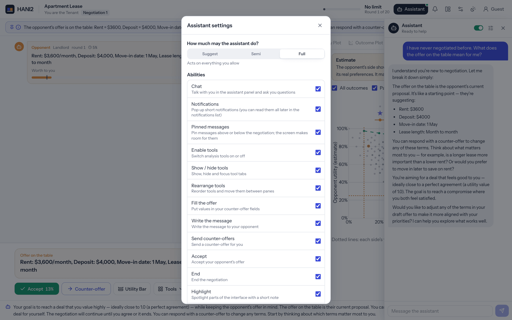
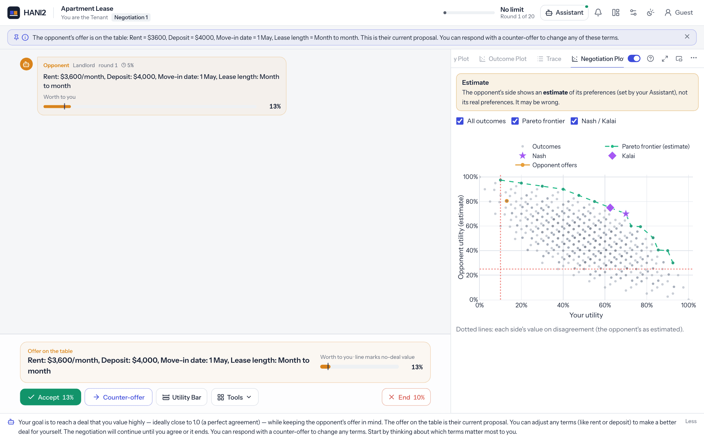
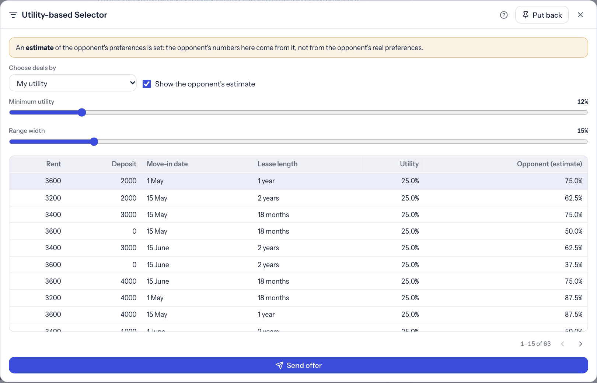
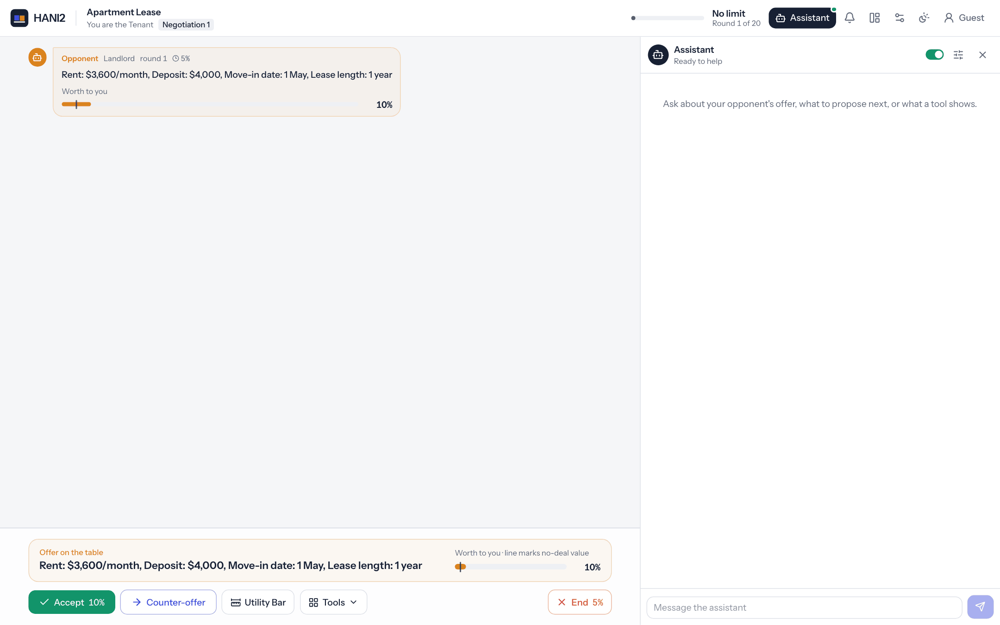
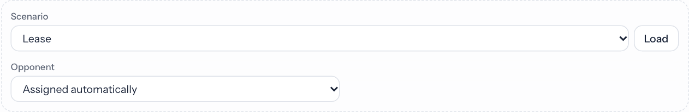

# Negotiating with an Assistant: advanced

This walkthrough continues [With an Assistant: the basics](hi-basics.md). You can talk to the
Assistant and negotiate with an AI or a person. Here you learn how to decide how much the
Assistant does, where it appears, how it guesses what the other side wants, and how to choose your
scenario, opponent and Assistant yourself when the study allows it.

!!! tip "Watch the video"
    A narrated video of this walkthrough: **YOUTUBE-LINK-PLACEHOLDER (HI advanced)**

A reminder of the words: an **offer** is one option for every **issue**; its **utility** ("Worth
to you") is how much you like it, from 0% to 100%; the **value on disagreement** is what you get
without a deal; the **deadline** is the last round or the end of the time limit; the **opponent**
is the other side, and the **Assistant** is the AI helper on your side.

## 1. How much may the Assistant do?

The sliders button in the Assistant's panel opens its settings. (Your study decides which of them
you see.)

| Level | Counter-offers | Accept or end |
|-------|----------------|---------------|
| **Suggest** | It fills the offer editor and points at **Send offer**. You send. | It points at the button. You decide. |
| **Semi** | It sends the offer for you. | It opens the confirmation window. You confirm or cancel. |
| **Full** | It sends the offer for you. | It acts at once. |

Start with **Suggest** if you want to see and approve everything. You can never give it more than
the study allows; you can always give it less.

The same settings have:

- **Abilities**: a switch for each thing it may do (chat, notifications, filling offers, pointing
  at parts of the page, using your tools...). Switch off what you do not want.
- **Unprompted messages appear as** notifications, a strip at the bottom of the page (the
  *status board*), or chat messages.
- **Clear the conversation** starts the chat afresh.

The header's **My settings** holds the page's own display settings and, when the Assistant
appears as a character, whether the character is shown.

## 2. Ask better questions

The Assistant answers best when you ask about something concrete:

- "Compare the last two offers from my opponent." It reads the history.
- "Find me an offer worth at least 60% that the opponent might accept." It can use your tools,
  such as the Utility-based Selector, and fill the offer editor.
- "Why is this offer worse than no deal?" It can explain your value on disagreement.
- "What do you think my opponent cares about?" See the next section.

When it asks you something, its question is framed and the answer options appear as buttons:
click one or type your own answer.

## 3. The Assistant's estimate of the opponent

You never see the other side's preferences. The Assistant can make an **estimate**: an educated
guess of what the opponent wants, made from its role and its offers. When it shares one, two tools
use it, always marked as an estimate:

- **The Negotiation Plot** appears among your tools. Each dot is a possible deal, placed by what it
  is worth to you (across) and what the opponent probably gets (up). The dashed line joins the
  deals where neither side can gain without the other losing; good deals for both lie near it. Your
  offers and the opponent's are drawn as paths, so you see who conceded how much.
- **The Utility-based Selector** gets an *Opponent (estimate)* column, and can choose deals by the
  opponent's estimated value: useful to find the deal that is still good for you and most likely to
  be accepted.

An estimate can be wrong. Treat it as advice, and watch whether the opponent's offers agree with it.

## 4. The Assistant in place of a tool

In some studies the open Assistant takes the place of the tools instead of opening beside the page.
Opening it covers the tool you were looking at; closing it brings the same tool back as it was.

When a tool is open in the small popup window, the Assistant takes that window instead. In the
focus view there is no tool area, so the Assistant opens beside the page.

## 5. Choose the scenario, the opponent or the Assistant

When the study allows it, the offer area shows pickers before you press **Start negotiation**:

- **Scenario**: choose a kind of scenario (and, optionally, a named one), then press **Load**.
- **Opponent**: *Assigned automatically*, or one of the opponents on offer.
- **Assistant**: *Assigned automatically*, another Assistant, or *No Assistant*.

A choice holds for one negotiation; the next one starts from the study's own choice again.
**Different scenario** loads another scenario of the study's choosing.

## 6. Playing people: a few tips

- **Waiting.** If nobody is waiting when you choose *Play a person*, you wait for the next one.
  *Play an AI opponent instead*, when the study offers it, starts at once against an AI. Some
  studies switch to an AI after a while on their own and tell you; others (people-only games and
  invitations) keep you waiting for a person.
- **Both start.** The negotiation starts when both of you have pressed **Start**.
- **Turns.** While the other person decides, the page says *Your opponent is deciding…*; ask your
  Assistant in the meantime.
- **Messages.** A short, friendly message with each offer helps: the other side is a person.
- **Leaving.** If one side leaves, the negotiation ends without agreement for both.
- **Their Assistant.** The other person may have an Assistant of their own. Each of you sees only
  your own.

To try a negotiation between two people on one computer, see
[Human opponents](../guide/human-opponents.md) and `hani2 human-trial`.

## Words used on this page

| Word | Meaning |
|------|---------|
| Autonomy | How much the Assistant may do on its own: Suggest, Semi or Full. |
| Estimate | The Assistant's guess of the opponent's preferences. |
| Negotiation Plot | A chart of every possible deal: worth to you across, worth to the opponent (estimated) up. |
| Status board | A strip at the bottom of the page where the Assistant can write. |
