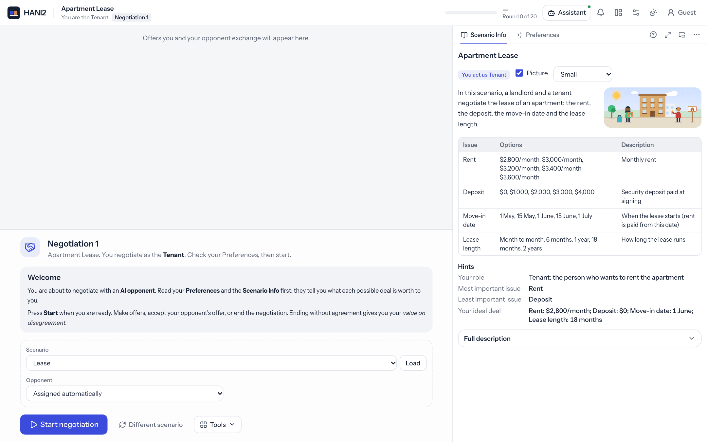
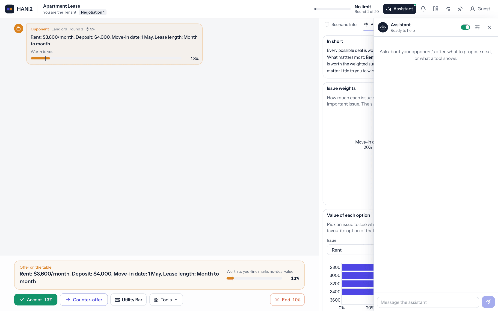
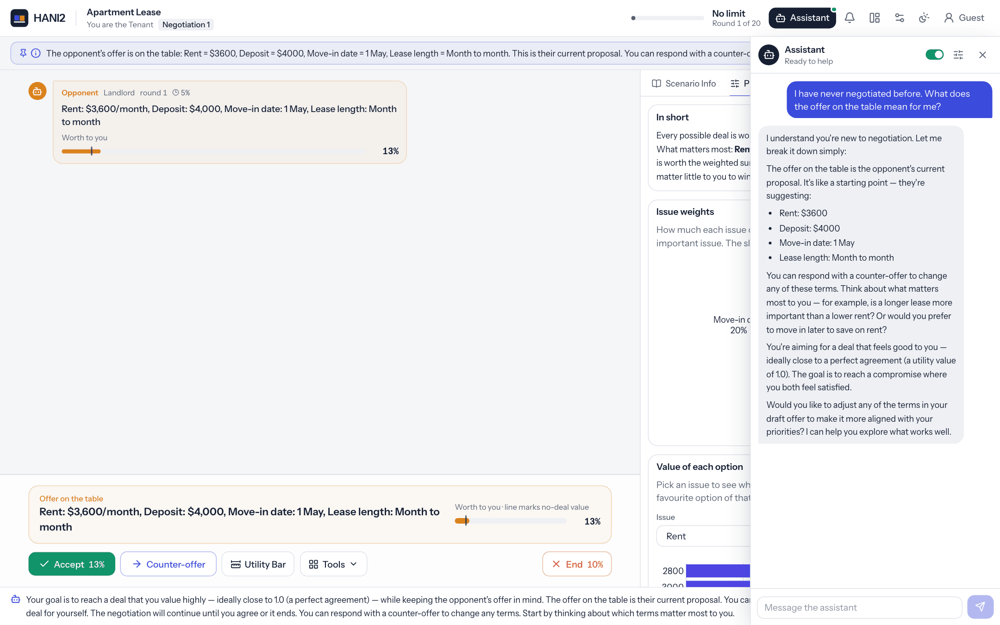
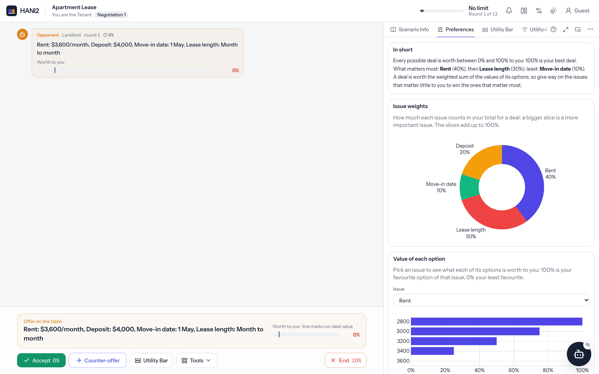
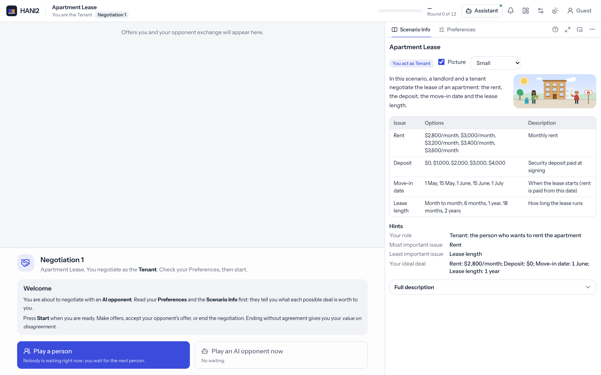
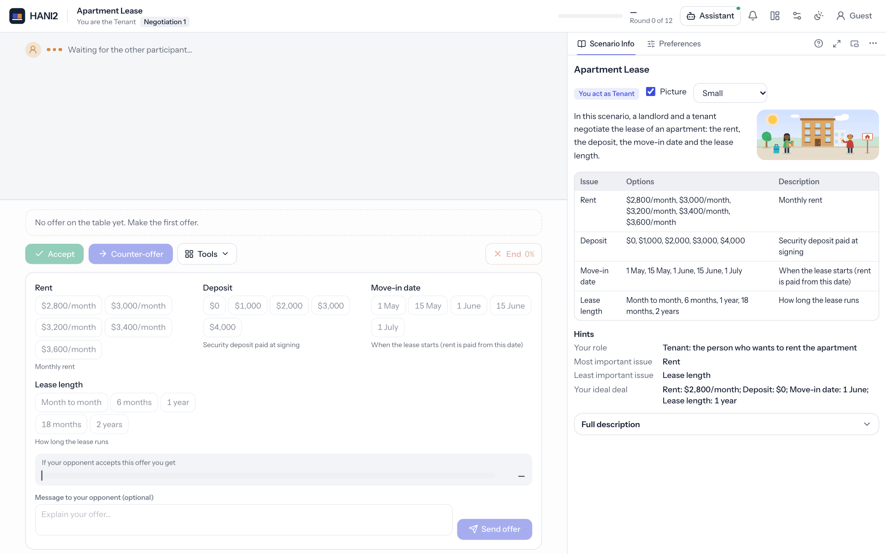
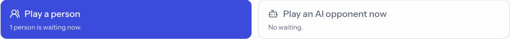
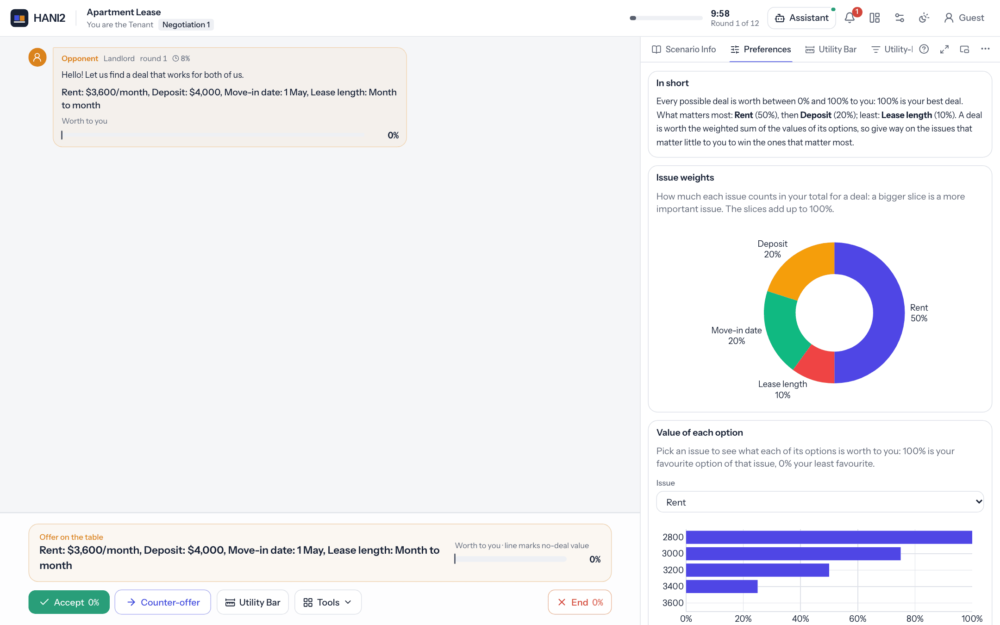

# Negotiating with an Assistant: the basics

In this walkthrough you negotiate with help. An **Assistant**, an AI helper on your side, sits
next to the negotiation: you can ask it questions in plain words, and it can explain offers,
suggest counter-offers and point at the right buttons. You stay in charge: nothing is accepted or
ended without you. Later in the walkthrough you meet the other kind of opponent: **another person**.

It is written for someone who has never negotiated before. If you have not read
[Against an AI: the basics](han-basics.md), the short summary below is enough to start.

!!! tip "Watch the video"
    A narrated video of this walkthrough: **YOUTUBE-LINK-PLACEHOLDER (HI basics)**

## The words you need

| Word | Meaning |
|------|---------|
| Negotiation | Two sides take turns to agree on a deal. On your turn you accept the other side's offer, make a counter-offer, or end without a deal. |
| Opponent | The other side: an AI program or another person. |
| Issue, option | A deal settles several issues (such as the rent); each issue has a few options (such as $3,000 a month). |
| Offer | One option for every issue. |
| Utility (*Worth to you*) | How much a deal is worth to you, from 0% (your worst deal) to 100% (your best). |
| Value on disagreement | What you get without a deal. A deal worth less is worse than no deal. |
| Deadline | When the negotiation ends without a deal: the last round, or the end of the time limit. |
| Assistant | The AI helper on your side. |

## 1. The page with an Assistant

The page looks as it does without an Assistant, with one more button in the header:
**Assistant**. Its small dot is green when the Assistant is on and ready.

Read the **Scenario Info** on the right (your role, the issues and their options), then press
**Start negotiation**. The **Preferences** tab opens: it shows how much each issue and each option
is worth to you.

## 2. Open the Assistant and ask a question

Press **Assistant** in the header. The conversation opens at the right of the page.

Type a question in the box at the bottom and press **Enter**. Ask anything, in your own words:

- "What does the offer on the table mean for me?"
- "Is this a good offer?"
- "What should I offer next?"
- "Which issue should I give up first?"

The Assistant sees what you see: the scenario, your preferences and every offer so far. It does
not see the other side's preferences. While it thinks, its status reads *Working…*.

## 3. Let it help with your offers

The Assistant can do more than talk. Depending on the study, it can:

- **suggest** a counter-offer and put it into the offer editor, so you only check it and press
  **Send offer**;
- **point** at a button, an issue or a tool with a short note;
- **notify** you with a short message at the top right of the page, for example when an offer
  is worse than no deal;
- open the confirmation window for **Accept** or **End**, which you still confirm yourself.

When it fills your offer, the editor opens with its suggestion. Read it: the bar under the options
shows what it is worth to you. Change any option you like, then send.

You decide everything that matters. The Assistant may be wrong: it is an AI. If you disagree, say
so in the chat, or ignore it.

## 4. Switch it off, or let it appear as a character

The switch in the Assistant's panel turns it off and on. While it is off it says nothing and does
nothing.

In some studies the Assistant appears as a small **character** in the corner of the page instead
of (or as well as) the panel. Click the character to talk to it. The eye button on it hides it,
and the header's **Assistant** button then opens the conversation.

## 5. Negotiating with another person

Some studies and games pair you with **another person** instead of an AI. That person sees the same
scenario from the other side, with their own preferences, and often their own Assistant.

When the study lets you choose, the page first asks whom you want to play:

- **Play a person**: the button shows how many people are waiting right now. If somebody is
  waiting, you join them; otherwise you wait for someone to come.
- **Play an AI opponent now**: start at once against an AI.

While you wait, the page says *Waiting for the other participant…*. Most studies also offer
**Play an AI opponent instead**; a people-only game or invitation waits for a person.

The next person to arrive sees that someone is waiting, and joins them:

Once both of you press **Start**, you take turns as usual. A person icon instead of a robot marks
the other side's offers, and while it is their turn the page says *Your opponent is deciding…*.
People need more time than programs: be patient, and use the time to ask your Assistant.

If the other person leaves, the negotiation ends without agreement and the page tells you.

## A glance at the advanced features

[With an Assistant: advanced](hi-advanced.md) explains:

- how much the Assistant may do (**Suggest**, **Semi**, **Full**) and its other settings;
- the Assistant **in the tool area**, in place of the open tool;
- the Assistant's **estimate of the opponent**, drawn in the Negotiation Plot and the
  Utility-based Selector;
- choosing the **scenario, the opponent or the Assistant** yourself, when the study allows it.
